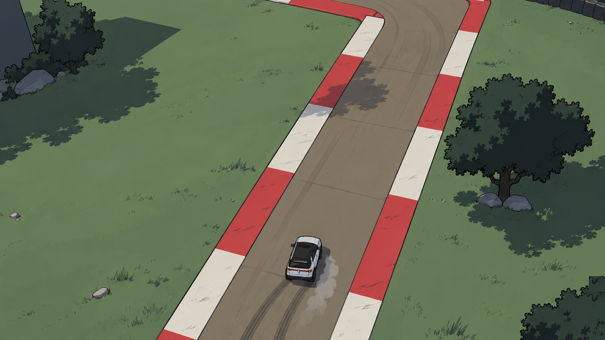
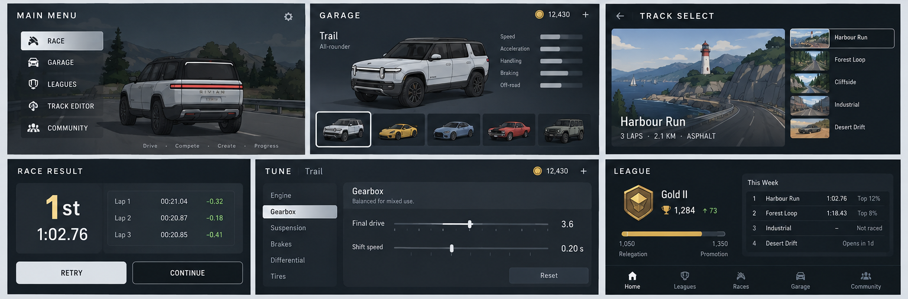

# CIRCUIT / 01
## Game, product and development blueprint
Version 2.0 · 11 September 2026

**Working title only. No final game name, brand clearance, prices or release date have been approved.**

A mobile high-overhead 2.5D racer with mature cel-shaded 3D presentation, built around active driving, earned car development, player-created circuits and repeatable competition. Typical laps last 10–30 seconds. Races normally use 3–5 laps. Players can keep racing and earning without paying, waiting for energy, or watching an advertisement.

This package is a specification and planning baseline, not a finished game or a commercial forecast. The interface prototype contains illustrative data and simulated interactions. All financial acquisition, retention and conversion rates are explicit assumptions. Platform facts were checked against the official sources listed at the end; recheck them before committing money or publishing.

## How to use this package
Read the product contract and release scope first. Approve the proposed decisions before treating them as requirements. Develop one roadmap gate at a time. Use Requirements.csv for traceability, Roadmap.csv for sequencing, the technical handoff for implementation boundaries, the HTML prototype for screen behaviour, and Financial_model.xlsx for editable scenarios. The Markdown is the maintainable textual source; PDF and Word are reading/editing editions of the same baseline.

# 01 / Product contract
## Confirmed requirements
The game is for Android and should be practical for a solo developer using Astra/Codex and a free local toolchain. Driving should evoke the active steering, sliding and correction of Slicks ’n’ Slide, rather than a passive auto-racer. Typical **lap** duration is 10–30 seconds, usually with 3–5 laps. That implies a normal overall envelope of 30–150 seconds, not a requirement that every race last under 30 seconds.

Players create circuits and share them with friends. A track should become a challenge: its exact version, race rules and a creator or friend ghost travel together. Global time distributions and a nearby-performance neighbourhood are core features. “Neighbourhood” means competitors near the player’s time/rank; this specification does not introduce location tracking.

Cars develop through driving. Better parts, upgrades and tuning options must be obtainable through play. A recurring league supplies competition and reasons to return. Free players can proceed and progress. Legitimate racing remains available without energy, fuel, lives, waiting gates, required ads, or a daily point at which base rewards disappear. Extra creator track capacity is a monetization option to evaluate.

## Confirmed visual direction / revision 2
The selected gameplay view is a high, oblique overhead following camera in a compact 3D environment. It shows only part of the track, with no horizon or low rear chase perspective. The car should appear about 15% larger than in the latest selected gameplay screenshot, by tightening the camera framing of the entire scene rather than scaling the car mesh. The selected look is mature cel-shaded 3D: believable vehicle proportions, selective dark contours, restrained natural colours and stepped light/shadow. The separate menu board guides general page styling, not the gameplay camera.

## Proposed decisions in this baseline
Landscape orientation; asynchronous ghosts instead of live networked collisions; a finite performance upgrade tree; credits plus vehicle XP; one weekly league with three events; free local editing and sharing; optional paid hosted-track capacity and cosmetic products. None of these implementation details should be mistaken for a previously approved user requirement.

**Product promise:** race as much as you like, improve your driving and garage, build a circuit, and challenge someone to beat you. Payment buys expression or creator capacity—not a competitive shortcut.

## Design rules that resolve conflicts
A retry must be easier than finding the shop. A slower run still earns legitimate progression, but cannot increase league standing merely by being repeated. An upgrade may improve performance; a purchased item may not. A global percentile only compares valid results under the same declared rules. An online outage must not prevent cached offline racing. Data integrity and moderation are part of the game, not optional additions after launch.

# 02 / Audience, positioning and scope
## Intended audience and distinctive value
Initial audience hypothesis: players who enjoy short-session racing, learning a handling model, tuning cars and challenging friends. A secondary audience is creators who enjoy building small circuits and seeing how others drive them. These are hypotheses to validate, not a measured market-size claim.

The differentiating bundle is active top-down driving + earned garage progression + simple track creation + a meaningful time neighbourhood. Do not claim the market is empty or that this combination has proven demand. Earlier optimistic discussion of an “open niche” is not commercial validation. Test the concept with strangers, record their voluntary returns, and check current competing products before the release positioning is finalized.

Fingersoft’s published HCR2 mastery system is a useful reference for vehicle-specific play progression. The design here borrows the general idea of useful repeated play, not HCR2’s branding, artwork, economy values or implementation. [S19]

## Release boundary
| Stage | In scope | Explicitly out of scope |
|---|---|---|
| Handling prototype | One car, one circuit, phone controls, slide recovery, restart, telemetry | Accounts, store, editor, seasons |
| Offline alpha | Three car archetypes, six circuits, local rewards, tuning, personal ghost, track editor and file exchange | Public records or purchase promises |
| Private online alpha | Versioned hosted tracks, challenge codes, verification, distributions, neighbourhoods | Public discovery without moderation |
| Public v1 | Six cars if quality permits; 12 curated tracks; one restrained visual theme; three weekly league events; creator capacity; small cosmetic catalogue | Live multiplayer, chat, clans, damage repairs, weather simulation, licensed cars, subscriptions, loot boxes, marketplace |

Six cars and 12 official tracks are content targets, not permission to dilute handling quality. Launch with fewer polished cars when they provide distinct, tested driving characteristics. The editor does not remove the need for official onboarding and league content. Keep a curated fallback pool when community content is scarce or unsuitable.

# 03 / Core loops and game modes
## Race loop
Choose a race or accept a challenge; confirm track version, car and rules; drive 3–5 laps; see the result immediately; receive credits and vehicle XP; compare against a nearby ghost; retry, tune or move to the next race. The results screen prioritizes time, improvement and a next action. Reward details never become a compulsory multi-screen ceremony.

## Progression loop
Drive a car; earn vehicle XP and shared credits; unlock a part tier; install the part with earned credits; gain performance or tuning range; return to a circuit and experience the difference. Later mastery emphasizes identity, setup breadth and achievements rather than unlimited raw power.

## Creator and social loop
Make a closed circuit; test-drive it; publish or export its immutable version; send a challenge; a friend races for free; compare ghosts and the time distribution. The creator can revise the circuit, but existing challenges retain their old geometry and records.

| Mode | Opponents | Competitive result | Progression |
|---|---|---|---|
| Quick race / cup | Local AI, later an optional curated ghost field | Local finishing order; no mixed global time record | Normal earned credits and vehicle XP |
| Time attack | Personal or selected non-colliding ghost | Best full-race result; separate flying-lap record | Normal rewards on valid repeated runs |
| Friend challenge | Sender’s ghost under pinned rules | Same comparison board plus friends filter | Normal rewards; recipient never pays |
| Weekly league | Asynchronous same-event rivals | Best event results determine league standing | Normal attempt rewards plus season settlement |
| Editor test | Creator drives the current draft | Local only until validated | No duplicate rewards for replaying a recorded test; eligible live driving follows reward policy |

A “cup” can later link three races into a 3–6-minute session. It must remain optional; a player can leave after one race without losing already-earned base rewards. AI should be honest about being AI. A sparse league must never invent supposedly human players to look busy.

# 04 / Driving and controls
## Handling target
The car should respond promptly, carry momentum through corners, rotate under braking/throttle changes and allow deliberate countersteering. Active control does not mean arbitrary instability. The player must understand why the car slides and how it regains grip. A novice should finish a simple lap quickly; an experienced driver should gain time through line, entry speed, throttle timing and correction.

Use a compact arcade model rather than attempting full vehicle simulation. State includes planar position and velocity, heading, yaw rate, wheel/engine state needed for feedback, and surface contact. Inputs are signed steering, throttle and brake. Heading and travel direction are different values: the car can point into a corner while moving sideways. Grip limits, steering authority, drag, acceleration and braking must be data-driven. Avoid hidden rubber-banding, unexplained boost and random grip variation in ranked play.

## Mobile input proposal
Default controls: left-thumb steering region; right-thumb throttle and brake. Prototype both a horizontal steering pad and separate left/right buttons. Support simultaneous steering and pedal input, left-handed mirroring, adjustable button positions, scale and opacity. Steering smoothing is a configurable control response, not input lag. Keyboard and controller bindings are development/accessibility alternatives.

Do not add auto-throttle merely to simplify implementation. It changes the intended active-driving experience. An assist can be tested later, but any assist that materially changes performance belongs in the comparison rules. Finger placement must not hide the upcoming corner. Cancelled touches, notification interruptions and app backgrounding must release throttle/brake state safely.

## Camera and visual feedback
Use the selected high-oblique overhead following-camera reference, tightened so the entire scene is 1.15 times larger in linear image size. Keep car-to-road geometry proportions unchanged. No rear chase camera, horizon, whole-circuit race framing or car-only scaling. World yaw remains stable; bounded look-ahead must work through a complete lap in every heading. The reference anchor is a calibration composition, not a fixed bottom-screen location for every direction. HUD scale is independent of world zoom.

For orthographic projection, reduce camera extent to 1 / 1.15 of baseline; merely moving it closer does not change apparent size. Perspective framing requires a calibrated match. Do not infer an exact focal length or physical camera height from a single image. [S21] Skid traces, restrained dust, tire sound and subtle haptics communicate slip without hiding the upcoming corner. See `ui/Camera_contract.json` and `technical/Rendering_and_camera.md`.

## Prototype acceptance
Test steering reversal, controlled slide, hairpin exit, high-speed braking, wall contact, multi-touch cancellation and restart on a physical phone. Record input-to-visible-response, frame pacing and qualitative feel. The first build is successful only when the owner approves handling and at least seven of ten external testers voluntarily choose five additional attempts after the instructed test. This is a product gate, not a statistically established market benchmark.

# 05 / Tracks, timing and race rules
## Track envelope
Typical laps: 10–30 seconds with the declared reference car and normal driving. Default race: four laps; creators choose three, four or five for a challenge. Faster upgraded cars can reduce lap times; do not silently stretch a track to preserve duration. League curation checks actual race duration at the event’s class cap. Prefer varied linked corners, brief straights, at least one braking decision and a readable recovery area.

Initial editor format: one directed closed circuit, no branches, jumps, bridges or self-crossing road. Use a small modular road kit with smooth joins, bounded width, straights, bends and chicanes. Separate decorative objects from collision and driving surfaces. One asphalt theme plus a clearly different off-track surface is sufficient initially.

## Timing contract
A full race uses a standing start at a fixed spawn, zero velocity, fixed countdown and prescribed lap count. Time starts when controls are released at GO, not when the car happens to cross the start line. Subsequent laps require ordered, directed checkpoints. Finish timing uses swept line crossing between simulation samples so a fast car cannot skip the trigger. Store official results in integer milliseconds; display hundredths of a second. Server-computed milliseconds settle ties even when the visible hundredths match.

Flying-lap records exclude the standing-start lap and live in a separate board. Replays preserve full precision and all checkpoint evidence. Backward start-line crossings, missed gates, teleports and shortcut respawns cannot produce valid records. Respawn or manual reset marks a ranked attempt invalid; it can continue as practice. A normal wall hit costs time but need not invalidate the run. Ranked trials use non-colliding ghosts; local AI collisions are a different mode.

## Pause and interruptions
Local play pauses and resumes. Ranked attempts require an uninterrupted simulation stream under a pinned challenge. Backgrounding or deliberate pause converts that attempt to practice, with an explicit notice; it does not remove previously earned progress. Network loss by itself need not invalidate a running attempt when a valid pre-issued run ticket and complete replay can later be checked before the event deadline.

## Comparison identity
A board is identified by track version hash, physics version, race-rules version, lap count, direction, start mode, competition type, class/spec constraint and performance-affecting assist policy. A result cannot move into another board simply because its owner upgrades a car later. Store the exact car/part/setup snapshot with the run. Metadata-only corrections should not reset driving records; geometry or collision changes must create a new version.

# 06 / Cars, parts and tuning
## Initial garage design
Begin with three archetypes: an easy front-drive hatchback, a lively rear-drive coupe and a stable all-wheel-drive compact. These are fictional handling categories, not claims about a licensed vehicle. Add faster and specialist cars only after players can reliably distinguish the first three without looking at their names.

Each car has an identity in acceleration, top speed, braking, rotation, recovery and stability. Do not reduce the garage to a single “power” score. Show four readable summaries and explain changes in plain language. Detailed parameters belong behind a setup sheet and in the developer overlay.

| System | Earned upgrade effect | Free tuning once unlocked |
|---|---|---|
| Engine | Higher usable drive force; finite tiers | Throttle response choice within certified limits |
| Gearbox | Better ratios and broader adjustment range | Short/long final drive trade-off |
| Tires | More usable grip; optional equal-tier compounds | Grip/response choice, not a paid tire advantage |
| Brakes | Better braking capacity and modulation | Brake balance within safe data bounds |
| Differential / chassis | Controlled rotation, traction and recovery | Stability/rotation trade-off |

Do not pretend that an abstract slider is realistic suspension engineering. Each parameter must map to a demonstrable change in the simulation. Explain the behaviour rather than exposing unexplained mechanical jargon. All parts that affect competitive performance are earned. Fitting already-owned parts and changing a legal setup costs nothing, has no timer and can be undone.

## Upgrade depth and balancing targets
Proposal: five part families, four meaningful hardware tiers, and a vehicle XP ladder that reveals new options. First useful upgrade target: 5–10 minutes of legitimate active driving. Second car target: 30–60 minutes. First car’s core performance tree target: roughly 8–12 active hours. These are tuning hypotheses for a measured economy—not guaranteed progression times. They should not become an obligation to drive poorly or complete arbitrary stunts.

Cap the mechanical progression. Higher mastery can continue indefinitely through XP counters, cosmetics, badges and challenge goals without adding endless horsepower. Do not repeatedly reset earned parts each season. Class caps constrain competitive builds; a part purchase using earned credits may move the car outside the selected event’s cap, so show eligibility before confirming installation.

## Upgrade UX
Display current behaviour, proposed behaviour, credits required and exact XP requirement. Provide a free test-drive of eligible configurations in a sandbox. Keep a car’s visual paint independent of hardware. A single Store button must never appear as the solution to an insufficient-credit upgrade: the action is “Race to earn,” with an honest progress estimate from current reward rates.

# 07 / Economy: always useful to drive
## Non-negotiable economy rules
No fuel, lives, entry tickets, repair bill, mandatory advertisement, paid acceleration, daily base-reward cap or session-based decay of ordinary rewards. Repeating the same legitimate race keeps earning credits and vehicle XP at the normal rate. Bonuses may finish, but base progress does not. There is no tradable player market, cash-out or sale of competitive currency.

Use only two progression quantities at launch: shared credits and car-specific XP. League standing is a competitive result, not a spendable currency. Track mastery and milestones are completion records, not extra wallets. Show two reward lines on normal results; milestone detail is expandable.

## Proposed base formula
Let E be eligible active-driving seconds validated from forward checkpoint progress. A completed canonical circuit must have physically plausible movement. Waiting, reversing over the same gate, running the same replay twice, editor idle time and duplicate submissions do not create E. A per-run plausibility envelope based on track reference duration prevents indefinite wall-crawling or looping from multiplying one race’s award; it is not a limit on how many legitimate races can be played.

Prototype rates: credits = floor(4 × E); vehicle XP = floor(2 × E). A 75-second valid race yields about 300 credits and 150 vehicle XP before a small, explicit objective bonus. Complete races add a proposed 10% completion reward; aborts can retain validated completed-sector progress once per run. Do not award a large flat amount per start or finish, because trivial micro-tracks and restart loops could dominate the economy.

These rates are parameters in an economy version, not hardcoded constants scattered through scenes. Replays and the run ledger prove each award. A checkpoint’s contribution is consumed once per lap/run. PBs and beating a neighbour primarily give satisfaction and standings; repeated tiny PB improvements must not become a currency exploit. Occasional deterministic achievements may give a clearly bounded extra reward, but core hardware must never require a random drop.

## Anti-farming without punishing normal play
A valid repeated circuit remains rewarding indefinitely. The system rejects fabricated movement and duplication, not enthusiastic play. Community tracks earn ordinary progress only after automatic structural checks and a valid completion proof; suspicious high-reward tracks can be removed from progression eligibility while staying playable as practice. Explain that state before a race. Farm-resistance tests must cover tiny loops, excessively slow driving, autoreset tracks, bots and edited save files.

Keep rewards already granted by an accepted legitimate run. Suspected abuse becomes a reviewable ledger event rather than silent deletion. Balancing may change future rates with a version note; do not retroactively remove legitimately earned upgrades. After maxing performance, credits still fund earned cosmetics and future cars; no mandatory seasonal credit wipe is proposed.

# 08 / Competition and league specification
## Separate reward progress from rank
Every legitimate attempt may earn ordinary rewards. Only an improved best event result changes competitive points. A player who repeats a poor run 100 times cannot win the league by activity alone. This preserves unlimited play without turning competition into an endurance contest.

## Weekly format proposal
One weekly season, Monday 00:00 UTC to the next Monday 00:00 UTC. Show the local closing time to the player. Three events are available from the beginning; no daily unlock schedule. A cohort targets 50 real entrants in a division. First valid entry establishes cohort membership; players cannot shop between easier cohorts. Late entrants use capacity or a clearly identified provisional cohort. Division history belongs to the account, not the currently equipped car.

Start with Rookie, Bronze, Silver and Gold, then expand only when participation justifies it. Require no purchase to enter. At least one starter-class or identical-loaner spec option must remain accessible. A stock/spec event loans the full prescribed setup; it does not require ownership or upgrade grinding. Developed-garage events allow earned builds within a frozen class budget and per-stat limits. A generic performance index is not assumed to equalize all cars on every circuit; monitor car dominance and offer spec competition alongside it.

## Scoring proposal
For each event, rank the cohort’s valid best full-race times. For N entrants, score = 1000 × (N − rank) / (N − 1), with competition ranking for ties; no valid finish scores zero. With N = 1, show provisional participation rather than promotion based on a meaningless “win.” Sum all three event scores. A weekly tie is settled by aggregate time divided by each event’s fixed reference time; remaining ties share a place. Do not use number of attempts or spend as a tie-breaker.

Proposed promotion: top 20%; relegation: bottom 20% among eligible established entrants, excluding protected new entrants. Test the rounding/tie policy explicitly; tied players at the cut share treatment even if group size temporarily changes. No relegation when a cohort has fewer than ten real entrants. A player returning after a break should get a gentle placement process, not punishment for skipping daily chores.

## Finalization and integrity
Events pin track, rules and physics versions for the whole week. Finish must occur before closing; allow a proposed five-minute upload grace only for server-ticketed attempts started before closing and completed before closing. Finalization waits for the bounded verification queue, then settles rewards once using a unique season/participant settlement key. Late disputed records have an appeal path. Never recalculate a finished season against newer physics.

A season reward is a bonus to ordinary progress. Keep winner bonuses modest enough that losing players can still develop cars. There are no cash prizes in v1. Keep two curated fallback weeks ready so community moderation or a creator deleting content cannot leave a season empty.

# 09 / Histograms, neighbourhoods and ghosts
## What the chart means
The global histogram counts **one best verified full-race result per player for the exact comparison key**. It is not a distribution of every attempt. Mixing all attempts would overweight grinders; mixing upgrades or lap counts would make the percentile misleading. Clearly name the cohort, such as “Class C · 4 laps · current rules.” Show number of distinct drivers and last refresh time.

Choose 12–24 readable time bins for sufficient populations. Bin boundaries are stable within a cached snapshot. Faster is left; slower is right. Mark the player using a line and label rather than a differently shaped bar. Include edge/overflow counts when a robust display range excludes extreme outliers. Do not quietly remove slow but valid players from the percentile denominator.

For N verified players and competition rank r = 1 + number strictly faster, display “Top 100 × r/N %,” rounded honestly. Tied times share rank; stable list order may use a non-performance key without pretending it breaks the tie. With fewer than 20 drivers, prefer “3 of 11 drivers” and individual times to a confident-looking smooth distribution. The current race marker and the saved PB are distinct when the current attempt is slower.

## Nearby competitors
Return up to five faster and five slower players around the player’s best time, including tied results. Show name, time, delta to the player and ghost availability. A “Next target” is the closest strictly faster available eligible ghost. No bot should be presented as a human rival. Friends is a filter on the same comparison rules; the denominator and empty state change with the filter.

## Replay representation
Record quantized control input per simulation tick plus periodic state checkpoints and the immutable race manifest. A visual ghost uses sampled positions/headings for smooth playback; it is not evidence that the run was fair. A server-verifiable input replay is separate evidence. Ghosts never collide with the player. Render at most the personal best and one selected rival by default to avoid clutter.

Track/rules/physics changes create new record partitions. Preserve an accessible legacy record view instead of deleting history. A ghost from an incompatible version cannot silently compete against the current car model. When a result is pending verification, show the local time immediately and label the online status; do not fabricate a global rank while waiting.

# 10 / Track creation, publishing and sharing
## Editor interaction
The initial editor is constrained by design: choose a road piece, place it on a snap grid, rotate it, and connect a closed circuit. Pan/zoom with explicit gesture affordances; use a selection outline, undo/redo, a visible saved state and a persistent Test button. Advanced spline tools can come later. A novice must be able to build and test a small valid circuit without reading a manual.

Initial limits: 256 road pieces; 128 decorations; 64 checkpoints; one directed start; one connected route; 256 KiB maximum uncompressed geometry payload. These are protective launch proposals, not observed engine limits. Reject duplicate keys, non-finite values, coordinates outside the declared bounds, oversized strings and unsupported schemas. The receiver regenerates collision/road geometry from allowlisted pieces. Never load a user-supplied Godot scene, script, resource path, executable or arbitrary image.

A validator checks connectivity, join compatibility, drivable width/radius, safe spawn, ordered gates and legal object placement. Publishing requires the creator to complete the prescribed validation race. Automated checks estimate whether the default race falls within the intended timing envelope; out-of-envelope tracks can remain private/fun tracks without entering curated leagues. A legal circuit is not necessarily a good one: league selection remains curated.

## Versioning and share flows
A local draft can change freely. Publishing creates an immutable geometry version and rules manifest with a content hash. A challenge pins that version plus a ghost and car/class rules. Later edits create a new version; they never alter an existing challenge under a friend’s feet. Name/description corrections are metadata revisions with moderation history, not reasons to invalidate driving records.

Offline sharing exports a small .circuit package through Android’s share sheet; a friend imports and validates it for local play. Online sharing uses a verified app link and short challenge code. The web landing page shows a thumbnail, sender alias, target time and Play install/open action. After a fresh installation, provide an explicit code entry fallback: automatic post-install deep-link continuation is not assumed. QR codes carry a code/link, not an arbitrarily large track plus replay.

## Capacity and archival
Proposed free allowance: five active hosted track identities; Creator: 50. Unlimited local drafts and free file exchange remain. An update to the same track identity does not consume a fresh identity slot, but historical versions and blob sizes remain bounded by a published retention policy. Archiving frees an active slot; it is not a promise of unlimited permanent server storage.

Do not break active challenges or seasons merely because a creator archives a track. Pin event versions through settlement and a stated archival window. Before deleting other hosted history, warn the creator and offer export; define the promised retention period before selling capacity. Moderation or legal removal can override retention, with an informative “unavailable” state rather than a broken screen.

# 11 / Interface design system
## Visual direction / selected reference baseline
A mature graphic-novel cel-shaded 3D world, paired with dark blue-charcoal menus, off-white text, quiet separators and a restrained light primary action. Believable cars, matte colour planes, selective dark contours and stepped shadows replace the old flat light/teal UI and all toy-like or glossy chase-camera alternatives. The aim is a coherent premium production standard on a phone, not a claim that a concept image proves AAA completion.

The lower menu panels in the supplied board are the styling reference. Its top-row rear chase-camera scenes are expressly NOT approved gameplay views. The original SUV/material reference does not require a specific brand or night setting. No final name or production-asset licence has been approved. Reference crops are for design review only.

Use five primary destinations: Play, Garage, League, Tracks and Create. Store and Settings remain secondary. Preserve the histogram, performance neighbourhood, creator sharing, driving-earned parts and unlimited free racing even where the style board omits them. Race hides main navigation, currencies and commerce.

Proposed tokens: background #172129; raised surface #24333E; primary text #EDF1F3; secondary text #A6B1B8; separator #35434E; light main action #E0E7ED. Reserve gold for restrained league/reward emphasis; signed positive/negative deltas do not rely on colour alone. Use an 8-unit spacing grid, body 16–18 logical units, timing values 40–56, and touch targets at least 48 logical units with larger driving zones. Validate actual phone size, cutouts and safe insets. Do not ship the reference crops or assume a desktop-scaled HTML page is phone-tested.

Numbers use tabular alignment. Motion is brief/skippable; retry never waits for celebration. All strings are localizable. `ui/UI_Art_Direction.md` gives the full visual, camera, screen and asset-provenance contract. `ui/UI_designs.pdf` and the HTML prototype are replaced with the v2 reference-based presentation.

## Screen map
| Screen | Primary information | Primary action | Important secondary state |
|---|---|---|---|
| Play | Selected car, recommended race, one next-upgrade cue, current league position | Race | Resume challenge; offline status |
| Race | Lap, total timer, current rival gap, position only in actual races | Drive | Pause; ghost toggle; connection state outside driving line |
| Results | Time/PB, histogram, nearest rival, two reward lines | Retry | Race ghost; tune; pending verification |
| Garage | Car, part tree, credits/XP, eligibility and next unlock | Upgrade / test | Free reversible tuning; earned not paid |
| League | Division, remaining time, three events, standings | Improve weakest event | Class/spec rules; provisional/settling |
| Tracks | Curated, friends/shared, local imports and saved tracks | Open / race | Search code, report, incompatible version |
| Editor | Circuit canvas, minimal tool strip, validation and saved state | Test / publish | Undo/redo; quota shown before publication |
| Challenge | Sender’s target, track version and rules, ghost | Race challenge | Enter code; expired/unavailable |
| Creator store | Clear capacity difference and cosmetic previews | Native purchase | Restore; pending; no performance advantage |

# 12 / Screen behaviour and empty states
## Race and results
Race controls stay in the lower corners; road visibility has priority. Lap is top-left, timer top-centre and rival gap nearby but subordinate. Pause is top-right. No coin counter, XP bar, sales badge or push prompt during a race. A ghost can be hidden without changing eligibility. The race can finish into an immediate lightweight results overlay; the player can retry before every non-critical cloud call finishes.

Results use a clear reading order: total time and PB delta; comparison label; distribution with the player’s PB; a short neighbourhood and next target; credits/XP; Retry. Current-run and PB status must not be confused. “Verifying result…” preserves local time and hides provisional percentile changes. “Offline—saved locally” offers normal retry, not a blocking login. A rejected record explains whether it is practice, incompatible or under review and offers support.

## Garage and league
Parts are a simple list/tree, not a field of locked boxes. Selecting a part opens a right-hand detail panel with the specific behaviour change and legal tuning bounds. Show “Requires vehicle level 8” beside the earned-credit price. An insufficient-credit state routes to racing. Tuning compares current and proposed values and supports reset/apply/test; no fee to switch.

League shows three events, the player’s best times and a compact standing list. It must not look like three more currencies. An untouched event says “Not raced”; it does not fabricate a poor time. A single entrant sees provisional competition. Closed events show “Verifying final results” until settlement is complete. Pending uploads preserve the race in local history and do not claim a confirmed promotion.

## Editor, store and account
The editor autosaves drafts locally after edits. A missing segment is marked on the canvas and explained in one sentence. Capacity is shown before Publish; a full account can archive/replace or export free without losing the draft. Purchase cancellation returns to the editor unchanged. A successful purchase updates capacity only after verification. Pending purchase is neither success nor failure; Restore is available.

Friend challenge links can be unavailable, version-incompatible, blocked or removed by moderation. Each state has a specific message and a way back to normal play. A guest can drive and create without an account. Request account linking only when cloud recovery/publication/verified competition needs it; explain that unlinked local data may be lost with the device.

# 13 / Technical architecture
## Recommended stack
Godot 4.7.2 standard edition was the stable Windows download at the research date. Pin that version and matching export templates for the initial branch, then update deliberately. Use typed GDScript for game/application/UI code, Git for versioning, and VS Code with official Codex integration for agent work. The engine is MIT-licensed; include required third-party notices. [S01, S02, S06]

Render a genuine 3D scene over the canonical planar simulation. The renderer choice is now a P0-V comparison between Compatibility and Mobile, using the same reference-matched scene on target devices; the old 2D-only justification is superseded. [S04, S22] Android tooling includes JDK 17 and the Android SDK. Export debug APKs to a phone during development; produce a signed AAB for Play. The export documentation’s SDK example is not the submission policy: at this research date new mobile submissions require target API 36. Verify the actual minimum device version separately from target SDK. Proposed minimum support is Android 10/arm64, subject to the physical-device matrix. [S03, S04, S11]

## Layers
| Layer | Responsibilities | Must not do |
|---|---|---|
| Presentation | 3D scene/materials, calibrated Camera3D, visual interpolation, 2D HUD, input, audio, editor, localization | Calculate official balances or trust client ranks |
| Application | Race orchestration, progression requests, track publishing flow, sync outbox | Depend on provider-specific SDK calls throughout UI |
| Domain / simulation | Vehicle step, collisions, checkpoints, timing, rules, reward eligibility, manifest validation | Read wall clock, filesystem or network inside a simulation step |
| Local persistence | Atomic saves, cache, journals, replay store and migrations | Overwrite state blindly with stale cloud snapshots |
| Service adapters | Auth, leaderboard API, tracks, entitlements, analytics, storage | Expose service-role secrets to the client |
| Backend | Identity, canonical inventory/ledger, verified records, league settlement, moderation | Accept claimed XP, speed or a purchase screenshot as authority |
| Verification worker | Replay canonical simulation; compute valid result/reward evidence | Execute user-supplied scripts or unconstrained payloads |

## 2.5D rendering boundary / revision 2
The canonical simulation remains planar and feeds interpolated snapshots to 3D car/track presenters. Camera, body lean, wheel animation, shadows and effects do not change official physics. The verifier remains headless and independent of GPU/render assets. Track visuals and canonical collision/gates derive from the same constrained track data; cosmetic meshes cannot alter valid racing boundaries. Menu showroom and editor overview cameras are separate from the gameplay follow rig. The detailed scene/data contract is `technical/Rendering_and_camera.md`.

## Deployment baseline
Start entirely local. For online alpha, use Supabase Auth, Postgres and Storage behind a small versioned HTTP/API layer, plus a separate headless Godot verification worker. Supabase’s free tier is useful for limited tests, not a guaranteed production entitlement; the official Pro entry is USD 25/month before larger workload requirements. The worker and operational support are separate budget items. [S17]

Use one EU-region deployment initially where available and justified. Keep migrations, API contracts and object-store keys portable. Do not split into many microservices. A modular backend, a job queue and a worker are enough. Cloudflare R2 is a later blob-storage option when measured traffic warrants it; no-egress pricing does not remove request, storage, compute or moderation costs. [S18]

# 14 / Simulation, replay verification and authority
## Determinism is a release gate
A fixed tick is necessary for repeatable stepping, but is not proof that a complete floating-point engine simulation replays identically on every platform. Godot documents physics ticking and visual interpolation; this design separately requires a cross-platform verification test rather than assuming determinism. [S05]

Build an isolated custom planar simulation with a proposed 120 Hz logical tick, integer/quantized inputs, stable update order, a fixed seed where needed and a canonical collision order. Display interpolation is separate from official timing. Physics parameters, surfaces, collision shapes, quantization rules and math lookup tables are versioned. A runtime performance setting must not silently change physics rate or grip.

P0 can use a tightly scoped GDScript implementation to find the handling. Before P4, replay the same corpus on Windows and representative Android devices against the server reference. If acceptable reproducibility cannot be demonstrated, use a deterministic integer/fixed-point core, potentially moved to a small C++ GDExtension and shared validator. Do not patch rankings with loose arbitrary tolerance while claiming exact fairness. This is a known engineering decision gate, not an already solved implementation.

## Authoritative run flow
The server issues a run ticket containing player, challenge/manifest hash, car snapshot, sequence/nonce and time window. The device drives locally and records input. At finish, it persists the run and pending reward locally, then submits a content digest and replay through bounded upload. The worker reconstructs the permitted vehicle and world, replays inputs, validates checkpoints, detects invalid state/time manipulation, and computes official result and reward eligibility. The backend commits the run, reward grant, PB improvement and histogram update transactionally/idempotently.

Never call a uploaded time “verified” merely because it looks plausible or the device has a valid integrity verdict. Device attestation is an additional risk signal, not evidence of an honest lap. Google explicitly positions Play Integrity alongside other protections and documents request quotas; request near sensitive actions rather than at every physics step, and plan quota scaling. [S16]

## Practical verification economics
Validate all claims that create authoritative transferable-to-cloud progression; prioritize the live queue without blocking offline driving. New PBs and league results always require verification before publication. A sampled anti-abuse strategy can supplement verification, but cannot replace it while the product claims authoritative totals. Benchmark CPU milliseconds per simulated race and worker throughput before committing the hosting budget. If the target cost is missed, simplify physics or queue design—not verification semantics.

Keep unverified local testing separate from public boards. There is no credible zero-backend, cheat-proof global economy. Client-side signatures or encrypted saves alone do not resolve that trade-off.

# 15 / Data, APIs and offline synchronization
## Principal records
The technical folder includes starter schemas and contract notes. Canonical records are Player, TrackIdentity, TrackVersion, Challenge, CarDefinition, PartDefinition, Inventory, CarBuild, RunTicket, RunSubmission, VerifiedRun, RewardGrant, PlayerBest, HistogramSnapshot, Season, Event, CohortMembership, Settlement, Entitlement, ModerationReport and AuditEvent.

TrackVersion and race/physics manifests are immutable. PlayerBest has a unique (player_id, comparison_key) constraint. RewardGrant has a unique run/grant key. Entitlements use unique verified purchase tokens. Inventory changes reference ledger events; never keep an untraceable editable total as the only record. Store canonical milliseconds, UTC server timestamps and monotonic tick durations separately. Display names are presentation metadata, not identifiers.

## API surface
| Operation | Authority / response |
|---|---|
| GET /v1/bootstrap | Supported schema/rules versions, feature flags, minimum client requirement, public policy versions |
| POST /v1/run-tickets | Server-approved manifest and immutable car snapshot; no invented client balance |
| POST /v1/runs | Idempotent pending submission; returns status resource, never blindly confirms the claimed time |
| GET /v1/runs/{id} | Pending / verified / practice / rejected with reason and official reward/result |
| GET /v1/boards/{key} | Population, bins, player rank, neighbours, snapshot age and ghost availability |
| POST /v1/tracks | Validate draft/version and capacity; upload uses bounded signed access |
| POST /v1/challenges | Pin published track version, rules and verified ghost; return code/link |
| POST /v1/garage/transactions | Atomic earned-credit spend, XP entitlement checks and idempotency |
| POST /v1/purchases/verify | Platform-token verification and entitlement grant/restore |
| POST /v1/reports and /blocks | Abuse controls with acknowledgement; no disclosure of reporter to target |
| POST /v1/account/deletion | Authenticated deletion workflow and status |

## Offline contract
Local racing, cached tracks, editor drafts and recorded ghosts work without a network. Pending run evidence and reward events use a durable outbox with device ID and monotonic sequence. Retry is exponential with jitter; idempotency keys survive process death. A server acknowledgement retires an outbox item only after the local transaction commits. Limit storage by archiving replaceable visual replays before discarding unacknowledged economic evidence; warn rather than silently losing progress when storage is full.

Cloud inventory is authoritative. Offline play displays pending progress and permits locally earned builds in practice. Verify supporting runs before admitting a build to ranked developed-garage events. Stock loaners remain accessible without upgrades. Reconcile two-device spending through the ledger and explicit transaction status; never merge balances by taking the maximum.

# 16 / Security, safety and service operations
## Security baseline
TLS; short-lived authenticated sessions; server-side authorization; least-privilege database access; no service credentials in the APK; bounded request/replay sizes; allowlisted content; rate limits; replay/ticket binding; encrypted backups; audit logs. Public leaderboard access does not imply access to private profiles, emails, inventory or raw purchase tokens. Rate limiting protects the service, not a monetized restriction on ordinary gameplay.

The client may cache entitlements for offline appearance but cannot self-grant them. Verify purchases on the backend, deduplicate tokens, wait for PURCHASED rather than PENDING, acknowledge correctly, and handle restore/refund/revocation. Test these failure paths with the native billing flow before selling anything. A Godot billing plugin is an integration candidate, not an assumed maintenance guarantee. [S15, S20]

## User-generated content and privacy
No chat, direct messaging, custom image uploads or arbitrary decals in v1. Tracks and names can still be abusive, so limited content tools do not remove moderation duties. Require terms before upload; provide in-app report/block controls; quarantine/remove content; maintain an appeal/contact route and a staff queue. Google Play’s UGC policy makes ongoing moderation and appropriate user controls release requirements. [S12]

Do not request contacts, location or advertising ID for a performance neighbourhood. Collect only account recovery data, necessary pseudonymous gameplay events, UGC, purchase verification records and proportionate security logs. Define purposes and retention before collecting. Where account creation is supported, provide an in-app deletion path and a web deletion-request resource, and complete accurate Data Safety declarations. [S13]

Decide target age/audience, territories, privacy basis and relevant GDPR/DSA/consumer obligations before public release, with qualified review where needed. This is a release checklist, not a legal opinion. An age label is not a shortcut around responsibilities if children are part of the audience; assess Google Play Families requirements against the actual design and marketing. [S14]

## Operations policy proposals
Daily automated backups and a monthly restore drill; proposed RPO 24 hours/RTO 24 hours for early service. Record that these are objectives, not a paid SLA. Give active league settlement and paid entitlements a stricter operational priority. Alert on worker queue age, error rates, rejected valid replays, duplicate grants, storage growth and spend.

Daily review of new reports at public launch; urgent harmful content prioritized promptly, with an owner and backup named. Cost thresholds at 50%, 80% and 100% of the approved monthly allowance require action. Budget alerts alone are not hard spend caps: use provider limits where available and application controls for publishing, uploads and optional discovery. Keep cached offline play available during an incident. Maintain a service-exit/export plan; do not promise lifetime unlimited hosting for a one-off payment.

# 17 / Monetization specification
## Recommended v1 catalogue
| Product / entitlement | Proposed price | What it changes | What stays free |
|---|---|---|---|
| Core game | Free | Full driving, earned garage progression and league access | Every performance-affecting unlock; repeated rewards; global comparison |
| Creator capacity | EUR 6.99 once | 50 active hosted track identities instead of five | Unlimited local drafts/file sharing; basic editor tools; playing friends’ tracks |
| Cosmetic packs | EUR 1.99–3.99 per pack | Clearly previewed paint/liveries/visual themes | Functional cars and parts; comparable earned cosmetics |

These are pricing hypotheses. Validate willingness to pay without artificially breaking the free creator experience. Do not sell advanced tuning insight, exclusive high-performing cars, faster XP, currency packs, extra attempts, rank protection or paid access to a useful neighbour ghost. Creator capacity expands organization/publication capacity; it does not make a circuit faster or give better tools for obtaining a competitive setup.

No advertisements in the launch baseline. A later strictly optional cosmetic-only rewarded ad experiment can be considered as a separate product decision. It must not reduce ordinary earned rewards or make them deliberately slow. No forced interstitial after a short race. The workbook includes an ads-off sensitivity switch, not approval to integrate an ad SDK.

## Fair purchase and quota behaviour
Show capacity before editing/publication. At full capacity, preserve the draft and offer archive/replace/export as free alternatives. Do not charge the recipient to race shared tracks. Explain what a hosted identity, archived version and retention window mean before purchase. Never advertise “unlimited” when storage/time limits exist. A refunded capacity upgrade leaves existing drafts safe; restrict future publishing rather than deleting user work without notice.

Native Play billing is the starting channel for digital entitlements. Fees are not a universally flat 10%: current official schedules distinguish service and billing charges and include conditional tiers. The financial baseline uses a 15% total planning assumption and tests higher rates. Confirm actual programme, account, territory and transaction treatment at release. [S08]

## Commercial implication
A fair creator/cosmetic model can yield very little per install. It relies heavily on people voluntarily sharing the game and a meaningful fraction finding creator capacity or cosmetics worthwhile. More play increases service workload even when it produces no further one-time purchase. Therefore retention is necessary but not sufficient for profit. Measure creator activation, purchase conversion, support burden and net revenue per acquired player together.

# 18 / Financial plan and interpretation
## Model structure
This v2 revision preserves Financial_model.xlsx byte-for-byte. Revenue assumptions, prices, conversion and cost inputs have not been changed or validated by the visual redesign. The added 3D/cel-shading production scope is a separate, provisional planning allowance pending P0-V; consult financials/Visual_scope_impact.md before interpreting the workbook as the revised production budget.

Financial_model.xlsx contains Read me, Assumptions, Retention, Low case, Base case, Strong case, Dashboard, Unit economics and Sources. It models 24 months after launch, monthly acquisition cohorts and activity, initial Creator/cosmetic conversions, sales-tax extraction, refunds, total Play fees, optional ads, operating cash costs, purchase/collection delays, funding gap and founder-time opportunity cost.

Consumer prices include an assumed 20% blended sales-tax component. This is not Finland’s VAT rate or tax advice; replace it with the actual customer mix and platform settlement treatment. The default refund assumption is 3%; total Play fee 15%. No paid acquisition or ads are included. Corporate/personal income tax, financing and full accounting treatment are excluded. Purchases recognized after month 24 are excluded from in-period revenue. Receipts after month 24 are excluded from closing cash, with outstanding receivables shown separately.

## Illustrative outcomes—not forecasts
| 24 months after launch | Low | Base | Strong |
|---|---:|---:|---:|
| Cumulative installs | 7,605 | 89,004 | 1,335,295 |
| Gross consumer purchases | EUR 345 | EUR 16,957 | EUR 644,616 |
| Net developer revenue | EUR 237 | EUR 11,651 | EUR 442,905 |
| Result before founder time, after launch costs | EUR (1,013) | EUR 7,468 | EUR 409,653 |
| Founder development + operating time value | EUR 47,680 | EUR 59,200 | EUR 97,600 |
| Economic result after founder time | EUR (48,693) | EUR (51,732) | EUR 312,053 |
| Peak funding needed with zero opening cash | EUR 1,026 | EUR 803 | EUR 4,520 |

The cases assume launch-month installs of 250 / 2,000 / 20,000 and monthly install growth of 2% / 5% / 8%. Creator conversion across all installs is 0.4% / 1.5% / 3%; cosmetic-buyer conversion is 0.5% / 2% / 4%. Strong is an illustrative organic breakout, not a probable or expected outcome. None of these acquisition or conversion inputs has been measured for this game.

The base case earns about EUR 0.14 in initial net purchase revenue per acquired install before operating costs. Creator purchase proceeds are about EUR 4.80 under the model’s tax/refund/fee assumptions. That is why a small fair game is not automatically a high-profit business. The base-case result before labour does not pay for the founder’s time, valued at EUR 40/hour in the model.

## Cash-cost boundary
An offline prototype can use existing hardware and an existing AI allowance with no incremental software licence bill. That does not mean development time is free, AI usage is unlimited, or a public online game has zero costs. Play registration is USD 25 once; the workbook uses a separate EUR 30 budget allowance rather than pretending to quote a live currency conversion. Applicable new personal Play accounts also have a closed-test gate before production access. [S09, S10]

Authorize only the next milestone’s discretionary spending. Before paid acquisition, use observed net contribution per acquired player after refunds, fees and variable service cost. Do not buy installs using the optimistic model as a bid. Maintain funding for refunds, support, backups and a safe shutdown/export path even when no new players arrive.

## Acquisition and live-operation plan
Start with observed handling tests, then ten first-time creators, then a 30–50-person private online group. Expand to a measured 300-player soft launch before claiming retention or commercial potential. Recruit through appropriate racing/indie communities, genuine invitations and creator challenges; respect promotion rules. Separate friends, incentivized testers and external organic cohorts. The baseline includes zero paid acquisition, not zero acquisition effort.

Store assets should show actual driving first, followed by track creation and a concrete friend challenge. A challenge code must remain usable when a share link or install flow fails. Track received challenge to completed race and returned challenge. Do not fabricate players or distributions to conceal a small community. Community-created content still requires official fallback tracks, curation and moderation.

Before public launch, assign an operator to crash/verification alerts, account and purchase support, reports, weekly event preparation, settlement review and cost monitoring. Compare monthly cohorts and record owner hours as well as cash. Do not purchase advertising until mature measured net player value, service cost and payback leave a conservative acquisition margin. The workbook's initial purchase yield is not a validated lifetime value.

The supplementary Launch_and_live_ops.md contains the recruitment, store, weekly operations and maintenance-mode checklist. Economy_tuning.csv is a separate illustrative cost curve; its values require P2 reconciliation and playtests, not automatic import into the game.

# 19 / Roadmap, staffing and agent workflow
## Delivery sequence and planning effort
| Phase | Deliverable | Productive person-weeks |
|---|---|---:|
| P0 | Handling proof on phone and reference-camera calibration | 2–3 |
| P0-V | One-car / one-corner cel-shaded visual slice and device profiling | 2–4 additional, provisional |
| P1 | Complete offline race loop | 2–3 |
| P2 | Garage, tuning and reward economy | 2–4 |
| P3 | Editor, versioning and private sharing | 3–5 |
| P4 | Online records, trust and synchronization | 3–5 |
| P5 | Leagues and settlement | 2–4 |
| P6 | Commerce, moderation and production readiness | 3–5 |
| P7 | Measured soft launch and iteration | 3–5 |

The original functional baseline was 20–34 productive person-weeks. A provisional 2–4-person-week P0-V allowance makes the current planning envelope 22–38 before contingency. With a 25% buffer this is 27.5–47.5 person-weeks, approximately 825–1,425 hours at 30 productive hours/week, or 55–95 calendar weeks at 15 hours/week. This is NOT a full estimate for producing six finished 3D cars and twelve tracks: re-estimate that content after the visual slice. The workbook remains the original commercial baseline; the additional visual-scope allowance is disclosed in `financials/Visual_scope_impact.md` rather than silently presented as a rerun financial forecast. These are judgement-based planning ranges, not a claim that AI can deliver on a fixed date. The first playable handling prototype comes far earlier than public-service completion.

Some editor and garage work can overlap after P1, but a solo developer still has one time budget. Public ranking depends on replay verification; public UGC depends on moderation; selling capacity depends on backend entitlements and retention promises. Do not prioritize a shop ahead of enjoyable handling.

## Responsibilities
The owner is product/creative director, handling judge, build/release owner and budget approver. Astra/Codex implements scoped tasks, tests, data tools, migrations and documentation. Humans must evaluate touch feel, clarity, ethics, art consistency, real-device behaviour and business/legal commitments. External testers provide evidence beyond developer familiarity. A named person must handle moderation/support before public content is opened.

## Agent work contract
Keep the engine and dependency versions pinned. Every task names requirement IDs, allowed modules, input/output contracts and acceptance tests. Work on one vertical slice per branch. Require a summary of changes, commands actually run, test results, known limitations and screenshots/video for visible work. Never permit an agent to claim a phone test it did not perform or replace a failing integrity test with a looser assertion without approval.

AGENTS.md defines folder boundaries, naming, deterministic simulation rules, save migrations, privacy restrictions and prohibited monetization. Official Codex guidance supports repository instructions, but the project still needs reviews and a reproducible build. [S07]

Maintain small Git checkpoints after a working feature. No production credentials, signing passwords, real purchase tokens or personal player data in prompts, fixtures or the repository. Generated art/audio and third-party assets need a rights/provenance ledger. The code-review gate applies equally to AI-written and human-written changes.

# 20 / Testing, analytics and release gates
## Technical verification matrix
| Area | Required tests before public v1 |
|---|---|
| Simulation | Same input corpus across frame rates/devices; reversal, drift, collisions, extreme values; deterministic contract |
| Timing | Fast swept crossings; wrong direction; skipped/repeated gates; standing vs flying laps; tie precision |
| Economy | Duplicate/offline/aborted runs; farm tracks; credit spend conflicts; ten-hour progression simulation |
| Save/sync | Force-stop; storage full; corrupted save; old-version migration; two-device conflict; network loss/backoff |
| Editor/import | Invalid JSON, payload bounds, unsupported schema, malicious strings, bad connectivity, invalid version hash |
| League | Small cohorts, late joins, ties at promotion, rules freeze, upload grace, settling twice, disqualification |
| Commerce | Native purchase success/pending/cancel/refund/restore; lost network; token reuse; account merge |
| Safety | Report/block, moderation removal, deletion, private/public access, rollback and restore drill |
| Phone UX | Two-thumb input; cutouts; 16:9 through tall phones; left-handed layout; audio focus; thermal play |

Physical-device target set: one modest Android 10/11 arm64 phone, one common mid-range device, and one current high-refresh device. Borrow devices initially where appropriate; emulators do not replace input/thermal testing. Target 60 fps, p95 frame time at or below 20 ms in the reference workload, no sustained 33+ ms pacing, warm retry below one second excluding the deliberately chosen start sequence, and a proposed package size below 150 MB. These are engineering acceptance targets to validate, not measured performance claims.

## Analytics definitions
Use versioned pseudonymous events: first_drive, race_start, race_finish, race_abort, replay_verified, reward_granted, upgrade_installed, tune_applied, editor_open, track_validated, track_published, challenge_shared, challenge_opened, challenge_completed, purchase_state and moderation_action. Distinguish local completion from verified completion. Do not emit raw per-frame telemetry to a general analytics vendor by default.

Define D1/D7/D30 retention as a qualifying driving/creation session on the named day after first play; publish the day-window and timezone convention. Track cohort sizes and uncertainty. Also track first-race completion, voluntary retry, control changes, car diversity, time-to-first-upgrade, creator activation, validation success, share-to-play conversion and crash-free sessions. Histogram counts are product data; attempts are separate analytics. Creator conversion uses all installs or activated creators explicitly—never switch denominators to improve the story.

## Proposed commercial decision gates
Handling: owner approval plus observed voluntary retries. Editor: eight of ten novice testers create/test/share a valid circuit within five minutes without guidance. Online trust: the golden replay corpus reproduces official results and duplicate submissions cannot double-grant. Soft launch: obtain at least 300 real first-time external players with a full seven-day observation window before treating retention as informative; still report uncertainty and recruitment bias.

Working targets, not industry benchmarks: first-race completion at least 80%, D1 retention at least 30%, D7 at least 12%, and at least 20% of received challenges leading to a completed race. Change or stop the relevant feature when two focused iterations fail the gate. Do not compensate for weak driving retention with more currencies, notifications or paid acquisition.

Store gate: current target SDK, signing, billing compatibility, account/testing requirements, Data Safety, age/content declarations and complete moderation/deletion flows. Recheck official policy immediately before submission. [S10, S11, S12, S13]

# 21 / Risks and decisions to resolve
| Risk | Consequence | Mitigation / stop condition |
|---|---|---|
| Handling is not enjoyable on touch | No durable reason to return | Stop feature expansion until P0 feel gate passes |
| Free progression becomes grind | Contradicts the central promise | Measure real time-to-upgrade; no paid shortcut used as a remedy |
| Parts dominate skill | Meaningless comparisons | Explicit class/spec keys, accessible loaners, class balance reviews |
| Replay divergence | False bans or fraudulent records | Canonical replay gate before verified public boards |
| Farmable UGC | Economy inflation and abuse | Structural limits, validated progress, exploit corpus, eligibility review |
| Too many boards with few players | Empty histograms/leagues | Restrict class/spec combinations; honest sparse-data states |
| Creator capacity fails to convert | Service costs exceed revenue | Validate creator use and willingness to pay; no assumed ad rescue |
| Sharing has install friction | Weak organic growth | Challenge code fallback, clean landing page and recipient-free race |
| Moderation outgrows owner time | Unsafe service and policy risk | Limited UGC surfaces, queue metrics, funded coverage, pause discovery |
| Free tier exhausted | Surprise spend or service failure | Cost alarms, measured budgets, staged rollout and local fallback |
| AI produces brittle code | Slow iteration and hidden defects | Small tasks, contracts, golden tests, review and actual device evidence |
| Rights/brand problem | Rework or takedown | Fictional assets; provenance ledger; name/legal clearance before launch |

## Decisions required before broad implementation
Approve the actual handling/control scheme through P0, not through this document. The high-overhead following view is selected. Approve its 1.15x framing implementation on a phone; the rejected rear chase and full-track race views are not open alternatives. Approve the class/spec balance and exact reward curve after playtests. Confirm target audience/territories and acceptable live-service budget. Choose a final name only after rights checks. Approve the free/premium hosted-track quotas, archival promise and tested price; they are not frozen commercial commitments today.

The architecture deliberately keeps the determinism implementation as a measured gate. A simple trustworthy reference simulation is more valuable than a sophisticated handling model that cannot be verified. Budget and schedule should be revised after P0 and again after P4; do not pretend the initial uncertainty disappeared because the document is detailed.

# 22 / First implementation brief
## Objective
Build a phone-playable handling laboratory, not a miniature version of every planned screen. One fictional car, one 15–20-second reference circuit, four laps, keyboard and touch control, local timing, restart and a developer overlay. No backend, account, store, currency, ad SDK or league yet.

## Required deliverable
A pinned Godot project that imports without errors; a Windows run; a debug Android APK installed through ADB; versioned car/track data; tests for checkpoint order and race/lap timing; an input log and replay-format spike; a short README with commands actually used. The owner must drive the build on a real phone and record feedback.

## Acceptance
Throttle, brake and steering can be used simultaneously as intended. Sliding is controllable rather than random. Grip recovery is readable. A player cannot complete a lap by reversing over the start line. Timing continues correctly across four laps. A warm retry restores the identical initial state quickly. Backgrounding releases inputs. The overlay shows heading vs velocity, slip, speed, input, surface, frame timing and tick count. Test results distinguish automated desktop checks from manual phone checks.

## What not to build
Do not invent a final brand, multiplayer service or monetization system. Do not add many cars to hide a poor car model. Do not tune against keyboard alone. Do not claim “Slicks ’n’ Slide feel” on the basis of generic drift code. Provide parameter variants and let the owner choose through driving. The next milestone is unlocked only by a good handling result.

# Sources and evidence boundary
External platform facts are referenced by source ID. Game rules, numerical design targets, architecture choices, effort ranges and commercial scenarios are original proposals derived from the user’s concept unless explicitly stated otherwise. Prices and policies may change. All listed sources were checked on 11 September 2026.

**[S01] Godot Windows download / stable release**
https://godotengine.org/download/windows/
Official page listed Godot 4.7.2, dated 18 August 2026.

**[S02] Godot license**
https://godotengine.org/license/
MIT engine license and attribution obligations; no engine royalty.

**[S03] Godot Android export**
https://docs.godotengine.org/en/stable/tutorials/export/exporting_for_android.html
JDK 17, Android SDK and export setup; Android bundles and signing.

**[S04] Godot renderer overview**
https://docs.godotengine.org/en/stable/tutorials/rendering/renderers.html
Compatibility and Mobile renderer capabilities; the selected renderer for the 3D presentation is a device-validation gate.

**[S05] Godot fixed physics / interpolation**
https://docs.godotengine.org/en/stable/tutorials/physics/interpolation/physics_interpolation_introduction.html
Physics ticks and visual interpolation are separate concerns.

**[S06] Codex IDE extension**
https://developers.openai.com/codex/ide/
Official IDE integration. Availability and allowance depend on the account.

**[S07] Codex AGENTS.md guidance**
https://developers.openai.com/codex/guides/agents-md/
Repository-specific instructions for the development agent.

**[S08] Google Play service fees**
https://support.google.com/googleplay/android-developer/answer/112622?hl=en
2026 fee structures distinguish service and billing charges; conditions apply.

**[S09] Google Play registration**
https://support.google.com/googleplay/android-developer/answer/6112435?hl=en
USD 25 one-time registration and identity/account requirements.

**[S10] Google Play closed testing**
https://support.google.com/googleplay/android-developer/answer/14151465?hl=en
Applicable new personal accounts: 12 testers, continuously opted in for 14 days, then production-access application.

**[S11] Google Play target API**
https://support.google.com/googleplay/android-developer/answer/11926878?hl=en
At research date, new mobile apps/updates require target API 36 from 31 August 2026; recheck at release.

**[S12] Google Play UGC policy**
https://support.google.com/googleplay/android-developer/answer/9876937?hl=en
UGC terms, moderation, reporting and blocking controls.

**[S13] Google Play account deletion**
https://support.google.com/googleplay/android-developer/answer/13327111?hl=en
Where account creation is supported, in-app and web deletion paths and Data Safety declarations.

**[S14] Google Play Families policy**
https://support.google.com/googleplay/android-developer/answer/9893335?hl=en
Target audience and child-directed use affect obligations; a label alone is not an exemption.

**[S15] Play purchase security**
https://developer.android.com/google/play/billing/security
Verify purchases on backend, acknowledge entitlements, handle pending/refunded purchases.

**[S16] Play Integrity overview**
https://developer.android.com/google/play/integrity/overview
Integrity is one risk signal, not complete anti-cheat; default daily quota and increase process.

**[S17] Supabase pricing**
https://supabase.com/pricing
Free and Pro capacities; Pro starts at USD 25/month. Production workloads can cost more.

**[S18] Cloudflare R2 pricing**
https://developers.cloudflare.com/r2/pricing/
Optional future blob storage. Standard storage and operation charges; no direct egress charge.

**[S19] Fingersoft HCR2 mastery notes**
https://fingersoft.com/news/2024/05/20/patch-notes-hcr2-v1-61-0/
Official example of vehicle-specific XP and mastery. Inspiration only, not a licence to reuse assets or branding.

**[S20] Godot Google Play Billing integration**
https://github.com/godot-sdk-integrations/godot-google-play-billing
Candidate Android billing plugin. Pin and test engine/library compatibility before integration.

## S21 / Godot Camera3D
https://docs.godotengine.org/en/stable/classes/class_camera3d.html
Orthographic/perspective camera projection, size and aspect policies. Checked 11 September 2026.

## S22 / Godot spatial shaders
https://docs.godotengine.org/en/stable/tutorials/shaders/shader_reference/spatial_shader.html
Documented toon shading render modes; final reference matching requires authored assets and shader validation. Checked 11 September 2026.
