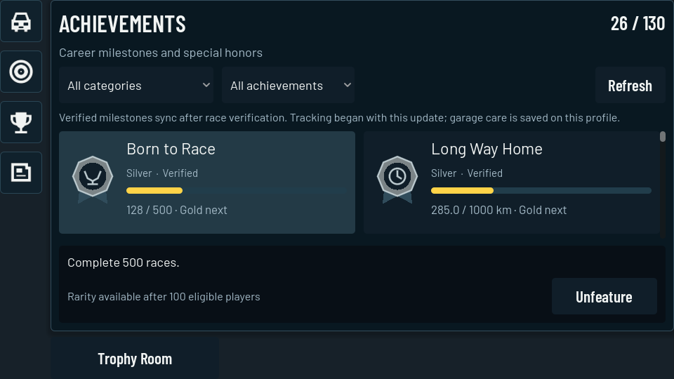
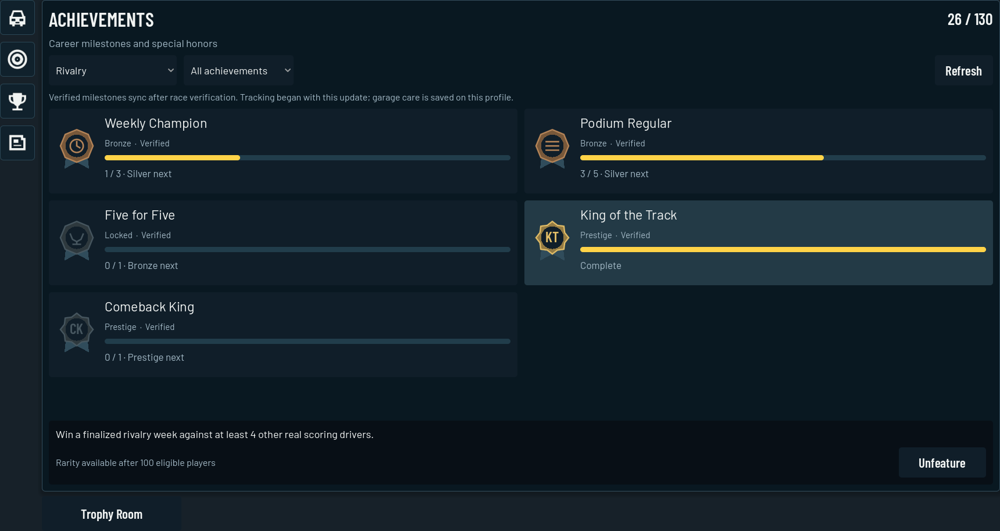
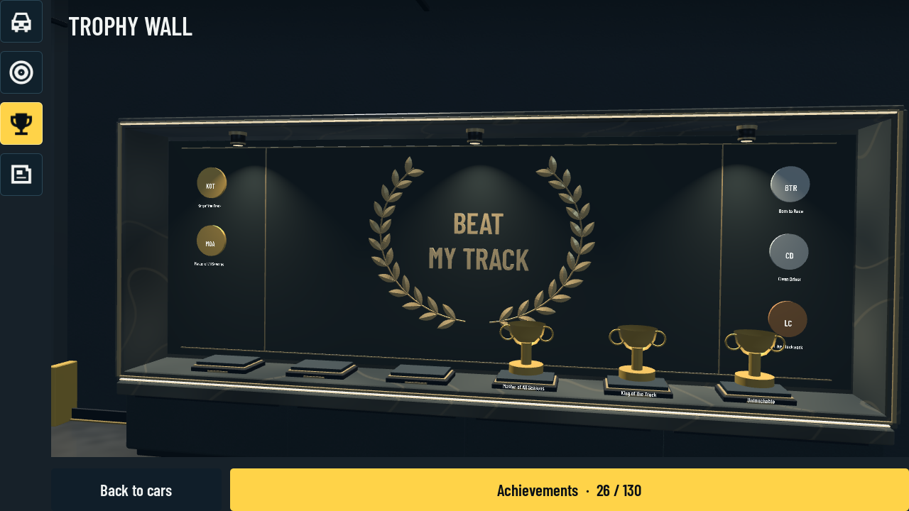

# Permanent achievements — 2026-10-17

Backend rollout follow-up: the account service and matching worker are now deployed through schema42. [Actual release and preservation checks](ACHIEVEMENTS_BACKEND_DEPLOY_2026_10_17.md) supersede the earlier implementation-only deployment status below. Game-client/device rollout remains separate.

The requested achievement collection is implemented in **Garage → Trophy wall → Achievements**, with 40 families, 120 Bronze/Silver/Gold/Platinum tier unlocks and 10 distinct prestige honors. Achievements remain permanent; this does not add resetting tasks or alter individual race awards, Coins, paid products, driving, scoring or canonical contracts.

## Requirements and behavior

- **ACH01, collection:** category selection, unlocked/in-progress/prestige filters, saved progress, the next tier, detailed requirements, earned-tier total and explicit refresh. Category changes select a visible achievement. The existing touch-swipe scroller owns card-start scrolling.
- **ACH02, progression:** completed races, completed circuit distance, clean races, existing race/flying-lap PB improvements, precision, distinct track identities, all five cars/biomes, biome-specific races/clean races, PB streaks, publishing, creator plays/reach, friends, challenges and rivalries. Progress and unlock dates survive restarts; a broken streak does not revoke an award.
- **ACH03, authority:** signed-in racing/competition/creation achievements come from accepted server results. Creator tests, unpublished/hidden/archived circuits and artificial populations do not earn this collection. Guest racing and garage care are explicitly local. Garage care counts a completed dirty-to-clean wash, and the first saved nondefault appearance on each car; opening controls or resetting an appearance does not farm progress.
- **ACH04, prestige/rarity:** Untouchable, Perfectionist, King of the Track, Against All Odds, Master of All Seasons, Comeback King, Track Legend, The Unbeaten, Full Grid and Road Scholar have individual badge monograms. Percentages use actual recorded eligible-player/unlock totals and are withheld below 100 eligible players. Local achievements have no global rarity.
- **ACH05, featured display:** choose up to five earned families. Verified choices save to the account; garage choices save to the profile. Featured names appear on the existing Profile page and engraved medals appear on the actual garage wall. Up to six earned prestige/exceptional milestones occupy the original physical award slots, using shared hollow-cup/handle meshes. No unearned award is fabricated.
- **G01/R01/Q01:** preserve unrelated working-tree changes, the original showroom/camera, free racing, currency policy and canonical simulation. No physics/rules version change.

## Exact competitive rules

Rivalry honors require **at least five real scoring participants**, an ended week and no queued/verifying results. Tied first places do not receive wins. Top-three rank earns a podium; completing all five slots earns Five for Five. Each group is processed once. Comeback King additionally requires an observed outright last scoring position while at least four opponents have scored; an initial empty standing does not qualify.

Challenges require at least two real verified scorers, an ended competition and no pending verification. Cancelled challenges and tied group winners receive no win. Against All Odds uses an immutable Beat target at least 10% faster than the challenger's prior established verified PB; beating an unknown initial PB does not qualify. This measures a concrete pace disadvantage rather than inventing a player-rank system.

Precision compares **every lap, including the standing first lap**, to the race average using integer arithmetic: 2% for Like Clockwork; 1% plus trusted clean evidence for Perfectionist. Missing clean evidence never grants clean achievements. PB milestones require an improvement over an existing PB. Consecutive-result metrics follow accepted verification order and count completed eligible races; dirty/nonimproving completions break their respective streak.

The Unbeaten starts observation once a board has ten eligible real drivers and a sole record holder. A tied or displaced record cancels the hold; the same owner's faster record retains its original start. One bounded worker check confirms the sole holder after 30 days. No earlier holding period is guessed from a current leaderboard.

## Backend cost and persistence

There is **no race-history scan, new process, notification fan-out or job launched by opening the collection**.

| Operation | Added work |
| --- | --- |
| Collection GET | Two SELECTs: at most two player projection rows and the fixed rarity summary. Existing auth/request-budget work remains. |
| Category/detail browsing | Zero requests. |
| Repeated entry/refresh | At most one collection request per 60 seconds, including failed attempts; disk cache remains available offline. |
| Accepted race | Reuses the existing Player transaction and durable CoinReward duplicate fence. Fixed-width JSON metrics; deduplicated track/friend facts. Creator plays update the separate creator scope; a new unique visitor can also update reach. |
| Distinct facts | At most 1,000 track identities + 100 defeated friends + 25 published tracks per player, stopping after the highest relevant tier. Revisions/cars cannot inflate track identities. |
| Friend overtake | Only on a race PB improvement, using the existing bounded 100-friend roster and one batched PB query. Each friend counts once. |
| Rarity | Coalesced pending flag per scope, processed by the existing idle worker. No shared rarity-counter writes in the race transaction. At most 122 unlock keys plus one denominator, across 16 fixed shards (1,968 possible summary rows). |
| Idle worker | One competition (existing maximum 20 entrants), one projection or one record per work unit. Empty checks cost three indexed SELECTs at most once per minute per worker. Backlog checks are limited to four work units per second and yield to verification. |
| Held record | One row per observed eligible board; indexed top-eleven query only on a PB change or the due confirmation. |

The eligible rarity cohort is real registered players with a recorded racing or creator milestone since launch. Rarity is an asynchronous historical cohort projection, not a live all-account population census. Artificial players never enroll. Account deletion removes personal facts/caches and subtracts only previously projected rarity contributions, once.

Migration **0042_achievements** follows existing 0041 and adds only achievement tables/indexes. The backend package includes its catalog. The client exports its identical raw JSON catalog explicitly. API contract: [achievements-v1.schema.json](schemas/achievements-v1.schema.json), authenticated `GET /v1/achievements` and idempotent absolute `PUT /v1/achievements/featured`; arbitrary progress writes are unavailable.

Local progress participates in the existing atomic LocalRecords commit/rollback. Integer normalization preserves exact round trips. Account/server caches are isolated by hashed origin + player identity; late responses cannot enter another account. New counters begin with this update. Historical race, distance and clean totals are not reconstructed; existing verified track-reach evidence remains usable. Distance is completed canonical circuit length, not a new per-frame odometer.

## Actual validation

Pinned **Godot 4.7.2**; native tests use isolated `APPDATA` under `build/achievements-user`. PostgreSQL tests use a new task-labelled disposable PostgreSQL 17 container and remove only that container afterward.

| Check | Actual result |
| --- | --- |
| Focused native achievements, headless | 56 checks, zero failures |
| Actual Compatibility UI/garage | 61 checks, zero failures |
| Actual Mobile Vulkan UI/garage on desktop | 61 checks, zero failures |
| Existing app/navigation | 101 checks, zero failures |
| Existing record persistence | 54 checks, zero failures |
| Complete script parser | 848 scripts, zero failures |
| Backend SQLite/regression set | 79 passed, four skips, zero failures |
| Disposable PostgreSQL/regression set | 56 passed, zero failures/skips |
| Catalog equality/export inclusion after final wording change | One passed |
| Ruff on added Python sources/tests/runner | Passed |

PostgreSQL includes concurrent players racing each other's created tracks, serialized scope increments, separate rarity projection workers, exact cohort deduplication, finalization waiting on pending runs, insufficient participation, ties, repeated finalization, challenge wins, record holds, rewards, news and discovery. The SQLite skips cover real row-lock concurrency and existing PostgreSQL-only concurrency paths. Existing privacy regression checks pass. These are correctness/coverage checks, not a production-load or FPS claim.

Actual commands are in [report.json](evidence/achievements-2026-10-17/report.json). Native logs, JUnit results, source hashes and an isolated task-only patch accompany the report. The patch uses snapshots of the already-dirty tree, preserving concurrent work.

Initial attempts are retained in the report: sandbox user-log/certificate-store access failures; unavailable preconfigured PostgreSQL endpoint; the first owned-container runner's obsolete test filename; the initial local integer-round-trip failure (fixed with integer normalization); and the category/detail visual discrepancy (fixed by selecting a visible family and testing actual controls). No failing assertion was removed to make the implementation pass.

## Native views

The scenes contain deliberately seeded isolated test progress, **not production unlocks or rarity**.

Both renderers also retain 1280- and 1720-pixel captures.

## Remaining acceptance and rollout

The matching client/API/worker and migration must be rolled out together before registered progression works on the retained service. **No backend deployment/migration, APK build/install, phone attachment check or physical-phone test was performed.** The owner still needs to review appearance, thresholds and phone interaction. No FPS/phone performance acceptance is claimed. Cosmetic-item rewards are not part of this launch; existing cosmetic ownership and Coins remain unchanged.
