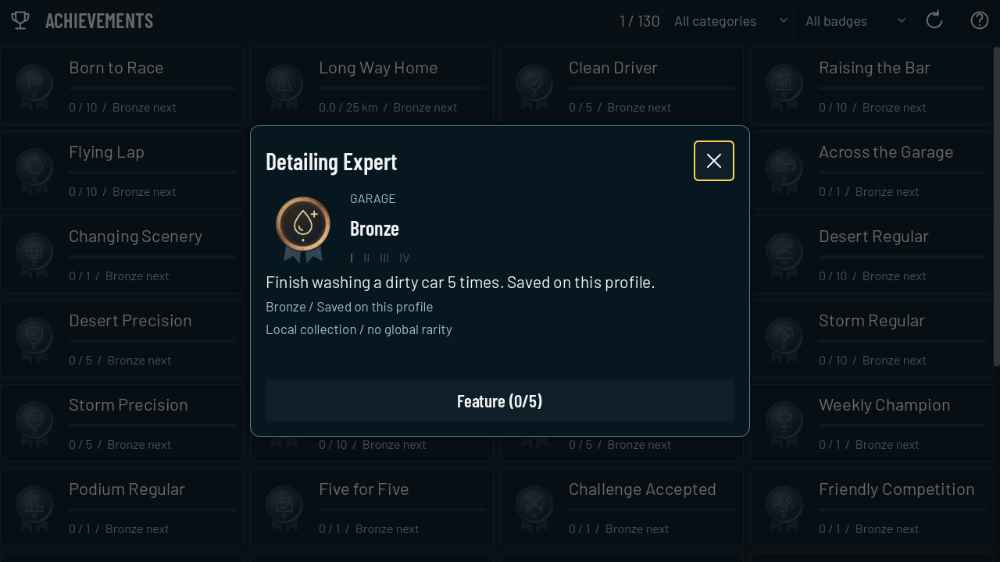
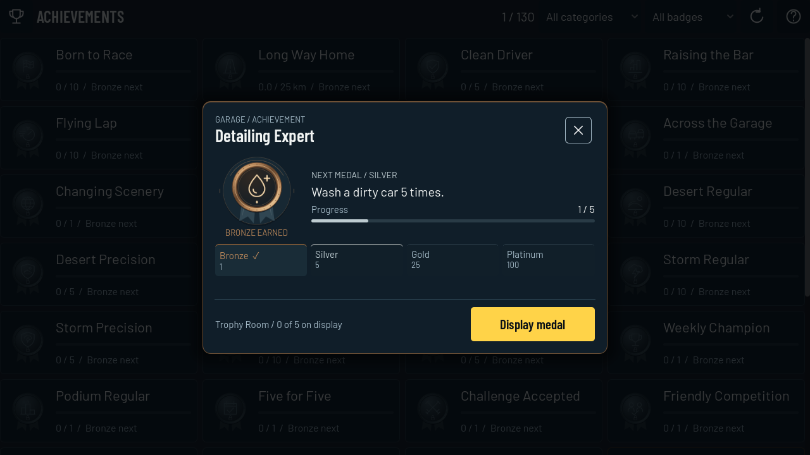
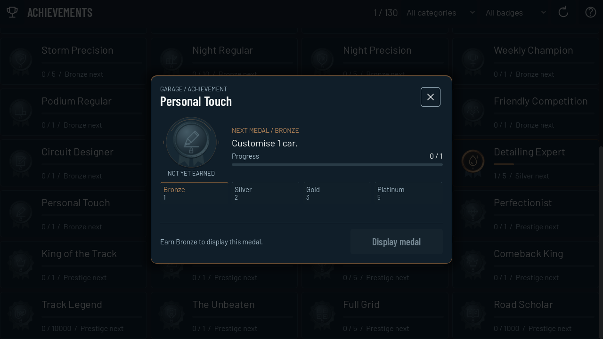
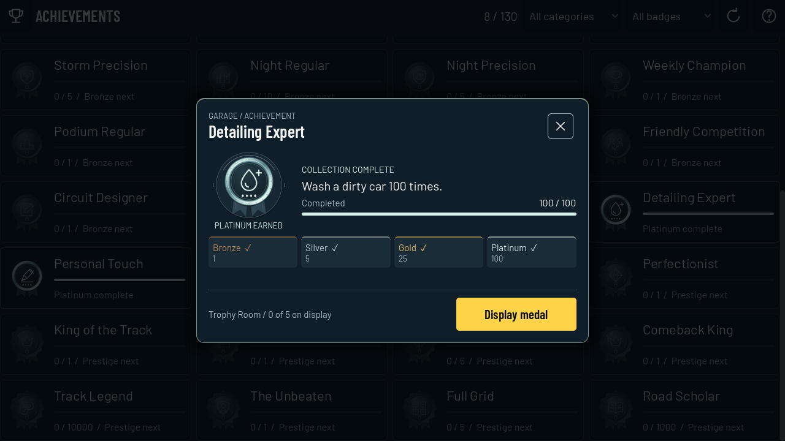
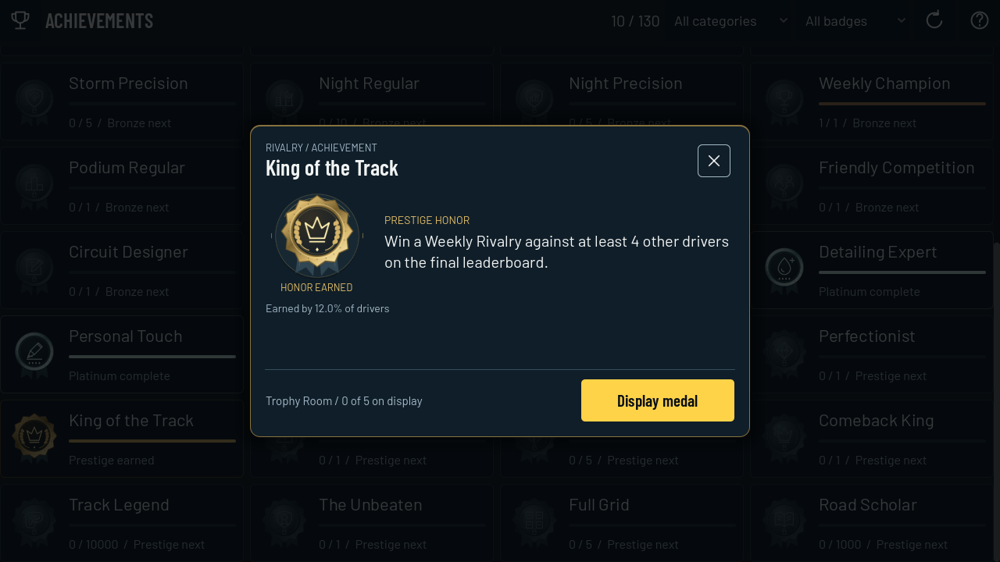

# Achievement detail presentation — 2026-10-22

The owner rejects the achievement popup's visual quality and developer-facing
copy, including “Saved on this profile.” The detail sheet now presents the
current medal, the next objective and actual progress, followed by a readable
milestone strip and a clear Trophy Room display action.

| Requirement | Result |
| --- | --- |
| ADP01 | Original medal mount, metal-accented panel, quieter close control, compact category/title hierarchy, restrained 0.16s entrance and dimmed collection. The sheet remains bounded at 640 × 400 logical units with scrolling on shorter screens. |
| ADP02 | Player-facing objectives throughout the catalog, natural singular counts, readable large numbers and distance units. Remove storage, source and unavailable-rarity explanations from the detail sheet. Rewrite About achievements around earning medals and displaying them. |
| ADP03 | Distinguish the earned tier from the next medal. Show exact progress, four named thresholds and earned checkmarks; retain appropriate locked, Platinum-complete and prestige presentations. Show rarity only for the original authenticated, non-local, 100-driver minimum. |
| G01 / R01 | Keep the original forty families, 130 unlocks, thresholds, sources, account boundaries and five featured medals. Preserve original art, Garage/wall navigation and canonical race behavior. Full display gives an actionable explanation; removal stays available. Tab stays inside the modal, Escape dismisses it, and closing restores collection focus. |
| Q01 | Inspect native screenshots, run focused and existing achievement checks, synchronize the shared catalog text, and retain an isolated source checkpoint. |

## Implementation

- `game/ui/achievements_menu.gd`: owned sheet, header, scrolling, focus and About copy.
- `game/ui/achievement_detail.gd`: objective/progress/tier/rarity/display presentation using the existing service.
- `game/ui/achievement_medal_stage.gd`: static native drawing around the original shared medal artwork. No new bitmap, texture cache, shader, external art or runtime image readback.
- `game/persistence/achievement_catalog.json` and `backend/bmt_backend/achievement_catalog.json`: matching player-facing descriptions only. Family identifiers, metrics, thresholds, scope and prestige flags remain exact.
- `game/tests/test_achievement_detail.gd`: isolated actual-sheet checks and captures.
- `game/tests/test_achievements.gd`: matching player-copy assertions and account-specific mock responses, preserving the original account-fence assertion.

The popup reads the existing cached service state. No new endpoint, polling,
schema, progression grant or account mutation is introduced. The backend catalog
change is source text only; no backend deployment was performed. Concurrent
achievement notification, account refresh and Garage changes are preserved.

## Actual validation

| Check | Actual result |
| --- | --- |
| Focused headless | 758 checks, zero failures |
| Focused native Compatibility | 767 checks, zero failures |
| Focused desktop Mobile / Vulkan | 767 checks, zero failures |
| Existing achievement regression, headless | 424 checks, zero failures |
| Existing achievement regression, native Compatibility | 559 checks, zero failures |
| Complete script parser at validation | 918 scripts, zero failures |
| Pinned engine import | Passed |
| Backend shared-catalog and precision contract | 1 passed; one existing Starlette/httpx deprecation warning |

Focused checks exercise all forty objectives at 1280 × 720, and the Detailing
Expert sheet at 960 × 540, 1280 × 720, 1720 × 914 and 740 × 360. They check actual
earned/next progress, visible objective/count/action geometry, unwrapped progress
numbers, local display saves and removal, five-medal capacity, busy state,
rarity at both sides of the original population minimum, modal keyboard focus,
Escape and navigation cleanup. The existing suite covers the actual Garage wall,
touch/mouse navigation, collection layout, persistence and account ownership.
Fixture records and caches are confined to disposable workspace APPDATA folders.

Commands used pinned `4.7.2.stable.official.ed1daf0bf` through `scripts/dev.ps1`.
Each engine command used process-only PowerShell execution-policy Bypass and
workspace APPDATA; native execution was approved to read the Windows certificate
store. Relevant arguments were:

```powershell
-Action TestScript -ScriptPath res://tests/test_achievement_detail.gd
-Action TestScript -ScriptPath res://tests/test_achievement_detail.gd -Graphical -RenderingMethod gl_compatibility
-Action TestScript -ScriptPath res://tests/test_achievement_detail.gd -Graphical -RenderingMethod mobile -RenderingDriver vulkan
-Action TestScript -ScriptPath res://tests/test_achievements.gd
-Action TestScript -ScriptPath res://tests/test_achievements.gd -Graphical -RenderingMethod gl_compatibility
-Action TestScript -ScriptPath res://tests/test_script_parse.gd
-Action Import
```

The native fixtures received
`-TestArgument --evidence-root=res://../docs/evidence/achievement-detail-2026-10-22/<renderer>`.
The original capture additionally used `--baseline`. The final Mobile receipt was
retained immediately through `build/run_achievement_detail_review.ps1`, which
calls the same entry point, to avoid concurrent command-log reuse.

Backend contract command, run from `backend/`:

```powershell
../.tools/backend-secure-venv/Scripts/python.exe -m pytest tests/test_achievements.py::test_catalog_matches_and_precision_has_exact_boundary -q
```

Initial attempts are reported separately. The host execution policy, original
user log location and Windows certificate sandbox restrictions stopped initial
launches; process-only Bypass, isolated APPDATA and approved native execution
resolved them. The system Python lacked pytest; the existing project environment
passed the contract check.

Native visual review caught the first layout's collapsed progress number. The
label now reserves its actual unwrapped text width, and the fixture explicitly
checks that geometry. An initial arbitrary 30-pixel test minimum rejected shorter
but fully readable counts; the final invariant uses the label's actual minimum
size and requires wrapping off. No text-fit requirement was relaxed.

During testing, concurrent achievement work introduced an identity-triggered
refresh. The old mock returned Alice's body to a fresh Bob request, causing two
native account-fixture failures; the focused fixture also counted the legitimate
identity read as a browsing read. The mock now returns account-specific data,
and browsing request counts are measured after the identity refresh settles.
The original assertion that Alice's delayed response cannot enter Bob's state
remains. Initial failure logs are retained; they are not counted as passes.

## Native review

Before:



Revised Detailing Expert, actual Compatibility renderer:



Locked achievement:



Completed collection and earned prestige:





Actual commands, source hashes, retained logs and the task-only source patch are
recorded in [report.json](evidence/achievement-detail-2026-10-22/report.json).
The patch is relative to archived pre-task working sources; unrelated existing
work is excluded. No commit or staging operation was performed.

Owner visual/touch acceptance and physical-device review remain. AAA is the
quality target, not a claimed acceptance result. No phone attachment check or
physical-device test was performed. No APK/export/install, live progression or
account change, backend deployment or performance claim is included.
