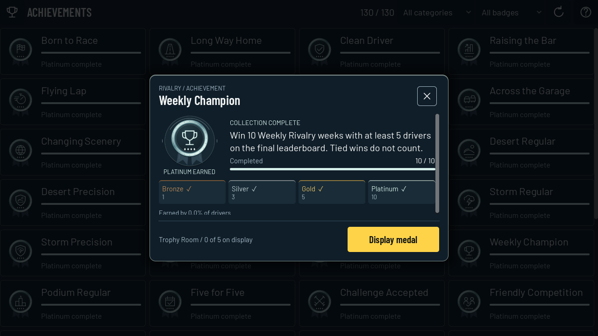
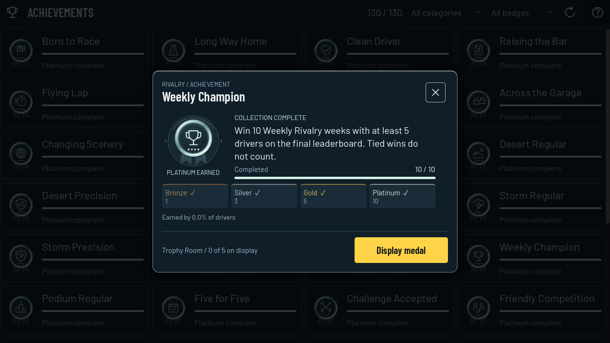
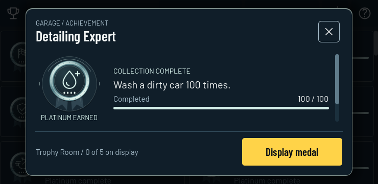

# Achievement popup fit and scrollbar spacing — 2026-10-22

The owner requests a popup that fits without scrolling at typical aspect ratios,
with appropriate scrollbar padding when scrolling is necessary. This supersedes
the earlier fixed 400-unit height cap; the original 640-unit width and 16-unit
screen-edge clearance remain.

| Requirement | Delivered behavior |
| --- | --- |
| ADF01 | Measure wrapped detail content and let the popup grow enough to show it. The 240 tested normal viewport/family combinations need no scrollbar or hidden overflow. Tested heights are 400–424 logical units. |
| ADF02 | On short windows, reserve the scrollbar's 8-unit width plus a 12-unit content gutter. Inset its lane another 6 units within the panel's existing padding, with clearance from the header and footer. Style a visible track and thumb. |
| ADF03 / G01 / R01 | Preserve the objective, actual achievement progress bar, milestones, rarity, display action, 52-unit controls, modal ownership and original achievement sources. Touch scrolls only the popup; returning to a normal size clears the scrollbar and offset. |
| Q01 | Reproduce the original overflow, inspect both native renderers, retain regression checks and a task-only patch. |

`game/ui/achievements_menu.gd` contains the sizing and padding change. The new
`game/tests/test_achievement_detail_layout.gd` reuses the existing isolated
achievement fixture. The two existing achievement fixtures now assert the
available screen-height bound instead of the superseded 400-unit cap. No font
size reduction, truncated objective or disabled scrolling substitutes for fitting
the content. No backend, catalog, progression or canonical race code changes.

The original implementation reproduces five focused failures: a 4-pixel overflow
with the rarity line at 1280 × 720, clipped detail content, and three short-screen
padding failures. The final fixture tests all forty families with earned progress
and rarity at 854 × 480, 960 × 540, 1280 × 720, 1024 × 768, 1280 × 800 and
1560 × 720, plus About at each size. A 740 × 360 case exercises fallback scrolling,
actual scrollbar dimensions/pixels, content spacing, touch ownership and resize.

| Actual check | Result |
| --- | --- |
| Focused fit, headless | 1,220 checks, zero failures |
| Focused fit, native Compatibility | 1,229 checks, zero failures |
| Focused fit, desktop Mobile / Vulkan | 1,229 checks, zero failures |
| Existing detail behavior, headless | 758 checks, zero failures |
| Existing actual Garage/achievement suite, Compatibility | 559 checks, zero failures |
| Complete script parser | 923 scripts, zero failures |
| Pinned-engine import | Passed |

Commands ran through the pinned Godot 4.7.2 `scripts/dev.ps1` entry point using
`build/run_achievement_detail_fit.ps1`, which sets workspace-only APPDATA and
retains logs immediately:

```powershell
powershell.exe -NoProfile -ExecutionPolicy Bypass -File build/run_achievement_detail_fit.ps1 -Mode baseline
# Subsequent actual modes: headless, compatibility, mobile, detail,
# native-regression, parser, import
```

The wrapper selects `TestScript` and the named fixture, adds `-Graphical` /
`-RenderingMethod gl_compatibility` for native Compatibility, and
`-RenderingMethod mobile -RenderingDriver vulkan` for desktop Mobile. Native
execution was approved for Windows certificate-store access. All fixture records
remain isolated in workspace folders.

Initial visual review caught a custom scrollbar style with zero minimum width.
After explicitly reserving 8 units, the geometry checks caught a remaining
4-unit content gap. Reserving both the bar and the required 12-unit gutter fixes
that; the original spacing assertion remains, and actual bar-width and rendered
pixel checks were added. Initial passing geometry-only captures and subsequent
gutter failures are retained separately. The temporary wrapper was also corrected
to propagate the entry point's failure exit code.

The first whole-project parser/import attempts encountered a concurrent
`DesertSandWind.WIND` constant-expression error. That separate work corrected its
constant; the final unchanged achievement sources pass parsing and import.
Desert, Garage icon and achievement notification changes are preserved and
excluded from this task's checkpoint.

Before, with unnecessary scrolling:



Normal viewport, fully visible content:



Short viewport, padded scrollbar:



Actual logs, measurements, hashes and the reviewable source patch are in
[report.json](evidence/achievement-detail-fit-2026-10-22/report.json). The patch
uses archived pre-follow-up working sources; no commit or staging was performed.
Owner touch/appearance and physical-device acceptance remain. No phone attachment
check or physical-device test, APK/export/install, backend/account mutation or
deployment was performed.
