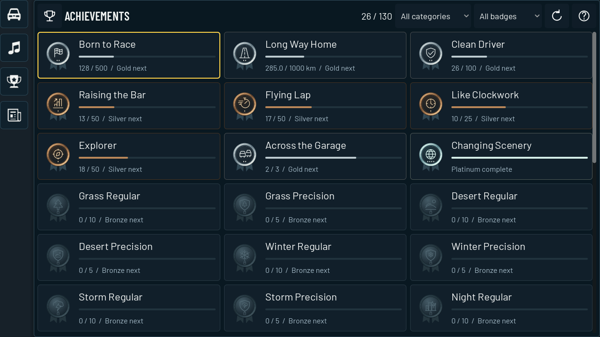
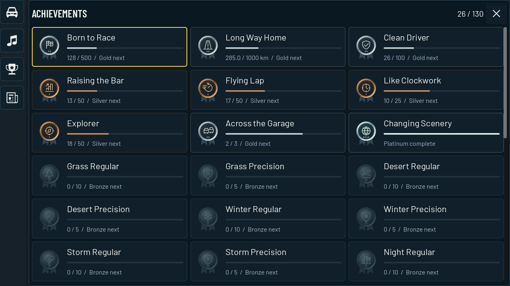

# Simplified achievement title bar — 2026-10-22

The owner requests only the title and earned count in the achievement card title
bar, plus an X that closes the collection and returns to the Trophy Room.

| Requirement | Result |
| --- | --- |
| AHB01 | The title bar contains ACHIEVEMENTS, the live earned-tier count out of 130, and X. Retire the trophy/back icon, category and badge filters, refresh and information controls. All forty families stay available. |
| AHB02 | The right-aligned X has a 52-unit touch target and uses the existing Trophy Room navigation signal, cleaning up any owned detail sheet. Real touch input returns to the actual Garage Trophy Room and restores its showroom. |
| G01 / R01 | Preserve actual progress, medal details, display choices, account/source fences, cached automatic entry reads, collection space and canonical racing. Existing service notices remain available in the count tooltip without another control. |
| Q01 | Inspect native before/after views, run the existing achievement workflows and parser, and retain a task-only checkpoint. |

`game/ui/achievements_menu.gd` contains the implementation. The original
`game/tests/test_achievements.gd` now exercises the requested header and X return;
the layout fixture replaces its retired About interaction with a header check.
The count remains data-driven; the owner's example 8/130 is never hardcoded.

Actual pinned Godot `4.7.2.stable.official.ed1daf0bf` validation:

| Check | Result |
| --- | --- |
| Existing full achievement fixture, headless | 424 checks, zero failures |
| Native Compatibility | 558 checks, zero failures |
| Desktop Mobile / Vulkan | 558 checks, zero failures |
| Complete script parser | 927 scripts, zero failures |

The native fixture retains wall selection, collection scrolling, detail input
blocking, display saving and account fencing. It checks 960 × 540, 1280 × 720 and
1720 × 914, confirms the three-control header and touch target, and sends real
touch input to X. Collection space and complete visible cards remain unchanged.
The retired About screenshot accounts for one fewer native capture/check than
the previous 559-check run. No progression or account assertion was weakened.

Actual commands used the workspace wrapper below with modes `headless`,
`compatibility`, `mobile` and `parser`:

```powershell
powershell.exe -NoProfile -ExecutionPolicy Bypass -File build/run_achievement_header.ps1 -Mode compatibility
```

The wrapper calls `scripts/dev.ps1 -Action TestScript` with the existing fixture,
uses `-Graphical -RenderingMethod gl_compatibility` or
`-Graphical -RenderingMethod mobile -RenderingDriver vulkan`, and selects
`res://tests/test_script_parse.gd` for parsing. Workspace APPDATA isolates fixture
records; native execution was approved for Windows certificate-store access.

Before:



After, actual Garage collection:



Logs, source hashes and the patch relative to archived pre-task working sources
are in [report.json](evidence/achievement-header-2026-10-22/report.json).
Concurrent Garage, achievement notification, Desert and backend work is preserved.
No staging or commit was performed. Owner appearance/touch and physical-device
acceptance remain. No phone attachment check or physical-device test,
APK/export/install, backend/account mutation or deployment was performed.
