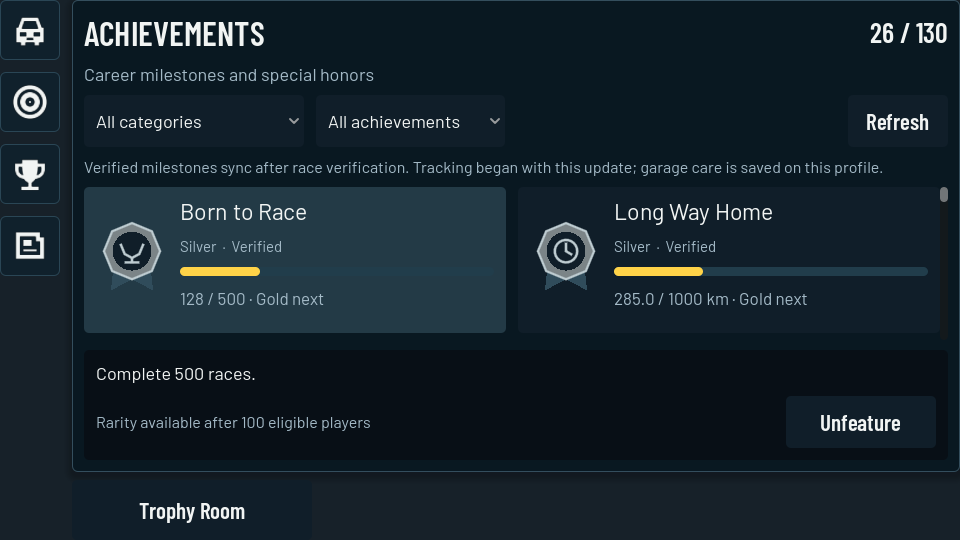
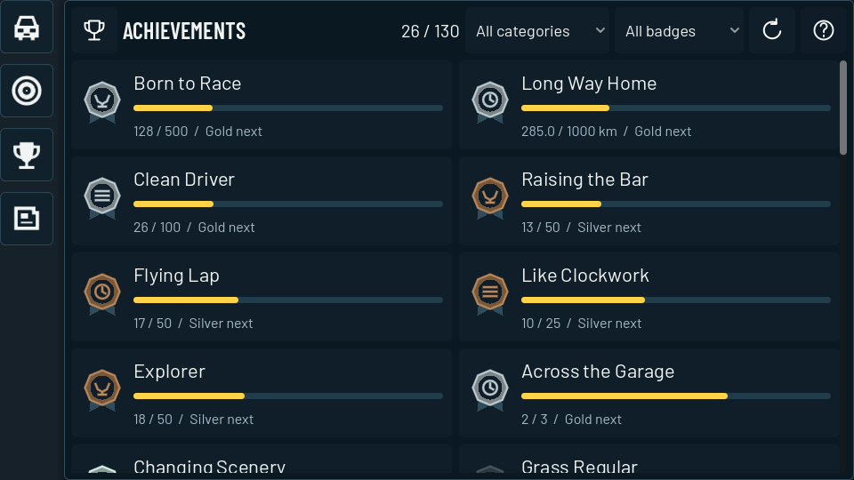
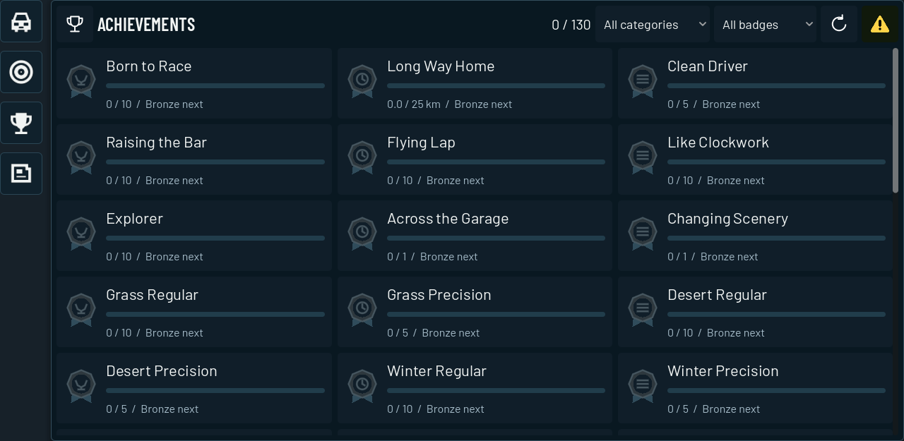
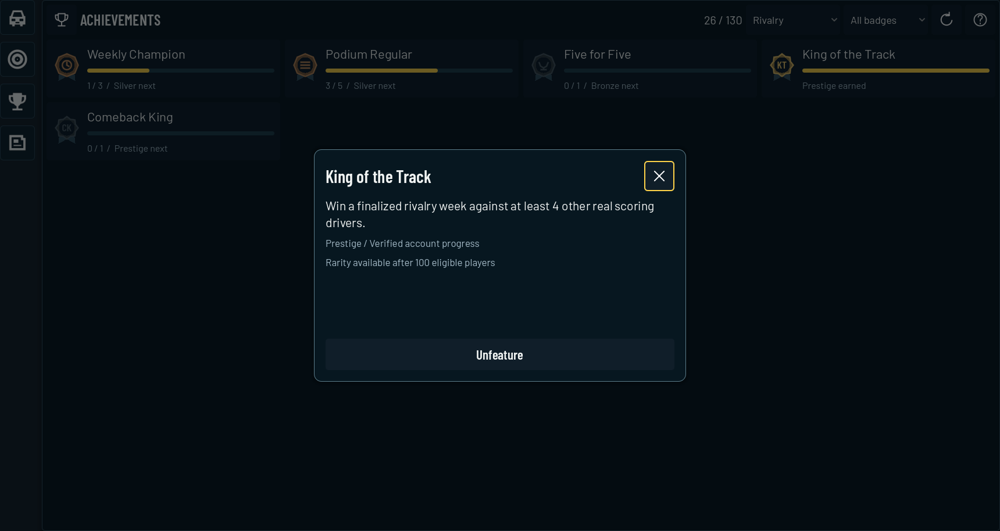

# More room for achievements — 2026-10-17

The owner reports that the achievement list is crowded out by the header, filters, help text, fixed details and bottom navigation. This presentation revision gives the collection most of the available screen.

**AS01:** one 52-unit toolbar contains Trophy Room navigation, title/count, category/filter choices, refresh and information. The subtitle, persistent explanation/status row and bottom navigation row are removed from browsing. Service notices remain available through a small highlighted information control.

**AS02:** cards shrink from 146 to 100 logical units while retaining the badge, readable name, progress bar and next tier. The grid uses two, three or four columns as available width increases. All 40 families, 130 unlocks, progress rules and saved selections remain.

**AS03:** tap a card to open its requirement, source, rarity and feature control in a compact modal. Close, Escape or tapping outside returns to the list. The sheet blocks background scrolling/menu gestures. Card-start swipes continue scrolling without opening details. Feature changes still use the original explicit account operation.

**G01/R01/Q01:** preserve the actual Trophy Room/showroom, account isolation, cache/throttle, achievements/backend behavior and concurrent work. This revision adds no requests, jobs, backend changes or per-frame processing.

## Actual screen-space comparison

Measured from the actual native Garage scene using the same isolated seeded progress before and after:

| Logical viewport | List height before → after | Screen devoted to list before → after | Fully visible cards before → after |
| --- | --- | --- | --- |
| 960 × 540 | 153 → 464 | 28.3% → 85.9% | 2 → 8 |
| 1280 × 720 | 333 → 644 | 46.3% → 89.4% | 4 → 18 |
| 1720 × 914 | 527 → 838 | 57.7% → 91.7% | 6 → 28 |

The empty `0 / 130` service-update state from the owner's screenshot is also reproduced at 1280 × 625. The notice does not take a row or enlarge the toolbar. Its original high-resolution warning artwork is explicitly bounded to 28 units. Rarity and source explanations occupy space only when requested.

## Actual checks

- Pinned Godot 4.7.2: **88 headless**, **96 Compatibility**, **96 Mobile Vulkan on desktop**, all with zero failures.
- Existing app/navigation: **101 checks**, zero failures.
- Complete script parser: **848 scripts**, zero failures.
- Checks cover viewport-space/card-count bounds, an actual card-start touch swipe, a touch tap, modal input isolation, Escape/close, feature/unfeature operations, no-read browsing, the actual header return to Trophy Room, and the empty-service information sheet.
- Native before/after captures and layout measurements use isolated test data. They do not represent production progress or a physical-phone test.

Visual review additionally caught an oversized intrinsic warning icon and a temporary text-wrap minimum that kept the modal unnecessarily tall. Both were corrected and receive explicit regression assertions; no failing invariant was weakened.

Actual commands, logs, source hashes and the task-only patch are recorded in [report.json](evidence/achievement-space-2026-10-17/report.json). Native commands use `scripts/dev.ps1 -Action TestScript` with `res://tests/test_achievements.gd`, headless or graphical `gl_compatibility`/`mobile`, isolated `APPDATA=build/achievement-space-user`, and an evidence-root argument. The before capture uses the original implementation with added measurement output. The existing `TestApp` and `test_script_parse.gd` also pass.

## Views

Before, 960 × 540:

After, 960 × 540:

Empty service state at the owner's screenshot aspect ratio:

Details on demand:

Owner appearance/touch acceptance remains. No phone attachment check/test, APK build/install, deployment, backend migration or FPS claim is made by this revision. The original achievement-service rollout requirement remains unchanged.
