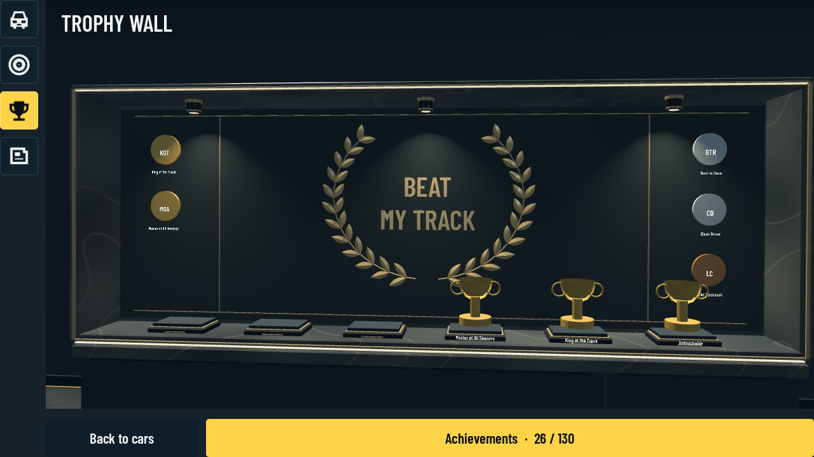
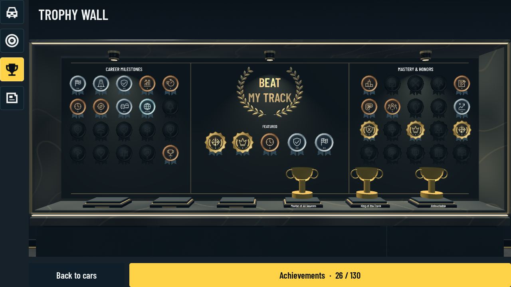
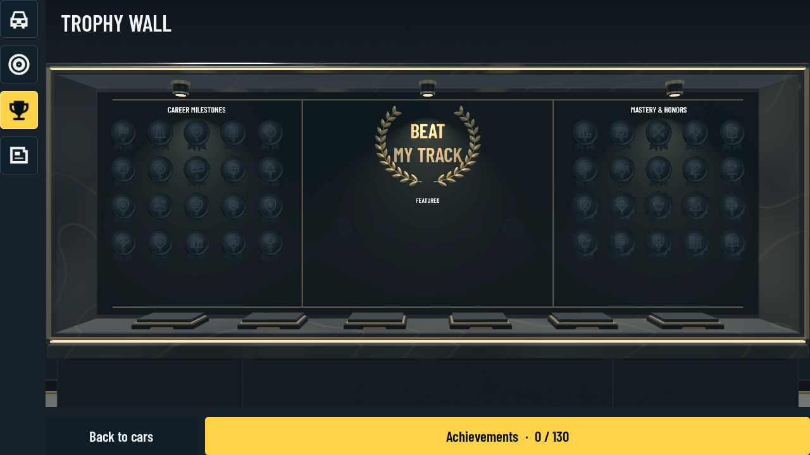
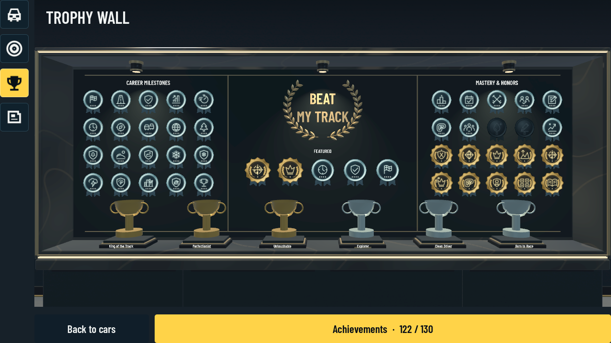
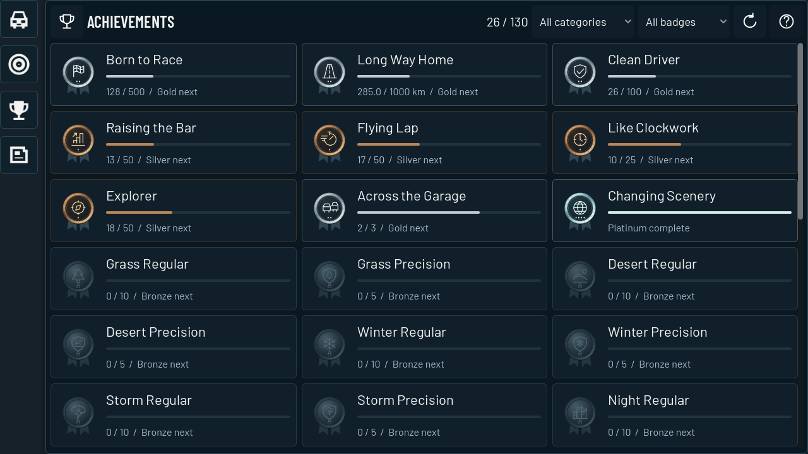
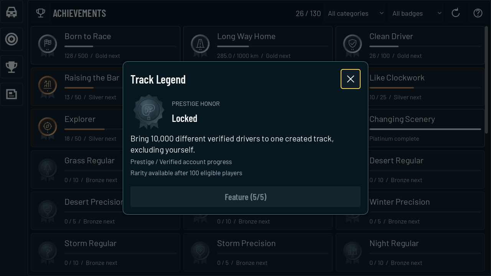

# Achievement medals and the Trophy Room wall — 2026-10-17

The owner rejects the achievement artwork's quality and requests a permanent
place on the actual Trophy Room wall, with faint shadows for missing awards and
properly finished earned medals. This revision implements that display and
replaces the repeated cup/clock/initials artwork throughout the collection.

## Requirements and resulting behavior

| ID | Delivered behavior |
| --- | --- |
| AW01 | Forty original family emblems, restrained enamel faces, bevelled metal rims, folded ribbons, four tier finishes/diamond marks and ten distinct prestige seals. The browser, detail preview and physical wall share the same artwork. |
| AW02 | All forty families have permanent positions in two wall banks. Missing medals remain faint silhouettes; earned medals show their actual earned tier, with physical minted edges. The original cabinet, lights, camera and six trophy bases remain. The brand relief is resized within the existing cabinet. |
| AW03 | Tap a locked or earned wall medal to open its matching requirement, rarity and feature controls. The centre holds up to five earned featured medals. Major trophies remain limited to six. Dragging, a cancelled touch or emulated mouse events cannot open an accidental medal. |
| AW04 | Cached progress drives the wall. The full collection uses one instanced face draw, the featured row another; minted edges share at most four metal groups per row. Unchanged family tiers and feature choices do not rebuild the display. No backend, projection, migration or deployment change is introduced. |
| AS01–AS03 | Preserve the compact 52-unit toolbar, 100-unit cards, 2/3/4 columns, modal input blocking and original 40 families / 130 unlocks. |
| G01 / R01 / Q01 | Preserve actual Garage navigation, care, saved choices and camera behavior; keep canonical racing and account-source rules; verify actual native views and record a task-only checkpoint. |

The artwork is original repository SVG, generated deterministically by
`scripts/build_achievement_art.py`. It uses no external artwork, image service,
live badge viewport or animation. The fixed 1280 × 2560 atlas contains 200
128-pixel cells and has mipmaps. Its theoretical full RGBA8 mip-chain bound is
16.7 MiB, shared by UI and wall. This is an asset bound, not a measured device
frame-rate or memory-peak claim. See the asset's [provenance and layout](../game/assets/achievements/README.md).

Collection entry retains the existing 60-second service cache and explicit
refresh behavior. The wall calls no service endpoint. Selection tests verify
that wall taps, resizing, filtering and detail browsing reuse cached data. The
original bounded rarity worker/read contracts and rollout requirement remain.
Unknown account progress creates shadows rather than invented earned awards;
local Garage care retains its original profile source.

## Actual validation

| Check | Result |
| --- | --- |
| Pinned Godot 4.7.2, headless achievement fixture | 424 checks, zero failures |
| Native Compatibility achievement fixture | 559 checks, zero failures |
| Native Mobile Vulkan on desktop | 559 checks, zero failures |
| Existing Garage carousel, navigation, care and camera | 152 checks, zero failures |
| Existing full application flow | 101 checks, zero failures on unchanged rerun |
| Complete project script parser | 852 scripts, zero failures |
| Original SVG generator | Deterministic byte-for-byte rebuild |

Native checks read back all forty atlas family/tier selections and locked/earned
brightness values, test an empty account and tier upgrades, enforce five featured
medals and six major trophies, check every wall hit target at three sizes, and
exercise real touch/mouse events with the application's menu-swipe owner active.
They include emulated-mouse suppression, a wall-start drag, locked-feature
blocking and modal input isolation. The dummy headless renderer has no GPU
MultiMesh readback, so those rendering assertions run in both native renderers;
source/tier ownership and navigation assertions also run headlessly.

The compact browser retains exactly the earlier measured space:

| Viewport | List height | Screen fraction | Fully visible cards |
| --- | --- | --- | --- |
| 960 × 540 | 464 | 85.9% | 8 |
| 1280 × 720 | 644 | 89.4% | 18 |
| 1720 × 914 | 838 | 91.7% | 28 |

Initial native review caught invalid ribbon color notation, a reversed bank
order, lower-row overlap with cups and detail rarity pushed just below the
scroll fold. These were corrected before the final captures. The first
headless test incorrectly attempted dummy-renderer GPU readback (59 failures);
the same assertions are retained in both native renderer runs. No production
requirement was relaxed.

The initial full app run stopped at an absent `LibraryBestTime` label in
`test_app.gd:503`; rerunning the unchanged application test passed all 101 checks.
A disposable pre-task presentation snapshot also passed 101 checks. That
diagnostic first encountered the separate `worn_asphalt` shader name collision;
only the disposable snapshot renamed that local shader variable to continue the
comparison. Neither shipping Tracks code, the app test, nor road shaders were
changed by this task. Original attempts and outcomes are retained in the logs.

Actual commands, log copies, source hashes and the reviewable task-only patch
are recorded in [report.json](evidence/achievement-wall-2026-10-17/report.json).
All test records and application data are isolated under `build/`. No owner
progress was modified by fixtures. Captures use seeded test progress; the
high-progress account view leaves the two local Garage families unearned.

## Native views

Original wall:

Actual wall with mixed earned progress:

Empty account, Mobile renderer:

High-progress account with upgraded medals and six trophies:

Compact collection with the same original artwork:

Tapped wall silhouette:

Owner appearance and physical-device acceptance remain. AAA remains the quality
target, not a claimed acceptance result. No phone attachment check or physical
phone test was performed; no APK, live backend migration/deployment or FPS claim
is included. The original matching achievement-service rollout remains pending.
