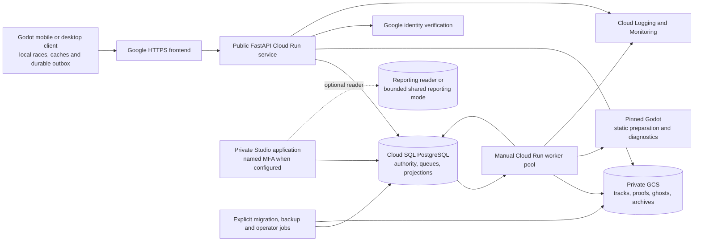

# Beat my track backend: architecture, cost, performance and security audit

26 October 2026. Audit only; no application, deployment, database, billing or infrastructure changes were implemented. Requirements AUD01 architecture, AUD02 cost, AUD03 scalability, AUD04 responsiveness, AUD05 algorithms, AUD06 correctness, AUD07 security/privacy, AUD08 maintainability, AUD09 operations, AUD10 testing, AUD11 evidence and AUD12 improvement plan.

## A. Executive assessment

**Keep the managed Google architecture and modular application. The implementation has useful transactional and resource-safety foundations, but the retained staging deployment is not ready to claim commercial production readiness or million-player capacity.** Its next investment should be representative PostgreSQL validation, recovery, a coherent release and measured unit economics, rather than a rewrite or an additional cache service.

The five highest-priority conclusions are:

1. **The current deployment has a narrow worker and connection envelope.** A single manually allocated worker shares its CPU/memory among several processes. In the inspected day it averaged 81.6% CPU while the API averaged only 0.101 requests/second. The cause is not established; artificial drivers and telemetry are enabled. API replication alone cannot resolve this. The SQL instance allows 40 connections.
2. **Storage lifetime and bytes delivered dominate plausible large-scale costs.** The reproducible reference scenario reaches approximately EUR28,100–34,300/month at one million DAU after a year of sustained activity. A lower-transfer scenario with existing local optimizations enabled is approximately EUR3,900–6,900/month. Neither is a measured bill, capacity result or budget ceiling. The difference depends on explicit activity, retention, logging and packaging assumptions.
3. **Competitive verification deliberately trusts more client evidence than a strongly cheat-resistant public competition can assume.** Current code still accepts the retained fabricated trajectory and trusts the incident claim used for clean-race rewards. This is an existing owner-approved lightweight-verification tradeoff, not a newly authorized change to that policy.
4. **Commercial purchase processing is incomplete.** The production public router does not mount the player billing endpoints. In the legacy-enabled local fixture, two simulated provider-completion failures return503 after exactly one entitlement grant has already committed. No durable completion job exists to finish acknowledgement/consumption without the client. Store availability remains false, limiting present exposure.
5. **Recovery and capacity evidence lag behind the current source.** Live readiness reports schema62; the working source reaches69. The existing mixed load client strips the trajectory required by the current real adapter, so it cannot certify today's acceptance pipeline. Cloud SQL is zonal with PITR and disk growth disabled. A current complete restore/failover exercise is not established.

No new P0 incident or live exploit was confirmed. P1 findings below are material before a public commercial launch or substantial growth. Existing staging settings are deliberate development choices; their presence is not itself proof that a production release has shipped insecurely.

### Observed state, distinct from source capability

Read-only inspection at approximately09:08–09:14 Helsinki found:

| Component | Live observation |
|---|---|
| Region | `europe-west1` |
| API | 1 vCPU/1GiB, service minimum1/maximum2, HTTP concurrency16, timeout60s; 100% traffic on `bmt-stg-e7a444ab-api-web-3f4205261369` |
| API image | `website@sha256:3f42052613699329aa7fad7e492eaba320b3edfacb4f526a502369667124c143` in the existing registry |
| Worker | One manual pool instance, 1 vCPU/768MiB; image `backend@sha256:16c22624a9bf5f1995c8315fbf1554d62dc3707826ba6a9217ff0f2d65327c0e` |
| SQL | PostgreSQL17, `db-custom-1-3840`, zonal, 10GiB SSD, growth disabled, `max_connections=40` |
| Recovery | Seven retained daily SQL backups, deletion protection on, PITR/log archiving off |
| Objects | Private regional Standard GCS; seven-day soft delete; no bucket lifecycle returned |
| Operating mode | Development authentication, test drivers and telemetry enabled; legacy Studio and temporary ad resumes disabled |
| Health | `/health`200, `/ready`200 with `0062_retire_discovery_cache`, `/v1/bootstrap`200 |
| Reporting | No analysis database configured; only one SQL instance observed |
| Other cloud resources | Seven existing Cloud Run job definitions listed. Scheduler, alert-policy and logging-exclusion reads were unavailable; their absence is **not** inferred. |

Different API/worker image digests are expected after a website-only release and do not prove a protocol mismatch. The audit did not inspect the running image filesystem. The schema response and metadata establish a deployment boundary, not that every working-tree fix is deployed.

The preceding24-hour monitoring window contained8,752 requests,13 HTTP503 responses (0.149% of counted requests), and2,526 HTTP4xx responses. Their causes and player relevance are unknown. CPU distribution means: API1.37%, worker81.61%; SQL mean CPU19.16%. Worker memory maximum sampled mean was about647MiB of768MiB; SQL used-disk maximum was502MiB, and the maximum aligned connection sum was14. These are sampled aggregates, not instantaneous maxima or saturation tests.

Latency distributions contained8,749 samples, slightly different from request counts because the provider series have independent reporting timing. Service-wide histogram bounds were P50 **38–42ms**, P95 **192–211ms**, P99 **255–281ms**; weighted mean57.3ms. These cover all routes/statuses, not successful game endpoints, client network time or result-confirmation delay. Timeout rate is not established.

Evidence: [cloud inventory](evidence/backend-comprehensive-audit-2026-10-26/cloud-inventory.json), [monitoring summaries](evidence/backend-comprehensive-audit-2026-10-26/cloud-metrics.json), [revision, health and latency details](evidence/backend-comprehensive-audit-2026-10-26/cloud-detail.json).

## B. Quality scorecard

Scores assess the inspected source and deployment evidence. They are engineering judgments, not certifications. Unmeasured quantities are identified separately instead of being inferred from these scores.

| Category | Score | Evidence and qualification |
|---|---:|---|
| Cost efficiency | 6/10 | Low staging compute floor, compressed immutable objects, device caches, packing/archive implementation. Actual player-day bytes, physical SQL amplification and invoices remain uncalibrated. |
| Scalability | 5/10 | Replicable API, durable leased jobs, bounded discovery/ranks. Manual shared worker,40 connections and hot projections constrain growth. Maximum sustainable throughput: **not assessed**. |
| Player responsiveness | 6/10 | Service-wide tail is reasonable at tiny load; cached menus and asynchronous local results help. Per-journey/mobile P95 and loaded confirmation latency: **not assessed**. |
| Database efficiency | 6/10 | Keyset traversal, indexes, bounded exact rank structures and shared acceptance reads. Significant trigger work, discovery statements and hot rows remain. Current loaded PostgreSQL plans: **not assessed**. |
| Correctness/consistency | 7/10 | Atomic reward/PB effects, durable idempotency, account fences, sorted gift locks and stale-worker fencing. External purchase completion and fresh-deletion authentication need attention. |
| Reliability/resilience | 5/10 | Retry-safe jobs, bounded shutdown and separate liveness/readiness. Single-zone database, one worker and incomplete current recovery evidence. |
| Security | 6/10 | Server economy, private storage, separated administration/credentials and request bounds. Retained proof/incident trust, bearer-only deletion and edge acceptance gaps. Not a complete CVE/native audit. |
| Software architecture | 8/10 | Appropriate modular monolith plus worker processes and one transactional authority; no architectural need for a general microservice split. |
| Maintainability | 6/10 | Domain modules and schemas help. Trigger/migration coupling, billing under Studio and overlapping historical runbooks complicate release reasoning. |
| Testing | 7/10 |184 selected Python test files;132 focused tests and5 audit probes passed. Current full PostgreSQL, real-provider and representative load coverage remain open. |
| Observability | 6/10 | Request IDs, bounded route counters, queue/worker health, structured failures. Available live metrics cannot explain endpoint-specific errors or full confirmation tails. Alert coverage not assessed. |
| Operational readiness | 4/10 | Ownership guards, immutable images, migrations and backups exist. Current release/recovery/load/edge/payment acceptance is incomplete. |

## Architecture and request/data flow

### Stack, boundaries and inventory

The source is Python with FastAPI0.141.1, Starlette1.7.0, Uvicorn0.54.0, SQLAlchemy2.0.54, psycopg3.3.6, Alembic1.20.0, Pydantic2.13.5, google-auth2.58.1 and cryptography50.0.2. The container pins Python3.12.15 and a base-image digest; the local test interpreter is Python3.10. Dependencies have exact wheel hashes in `requirements.lock`. Installed versions inspected here match those selected locked packages. This does not certify all OS/native/dependency vulnerabilities.

The game/client is Godot/GDScript, pinned to4.7.2. Google is the implemented real player identity provider; development identity is explicitly gated and separate. No player Apple identity implementation was found in the inventoried authentication paths. Tokens are opaque bearer/refresh credentials whose hashes and revocation state live in SQL. Google challenges/nonces, refresh rotation and recovery are server-owned.

The audit inventories600 current selected files/165,939 lines, including261 runtime/migration Python files and184 Python test files. Constructing current routers locally yielded148 public-application route records and98 administrative-application route records, including framework/operations routes;146 ORM tables were loaded. The261 AST route declarations also include tests and other router definitions, rather than261 production endpoints. Generated build copies are excluded from these source counts. [All effective routes and model metadata](evidence/backend-comprehensive-audit-2026-10-26/runtime-inventory.json), [source inventory, hashes and dependency versions](evidence/backend-comprehensive-audit-2026-10-26/inventory.json).

The private Studio application is a source capability; no active named-staff/MFA configuration was established. GCS is not directly served to clients through a demonstrated CDN/signed-download architecture. No Redis, Firestore, Pub/Sub, Cloud Tasks, API Gateway, GKE or realtime race server was found in the inspected deployment path. Cloud Run worker pools are continuously allocated and require manual/external-metric scaling; ordinary service HTTP autoscaling does not scale them. [Google worker-pool documentation](https://docs.cloud.google.com/run/docs/overview/what-is-cloud-run).

### Important endpoint families

| Boundary | Important routes/operations | Principal state/dependencies |
|---|---|---|
| Compatibility/identity | `/v1/bootstrap`, `/v1/manifest`, Google challenge/login, browser handoff/poll, refresh, logout, `/v1/me` | Players, identities, challenges, session families/tokens; Google public keys |
| Discovery/content | `/v1/discovery/v3/tracks`, `/random`, compatibility `/v1/tracks`, version metadata/document, track links, `/v1/track-of-the-day` | Indexed discovery partitions/heads/sessions/collections, track versions and current visibility; immutable GCS documents |
| Race pipeline | `/v1/run-tickets`, `/v1/runs`, ticket recovery, batched status, run status/wait/retry | Pinned board/ticket, immutable proof, SQL queue reservation and final outcome |
| Rankings/comparison | Board top/around-me/histogram/ghost, version leaderboard/results comparison | One PB/player/pinned board, exact prefix/tie indexes, lap PBs, demand-built histogram generations |
| Weekly/World competition | Rivalry current/join/group/ticket/ghost/result/continue; World Ranking/circuit/profile | UTC weeks, bounded groups, planned tracks, atomic ranking generations and archives |
| Challenges | Discovery/list/create/detail/join/cancel/rematch/tickets/results/ghosts; series/custom-track capabilities | Challenge/stage membership, finite attempts, pinned sources and one reward identity |
| Progression/Garage | Coins, unlock/purchase-with-earned-coins, achievements, appearances, news | Wallet/reward/milestone authority, cosmetic grants, optimistic appearance recovery |
| Social/privacy | Community terms/blocks/reports, friend news/publication subscriptions, deletion preview/request/preferences | Ownership, privacy fences, tombstones, erasure jobs/journal, consent |
| Store/resumes | Product catalogue, entitlements, development purchases/gifts, resume races/receipts | Immutable buyer/recipient receipts, separate real/simulated balances; shipping store disabled |
| Administration | Separate `/admin`, `/v1/admin`, monitoring/reporting/configuration/control routes | Named staff/MFA, audited actions, restricted database authority; billing placement requires correction |

No realtime peer messages or authoritative120Hz multiplayer service is implied by these online racing features. Normal simulation remains on the client.

### Background work and persistence

| Process/work | Trigger and scheduling | Durability/resource behavior |
|---|---|---|
| Competitive worker | Pulls queued/expired-lease attempts | `SKIP LOCKED`, lease tokens, bounded attempts/backoff, compatible build cohorts; currently serial acceptance loop per main worker process |
| Publication worker | Explicit publication intents | Independent process, one pool connection, native preparation/creator evidence and atomic slot consumption |
| Discovery worker | Change receipts plus periodic maintenance |16 partitions, resumable projection, expiration and daily selection; current source includes daily curation and Track of the Day |
| Product worker | Optional durable telemetry intake | Partitioned actor/shared/rollup stages, bounded batches and retention; still primary SQL work |
| Ranking worker | Configured launch/week settlement | SQL-only phased work, one connection, low priority, atomic published generations and previous-generation reads |
| Packing/cost worker | Explicit packing enablement | SQL pending bytes, immutable packs, range reads, upload leases, archival, reference-aware GC and compaction; disabled by default |
| Reserved main-worker turns | Every16 completed jobs plus idle opportunities | Privacy, presentation and active histogram maintenance avoid complete starvation |
| Operator jobs | Explicit deployment/maintenance commands | Migrations, smoke, catalogue/reporting/simulator tools; listed job definitions are not evidence of recurring schedules |

Persistent state resides in PostgreSQL and immutable blobs, not in a particular API replica. RAM caches, run notifications and local rate leases are bounded hints; SQL remains authoritative. Local filesystem and S3 adapters support development/other hosts. GCS generation preconditions, canonical hashes, SQL pins and retained references guard publication/collection. New packing acknowledges only after pending SQL bytes commit, then atomically changes the location to a verified immutable pack.

## C. Prioritized findings

Severity follows the requested P0–P3 definitions. S is approximately1–3 engineering days, M roughly1–2 weeks, L several weeks or dependent work; estimates exclude owner/provider approval and are not delivery commitments. Confidence describes the stated observation, not unmeasured capacity or savings.

### AUD-F01 — Client trajectory and incident trust remain a competitive-integrity boundary

**P1; security/correctness; confirmed retained policy risk; confidence high; effort L; regression risk high.**

Sources: `backend/bmt_backend/trajectory_verifier.py:15,108`, `verifier.py:364`, `economy.py:242`. The checker enforces bounds, ordered gates, speed-distance limits, layers and timing; it does not independently enforce acceleration, steering dynamics, traction or collisions. Clean-race reward eligibility is taken from a well-formed client incident report. The unchanged retained probe still accepts the synthetic five-lap879-tick path and shows the incident claim controls clean status. No live result/reward was submitted.

Impact: fabricated competitive results and progression farming remain possible within this proof policy. Server-owned coin amounts and idempotency prevent client-chosen amounts or duplicate awards but do not prove the underlying event happened legitimately. Repeating an invalid but newly identified race can still create work and storage.

Recommendation: obtain an explicit commercial integrity decision. Preserve the inexpensive trajectory pass; evaluate targeted independent checks and anomaly/risk review, and stronger verification for competitive/reward-sensitive outcomes where justified. Attestation alone is not proof of a race. Do not silently restore native replay for every race or override the accepted verification policy. Expected improvement: reduced dishonest ranking/reward acceptance, with a measured compute/latency budget. Verify against fabricated trajectories, incident tampering, legitimate edge driving, rewinds, all cars and false-positive rates.

### AUD-F02 — Data lifecycle and delivery savings exist locally but are not an operating cost guarantee

**P1; cost/storage; confirmed deployment/default gap plus quantified scenarios; confidence high for mechanisms, medium for future bill; effort M–L; regression risk high.**

Sources: `config.py:97,114`, `maintenance.py:33`, `cost_maintenance.py:26`, `cost_archives.py:134`, `packed_storage.py:35`, `economy_models.py:35`, `economy.py:233`. Live schema62 predates packing/archive migrations65/66; packing is opt-in. Merely setting90 retention days does not demonstrate a recurring successful retention schedule. Soft delete adds retained bytes after application deletion; it does not discover unreferenced objects.

Current source has durable packs, encrypted exact retry/reward archives, maintenance scheduling and protected-reference GC. These should not be rediscovered as missing implementations. However `CoinMilestone` challenge/day/attempt identities still accumulate and are removed by account erasure, not ordinary cost retention. Archiving receipts therefore does not bound every permanent table. Published tracks and active PB/creator/challenge references also remain deliberately protected.

Impact: SQL indexes/WAL/backups, object count/storage and delivery can grow faster than compute. The reference one-million-DAU scenario reaches about10.6–10.9TiB used SQL and46.4TiB object storage after a year; these are assumptions, not a live inventory. Even the lean model includes permanent milestone growth and approximately0.9TiB SQL/9.9TiB objects, rather than assuming every historical reference disappears.

Recommendation: validate and release the existing storage/archive/cache implementation coherently; explicitly approve each retention boundary, including milestone compaction and protected history. Track arrivals, oldest retained age, deletion/compaction throughput, pack fill, soft-deleted bytes and restoration. Keep exact anti-duplicate fences and purchase promises. Expected improvement: much smaller hot SQL and object-operation bills, subject to the model. Verify current PostgreSQL WAL/IOPS/size deltas, retries after archival, key erasure, read-pin races and database-plus-object restore before enabling it.

### AUD-F03 — Worker scaling does not follow player demand, and process separation is not resource isolation

**P1; performance/scalability/reliability; live observation and confirmed design; confidence high; effort M; regression risk medium.**

Sources: `service_worker.py:91`, `worker.py:65,373`, `publication_worker.py:34`, `discovery_worker.py:21`, `world_ranking_worker.py:20`, `packed_storage.py`. One main acceptance loop plus publication/discovery/product and optional ranking/packing processes share one container allocation. The supervisor intentionally fails the service if a child exits. That is useful failure visibility but also couples all roles to one restart and memory budget. Linux nice values do not reserve database, memory or CPU capacity.

The live single worker averaged81.6% nominal CPU, with sampled memory near647/768MiB, while test drivers are active. It is not proven that verification itself causes this usage. Manually allocated worker instances remain billed while idle. [Manual pool scaling and billing](https://docs.cloud.google.com/run/docs/configuring/workerpools/manual-scaling).

Recommendation: first attribute CPU/RSS and database time by existing role and distinguish artificial from real player demand. Add a reviewed scaling controller/runbook based on oldest eligible queue age, arrival/drain rate and resource limits. Give expensive preparation and low-priority projections separate allocation only when contention measurements justify it; reuse the same code/image. Expected improvement: stable confirmation delay and less unrelated-work interference. Verify burst drain, role crash/OOM, compatible-build availability and zero duplicated rewards under replica changes.

### AUD-F04 — Database connections and queue admission impose a small, explicit burst envelope

**P1; scalability/reliability; confirmed configuration/design; confidence high; effort M; regression risk medium–high.**

Sources: `db.py:47`, `config.py:66,100`, `queueing.py:12`, `run_signals.py:41`, `backend/deploy/gcp/staging.py:66–80`. API pools are4 with zero overflow. A worker container can consume2 main connections plus1 each for publication/discovery/product and optional ranking/packing. Notifications borrow the existing pool. The deploy planner correctly budgets revision overlap, operations and spare connections, refusing totals above40; runtime capacity is therefore intentionally small.

At the model's one-million-DAU peak,128 verification slots represent only0.221 seconds of incoming races. The50,000-client-event backlog is8.64 seconds at100 events/player/day and5× peak, before server events. These bounds protect resources but cannot absorb a meaningful consumer outage at that workload. `check_capacity` probes64 slots: with one free slot in capacity C>64, its hint succeeds with probability64/C. Raising capacity alone can therefore increase conservative busy responses near full.

Recommendation: retain bounded admission and durable client retries. Size backlog from tolerated outage duration; redesign finite-slot probing before huge capacity increases. Size pools, SQL limits and autoscaling together, including rollout overlap and operator access. Evaluate a pooler only if measured connection pressure warrants its operational/transactional complexity. Expected improvement: predictable rejection/recovery instead of connection storms. Verify at90–100% admission occupancy, rolling revisions, SQL loss and delayed clients; distinguish accepted durable attempts from requests that never entered the queue.

### AUD-F05 — Efficient rank reads move work into writes and shared hot-board rows

**P1; database performance/scaling; structural bottleneck hypothesis, not a measured throughput failure; confidence high for shared writes, medium for scale impact; effort M–L; regression risk high.**

Sources: `migrations/versions/0013_scalability.py:124`, `0045_reward_rank_index.py`, `0055_bounded_rank_reads.py:126`, `leaderboard_ranks.py:29`, `worker.py:282`. One PB per player is correct. Rank reads use bounded prefix counters and a compressed tie tree instead of scanning all faster players. Common old/new prefix nodes are deliberately excluded on replacements; that optimization must be preserved.

Nevertheless first finishes share aggregate prefix totals, PB projections update the same `boards` row, first version finishers update a shared track-version counter, and reward/lap/discovery projections add writes. Different player locks do not remove these common database locks. Sparse-prefix/tie structures add indexes and WAL even when client query counts look bounded.

Recommendation: test new entrants, improving PBs, ties and ordinary slower races separately on one exceptionally popular board. Measure lock waits, trigger execution and physical writes. Shorten the acceptance transaction and coalesce derived invalidations before considering striped exact counters or asynchronous presentation aggregates. Preserve exact PB/reward decisions; moving every authority write to eventual consistency would change correctness. Expected improvement: lower hot-board P95 and write amplification. Verify rankings/awards against the existing oracle under concurrent PB/restriction/deletion changes.

### AUD-F06 — Recovery guarantees are weaker than commercial data promises

**P1; reliability/privacy; confirmed settings and missing current exercise; confidence high; effort M; regression risk medium.**

Sources: live SQL metadata; `backend/deploy/restore.sh:24`, `backend/deploy/README.md:240`, `privacy.py:484`, `cost_archives.py:31`. The database is zonal, PITR disabled, with daily backups and fixed10GiB disk. Cloud SQL does not automatically recover a standalone instance from a zonal outage. [HA/recovery behavior](https://docs.cloud.google.com/sql/docs/postgres/high-availability).

The existing restore wrapper verifies checksums/empty targets and leaves services stopped, which is good. The generic start-after-restore example does not enforce the separate privacy-ledger replay step. Restoring old archive keys without applying independent erasure records can resurrect access to previously erased private archives. A seven-day GCS soft-delete policy is not a complete consistent database/object disaster-recovery plan.

Recommendation: decide RPO/RTO explicitly; evaluate regional HA, PITR and monitored disk growth/caps before public launch. Add an enforced restore acceptance gate for current image/schema, packed and pending data, exact rewards/entitlements, all referenced objects and erasure replay before reopening traffic. Expected improvement: bounded acknowledged-data loss and demonstrable recovery. Test instance/zone loss and destructive operator error on an isolated authorized target; report actual restore time and reconciliation results. No such cloud restore was executed by this audit.

### AUD-F07 — Google Play fulfilment lacks a complete public and durable provider lifecycle

**P1 before paid launch; commerce correctness/architecture; confirmed; confidence high; effort M–L; regression risk high.**

Sources: `app.py:137,151,163`, `studio_finance.py:64,76,130`, `studio_providers.py:25,44`, `commerce_models.py:24`, `commerce.py:38`. The billing account/verification routes are in `studio_finance.router`, mounted only inside the administration branch. Runtime route inventory confirms neither route exists in the default public API. Legacy-enabled fixtures mount them and therefore do not establish shipping route availability.

The adapter verifies account/product/state, locks buyer/recipient in a stable order, deduplicates the token digest and commits entitlement fulfilment. It then calls provider completion synchronously. The audit failure probe returned503 twice while one fulfilled purchase and the increased slot balance remained committed. Retrying from the client can complete it, but the purchase row contains neither a recoverable token nor durable completion state. No configured server reconciliation/notification/refund path was established. Google requires timely processing/acknowledgement and documents the three-day refund window. [Billing lifecycle](https://developer.android.com/google/play/billing/integrate).

Recommendation: separate player billing routes from private Studio, then add a secure durable outbox for provider completion, verified notifications and scheduled reconciliation/reversal policy. Keep server verification, immutable recipient and once-only grant identity. Release only after native Billing integration and real sandbox-provider tests. Expected improvement: purchases remain correct when a client disappears after SQL commit. Verify lost replies, completion timeout, refund/revocation, pending approval, opposite-direction gifts and operator retries. Current disabled store limits exposure; this is not evidence of a live charge/refund incident.

### AUD-F08 — Source/deployment/client release boundaries are not yet one production contract

**P1; release readiness; confirmed; confidence high; effort M; regression risk high.**

Sources: `migrate.py:21`, `readiness.py:44`, `runs.py:147`, `worker.py:134`, deployment evidence and current inventories. Live schema62 and worker image differ from working head69. Security header/effective-grant repairs and packing/archive/client features have later source receipts. Historical PC and cloud releases also differ. Pinned immutable boards and build mismatch rejection are intentional; retaining old records is correct, but installing a newer client does not make a matching worker available.

Recommendation: publish one release manifest covering API, worker/static verifier, database head/grants, client capability contract, applicable content and tested rollback/read compatibility. Drain or preserve old cohorts deliberately. Roll back configuration/writes only where newer authoritative formats remain readable; do not claim old binaries can read new packed/archive schemas. Expected improvement: fewer incompatible tickets, missing features and false deployment claims. Verify mixed-version requests and leases, old protected content, new migration chain and source-to-image provenance before promotion.

### AUD-F09 — Edge identity, anonymous abuse budgets and deployed header protection need acceptance

**P2, elevated to P1 if externally exploitable; security/cost; confirmed missing configuration, external effect unverified; confidence medium; effort S–M; regression risk medium.**

Sources: `client_address.py:45`, `middleware.py:155,356`, `http_server.py:14`, `config.py:109`; live flags have no trusted-proxy networks. By default forwarded headers are ignored, avoiding caller spoofing. Whether Cloud Run peers then collapse real users into a shared network budget depends on the actual frontend/peer chain, not on the header name alone. This audit did not perform a live exhaustion attack or inspect individual client-IP logs.

Current source has absolute header deadlines, inactive-socket eviction, body/decompression bounds, separate receivers, shared actor/network work credits and backoff. The focused local suite exercises the new HTTP server. The inspected image does not attest that these later repairs are present. Distributed accounts/IPs can still create legitimate-shaped read/egress cost inside per-actor limits; service-level exposure needs monitoring.

Recommendation: verify trusted peer ranges and spoof-resistant resolution on the actual edge plus any bypass path; stage incomplete-header, NAT, IPv6/64, large-body and distributed-budget tests. Deploy the existing header/grant repairs coherently. Add provider quotas/spend alerts and selective edge controls only where traffic evidence justifies their cost. Budget alerts are notifications, not a hard spend cap. Expected improvement: fewer shared-NAT false throttles and lower abuse amplification without trusting arbitrary forwarded addresses.

### AUD-F10 — Current mixed load tooling cannot certify current real acceptance

**P1; testing/capacity evidence; confirmed; confidence high; effort S for protocol repair, M–L for validation; regression risk low for tooling.**

Sources: `loadtest.py:197,220`, `load_fixtures.py:43`, `verifier.py:364`, `backend/LOAD_TESTING.md:29`. The mixed generator uses `pack_replay(fixture['replay'])`, which emits controls/rewinds without `race_proof`. The real current adapter requires trajectory proof. The direct audit probe runs that exact encoder/decoder and current adapter and confirms rejection before geometry/native execution. The synthetic adapter accepts a different path.

The lab also exercises compatibility `/v1/tracks` rather than the current discovery-v3/daily client workload and labels `--canonical` in terms that can be confused with per-race native replay. Thus historical read throughput or a synthetic mixed pass cannot support current end-to-end capacity, cost or CPU claims.

Recommendation: update the workload fixture/protocol and reporting labels before any current capacity exercise. Add a contract gate proving the exact load body completes one real current acceptance and all relevant projections. Then execute the isolated plan in sectionI with PostgreSQL, GCS-shaped latency, background work and open-loop arrivals. Expected improvement: trustworthy capacity and cost calibration. Do not loosen acceptance or substitute FakeVerifier merely to obtain a green million-player test.

### AUD-F11 — Endpoint/confirmation cost and latency are not yet an operational feedback loop

**P2; observability/operations; confirmed evidence gap; confidence high; effort S–M; regression risk low–medium.**

Sources: `http_costs.py:13`, `middleware.py:629`, `operations.py:76`, `observability.py`. Source now samples fast successes at1%, retains errors/slow requests and emits bounded all-request route/byte/latency summaries. Worker health reports queue age, rate and mean/max completion; these are useful but do not provide full confirmation P95/P99. Available provider aggregates mix health/admin/client-error and gameplay requests.13 live503s and1,131 validation422s remain unexplained by the collected data.

Recommendation: use existing bounded summaries and sampled traces to join upload acknowledgement, queue wait, object/decode/checker, SQL commit and client-observed completion. Separate eligible gameplay success/error/timeout metrics from intentional long waits and rejected abuse. Reconcile compressed body counters with provider bytes and invoices. Keep labels bounded to route/role/version, avoiding player IDs, tokens and raw paths. Retain complete required financial/security evidence independently of routine success sampling. Alert/policy reads failed here; validate their actual existence rather than assume they are absent.

Expected improvement: reliable P95 diagnosis, lower telemetry overhead and measurable cost/player. Verify aggregate conservation, dropped/overflow labels, provider-log duplication, alert delivery and one diagnostic incident from client outbox to final receipt.

### AUD-F12 — Avoidable sequencing and polling can delay online presentation

**P2; player responsiveness; source observation, player impact unmeasured; confidence medium; effort S–M; regression risk medium.**

Sources: `game/backend/account_controller.gd:46,93`, `weekly_rivalry_client.gd:170`, `appearance_sync.gd:97`, `challenges_client.gd:257`, `run_signals.py:41`, `runs.py:367`. Startup checks bootstrap before restoring a saved session. Rivalry refresh/join waits for appearance synchronization before fetching competition data; the sync path can include a read and several dirty-car writes. Existing caches/no-op checks already avoid some of this work. Challenge list/detail and result refresh paths also contain sequential dependencies. Completion wait capacity is four per API process, still consuming HTTP concurrency even while SQL is released.

Recommendation: measure these chains and make cosmetic publication independent of standings display where authority permits; show the cached authorized snapshot immediately. Reuse bootstrap/configuration knowledge with explicit capability invalidation rather than an unconditional speculative skip. Keep durable result submission/authoritative purchase/reward acknowledgement ordered. Consolidate/coalesce suitable outcome reads before increasing waiters. Expected improvement: remove one or more unnecessary network RTTs on affected journeys while preserving account/navigation fences. Verify account switches, stale appearances, lost notifications, connection limits and constrained international networks.

## D. Infrastructure cost and unit economics

### Price basis and current small-service floor

Official EUR catalogue receipts were retrieved on26 October for `europe-west1`/EMEA. No invoices, credit balance or billing export was available in this review. Measured utilization is not a measured charge. All figures below are before tax/credits and engineering labor; shared free compute allowances are not deducted. Google bills actual usage, routing and applicable account currency. [Cloud Run pricing](https://cloud.google.com/run/pricing), [Cloud SQL pricing](https://cloud.google.com/sql/pricing), [Storage pricing](https://cloud.google.com/storage/pricing), [Logging pricing](https://cloud.google.com/products/observability/pricing).

| Item | Retrieved EUR rate | Interpretation |
|---|---:|---|
| Cloud Run request CPU / memory |0.000021119/vCPU-second;0.000002199/GiB-second | Active request-based allocation, with separate idle-minimum rates |
| Idle minimum CPU /1GiB memory |0.000002199 each per second | ApproxEUR11.40 per30-day idle1CPU/1GiB minimum before free allowances |
| Instance-billed service CPU / memory |0.000015839/vCPU-second;0.000001759/GiB-second | ApproxEUR45.62 per allocated1CPU/1GiB30-day equivalent |
| Requests |0.351/million beyond captured2million free tier | Not additionally charged in instance-based service billing |
| Worker CPU / memory |0.000009894/vCPU-second;0.000001086/GiB-second | Existing1CPU/768MiB allocation aboutEUR27.76/30days |
| Zonal SQL CPU / RAM |0.036343999/vCPU-hour;0.006159999/GiB-hour | Existing1CPU/3.75GiB aboutEUR42.80/720hours |
| HA SQL CPU / RAM |0.072687999/vCPU-hour;0.012319999/GiB-hour | Includes HA compute; do not add another HA standby charge |
| SQL SSD / HA SSD / backups |0.149599999 /0.299199999 /0.070399999 perGiB-month | Physical allocation and used backup bytes differ |
| Regional Standard objects |0.017599999/GiB-month | Live, protected and soft-deleted bytes all matter |
| GCS ClassA / ClassB |4.399 /0.351 per million after captured free tiers | Packing reduces object operations, not the logical records stored |
| Run Europe→Europe egress |0.092399999/GiB first10TiB;0.070399999 next140TiB;0.052799999 beyond | Other destinations/routes must be separately priced |
| Logging ingestion/storage |0.439999999/GiB beyond50GiB/project/month | Additional retention beyond30days is separately priced |

The four existing staging fixed-floor components sum to **aboutEUR83.45/30days**: SQL compute42.80,10GiB disk1.50, idle warm API11.40 and worker27.76. Active API time, storage/operations, backups, transfer, logs, registry/secrets and any other resources are additional. This is a catalogue calculation, not today's bill. A commercial HA model has a higher baseline than this zonal staging allocation.

[Regional SKU receipts](evidence/backend-comprehensive-audit-2026-10-26/prices.json), [Logging SKUs](evidence/backend-comprehensive-audit-2026-10-26/logging-prices.json), [executable model](evidence/backend-comprehensive-audit-2026-10-26/cost_model.py), [all model outputs](evidence/backend-comprehensive-audit-2026-10-26/cost-model.json).

### Explicit workload and storage assumptions

Both scenarios have2 sessions/player/day,5 races/session,30-day billing calculations,DAU/MAU=0.20,30 minutes active/player/day and5× peak-to-average activity. Thus MAU=5×DAU and monthly sessions=60×DAU; monthly races=300×DAU. These are invented planning assumptions, not measured behavior.

| Assumption | Reference mechanics | Lean operating scenario |
|---|---:|---:|
| Dynamic calls/player/day |150 |60 |
| Backend-downloaded compressed bytes/player/day |5MiB |0.5MiB |
| Unprotected proof/run detail lifetime |90days, with successful maintenance assumed |7days, requiring policy approval and enabled maintenance |
| Proof+ghost compressed mean/race |50KiB |50KiB |
| Protected race fraction retained a year |1% |1% |
| Hot SQL/race excluding permanent receipt bundle |3KiB |3KiB |
| Permanent reward/retry bundle |2KiB/race in SQL for a year |0.5KiB/race in private object archives for a year |
| Permanent milestones |3 rows/day/player,192 physical bytes/row, one year |Same; growth remains after archival |
| Object uploads |2/race |2 logical records/race,32–128 effective records/pack plus15% overhead |
| Object reads |1–2/race plus4/player/day |Same conservative read allowance; pending SQL reads may reduce actual GCS reads |
| Consenting telemetry |100events/player/day |20events/player/day |
| Telemetry SQL size/lifetime |1KiB/event8days;1–3 daily1KiB contexts180days |Same sizes/lifetimes with lower events |
| Combined routine/provider logs |1KiB/request plus512B/race |102.4B/request plus128B/race; requires both application and provider sampling |
| CPU/request / entire serial worker occupancy |5–15ms /20–100ms |Same uncertainty bounds |

The150 calls can be understood as8 startup/auth/config,20 discovery,4 content misses,8 recording calls,10 tickets,10 uploads,30 completion/status,20 board/comparison,12 competition,10 Garage/Store,8 social/news,4 telemetry batches and6 retry/other calls. This is a scenario mix, not a traced session. The60-call target uses10 tickets,10 uploads,10 terminal status,4 startup,8 discovery,4 recording,8 comparison,2 social,2 Garage and2 telemetry calls. No free-racing limit or change to rewards is implied.

Assume1 publication per1,000 player-days, with1MiB content+evidence average (about29GiB/month at one million DAU). Its small ordinary storage/API allowance is inside miscellaneous/contingency; adversarial or much larger creator usage needs separate calibration. Basic account storage uses20KiB per modeled MAU; dormant accounts outside that cohort are additional.

The model includes a regional HA SQL primary at every DAU scale, optional reporting reader only in its upper variant,30% disk headroom, two used-data equivalents of backups, seven-day object soft-delete overhead, registry/secrets/monitoring allowances and20% contingency. Lower/upper variants change assumed CPU/job occupancy, SQL compute and reporting allocation; they are **not statistical confidence intervals or upper bounds**. Database sizing and fractional average compute equivalents are test envelopes, not demonstrated capacity. Peak workers and connections must be redesigned/calibrated first.

Reference SQL envelopes are2/8,2–4/8–16,4–8/16–32 and8–16/32–64 vCPU/GiB at the four DAU levels. High storage/WAL or hot-board pressure may require substantially more. Peak active instances, idle billed time, CPU rounding, actual backup incrementality, vacuum/index-build headroom and geographical mix can materially change the bill.

### Monthly scenario totals

**Reference mechanics, after one year of stable activity:**

| DAU | Modeled monthly infrastructure EUR | EUR/DAU/month | EUR/1,000 races | EUR/MAU/month | EUR/session |
|---:|---:|---:|---:|---:|---:|
|1,000 |313–460 |0.313–0.460 |1.044–1.534 |0.0627–0.0920 |0.00522–0.00767 |
|10,000 |584–980 |0.0584–0.0980 |0.195–0.327 |0.0117–0.0196 |0.000974–0.00163 |
|100,000 |3,410–4,563 |0.0341–0.0456 |0.114–0.152 |0.00682–0.00913 |0.000568–0.000761 |
|1,000,000 |28,108–34,250 |0.0281–0.0343 |0.0937–0.1142 |0.00562–0.00685 |0.000468–0.000571 |

**Lean scenario with compatible local features released, lower calls/bytes and approved retention:**

| DAU | Modeled monthly infrastructure EUR | EUR/DAU/month | EUR/1,000 races | EUR/MAU/month | EUR/session |
|---:|---:|---:|---:|---:|---:|
|1,000 |292–438 |0.292–0.438 |0.974–1.461 |0.0585–0.0876 |0.00487–0.00730 |
|10,000 |322–687 |0.0322–0.0687 |0.107–0.229 |0.00644–0.0137 |0.000537–0.00115 |
|100,000 |801–1,613 |0.00801–0.0161 |0.0267–0.0538 |0.00160–0.00323 |0.000133–0.000269 |
|1,000,000 |3,945–6,919 |0.00394–0.00692 |0.0131–0.0231 |0.000789–0.00138 |0.0000657–0.000115 |

These are fresh scenarios, not a validation of the earlier EUR1,800 target. Lower transfer alone does not eliminate permanent history, primary projection work or recovery costs. At small scale fixed HA/worker floors dominate; at large scale efficient data lifetime and bytes dominate.

### Distribution at one million DAU

| Component | Reference lower–upper EUR/month | Lean lower–upper EUR/month |
|---|---:|---:|
| API |660–1,980 |264–792 |
| Worker equivalents |107–535 |110–549 |
| HA primary compute |703–1,405 |703–1,405 |
| Optional reader compute |0–176 |0–176 |
| SQL disks |4,217–6,525 |357–736 |
| SQL backups |1,526–1,575 |129–178 |
| GCS bytes/operations |3,623–3,729 |349–525 |
| Player delivery |10,538 |1,257 |
| Log ingestion |1,929 |69 |
| Other allowance |120–150 |50–80 |
|20% contingency |4,685–5,708 |657–1,153 |

There is no assumed CDN, additional region, purchased commitment or managed cache in this model. A CDN can change origin load/pricing but still bills delivery, lookups/fill and often a load balancer; device reuse avoids the transfer entirely. Private or withdrawable records need current authority/invalidation. Compare the full net bill only after measuring reusable content and geography.

### Cost per operation: measured query probes and indirect work

SQL below means top-level statements observed by SQLAlchemy on isolated SQLite fixtures. It does **not** mean rows read/written, PostgreSQL trigger work, physical I/O or per-operation provider charges. SQL is provisioned compute/storage, not a Firestore-style billed read count. Single-call local timings are preserved in JSON but are not presented as latency percentiles.

| Operation | Requests and measured SQL | Additional cost/work and correctness |
|---|---|---|
| New Google-style sign-in |2 requests;11 statements:7INSERT,1UPDATE,1SELECT,2 savepoint-control | Fictional identity verifier; real cryptographic/key/network work excluded. Creates player/identity/session state; refresh is a different path. |
| Bootstrap |1 request;5 statements cold:3INSERT,2SELECT |2,169 decoded response bytes in fixture. Capability/budget state is not free even for a read. |
| `/me` |1 request;2SELECT |192 decoded bytes; fresh SQL revocation check retained. |
| Appearance read |1 request;3SELECT |18 decoded bytes in empty fixture; ordinary authored cars are larger. CAS write checks ownership and account lock. |
| Store products |1 request;3SELECT |722 decoded bytes; store remains disabled. |
| Entitlements |1 request;6 statements cold:4SELECT,1UPDATE,1INSERT |202 decoded bytes; first access initializes/locks entitlement state. Repeats need separate measurement. |
| Friends/news subscriptions |1 request;3SELECT in empty fixture |12 decoded bytes; real populated pages/notification fan-out unmeasured. |
| Discovery page |1 POST per page; not freshly instrumented here | Earlier local5,001-track evidence measured17–20 statements/warm page and27/new view. Current daily/preview changes mean those are historical reference, not a new measurement. Shared credits/collections/freshness checks add writes. |
| Track detail/document |1–2 requests on cache miss; document probe4SELECT+1INSERT | SQL current authority/read pins; GCS read on representation-cache miss. Valid exact hash/bundled local content avoids document download. |
| Ordinary ticket |1 request;7SELECT+3INSERT | Fake-auth domain fixture; pinned board creation may add work. Durable idempotency/ticket lifetime7200s. |
| Race upload |1 request;20SELECT+5INSERT | Fake-auth fixture; immutable object write before final SQL admission, two-phase rechecks/pins and queue reservation. Body bounded to8MiB. |
| Non-PB acceptance |Background;12SELECT+5UPDATE+7INSERT | FakeVerifier excludes real checker/storage behavior. Wallet, result, achievement/news/reward effects and receipt commit together; trigger-internal writes not counted. |
| Personal-best acceptance |No additional client upload required | Adds PB/lap/rank/finisher and dirty projection writes; popular-board locks matter more than a statement count. Fresh PostgreSQL physical delta unknown. |
| Run status / top board |1 request each;3SELECT /5SELECT | Fake-auth fixture. Batched/compact reads and waits already exist; repeated polling can multiply reads. |
| Ghost |Metadata plus body on persistent-cache miss; no body on unchanged cache hit | Current access check first, optional packed representation, GCS/range read and decode/compress on server cache miss. Per-route CPU/RSS not measured. |
| Rivalry standings |1 request; statement count not freshly measured | Bounded group, five slots and up to20 drivers; first join can create membership and match candidates. Dirty appearance sync can precede it. |
| Publication |Intent upload, status/retry reads, background validation | Independent evidence quota, native static preparation/creator check, immutable content, atomic slot consumption and discovery/creator/news work. |
| Earned progression |Part of acceptance plus later wallet/outcome read | No client-selected balance; creates receipts/milestones and finance evidence, not just one walletUPDATE. |
| Paid purchase |Unavailable through default public router | Would call external verify and completion, lock accounts and grant once; durable provider lifecycle still missing. |
| Telemetry/statistics |Batched intake plus background reducers | Consent-gated client events; server domain events are additional. Raw/fact expiry and indexes/WAL also consume primary resources. |

[Fresh authenticated operation probes](evidence/backend-comprehensive-audit-2026-10-26/operation-probe-auth.json), [race probes](evidence/backend-comprehensive-audit-2026-10-26/operation-probe-race.json). At one million DAU, ten races/day and three status reads/race, the fixture's10+25+24+9 statements imply roughly7,870 statements/s average and39,350 at5× peak, **before** real authentication, triggers and other menus. This is workload arithmetic, not measured PostgreSQL throughput.

For marginal scale intuition, one million60KiB ghost transfers are about57.2GiB, approximatelyEUR5.29 at the first Europe egress tier, excluding request/SQL/read costs. One million individual object writes cost aboutEUR4.40 after free tiers; packing128 records per effective pack divides that operation count but adds SQL/WAL and compaction work. A cache avoids total cost only if it removes enough real repeated work to exceed its own operation, invalidation and infrastructure costs.

## E. Scalability assessment

| Component | Current concern / first likely limit | Recommended improvement | Priority |
|---|---|---|---|
| API replicas | Max2, concurrency16, Uvicorn allowance24 and4 SQL connections/replica | Calibrate CPU/memory/pool waits and bounded concurrency; revise limits with database budget |P1 |
| Verification | Serial job occupancy and one manually allocated instance; checker-only benchmark excludes I/O/commit | Correct load path, measure full job, scale from queue age and drain |P1 |
| PostgreSQL |40 connections, hot board/version writes, primary projections, fixed disk | Optimize statement/lock/WAL cost; pool/compute/disk plan and representative load |P1 |
| Discovery | Indexed/partitioned but still multiple statements, collection storage and stale-index guard | Measure current daily/v3 mix, coalesce safe metadata and monitor maintenance lag |P2 |
| Rankings | Bounded reads; transactional counters serialize hot writes; global generation sorting is population-dependent | Preserve bounded reads; stress hot inserts/ties and isolate measured settlement interference |P1 |
| Rivalry | Bounded groups scale naturally; synchronized week-start joins and settlement can bunch | Warm/precompute common schedule, jitter optional refreshes, test boundaries and planner |P2 |
| Objects | GCS scales independently; small writes, delivery and SQL-packed metadata drive cost | Enable only validated packing/cache lifecycle; avoid publicizing private records |P1 |
| Telemetry | Shared primary CPU/WAL and nonlinear reducer speedup | Reduce optional volume and active contexts; offload only if measured primary burden warrants it |P2 |
| Reporting | Default dedicated-reader mode unavailable without reader; source also has bounded `shared_limited` | Use existing seven-day/1-report/1.5s read-only mode if suitable and validated; add full reader only for actual demand |P2 |
| Recovery | One database zone and one worker allocation | Accepted RPO/RTO, tested restart/failover, safe retained evidence and erasure replay |P1 |

First observed resource concern is the shared worker. At substantial growth, primary database statement/lock/connection capacity is the strongest structural bottleneck candidate. Neither is a measured maximum sustainable request rate. Fast checker computation alone cannot establish fleet size: the earlier current-source prepared-adapter result (24October) was1.766ms median/3.003ms P95 on2,130 samples; it excludes queue, SQL, object I/O, decoding and cold geometry.

At579 races/s peak,20–100ms entire serial job occupancy at60% utilization corresponds to roughly20–97 parallel main-worker equivalents. This is a sensitivity calculation, not a requirement to allocate97 vCPUs: bounded I/O overlap or reduced work may lower the number, and measured CPU may be smaller. Replicating the entire supervisor for every equivalent would also replicate all its background processes/connections. Avoid that before revising role scaling.

| Scenario | Expected failure/limit and response |
|---|---|
| Normal current day | API has low sampled utilization; worker is busy. Attribute background/test work before rightsizing. |
| Successful launch | Cold geometry/content and new identities/PBs amplify writes. Current limits reach admission/connection ceilings; stage controlled capacity increments. |
| Sudden10× | Service max2 and fixed worker cannot follow automatically. Queues/backpressure preserve bounded resources; clients must retain attempts and retry with jitter. |
| Week rollover | Join/matching, current results, ranking and client refresh can align. Test UTC boundary and sustained foreground while settlement runs. |
| Very popular track | One board/version's projection locks and counters may serialize unrelated players. Stress concentrated, not only uniform boards. |
| Same leaderboard everywhere | Bounded keyset reads/conditional snapshots help; authentication/current visibility still costs SQL. Measure cache generation reuse before adding Redis. |
| Europe/NA/Asia | A single European write authority adds network RTT abroad. Cache/prefetch immutable data and measure regional journeys before choosing another serving/write region. |
| SQL/object degradation | Boundaries return503; leases/backoff/outbox retries protect acknowledged work. Long provider/DB waits can exhaust small concurrency before hard deadlines. |
| Automation/abuse | Per-player/network/body/work quotas constrain one actor, but distributed allowed reads/egress still cost money. Validate edge identity and aggregate alarms. |

## F. Player-facing responsiveness

Current per-journey P50/P95/P99 are unavailable. Service-wide histogram bounds in sectionA must not be copied into every row below. Suggested targets are initial engineering SLOs to validate, not contractual promises.

| Journey | Current latency evidence | Critical path / opportunity | Suggested initial target |
|---|---|---|---|
| Startup/saved login |Not measured end to end | Bootstrap→refresh; Google browser/native sign-in and key fetch have separate external/user time. Show local/guest shell while online session resolves. | Warm regional machine portion P95≤500ms/P99≤1s, excluding interactive identity |
| Main menu |Not measured by this audit | Local retained menu is independent of most cloud reads. Render authorized cache and refresh news/config/wallet where needed. | No online presentation dependency for ordinary local menu navigation |
| Browse tracks |Historical local warm page median47.2ms/max98ms; current cloud endpoint percentiles unknown | Indexed view/cursor→authority hydration; reuse preview dictionary and page cache. | Server P95≤200ms/P99≤500ms; regionally observed complete page P95≤500ms |
| Open/download track |Not measured | Current metadata→exact hash/bundled/disk cache→download only on miss. Preserve validation and withdrawal checks. | Warm detail server P95≤200ms; bytes/transfer time budget separate |
| Prepare online race |Not measured | Ticket pins current contract; cached document/ghost can prepare independently if authority known. | Ticket server P95≤250ms; no result-history refresh gate |
| Ghost |Historical46.3KiB packed fixture; no population latency | Current target metadata→disk/RAM hit or body transfer→decode. Prefetch chosen likely ghost only. | Metadata P95≤200ms; cached start without repeated body download |
| Submit finished race |Not measured end to end | Durable client outbox→upload→immutable storage→SQL admission. Local summary need not wait. | ACK P95≤500ms/P99≤1s after body receipt |
| Verified result/reward |Checker-only historical≈3ms P95; complete tail unknown | Queue→object/decode→check→atomic effects→wait/status/outcome. Use existing batch/compact reads. | Complete ordinary confirmation P95≤2s/P99≤5s after durable upload ACK |
| Rivalry |Historical16s cold request is old evidence; live service-wide tail is not endpoint evidence | Appearance synchronization can precede current/join. Render cached snapshot; update dirty appearance independently where safe. | Current/standings server P95≤200ms, first join≤500ms; settlement separate |
| Global/around-me boards |Prior local ranking experiment P95≈55/99ms; not current cloud | Bounded rank/keyset generation reads; hot writer contention remains. | Server P95≤200ms/P99≤500ms |
| Garage/Store |Local empty reads6–11ms are not cloud/device results | Current appearance/entitlements ownership matters on commit, while ordinary selection renders locally. | Read P95≤200ms; cosmetic selection immediate locally |
| Friends/social |Only tiny empty fixture measured | Bounded list/news fetch can run in background; actions require authorization and block state. | Server P95≤200ms; avoid a mandatory startup chain |

Targets need distinct regional/new-install/returning/cache-miss cohorts, cold-start measurements, slow cellular tests and healthy-vs-degraded service budgets. End-to-end latency is connection/TLS+network round trips+server queue/SQL/serialization+transfer+client decode/render. A single Europe endpoint cannot provide the same RTT to Asia without changing topology; no geographical RTT has been invented here.

Must remain strongly ordered: identity/revocation, accepted upload durability, ticket/attempt consumption, PB/reward writes, purchase grants, ownership and irreversible deletion. Suitable background/eventual work: news, aggregate analytics, replaceable presentation projections, selected prefetches and cosmetic synchronization that does not change authority. Use cached information only with its existing account/source/current-visibility fences.

## G. Highest-value cost opportunities

The following large-scale figures compare explicit scenario components, not observed savings. They overlap and must not be added as independent promises. At current traffic many changes save little money and are justified by validation/readiness instead.

| Rank | Recommendation | Illustrative one-million-DAU monthly effect | Effort/risk | Player/scaling effect |
|---:|---|---|---|---|
|1 |Release existing immutable recording/document/preview reuse and measure unique bytes | Reference5→0.5MiB/day changes Europe delivery fromEUR10,538 to1,257 |M; medium | Fewer transfers, faster repeat opens; no quality/content reduction required |
|2 |Validate explicit hot-history/receipt/archive lifecycle and remaining milestone growth | Combined SQL disk+backup component falls fromaboutEUR5,743–8,100 to486–914 in the model |L; high | Smaller working set, backups and vacuum; exact retries/rewards must survive |
|3 |Enable packing only after PostgreSQL net-cost tests |600million ClassA writes becomeabout5.4–21.6million in assumptions; gross operation saving aboutEUR2,500/month |M–L; high | Adds SQL/WAL/range/compaction work; gross GCS saving is not net saving |
|4 |Apply existing application sampling plus reviewed provider request-log sampling | Modeled ingestionEUR1,929→69 |S; medium | Keep all required audits/errors and unsampled counters; lower logging overhead |
|5 |Reduce redundant optional reads/status calls using current coalescing/outcome capabilities |150→60 daily calls reduces modeled API compute; at high sustained volume instance billing avoids per-request fee |M; medium | Better tail latency and less SQL; preserve exact mutation acknowledgements |
|6 |Measure full worker service time and separate only contending resource roles | No defensible fixed saving; avoids sizing from obsolete native replay or replicating every background role |M; medium | More predictable confirmations and pool budgets |
|7 |Reduce consenting telemetry/context volume before extra analytics infrastructure | Model includes20vs100 events/day; actual WAL/CPU/storage saving needs measurement |S–M; medium | Frees primary capacity without a new recurring service |
|8 |Use bounded shared reporting only if its existing restrictions fit | Avoids an unnecessary reader floor; full reader still costs compute+entire replicated disk |S–M; medium | Backoffice queries remain bounded; no false HA-standby reader claim |
|9 |Compare request/instance billing using real traffic shape | Current quiet warm floor favors request billing; model's sustained million-player traffic favors instance billing |S; low–medium | Same user behavior if concurrency/scale are correctly calibrated |
|10 |Tune lifecycle of inactive artifacts/development workloads with owner retention constraints | Unquantified; fixed worker removal alone is onlyaboutEUR28/month today |S; medium | Avoid accidental bills without deleting retained tracks or interrupting active work |

No commitment purchase is justified by this unvalidated forecast. No database/cache/microservice should be added solely because the target is millions of players. A CDN, additional region, pooler or analytics warehouse should have a measured net benefit and a clear correctness/operations owner.

## H. Algorithms, correctness and maintainability

### Algorithmic complexity

| Path | Current behavior | Assessment/tradeoff |
|---|---|---|
| Trajectory | Single pass over samples and ordered gate crossings; bounded samples/ticks | Efficient ordinary CPU path, with the explicit integrity limitation inF01 |
| Top/around-me rank | Indexed windows plus bounded time-prefix/tie queries | Avoids population scans per normal rank read; costs migrate to trigger writes and exact-index storage |
| Rivalry standings | Five bounded per-group fields, sorting at most20 drivers | Small bounded work; global population does not directly enlarge one group's sort |
| Matching skill | At most20 recent comparable boards, batched exact counts | Bounded source selection; assess index selectivity and contention, not a global Python scan |
| Histogram | Packed distinct-tick frequencies, generation snapshots and demand-driven refresh | Avoids per-driver allocation on every GET. Refresh is still population/distinct-time work; expiry/freshness is a product tradeoff. |
| Discovery |16 partition probes, indexed ordering, frozen views and bounded delivery/current-authority checks | No justification to repeat earlier repaired full-catalogue-per-request finding. Complex filters can consume guarded budgets and return retryable errors. |
| Daily curation/Track of Day | Bounded scan batches/pools and worker-owned UTC publication | Moves global selection out of HTTP; once/day work can still grow with catalogue and needs completion-lag monitoring |
| World Ranking | Batch phases plus SQL sorting/window ranks over the population, atomic generation publication | Global ordering naturally needs population-dependent work. Existing earlier million-player experiment took18.7minutes; not a15-minute acceptance pass or current mixed-load capacity proof. |
| Packing/archives | Bounded frames/packs/batches,16 intake partitions, encrypted per-account records | Saves provider operations/hot rows but adds SQL lookups/WAL, range calls, archive-overlap checks and compaction. Test net effects. |

No newly proven unnecessary unbounded O(n²) gameplay algorithm was found. There is substantial work proportional to players/results/catalogue in background projections and migrations, which remains important even when each request is bounded.

### Consistency and failure behavior

| Event | Existing protection | Remaining verification |
|---|---|---|
| Lost race upload reply | Same-key receipt, ticket/replay-hash recovery, durable outbox | Current full wire/protocol and expired-history/archive recovery under PostgreSQL |
| Duplicate/parallel accepted result | Player/Run locks; PB upsert only improves; reward/run identity; one acceptance transaction | Popular-board lock/tie behavior and current production-role PostgreSQL transactions |
| Late SQL failure after proof check | Proof/fence retained; pending finalization retries without rechecking | Process death and database failover after each boundary |
| Stale worker/duplicate scheduled step | Lease tokens, `SKIP LOCKED`, conditional publication and atomic generations | Clock skew/lease expiry, interrupted settlement and old/new compatible workers |
| Account restriction/deletion during I/O | Recheck/write fence before commit, revoked sessions, durable tombstone/erasure journal | Cloud restore ledger enforcement and selected retention/privacy acceptance |
| Opposite-direction gifts | Sorted buyer/recipient locks, immutable receipt target | Real PostgreSQL deadlock/retry and real-provider completion/reversal |
| Lost appearance acknowledgement | Previous/current compare-and-swap plus durable pending client value | Real multi-device/device-vault acceptance and owner touch flow |
| Database down | Bounded connection/statement/lock timeouts,503, readiness invalidation, retries | Tail behavior when pools/threads/HTTP slots simultaneously saturate |
| Object outage after SQL effects | Immutable content addressing/pins, durable pending packs, retry/retirement fences | Current pack/DB backup consistency and real GCS fault behavior |
| Deployment during active work | Pinned manifests and incompatible-work refusal; drain/lease lifecycle | Coordinated69 rollout and backward read compatibility for accepted authoritative formats |

The audit's focused suite includes atomic acceptance rollback, repeated reward prevention, account fences, request resource bounds, archived receipts, packing, gifts and daily selection. These strengths should be retained. They are not proof of fresh PostgreSQL isolation: SQLite ignores `FOR UPDATE`, has different trigger/query behavior and serializes writes differently.

### Debt and simplification

The largest inspected runtime Python module is858 lines, so the source does not support a simplistic claim that one enormous handler file causes every problem. Domain separation is useful. The real maintenance burdens are cross-domain trigger effects, handwritten deployment reconciliation and overlapping historical documentation. `backend/deploy/README.md` contains multiple historical statements of the current schema; a developer can select a stale procedure unless they follow the latest receipts.

Keep one current architecture/release/runbook entry with historical links rather than treating all chronological notes as current instructions. Make the operation→transaction→trigger dependency map part of review. Move player billing out of the administrative module boundary. Retire compatibility routes/old fixture helpers only after deployed-client and immutable-history usage is known; their presence is not authorization to delete player data. Pinning hashes is a strength, but add scheduled dependency/container advisory review and test the custom Uvicorn/h11 protocol on upgrades. No complete dependency vulnerability scan or license reassessment was performed here.

No repository CI workflow was found among the inspected workflow/pipeline manifests; external CI is unassessed. Existing test/lint/build scripts are not evidence of an enforced release gate. A small PostgreSQL-backed integration pipeline is more valuable now than additional architectural abstraction.

## I. Test coverage, gaps and controlled load plan

### Tests actually executed

1. Source inventory/AST parse:600 current selected files inventoried; no syntax errors in parsed Python. Runtime route/model construction:148 public records,98 admin records,146 tables. The initial broad manifest also included269 generated build copies, which were excluded when finalizing the current-source inventory.
2. Focused existing backend suite: **132 passed,3 skipped,61 deselected**,158.51s. Files: `test_cost_http`, `test_cost_archives`, `test_packed_storage`, `test_earned_coins`, `test_race_acceptance_sql`, `test_security_fixes`, `test_http_server`, `test_attack_resistance`, `test_rivalry_concurrency`, `test_track_of_day`, `test_slot_gifts`. PostgreSQL/Godot selections were excluded. Skips include tests explicitly requiring independent PostgreSQL transactions.
3. Audit probes: **5 passed,1 PostgreSQL parameter deselected**,8.55s. They confirm the load-body mismatch, purchase completion failure with exactly one grant, retained trajectory/incident/deletion risks and operation statement counts. A passing finding probe confirms the weakness; it is not a clean-security pass.
4. Cost model assertions/recalculation passed and public price/resource/metric reads completed as recorded. No production load, provider purchase, physical-device test or cloud restore ran.

Initial audit runner errors are retained: a mistyped test filename prevented collection; the next attempt lacked the parent for its explicitly selected temporary directory (12passed/123setup errors). Creating that audit-owned parent produced the132-pass result. No application assertion was weakened. The first sandboxed Cloud CLI read could not use its profile; the same metadata-only command succeeded with approved local-profile access. Some optional metadata reads remained unavailable. These are tooling/access limitations, not backend failures.

Logs/XML: [focused suite](evidence/backend-comprehensive-audit-2026-10-26/focused-tests.log), [JUnit](evidence/backend-comprehensive-audit-2026-10-26/focused-tests.xml), [audit probes](evidence/backend-comprehensive-audit-2026-10-26/audit-probes.log), [probe XML](evidence/backend-comprehensive-audit-2026-10-26/audit-probes.xml), [initial runner errors](evidence/backend-comprehensive-audit-2026-10-26/initial-test-fixture-errors.xml), [purchase reproduction](evidence/backend-comprehensive-audit-2026-10-26/purchase-failure-probe.json), [load-protocol reproduction](evidence/backend-comprehensive-audit-2026-10-26/load-protocol-probe.json).

### Missing highest-value checks

| Gap | Required verification |
|---|---|
| Current PostgreSQL correctness | Schema69 and production workload grants; concurrent same-ticket submission, same-player/board PBs, restrictions/deletion, gifts, queue near full, planner/trigger equivalence |
| Current load contract | At least one actual trajectory accepted through the same wire encoder, real worker and full effects before capacity tests |
| Storage/cost | Accepted-race physical SQL/index/WAL deltas, pack fill and GCS calls, unprotected/protected lifetime distribution, soft-deleted inventory, archive lookup/recovery and GC catch-up |
| Reliability | Worker/API kills at every lease/commit boundary, object timeouts, SQL failover, mixed revisions, lost notifications and bounded recovery |
| Commerce | Billing routes in public service, true provider sandbox lifecycle, durable completion, notifications/refunds, immutable gift recipient and once-only balances |
| Security/abuse | Actual edge identity/IPv6/NAT, header/body/decompression pressure, distributed account/egress costs, proof forgery policy and recent identity challenge for deletion |
| Recovery/privacy | Current DB+objects+pending packs restore; independent erasure ledger/key replay before service start; accepted RPO/RTO |
| Player latency | Cold/returning installs, Europe/NA/Asia network cohorts, full confirmation P50/P95/P99 and long-poll/poll fallback under saturation |

### Population-to-load translation

Use an isolated, explicitly authorized environment with invented players/tracks. No live-player database copy, production load or billable resource creation is authorized by this audit. Existing load-tool isolation guards are valuable but its protocol must first be corrected.

| DAU | Reference average /5×peak HTTP RPS | Lean average /5×peak HTTP RPS | Average /5×peak accepted races/s |5×peak online players at30min/day |
|---:|---:|---:|---:|---:|
|1,000 |1.74 /8.68 |0.694 /3.47 |0.116 /0.579 |104 |
|10,000 |17.36 /86.81 |6.94 /34.72 |1.157 /5.787 |1,042 |
|100,000 |173.61 /868.06 |69.44 /347.22 |11.574 /57.870 |10,417 |
|1,000,000 |1,736.11 /8,680.56 |694.44 /3,472.22 |115.741 /578.704 |104,167 |

For the100-event scenario, client telemetry peak is5.79/57.9/578.7/5,787 events/s respectively; batches reduce HTTP requests, not event-processing work. Add server-generated events. Population seeding tests data size; request arrival tests activity. One million registered accounts is not one million DAU.

### Execution plan and pass/fail gates

Run each scale with the same version/limits and a recorded fixture size, then change one resource limit at a time. Start with a low-rate contract smoke,10-minute warmup,30-minute steady phase and15-minute5× peak; add a2-hour soak once the small envelopes pass. Run a separate10× step for5minutes with bounded generators and a recorded maximum spend/time. These are proposed future durations, not executed tests.

Use open-loop scheduled arrivals with bounded in-flight requests. Count offered/completed/dropped arrivals, retries and scheduled latency to avoid coordinated-omission optimism. Mix actual client journeys: new/saved identity, discovery-v3/daily, cache hit/miss content, ticket/upload/current trajectory, wait/status/reward, comparisons, Rivalry first/current joins, challenges, social, Garage and sparse publication. Exercise two recurring sessions/ten races rather than hammering only top boards.

At each scale add concentrated variants:50% racing one track;80% reads one board; huge ties; Monday rollover with matching/settlement;90–99% cache misses; low-memory/cold geometry; duplicate uploads and late retries; database/object latency and outages; worker death/OOM; current/previous revision overlap; compromised-account/distributed-network quota traffic. Keep real purchases and authentication out of the load generator.

Collect endpoint and complete-confirmation P50/P95/P99, eligible error/timeout rates, arrival/drain/oldest age, background freshness, pool wait/peak, SQL statement latency and lock waits, trigger/WAL/IOPS, physical table/index bytes, vacuum lag, CPU/RSS/cold starts, object calls/fill/bytes and log volume. Record actual billed instance lifetime and regional transfer; reconcile to model components after the exercise.

Proposed ordinary-read gates are server P95≤200ms/P99≤500ms and eligible infrastructure error rate≤0.1%; complete confirmation P95≤2s/P99≤5s; no duplicate rewards/slots, lost acknowledged attempts or stale unauthorized data. Overload is expected to fail latency/admission gates safely: record rejection counts, preserve accepted work, drain within an agreed recovery window and restore normal SLOs. Record the first failing offered rate and cause instead of claiming the last completed RPS is maximum capacity. If no suitable environment is available, retain this plan without execution—as done here.

## J. Improvement roadmap

| Phase/order | Work | Effort | Benefit/dependencies/risk |
|---|---|---|---|
|1.1 Immediate | Fix the load-body/protocol gate and create a current release/route manifest |S | Makes later measurements meaningful; low tooling risk; no game-rule change |
|1.2 Immediate | Decide commercial proof/clean-bonus policy and complete paid-lifecycle requirements before enabling Store |L | Integrity and revenue protection; depends on owner policy/provider configuration; high gameplay/payment regression risk |
|1.3 Immediate | Review current worker-role utilization,503/422 causes, trusted edge identity, pool/queue budgets and alert ownership |S–M | Removes blind scaling/abuse risk; read-only diagnosis first; preserve active development drivers |
|1.4 Immediate | Approve RPO/RTO and rehearse current isolated restore including erasure ledger, packs and pending bytes |M | Protects acknowledged assets/private data; needs authorized environment and matching artifact; medium operations risk |
|1.5 Immediate | Prepare coherent security/header/grant/migration/client rollout with smoke and old-cohort plan |M | Makes local repairs real; separate deployment authorization required; high migration compatibility risk |
|2.1 Performance | Instrument complete journey/confirmation costs using existing summaries; calibrate PostgreSQL plans/WAL/locks |M | Replaces unmeasured model inputs; must precede major sizing decisions |
|2.2 Performance | Validate/release existing cache, packing/archive/logging implementation in increments |M–L | Largest expected unit-cost gains; depends on restore/protocol gates; high data-lifecycle risk |
|2.3 Performance | Hot-board/rollover/open-loop load tests and worker scaling/controller/resource separation |M–L | Predictable queue/foreground P95; depends on database budget and measured arrival/service times |
|2.4 Performance | Remove measured cosmetic/read sequencing and redundant polls; tune optional telemetry and reporting mode |M | Fewer RTTs/statements, lower primary burden; retain ownership/account fences |
|3.1 Longer term | Add CDN/region only from actual unique-byte/geographical latency evidence |L if needed | Net transfer/origin or international latency benefit; adds invalidation, authority and operating complexity |
|3.2 Longer term | Partition/archive additional permanent history or offload analytics only when primary/storage measurements justify it |L if needed | Predictable large-history operation; exact correction/privacy/reward semantics required |
|3.3 Longer term | Consider commitments, specialized pools or pooler after sustained baseline and drills |S–L if needed | Reduces measured recurring cost/connection pressure; commitments remain payable if traffic falls |

Do not buy extra infrastructure or change the accepted verification policy as an implicit part of this plan. Keep one codebase and a small number of independently budgeted workloads unless measurements demonstrate a clearer boundary.

## K. Ten highest-value next improvements

1. Repair the real-acceptance load contract before trusting capacity results.
2. Measure unique compressed player-day bytes and release the existing exact-content reuse.
3. Rehearse complete restore/erasure and agree the database availability/RPO/RTO policy.
4. Validate existing archival/packing with production-shaped PostgreSQL net-cost measurements.
5. Establish one compatible API/worker/schema/client release and safe old-cohort handling.
6. Resolve lightweight competitive-proof/incident trust explicitly for commercial competition.
7. Finish the public and durable provider purchase lifecycle before enabling payments.
8. Calibrate shared worker, connection and queue budgets with hot-board/rollover arrival tests.
9. Use bounded endpoint/confirmation metrics and sampled provider/application logs to explain cost and P95.
10. Remove measured appearance/read sequencing and redundant polling while keeping current account/authority fences.

This ordering favors prerequisites and data protection before speculative optimization; implementation savings in sectionG are a separate ranking.

## L. Coverage, limitations and review artifacts

The entire selected backend source tree was inventoried and parsed where applicable; all current application routes and ORM table/index metadata were enumerated. Manual tracing concentrated on app/middleware/auth/security, ticket/submission/finalization, PB/rank/histogram/discovery, Rivalry/World Ranking/daily selection, commerce/rewards/gifting, privacy/archives/packs, worker supervision, reporting, deployment/recovery and the corresponding Godot account/content/recording/outbox/competition paths. This is **not a line-by-line review of every one of165,939 selected lines**. Admin UI JavaScript, every reporting query, Android/native SDK implementations, complete dependency/OS CVEs, complete Git secret history and all cloud/organization IAM inheritance were not exhaustively audited.

Fresh measurements are the metadata/aggregate GETs, price receipts,132-test selection,5 finding/operation probes, source/router/model inventory and cost arithmetic. Prior discovery/trajectory/ranking/telemetry measurements are explicitly dated and reused only for context. No historical FakeVerifier result is presented as current real-worker capacity. Current PostgreSQL concurrency/plans, player-device/geographical latency, actual billing/credits, complete blob inventory, current image contents and provider lifecycle remain unmeasured. Unavailable Scheduler/alert/log-policy reads are unknown, not absent services.

Assumed economics include activity, calls, payloads, physical row sizes, protection fractions, consent/events, backup occupancy, instance/job service times, SQL envelopes, log sizes and overhead. Dormant accounts, old official versions, large persistent private histories, retention exceptions, unusually high creator usage, extra geographical destinations, attack traffic, failover/restore staging, taxes and engineering costs can raise totals. Both resource envelopes may be insufficient at the proposed RPS; a cost scenario does not prove capacity.

Working-tree source is not immutable while other tasks continue. Hashes and start/end manifests distinguish concurrent drift: `game/backend/cloud_tracks.gd` changed concurrently; inventoried runtime Python hashes remained unchanged. Client-path conclusions are bounded by that drift. The audit does not stage or commit unrelated changes. Reviewable scope consists only of this document and its new evidence directory. No phone/tablet attachment check, physical-device test, APK/export/install, actual sign-in/purchase/ad, live player read/export/write, database migration, cloud resource creation, configuration change, deployment, resource deletion or owner-process restart was performed. Read-only metadata, aggregate monitoring, public pricing and ordinary health/bootstrap GETs were the only cloud interactions.

The audit is complete as an evidence-based source/deployment review. Production and million-DAU acceptance remain the explicit validation work above; they are not claimed by this report.
