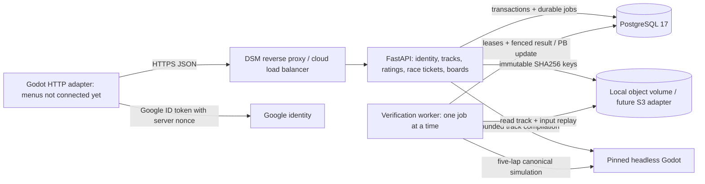

# Backend v1: architecture, contract and acceptance

**2026-09-29 client integration:** [CLOUD_TRACKS.md](CLOUD_TRACKS.md) connects Play,
verified racing, ratings, high scores, publication and a persistent track cache/outbox.
It supersedes the historical unconnected-adapter statements below.

**Sign-in follow-up:** [ACCOUNT_SIGN_IN.md](ACCOUNT_SIGN_IN.md) supersedes this
initial checkpoint's statements that menus/authentication are unconnected.
Google browser sign-in and the fixed `developer` menu option now exist. Other
online game-menu integration and the original NAS/real-Google acceptance remain.

Owner request: **2026-09-28**. Implement the first backend for authentication, shared
tracks, ratings and leaderboards, initially on a Synology DS925+ and later in the
cloud. The owner subsequently selected Google sign-in and requested a development
authentication bypass. The supplied 28-category inventory is recorded below without
silently adding its later economy/social/multiplayer scope to this slice.

The implemented server is a **modular monolith with a separate verification worker**:
FastAPI/Python, PostgreSQL 17, immutable object files and the game's exact canonical
Godot simulation. This gives one transactional data model and one deployable codebase
while allowing API and CPU-heavy workers to scale independently. It avoids a broker,
Redis, Kubernetes or a separate identity service as mandatory first-deployment
dependencies. Runtime clients never make AI/media-generation calls.

The user-facing game remains local and offline in this slice. An optional, unconnected
GDScript HTTP adapter provides an integration boundary. No login/share/rating menu,
Android Google sign-in adapter, persistent replay outbox, deep-link Android intent or
cloud-save flow has been added. The server API, adapter and deployment package are
the reviewable deliverables; existing player files and local tracks are preserved.

## Requirements inventory and decisions

IDs B01–B28 map directly to the attachment's numbered categories. “Later” means
recorded architectural direction, not implemented or implicitly authorized commerce.

| ID | Attachment domain | First slice and next boundary |
|---|---|---|
| B01 | Player identity/account state | Internal player UUID, Google token exchange, nonce challenge, profile name, access/refresh sessions, logout/all-device logout. Explicit isolated development bypass. Guest upgrades, Apple, account linking, avatar uploads, cloud save/reinstall state, self-service deletion and friends are later. |
| B02 | User-created tracks | Ownership, immutable versioned JSON, server validation, private draft/test states, creator proof, publish, public retrieval/share URL, owner unlisting. Cloud draft synchronization, thumbnails, slot entitlements and commerce are later. |
| B03 | Track discovery | Latest published version, chronological bounded listing, name and creator search. Random/personalized/trending/friend/history/favorite/event discovery are later. |
| B04 | Ratings | One changeable 1–5 rating per player per immutable version, aggregate sum/count, no self-rating, verified completion required. Reputation/Sybil detection and rating trends are later. |
| B05 | Records/leaderboards | One verified PB/player/pinned board, global rankings, deterministic tie ordering, around-me, percentile and histogram; per-vehicle boards. Friends boards, richer history and event scopes are later. |
| B06 | Ghosts/replays | Bounded quantized input replays in content-addressed storage; authenticated owner-only PB evidence retrieval. Public/friend ghosts need a non-input positional projection before release; compatibility workers and lifecycle/GC policies are later. |
| B07 | Anti-cheat/validity | Server-issued ticket, exact immutable course/config/rules/engine manifest, full canonical replay of every submitted competitive attempt, legal checkpoint/lap completion, bounded leased retries, no client time authority. Device attestation and automation detection are later. |
| B08 | Cars/upgrades/progression | Current five local vehicles have pinned server handling/config hashes. No new inventories, unlocks, mastery, abilities or progression writes. Add a separate transactional progression domain later. |
| B09 | Currency/economy | Deferred. Future balances derive from an idempotent append-only transaction ledger; never accept client grant/balance claims. |
| B10 | Creator economy | Deferred. Future unique/completed/returning-player aggregates and anti-farming reward grants require explicit rules and idempotency. |
| B11 | Achievements | Deferred. Reward-bearing/public achievements become trusted progression events; local-only display can remain client-side. |
| B12 | Social competition | Shareable exact track-version URL now. Friends, blocks, challenges, follows, rivalries, activity and social attribution are later. |
| B13 | Notifications | Deferred. Future domain outbox delivers push events without coupling request success to an external push provider. |
| B14 | Monetization | Deferred. Receipt validation, purchase/refund history, allowed entitlements, ads and grants require separate owner-approved rules. No power, credit/XP/competitive-boost sales or paid racing/sharing. |
| B15 | Remote config/LiveOps | Server exposes a pinned compatibility/competition manifest. Editable config, experiments, prices/events and remote content toggles are later and may not mutate an existing competitive rules key. |
| B16 | Analytics | Operational API logs and persisted verification data only. No analytics vendor, gameplay event warehouse or broad client telemetry is introduced. |
| B17 | Creator analytics | Current rating counts/averages and stored race records are a base. Creator dashboards, trends, favorites/shares and reward analytics are later. |
| B18 | Moderation/abuse | Authentication/ownership, body/input bounds, rate limits, disabled-account exclusion and owner unlisting. Reporting, moderator hide/removal, ban tooling, review queues and audit UI still need implementation before a broad UGC launch. |
| B19 | Lifecycle/quality | Draft → tested by verified five-lap creator proof → published. Connected automatic road route, start line, format/object/resource validation. Owner hide unlists; published data is immutable. Entitlement/slot checks are deferred. |
| B20 | Content/version compatibility | Track schema, content/compiler, engine, rules, physics, input, tick rate, laps, vehicle handling/config identity are pinned. Incompatible old content returns an explicit incompatibility; it is never silently rescored under new rules. |
| B21 | Developer/admin tools | API/OpenAPI, request IDs, logs, direct operational database inspection and backup tools. A moderator/support UI, record invalidation workflow and sensitive admin audit trail are later. |
| B22 | Business metrics/reporting | Deferred. Measure operational workload/storage before capacity/cost forecasts; DAU/revenue/retention dashboards need consent, definitions and retention decisions. |
| B23 | Observability | Health/readiness, request logging/correlation, worker failure states, bounded logs, documented queue/DB/disk/backup checks. Metrics exporter, alerts/traces and hosted error tracking are later. |
| B24 | Crash/client diagnostics | Deferred. Android ANR/crash/device collection is separate from the server implementation and requires an explicit privacy/retention design. |
| B25 | Multiplayer | Deferred and architecturally separate. Future 2–10-player sessions need lobbies/matchmaking/region/network/authoritative-session infrastructure; this worker is asynchronous verification only. |
| B26 | Leagues/events/seasons | Deferred. Add event identity and eligibility around pinned boards; points reward best performance, never raw attempts. |
| B27 | Content delivery | Track JSON and PB replay delivery through API now; object-store interface preserves SHA256 keys for S3/CDN later. Packaged art/music remain local; no remote soundtrack dependency. |
| B28 | Security/infrastructure | Auth/authz, hashed rotating sessions, bounded requests/rates, idempotent writes, isolated containers/DB, immutable object checks, migrations, tested backup mechanisms and cloud migration plan. NAS/public-cloud launch, external monitoring, retention/deletion policy and recovery objectives require acceptance. |

The attachment proposes selective anti-cheat rather than replaying every attempt.
This slice deliberately verifies **every submitted competitive attempt** because the
approved invariant requires verified PBs and the repository already has a canonical
simulation. Ordinary local racing remains free and unlimited. Verification queue
backpressure does not prevent offline racing. As scale grows, reduce uploads of
noncompetitive attempts or optimize workers before weakening verified-board trust.

The attachment also mentions purchasable upgrades/currency and paid slots/packs.
Those are possibilities, not adopted requirements: project invariants prohibit sales
of power, credits, XP or competitive boosts; legitimate racing/rewards have no energy
or retry gates; shared tracks are free to race and local drafts/export are free.
No conflicting commerce has been implemented. Future allowed cosmetic/entitlement
proposals require their own accepted design.

The creator editor's untimed Practice remains unchanged. Backend publication proof
uses a separate normal five-lap recorded race contract. This does not replace the
editor's accepted untimed practice flow.

## Data and trust boundaries

Google identity is `(provider, subject)` mapped to the game's UUID. A verified Google
email or supplied display name is not an account-link key. Server challenges are
short-lived and single-use. Access/refresh credentials are opaque random tokens;
only their hashes are stored. Refresh rotation and session-family revocation bound
stolen-token reuse. The development provider has its own namespace, requires a
separate secret in a development environment and is rejected when enabled in
production. No client-visible shared production login key is introduced.

Every published course version keeps its name, document hash and manifest. An edit
creates a new immutable version and its own leaderboard/rating population. Discovery
shows the latest published version of each logical track. Older share URLs remain
valid. Owner “hide” means unlisting; it is not privacy deletion or moderator takedown,
and existing URLs/records remain available. Account disabling suppresses public
content/records through current queries; an admin workflow is still needed.

A board key includes track version/content identity, canonical compiler/rules/physics,
engine version, vehicle identity/handling/config hash, replay schema, tick rate and
five-lap count. A server-issued two-hour race ticket pins that key before a replay is
submitted. Replay frames contain only integer steering/throttle/brake; no positions,
clock values, checkpoint claims, lap times or arbitrary scripts are trusted.

Workers claim queued rows with PostgreSQL row locks and `SKIP LOCKED`, release the DB
transaction while simulating, and finalize only with a current lease token. Repeated
delivery cannot produce duplicate PBs. Infrastructure failures retry with bounded
attempts; invalid/incomplete races are rejected. The PB upsert only accepts a strictly
faster result, so a tied/slower attempt cannot replace its retained ghost. This proves
the submitted inputs produce a legal course result; it does not prove a human drove
them or prevent replay copying, account farming, bots or tool-assisted driving.

Object JSON is canonicalized, hashed, published through an atomic hard link and integrity
checked on reads. PostgreSQL contains identities, ownership, manifests, lifecycle,
ratings, tickets, run queue/results and PB indexes. Large replay/course payloads live
outside the relational database. A failed transaction can leave an unreferenced
immutable object; garbage collection is deferred until a retention policy exists.
There is no cross-device/save migration of current local progress.

All domain writes use `Idempotency-Key` (8–128 printable nonspace ASCII characters).
The server binds a key to player, operation and request hash, replays the original
response and rejects conflicting reuse. Future economy/purchase writes must extend
this transactional pattern with ledger/outbox semantics, not reuse a mutable balance.

## API map

The generated `/openapi.json` is the exact schema. All paths below except operations
are under `/v1`. Bearer access tokens authorize account/private/write operations.
Public discovery and published documents/boards are readable without login; draft
documents, run status and raw PB replays are owner-only. Public raw input downloads
would allow easy copying of somebody else's result, so they are not exposed.

| Method/path | Purpose |
|---|---|
| `GET /healthz`, `GET /readyz` | Process liveness; database schema and writable object-store readiness. |
| `GET /v1/bootstrap`, `GET /v1/manifest` | API capability/auth status; canonical competition configuration. |
| `POST /auth/google/challenge`, `POST /auth/google` | Obtain challenge/nonce, exchange a Google ID token with matching nonce. |
| `POST /auth/development` | Explicit development-only login with `X-Dev-Auth-Key`; hidden from public OpenAPI. |
| `POST /auth/refresh`, `/auth/logout`, `/auth/logout-all` | Rotate credentials, revoke current/all sessions. |
| `GET /me`, `PATCH /me` | Internal identity/profile and bounded display-name edit. |
| `POST /tracks`, `POST /tracks/{id}/versions` | Validate and upload an immutable draft or next version. |
| `GET /me/tracks`, `GET /me/track-versions/{id}/document` | Owner content and private draft document. |
| `POST /run-tickets`, `POST /runs`, `GET /runs/{id}` | Pin race contract, submit bounded input replay, poll verification. |
| `POST /track-versions/{id}/publish` | Publish only after creator's verified completion proof. |
| `GET /tracks` | Newest published versions with `q`, `creator`, bounded `offset`/`limit`. |
| `GET /track-versions/{id}`, `/track-versions/{id}/document` | Exact public share metadata/course payload. |
| `POST /tracks/{id}/hide` | Owner unlisting with immutable records retained. |
| `PUT /track-versions/{id}/rating` | Upsert a qualified nonowner's 1–5-star vote. |
| `GET /boards/{id}` | Global ranking over one verified PB/player for the pinned key. |
| `GET /boards/{id}/around-me`, `/boards/{id}/histogram` | Adjacent performance/percentile; bounded distribution bins. |
| `GET /boards/{id}/ghosts/{player_id}` | Authenticated owner retrieves their own PB's raw replay. |

Ties share competition rank; position sorts ties by player ID for stable pagination.
The percentile means the fraction of other players with strictly slower PBs; a
single-player population has no comparative percentile. Times are canonical 120 Hz
ticks. Share URLs currently return JSON metadata, not an Android-installed-app deep
link or polished web landing page.

## Maintainability, capacity and deployment

Domain modules separate identity, tracks/ratings, race submission/boards, verification,
storage and operations. Typed request models and a versioned HTTP API protect the
boundary; Alembic versions the DB. The service does not mutate the canonical physics
step. A curated verifier project copies unchanged canonical scripts/resources and
excludes menu/music/art imports. The exact game build remains authoritative.

The DS925+ deployment uses one API, one sequential worker and an internal PostgreSQL
service with persistent volumes. Its Ryzen/4 GB baseline informs conservative memory
limits, not a player-count guarantee. See [Synology's hardware specification](https://www.synology.com/en-global/products/DS925%2B)
and the [deployment, backup and cloud runbook](../backend/deploy/README.md).
Containers share one code artifact; API replicas and workers can increase separately.
The initial filesystem adapter requires a shared durable volume; a tested S3 adapter
is necessary before spreading replicas across independent hosts.

No measurements support “100k” or “1M+” capacity today. Registered player count is a
poor sizing metric: determine simultaneous API requests, new verified attempts/sec,
replay length, peak compile workload, board cardinality, retention and storage egress.
Measure p95 API latency/DB plans, oldest verification queue age and per-job CPU/RAM.
The current exact rank/histogram queries scan a board population and substring search
needs later indexing/search changes when measurements justify them. Add caching,
preaggregates, keyset pagination, connection pooling and partitioned histories at the
appropriate measured limit. S3/CDN and managed PostgreSQL provide the first cloud
growth steps without changing identity/track keys or API contracts.

## Changed files and actual verification

- `backend/bmt_backend/`: configuration, authentication, database/migrations, API,
  request boundaries, tracks/ratings, races/boards, immutable storage and worker.
- `game/backend/`: headless canonical runner, regression-fixture generation and an
  optional HTTP client adapter separate from gameplay/autoloads.
- `backend/tests/`: identity/domain/PostgreSQL/canonical-verifier fixtures and checks.
- `backend/pyproject.toml`, `backend/requirements.lock`: isolated Python package and
  exact dependency versions; no Android runtime dependencies were added.
- `backend/Dockerfile*`, `backend/deploy/`, `backend/README.md`: deployment, minimal
  verifier staging, backup/restore and operating instructions.
- `scripts/dev.ps1`: pinned-engine backend migrate/test/API/worker entrypoints.
- `game/export_presets.cfg`: excludes server/test entry scripts from Android exports;
  Android internet permission remains disabled until the client integration slice.
- `AGENTS.md`: records the owner's backend and development-auth authorization.
- `docs/BACKEND_V1.md`, `DEVELOPMENT_STATUS.md`, `docs/PHASE_0_PLAN.md`: scope/evidence.

Actual checks on this Windows workspace and its Ubuntu WSL Docker host:

| Command | Observed outcome |
|---|---|
| `scripts/dev.ps1 -Action BackendTest` with `PYTEST_ADDOPTS=-k "not postgres"` | 97 passed, 30 deselected, 29.63 s before the final route-preservation regression. Includes signed Google-token validation, dev bypass isolation, nonce/session controls, immutable storage, domain semantics, real canonical replays and the Godot HTTP adapter. [Captured output](evidence/backend-v1/backend-tests.txt). |
| `.tools/backend-venv/Scripts/python -m pytest backend/tests/test_domains.py -q -k postgres --maxfail=1` | 21 PostgreSQL cases passed in 258 s; five PostgreSQL-only cases intentionally skip their SQLite counterparts. Concurrent workers, PB races, vote aggregates, duplicate writes, queue admission and coherent histogram snapshots pass. |
| `.tools/backend-venv/Scripts/python -m pytest backend/tests/test_auth_postgres.py -q` | Three PostgreSQL cases passed in 41.23 s: concurrent refresh reuse, simultaneous identity creation and repeat migration. |
| `.tools/backend-venv/Scripts/python -m pytest backend/tests/test_end_to_end.py -q -k postgres` | Real PostgreSQL + Windows canonical two-player publish/share/race/rate/board flow passed in 22.68 s. |
| `.tools/backend-venv/Scripts/python -m pytest backend/tests/test_verifier.py backend/tests/test_end_to_end.py -q -k 'not postgres'` | After the route-preservation fix: **32 passed** in 26.91 s, including the new frozen-route regression and real two-player workflow. |
| `scripts/dev.ps1 -Action TestDriving` and `-Action Import` | 74 driving checks and project import passed. Driving exit retains the existing six-ObjectDB-instance warning; import reports a build-tools fallback. No export/device acceptance is implied. [Driving output](evidence/backend-v1/driving-tests.txt). |
| `python backend/deploy/stage_verifier.py --destination build/backend-verifier/game` | 43 canonical inputs staged without presentation/native music dependencies; exact Windows engine import and minimal-project verification passed. |
| `wsl -d Ubuntu -- docker build --build-arg GODOT_SHA256=8d106cbe6144c2dc7e881d61d2429c1a8a76e6b22ef48bd5e48dcf934953f71e -f backend/Dockerfile -t bmt-backend:local .` | Full Linux production image built. The build checks engine SHA256/version, import, complete Windows manifest (including all five vehicle config hashes), **12,757 ticks / 106,308 ms**, and lap ticks **2634, 2532, 2531, 2530, 2530**. |
| `wsl -d Ubuntu -- python3 backend/deploy/smoke_compose.py --full-image` | Corrected full production image passed actual HTTP/API/Linux worker/PostgreSQL publication, second-player race, voting, histogram, invalid-run rejection and backup/restore. Restored two players, two PBs and one rating; refused occupied/source restore targets and corrupted checksums. [Result](evidence/backend-v1/linux-compose-result.json). Temporary Compose projects were removed afterward. |
| `.tools/backend-venv/Scripts/python -m unittest discover -s backend/deploy -p test_operations.py` | Four archive-safety checks passed: ordinary backup/restore, unsafe archive entries, duplicate entries and interrupted hard-link publication. |
| `.tools/backend-venv/Scripts/python -m ruff check --config backend/pyproject.toml backend/bmt_backend backend/tests backend/deploy` and `python -m pip check` in the backend venv | Lint clean; no broken dependency requirements. |

The Linux engine came from the [official 4.7.2 release](https://github.com/godotengine/godot-builds/releases/tag/4.7.2-stable).
Its ZIP matched the release API's SHA256 and the official `SHA512-SUMS.txt`; the
extracted executable SHA256 is the value used by the build command above. Binaries
and temporary deployment credentials are ignored by Git.
Pytest emits a Starlette/httpx test-client deprecation warning; the exercised tests pass.

The strict manifest check initially caught regeneration changing route point 77's
x-coordinate from `-45.4995727539063` on Windows to `-45.4995727539062` on Linux.
The verifier now validates the connected automatic route, then compiles the frozen
submitted document exactly as the game does. It does not substitute regenerated
points. No canonical game class changed, and the hash/parity gate remains strict.
This verifies this representative course/replay and all current vehicle configuration
hashes; it does not establish every track/vehicle trajectory across every platform.

Remaining acceptance includes NAS deployment/resource/thermal tests,
real Google client credentials and sign-in, Android adapter/UI/outbox/deep-link work,
actual TLS/public abuse testing, privacy/deletion/retention policy, moderator/admin
workflow, external monitoring, a measured NAS restore drill and load/capacity tests.
No phone/Android testing is performed for this backend-only slice. There are no
visible UI changes requiring screenshots; the architecture diagram is documentary.
