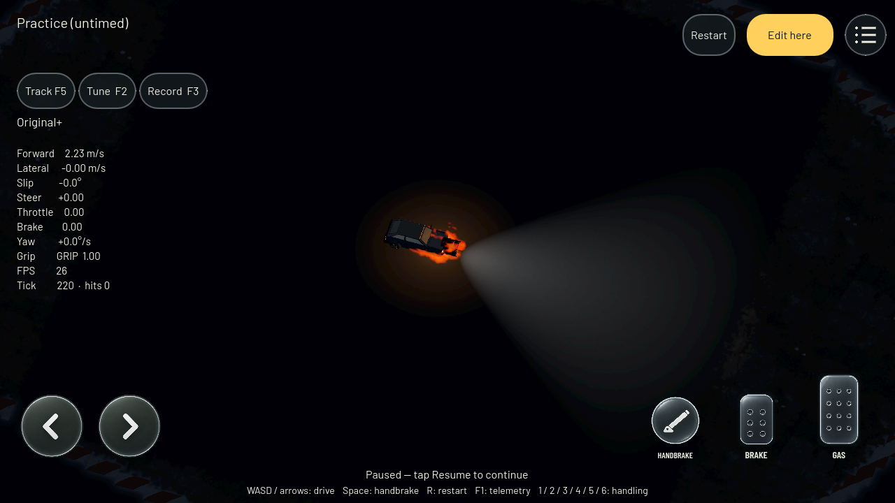

# Stronger burning-barrel contact - 2026-10-16

Burning barrels now take substantially more speed from the car and resist sustained pushing. The previous impulse cap limited a normal Compact's 12 m/s hit to a 0.533 m/s speed loss, and the car's position could continue through the drum. Full inelastic normal momentum transfer now removes 3.310 m/s in the same test, 6.2 times as much. Effective barrel mass increases from140 to400 kg, its movement cap drops from6 to2 m/s at normal scale, and ground deceleration increases to18 m/s² upright/12 on its side.

Contact keeps the car outside the drum. Swept hits retain the approached side so the car cannot emerge beyond its centre. Separation checks the existing world-contact sampler and can fall back to the clear previous car position. Only the contact-normal velocity changes; tangential travel remains available for steering around the obstacle. Sustained throttle holds the five tested cars to2.02-2.49 m/s instead of the unobstructed30-49 m/s in the same three-second fixtures.

BR01 covers meaningful impact speed loss. BR02 covers sustained pushing, separation and swept/world-wall behavior. BR03 covers retained toppling/fire, replay, rewind and reset. All five normal-size barrels still topple; the2.5x barrel test now uses a stronger46 m/s hit. The existing eight-second ground fire and ten-second smoke tail, one shared drum/noise field and all emitter/light bounds remain. Other movable props and all snapshot/input row shapes are unchanged. Physics `arcade-planar-0.64` fences the changed response, retaining the independent bridge-flight and rules22 work. The fixture manifest preserves its actual document, inputs and timing; matching client/verifier rollout remains separate.

Actual Godot4.7.2 checks:

- Dedicated resistance suite78 headless passes: all five cars at12/24 m/s starting speeds with throttle held, actual first-hit speed loss, over45% loss after0.1s of continued contact, bounded pushing speed, no pass-through, tangential preservation, fast sweeps, guarded world separation, elevated/airborne exclusion and exact JSON replay/rewind branches.
- Existing barrel suite54 headless/71 Compatibility/71 Mobile passes, including all-five-car toppling, three scales, exact original behavior for the other nine soft props, prepared-world ownership, actual race pause/restart and retained editor limits. Native game captures show the car held behind the drum.
- Fire-spill40 Compatibility, object-browser88 and whole-project parser839 pass. The browser's100-tick sample now checks that tipping has started, rather than requiring its later fully fallen pose.
- Frozen canonical verifier import and68 selected backend checks pass. The two historical-runner/HTTP count fixtures identified by the previous task are explicitly deselected; this does not claim a complete70-check backend pass. The standalone staged-source hashes and exact command are recorded.

Initial failures remain in the logs. A60 m paint width invalidated the first dedicated fixture; using the allowed40 m stroke and checking compilation corrected it. The first powered-pickup assertion demanded15% net first-step loss; engine acceleration makes the measured result14.87%, so the declared cross-car bound is14%, while the much stronger continued-contact bound remains. The large-barrel and browser tests were updated for their actual heavy-body impact/time conditions. No runtime behavior was weakened to pass those fixtures.

Commands, measured comparisons, native captures, source hashes, frozen verifier and task-only checkpoint are in [report.json](evidence/barrel-resistance-2026-10-16/report.json). The native practice telemetry is scripted and is not a performance measurement. Owner driving feel and physical-phone acceptance remain. No phone check/test, APK, live backend mutation or deployment was performed.
