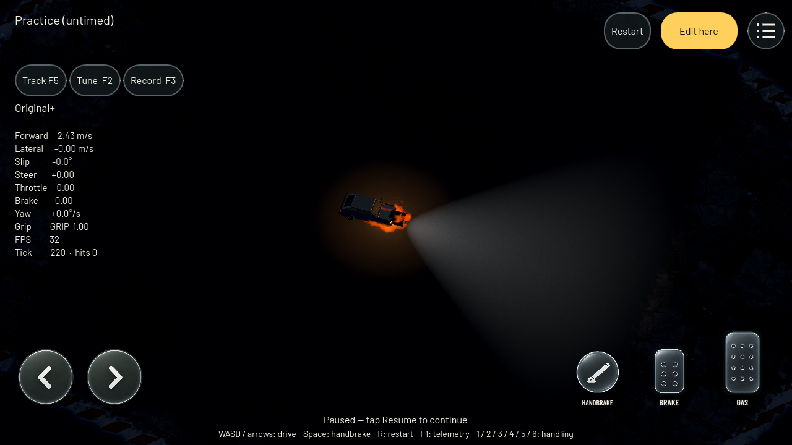

# Burning-barrel slowdown tuning — 2026-10-17

B30-01: Reduce the car's collision-normal slowdown by 30% from the retained 400 kg barrel response. `BurningBarrel.CAR_SLOWDOWN = 0.7` scales only the car's velocity reaction. The same Compact hit at exactly 12 m/s now loses 2.317242 m/s instead of 3.310345 m/s. Pickup, Classic, Formula and Kart also retain 70% of their previous loss, within floating-point precision. This is an arcade response adjustment independent of barrel inertia; changing mass alone would give different percentage reductions for different cars.

B30-02: Preserve solid contact, approached-side sweep separation, tangential travel, toppling, drag and the finite fire spill. At identical incoming states the complete barrel row and corrected car position match the preserved implementation exactly. Continued powered contact still resists pushing: the three-second fixtures settle at 2.16–2.78 m/s. The 30% reduction applies to each contact's velocity reaction; it is not a promise of 30% less total journey-time loss when pushing against an obstacle. Other soft props, row shapes, input schemas, effect resources and light/emitter limits remain unchanged.

Physics `arcade-planar-0.65` identifies this canonical change, retaining the existing bridge-flight and rules22 behavior. The local standalone verifier and fixture manifest use the same version. Fixture document, recorded inputs and timing are preserved; matching client/verifier rollout remains separate.

Actual Godot 4.7.2 validation:

- Resistance suite: 169 headless checks pass, including 45 before/after impacts covering all five cars, three scales and three speeds, plus full driving replay/rewind, swept contact, guarded wall separation and continued pushing. Earlier “over five times” and 14% first-hit expectations describe the superseded heavier response; the retained resistance floors are now four times the old light-barrel response and 9.5% net first-step loss. The explicit 30% comparison is the primary tuning requirement.
- Existing barrel suite: 54 headless, 71 Compatibility and 71 Mobile checks pass. These cover all-five-car toppling, three sizes, exact behavior of the other nine soft props, bounded effects, pause and restart.
- Spill suite: 27 headless checks pass, including spread, finite burnout, no fuel replenishment and exact rewind.
- Whole-project parser: 839 scripts, zero failures.
- Frozen standalone verifier: 68 selected backend checks pass, including full-race replay and staged source checks. Two previously documented independent fixtures are deselected: historical physics0.50/`BRIDGE_FLIGHT` compatibility and the HTTP adapter's13-versus14 check count. This is not a complete70-test pass.

Changed runtime files are `game/vehicle/burning_barrel.gd` and the physics pin in `game/vehicle/vehicle_simulation.gd`. Supporting changes are the preserved pre-tuning fixture, resistance comparisons, current evidence destinations, backend physics expectation/manifest and task documentation. Actual commands, source hashes, verifier outcome and the isolated task-only Git checkpoint are in [report.json](evidence/barrel-slowdown-2026-10-17/report.json). Native capture telemetry is synthetic and does not establish performance.

Owner driving feel and physical-phone acceptance remain. No phone attachment check/test, APK, live backend mutation or deployment was performed.
