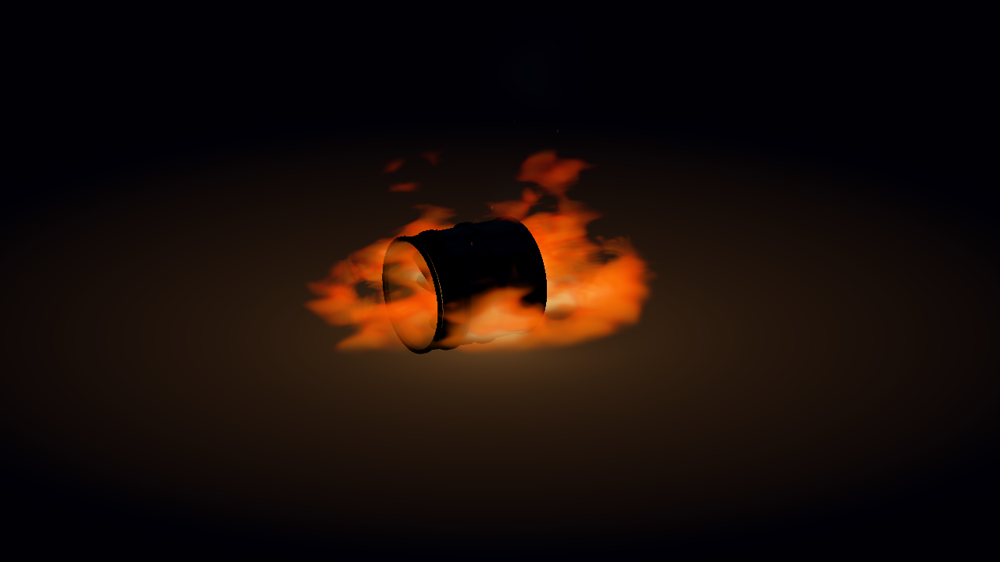
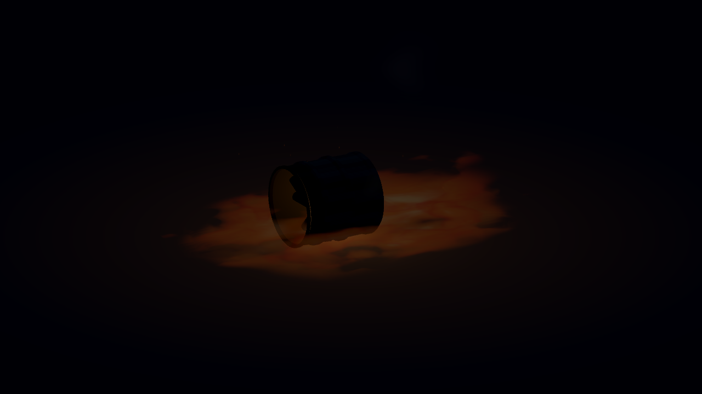

# Heavier barrel and fading fire spill - 2026-10-16

The burning barrel now has four times its previous mass: 140 kg at normal scale. Stronger ground drag, a lower travel-speed cap, more angular damping and less bounce make it land with weight. In the preserved same-impact comparison, a 12 m/s car hit moves it 0.925 m instead of 4.182 m, a 78% reduction. The car transfers roughly three times as much momentum to it. All five cars can still topple the normal barrel; a large decorative barrel needs a stronger hit.

An impact at 1.6 m/s relative closing speed or above spills the fuel. Fire spreads across the ground over 1.25 seconds, forms lower irregular tongues, fades out over eight seconds and leaves smoke that clears by ten seconds. The ground spill remains at the impact location as the drum moves away. Flame height, transparency, sparks and warm light diminish together. A second hit cannot replenish spent fuel. Gentle nudges retain the original barrel fire; airborne/bridge cars cannot spill a ground barrel.

BS01 covers the weight and measured travel change. BS02 covers impact-triggered spread and finite burn. BS03 covers replay, rewind, pause, restart and bounded native presentation. The spill origin, direction, strength and finite age occupy five additional entries in the burning barrel's existing movable-prop row, now 15 values. Other soft-prop rows, the 24-field vehicle snapshot and recorded inputs retain their shapes. Physics `arcade-planar-0.62` fences the changed simulation. The local fixture manifest preserves its document, inputs and timing. Matching client/verifier rollout remains a separate action.

One existing fire volume per barrel changes shape and energy; its seven ember and three smoke slots spread over the same patch. No additional emitters, textures, lights or physics bodies are allocated. The shared 128 KiB noise field, 32-step/two-sample integration and world caps of 32 fires/four added lights remain. Per-source energy uses existing MultiMesh custom data. Fully spent flames discard before volume sampling. Warm-light extinction happens on the source update, preserving the covered preparation pass's visibility controls. Pose/age keys stop instance writes once the body and fuel are settled. Prop version `authored-props-11-barrel-spill` fences old prepared scenes. Burning-car fires and other Night objects retain their existing behavior.

Actual Godot 4.7.2 validation:

- New spill suite: 27 headless and 40 per native renderer pass, covering the preserved weight comparison, trigger/nudge/elevated separation, spreading ground anchor, gradual/terminal fade, repeat hits, exact replay/rewind and zero-energy native fire/embers/smoke/light. Both renderers have the eight burn phases and restarted flame captured. Paused native pixels remain exact.
- Updated barrel suite: 54 headless and 71 Compatibility checks pass, covering all five cars, three scales, exact input replay/rewind, actual race restart/pause, cached source ownership and the dense retained editor. Original behavior for all nine other soft prop kinds remains snapshot-exact over 180 steps each.
- Existing Night suite: 103 headless; prepared race resources: 162; full parser: 830; local canonical verifier: 70 pass.

The first updated regression retained an exact comparison against a separately computed ground height. Its minute floating-point height difference was unrelated to cache sharing; the corrected check compares the original source dictionary before and after restoring/updating the other world. The failed log is retained. The first ground-fire presentation was too flat; the final shader adds smaller independent tongues and a taller initial spill flame. The final captures replace that trial in the same renderer output paths.

Actual commands, source/capture hashes, logs and the task-only checkpoint are in [report.json](evidence/barrel-spill-2026-10-16/report.json). Concurrent bridge/rule changes subsequently advanced the shared working tree to physics0.63/rules22. They are preserved; the barrel checkpoint freezes the actual tested0.61-to0.62 transition whose verifier run passed70 checks. A later combined-tree attempt has68 passes/two failures: the historical runner reports an engine error, and the HTTP client reports13 passing checks while its assertion expects14. Its full JUnit failures are retained separately; this is not an all-green combined-tree claim. Concurrent terrain, spline-rule and other work is preserved. Owner impact/appearance tuning and physical-phone performance acceptance remain; native practice telemetry is synthetic, not a performance measurement. No phone test/attachment check, APK, live backend mutation or deployment was performed.
