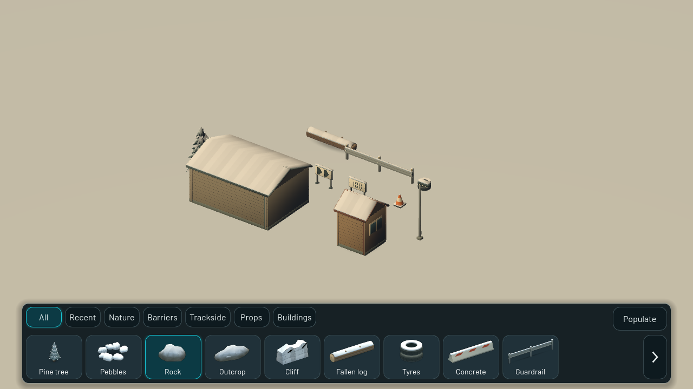
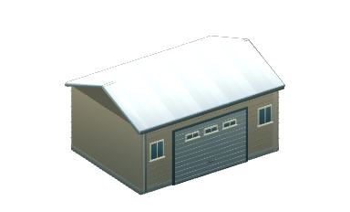

# Curated Desert and Winter object kits — 2026-10-18

BOK01 narrows Desert to twelve object families: pebbles, rock/boulder, outcrop, cliff, chevron, brake board, flag, start gantry, pyramid, obelisk, intact/broken lotus column and temple wall. Hay, oil, containers, vehicles/wrecks, crates, barrels, pallets, modern buildings, fences and other general equipment are absent from its new-placement palette. Populate now uses Egyptian stonework and natural rocks rather than wrecks, barrels or crates.

BOK02 gives Winter a curated twenty-three-family collection with its own appearance:

| Group | Available Winter objects |
|---|---|
| Nature | Pine, pebbles, rock/boulder, outcrop, cliff, fallen log |
| Barriers | Tyre stacks/walls, concrete barrier, guardrail, wooden fence, cone |
| Trackside | Chevron, brake board, flag, light pole, start gantry |
| Buildings | Snow-roofed garage and marshal hut, igloo, snow castle |
| Props | Snowman, snow lantern, ice lantern |

Existing Winter nature/fence and snow/ice craft retain their authored snow. Thirteen additional model kinds receive fitted geometric snow caps and restrained frost, and the movable tyre mesh receives a snow-covered upper annulus with its open centre preserved. Roof blankets follow the real pitch and overhang, with small opaque blue eave icicles; logs retain exposed bark and cut ends. Sign faces and reflective markings remain readable. All additions join the existing opaque mesh draws. There are no new texture samplers, shaders, emitters or lights. The thirteen normal-size additions total2,920 triangles across the whole review set, with bounded sections for long runs; this is a geometry count, not a performance claim.

BOK03 applies the same collection to category/search/Recent filtering, direct browser selection, stale Desert/Winter stamps and line/curve/road-edge runs, and Populate. Empty Desert categories disappear; reopening a retained unavailable selection chooses an available family. Existing saved placements remain valid, compiled and editable; no objects or stored tracks are deleted or rewritten. Grass, Night and Storm retain their catalogs, population choices and direct-stamp behavior. Before/after comparison preserves every original mesh channel for the thirteen reviewed models in those biomes and Desert.

The shared shipping builder supplies race placement, retained editor groups and native browser previews. `authored-props-12-biome-winter` fences the existing prepared-world and thumbnail caches. Current32MiB prop/24MiB thumbnail/64MiB world budgets remain. Winter tyre motion uses the same canonical row and submitted transforms. Vehicle physics, collision dimensions, road/terrain geometry, input/snapshot schemas, scoring/rules and stored records are unchanged. Concurrent road upload/preparation edits in the shared visual builder are preserved and excluded from the task-only patch.

Actual validation passes: focused983 headless/993 Compatibility/993 desktop Mobile; population20,576; browser88; breakables46; Winter craft595; prepared-world85; biome navigation108; whole-project parser887. Commands, model counts, source/capture hashes, initial failures and the isolated Git checkpoint are recorded in [report.json](evidence/biome-object-kits-2026-10-18/report.json). The focused checks cover the exact palettes and grouped variants, all filtering paths, twelve Populate seeds per curated biome, legacy saved props, rejected stale placement, native movable tyres, cache bounds, and real Winter placement/preview captures.

Initial attempts are retained. The preserved dynamic GDScript catalog fixture needed a typed empty array. Pebble caps initially repeated internal skirts and exceeded the chosen geometry bound; retaining only exposed rims reduced their addition from2,758 to634 triangles. The headless dummy renderer returns identity for MultiMesh getters, so that environment checks the actual CPU pose state while both native renderers also check the submitted transform. Native inspection found guardrail post caps at the wire-fence height; these now sit on the real1.25m posts, including continuous runs. The older biome-navigation fixture now awaits covered startup and honours the existing discard dialog/menu transition; its assertions remain intact. The earlier broad prop-optimization goal of adding no geometry is superseded specifically for these new Winter caps; other-biome geometry remains exact.

Owner art-direction and physical-device appearance/performance acceptance remain. Existing legacy objects outside the new palettes are retained rather than migrated. No phone attachment check/test, APK/export/install, backend mutation or deployment was performed.
