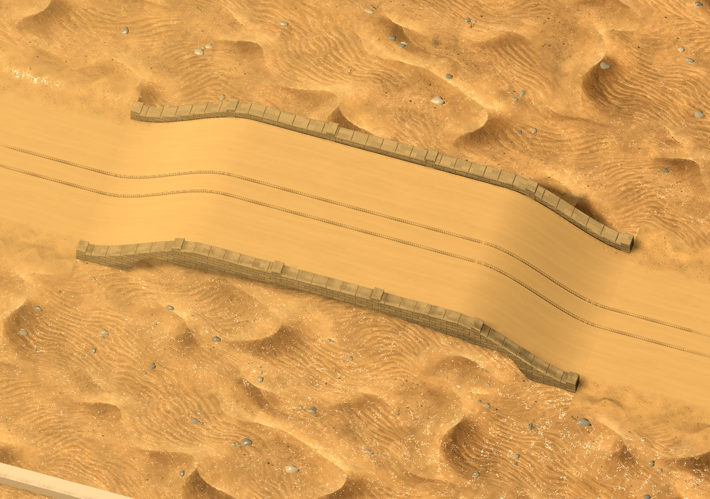

# Bridge tire marks — 2026-10-17

BTM01 restores deposited tire marks on Desert bridge decks and both ramps. BTM02 checks the same rendering path in Grass (`pine`), Winter, Storm and Night (`night_city`), including reverse sampling and independent ground/deck layers. G01/R01 retain canonical driving and track data; Q01 retains the existing single four-vertex/two-triangle MultiMesh draw and 16,384-slot ring.

Desert's 18 cm cosmetic road/deck recess correctly lowered the deposited contacts, but the projected bridge occlusion mask still described the original bridge height. Consequently, the mask classified legitimate deck marks as ground marks. The native Compatibility baseline measures zero surviving Desert mark pixels in all three inspection regions, versus 1,283 entry, 3,810 deck and 1,669 exit pixels with the mask disabled. The other four biomes preserve every sampled mark pixel in that baseline.

`SkidTrails` now binds the actual bridge presentation's vertical offset and transforms contacts into the mask's original reference frame. This includes the existing asphalt lift and the Desert recess, with no recess for an empty relief field. Geometry, mark height, pigments, pressure, sampling, surface selection, dust and shared dust-mask code remain unchanged. The binding is cached by track and presentation; changing either refreshes it. There is no new texture, mesh, draw call, rendering world, simulation version or cache schema.

The focused fixture builds an ordinary closed creator circuit and calls the actual four-wheel `sample` path in both directions. Each direction deposits exactly 400 segments. Every endpoint follows visual support within 0.000002 m. Graphical checks compare normal clipping against disabled clipping in both ramps and the flat deck, requiring at least 95% of control mark pixels. A second test deliberately disables hardware depth and deposits ground-layer marks; the mask must prevent every ground-mark pixel from covering the visible deck. Canonical track arrays and per-sample vehicle snapshots remain exact.

The fixture freezes child presentation clocks, hides moving weather overlays and suppresses focus-triggered pause menus before each capture. Night's native materials receive a diagnostic directional inspection light, because unlit asphalt and dark rubber cannot provide a reliable visibility control in Mobile. This is a test-scene light only; native game lighting is unchanged. Earlier dark Night/headlight captures are retained and do not establish a lighting defect. The fixture does not measure phone performance or complete a real race.

Final focused results are 30 headless, 70 Compatibility and 70 Mobile/Vulkan checks, all passing. All 30 biome/region combinations retain 100% of the control mark pixels. All ten biome/renderer underpass cases have zero leaked pixels despite deliberately disabled hardware depth. Existing bridge trails (8 Compatibility and 8 Mobile), tire seams (6), joined ribbons (14), Desert recess (48) and whole-project parsing (841 scripts) pass. The existing guard test samples 43,502 deck pixels: deliberately unprotected controls contaminate 9,821 Compatibility and 9,750 Mobile pixels; normal protection contaminates zero. Initial failures and their corrections remain in the evidence logs.

Commands actually run, with `$env:APPDATA` under `build/bridge_tire_marks/`:

```powershell
powershell -NoProfile -ExecutionPolicy Bypass -File scripts/dev.ps1 -Action TestScript -ScriptPath res://tests/test_bridge_tire_marks.gd -Graphical -RenderingMethod gl_compatibility -TestArgument '--before'
powershell -NoProfile -ExecutionPolicy Bypass -File scripts/dev.ps1 -Action TestScript -ScriptPath res://tests/test_bridge_tire_marks.gd
powershell -NoProfile -ExecutionPolicy Bypass -File scripts/dev.ps1 -Action TestScript -ScriptPath res://tests/test_bridge_tire_marks.gd -Graphical -RenderingMethod gl_compatibility
powershell -NoProfile -ExecutionPolicy Bypass -File scripts/dev.ps1 -Action TestScript -ScriptPath res://tests/test_bridge_tire_marks.gd -Graphical -RenderingMethod mobile -RenderingDriver vulkan
powershell -NoProfile -ExecutionPolicy Bypass -File scripts/dev.ps1 -Action TestScript -ScriptPath res://tests/test_tire_mark_seams.gd
powershell -NoProfile -ExecutionPolicy Bypass -File scripts/dev.ps1 -Action TestScript -ScriptPath res://tests/test_tire_ribbons.gd
powershell -NoProfile -ExecutionPolicy Bypass -File scripts/dev.ps1 -Action TestScript -ScriptPath res://tests/test_desert_recess.gd
powershell -NoProfile -ExecutionPolicy Bypass -File scripts/dev.ps1 -Action TestScript -ScriptPath res://tests/test_script_parse.gd
powershell -NoProfile -ExecutionPolicy Bypass -File scripts/dev.ps1 -Action TestScript -ScriptPath res://tests/test_bridge_trails.gd -Graphical -RenderingMethod gl_compatibility -TestArgument '--folder=res://../docs/evidence/bridge-tire-marks-2026-10-17/legacy-gl_compatibility'
powershell -NoProfile -ExecutionPolicy Bypass -File scripts/dev.ps1 -Action TestScript -ScriptPath res://tests/test_bridge_trails.gd -Graphical -RenderingMethod mobile -TestArgument '--folder=res://../docs/evidence/bridge-tire-marks-2026-10-17/legacy-mobile'
```

Actual commands use the pinned Godot 4.7.2 through `scripts/dev.ps1`, with separate workspace-local APPDATA folders. Full commands, results and source hashes are in [report.json](evidence/bridge-tire-marks-2026-10-17/report.json). Before/final images and logs are in the same evidence folder. The initial sandbox attempt could not access the Windows certificate store; native execution succeeded. Initial fixtures incorrectly expected more than the actual 400 segments, left Night controls unlit, included moving Storm overlays, and allowed a focus pause; their logs remain. These fixture corrections do not relax the mask visibility or zero-leak assertions.

Changed runtime file: `game/vehicle/skid_trails.gd`. Supporting files: `game/tests/test_bridge_tire_marks.gd`, this report and project instruction/status documents. The isolated task-only Git checkpoint and patch preserve the pre-existing Desert visual-support edits and unrelated work. The main repository index is untouched.



Owner appearance and physical-phone acceptance remain. This task performed no phone attachment check/test, APK build/install, backend mutation/deployment or FPS measurement. Concurrent phone-deployment documentation is preserved and is outside this task.
