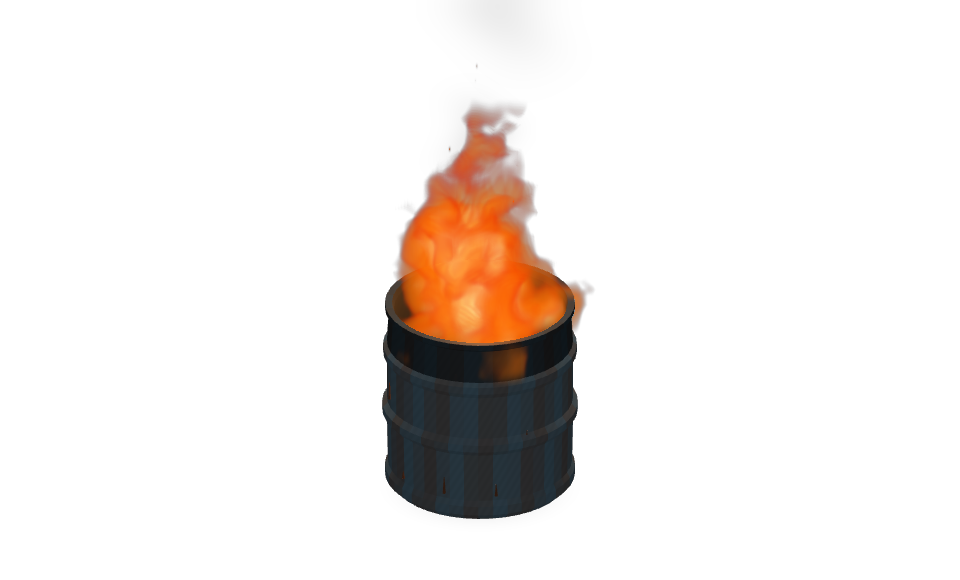
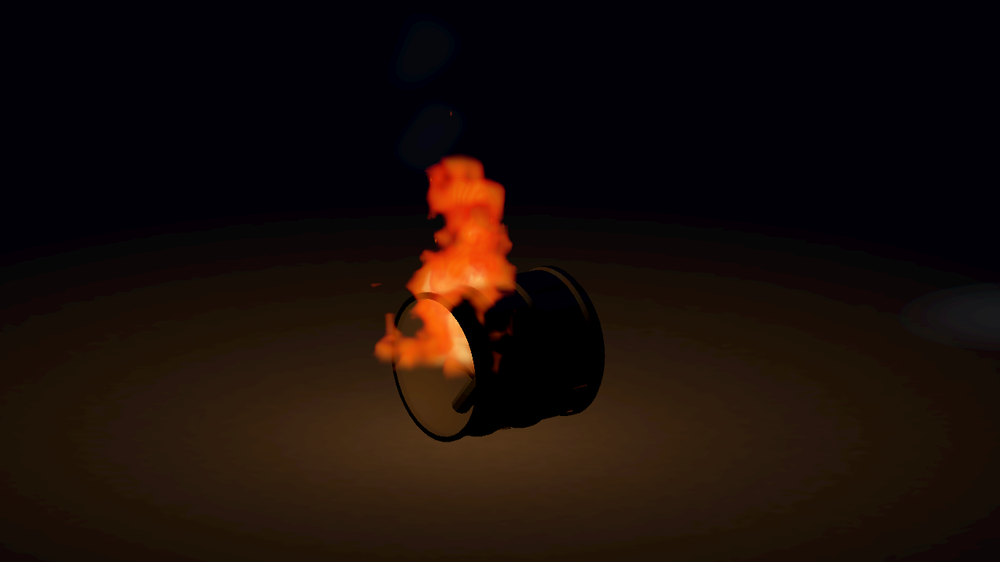

# Burning barrel fire and collision refinement - 2026-10-16

The burning barrel now has turbulent 3D fire with a hot core, orange tongues, rising embers, smoke and warm light. This replaces the five flat flame cards per source. The burning car uses the same revised fire at its two existing openings. The native object-browser photograph includes the full flame height.

BBF01 covers the fire's volume, turbulence, depth occlusion and native presentation. BBF02 covers car impacts, supported tipping, ground motion and settling. BBF03 covers attached effects, replay, rewind, restart, editor ownership and bounded resources.

An impact transfers momentum and tips the drum about its supported centre. Gravity carries a sufficiently strong hit past the balance point, then the drum bounces and rests on its side. Sideways motion rotates the cylinder; gentle nudges can rock back upright. A car on a bridge or in the air cannot hit a ground barrel. The flame, smoke, sparks and light follow the fuel opening while the flame continues rising vertically. Simulation owns the complete motion, so presentation never integrates a separate rigid body or changes a run.

Only burning barrels extend their existing movable-prop row from five to ten values. The outer vehicle snapshot and recorded input schemas remain unchanged. Physics `arcade-planar-0.61` identifies the new behavior; the local canonical verifier stages the new helper. Existing saved tracks and old leaderboards are retained. Matching client/verifier rollout remains a separate action. Concurrent spline-gate rules and Night-ground work are preserved and excluded from this task's patch.

There is one shared immutable drum mesh and one shared 32-cubed RGBA noise field (128 KiB). Fire uses bounded 32-step volume integration with two noise samples per step. One world controller retains the original caps of 32 fire sources, 224 embers, 96 smoke cards, 384 fireflies and four added shadowless lights. Moving source buffers update only when the drum pose changes. Editor individuals suppress their own controllers; the retained editor shares one aggregate controller. Prepared worlds own independent source dictionaries, materials and instance buffers. Prop version `authored-props-10-volume-fire-barrel` fences old prepared assets.

Actual validation with Godot 4.7.2 and isolated local APPDATA:

- Focused barrel suite: 54 headless, 71 Compatibility and 71 Mobile checks pass. All five cars knock the barrel onto its side; JSON input replay and rewind branches reproduce exact snapshots. Three prop scales, gentle nudges, elevated/airborne separation, native fuel/light attachment, cached-world independence, retained-editor caps and real race pause/restart pass.
- Native views show multiple fire times and angles, the falling sequence, the final supported pose, browser framing and actual gameplay impacts. Paused final shader pixels are exact after render settling; changed fire time changes native pixels.
- Existing Night suite: 128 Compatibility checks pass, including mixed car/barrel source limits, thumbnails and editor refresh/deletion. Winter construction/breakables: 595 headless; object browser: 88; prepared race resources: 162; full script parser: 833 pass. The preserved original movable-prop implementation produces exact snapshots for all nine previous soft kinds over 180 steps each.
- Local verifier suite: 70 pass. Its first run overlapped concurrent spline-rule edits: the temporary staged project lacked `SplineGateCorridor` and one assertion changed during the run. The complete rerun passes after that independent staging update.

Initial checks exposed insufficient impulse caps for the smaller cars and large decorative scales, a settling fixture that ended too early for the smallest drum, a legacy three-value input decode, insufficient render settling and the removed circular footprint query. These were corrected; their original logs remain. The first soft volume render was also refined for clearer tongues and less visible integration banding. Initial editor import encountered the shared Windows audio DLL temporary-copy lock; normal native runs and the final whole-project parser pass.

Actual commands, logs, hashes and the isolated task-only checkpoint are recorded in [report.json](evidence/barrel-fire-2026-10-16/report.json). The retained gameplay captures use paused scripted practice views with synthetic telemetry; they are not FPS or hitch measurements. Owner visual/impact tuning and physical-phone performance acceptance remain. No phone test, attachment check, APK, live backend change or deployment was performed.
