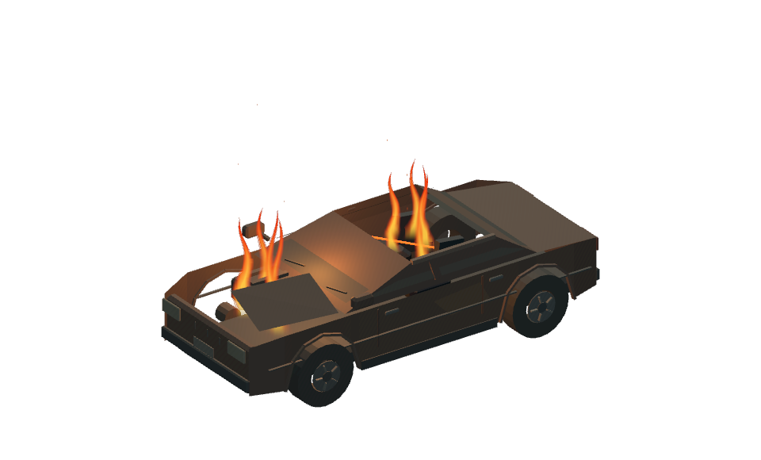
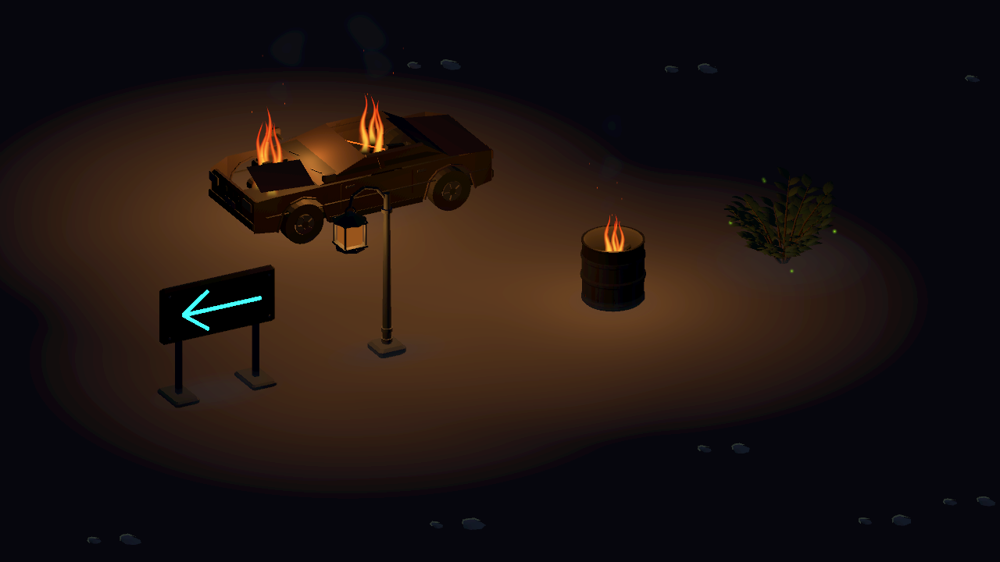

# Burning Night car — 2026-10-16

Night's Props browser now includes **Burning car**, and Night Populate uses it in the roadside mix. The solid wreck reuses the game's existing damaged vehicle, with its bent hood, collapsed cabin, missing wheel and fitted hardware. Its engine bay and roof are actually open. Charred bodywork, exposed seats and glowing fuel sit beneath two animated fires, with rising embers, smoke and a warm ground light. The ordinary wreck and movable barrel retain their existing models and behavior.

BC01 covers native geometry, Night-only browser availability, saved ID/JSON validation, collision footprint and Populate. BC02 covers both engine/cabin fires, moved/rotated/scaled emitters, light, embers and smoke. BC03 covers shared budgets, prepared-world ownership, pause/hide/restart and canonical isolation.

The model has3,368 triangles and fits a4.5m by2.2m selection/collision footprint. Each car uses two of the existing32 fire-source slots, ten flame cards, fourteen embers, six smoke cards and at most one of the existing four extra shadowless lights. Cars and barrels share those bounds; the budgets were not raised. There are no new canonical vehicle fields or simulation effects. Physics0.60/compiler27 remain. Existing saved tracks are not rewritten; place the object or use Populate.

The native thumbnail frames the actual model plus its flame height. Prop cache version `authored-props-8-burning-car` fences previous browser/prepared assets. Testing exposed an existing prepared-world copy omission: all four shader-driven streams lost `MultiMesh.custom_aabb` when instance buffers were isolated. One assignment now preserves that box, so cached flames/smoke/fireflies retain the full shader motion envelope. The new restoration assertions first failed four times, then passed after the correction.

Actual checks on pinned Godot4.7.2, with isolated `build/burning-car-*-user` APPDATA:

- Night suite:95 headless,118 Compatibility and118 Mobile, including all previous Night checks plus both car openings, source transforms, mixed car/barrel caps and exact restored culling boxes. Native runs verify changed animation pixels, exact paused images, actual race presentation/restart, canonical snapshot isolation, released native thumbnails and editor views.
- All-prop geometry/isolation:819 checks; Populate road clearance, spacing, deterministic save behavior and biome availability:20,578; original prepared-race ownership/cache/bounds:85.
- Whole-project parser:820 scripts, zero failures at this task's observed run.

Native views were inspected in both renderers. [report.json](evidence/burning-car-2026-10-16/report.json) retains commands, initial cache failures, final logs, source/image hashes and the isolated task-only Git checkpoint/patch. Concurrent work and the main index/history are preserved. No new external media or audio was used. No physical-phone test, APK, live track/backend mutation, deployment or FPS claim; owner/device art and performance review remain.
