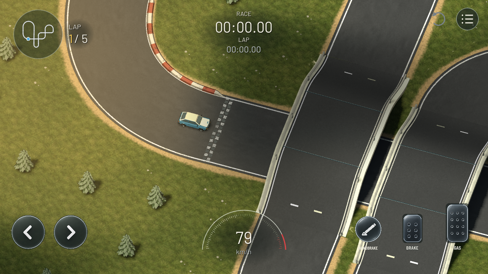
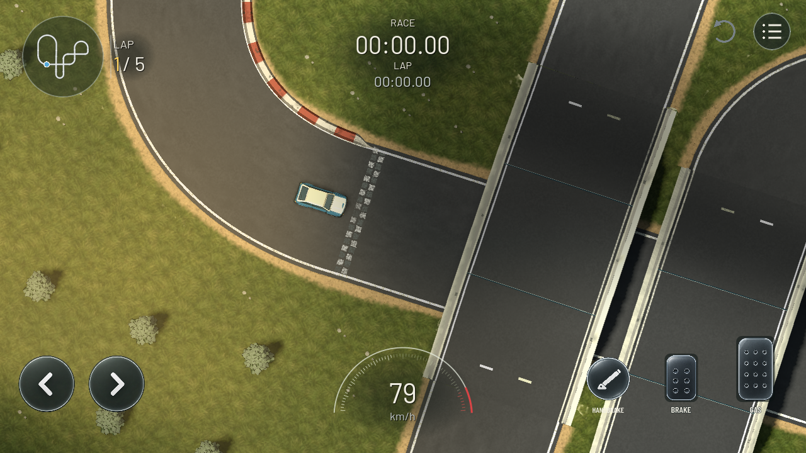
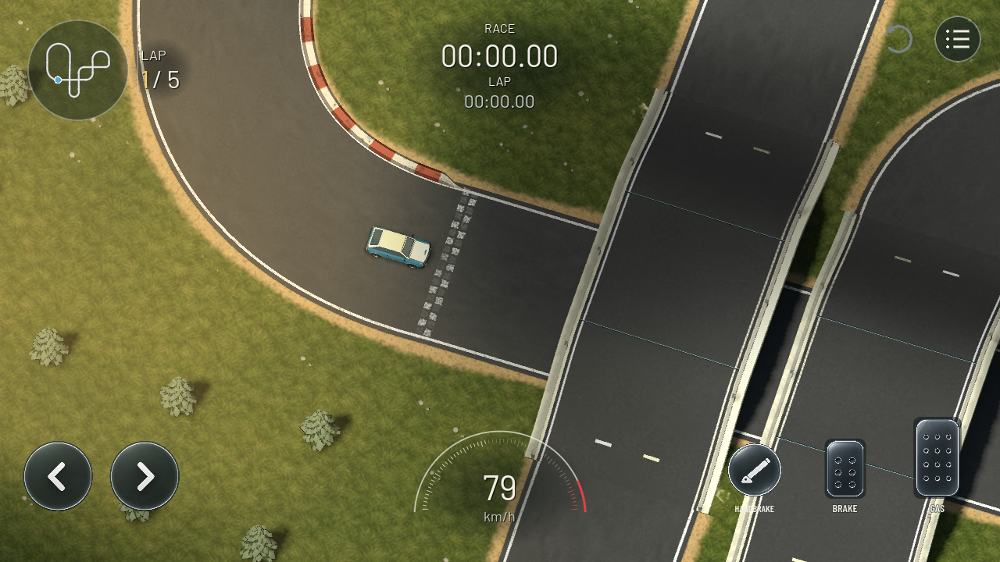
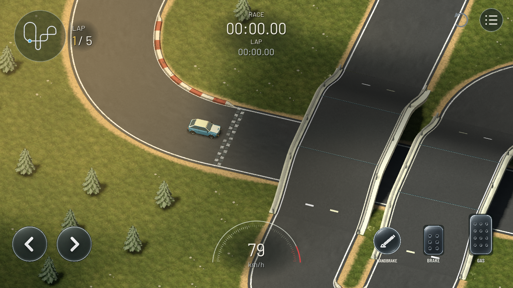

# Driving camera angle choices — 2026-11-12

Settings → Camera and Pause → Settings → Camera now offer three additional fixed-world views. Select a view and Apply settings; C cycles through all six views while driving. Existing saved selections and the original Overhead default remain compatible. Reset camera restores Overhead and the existing On/30% speed zoom defaults.

| View | Downward pitch | Purpose |
|---|---:|---|
| Overhead (existing default) | 56° | Balance between track readability and visible car/scenery sides |
| Follow car (existing) | 48° | Gently rotates with the car, capped at 60°/s |
| Look ahead (existing) | 56° | Fixed world orientation with a stronger, delayed travel offset |
| Top down (new) | 85° | Almost vertical view for corner shapes and car placement |
| High angle (new) | 70° | Flatter overview with less foreshortening |
| Low angle (new) | 46° | More visible vehicle sides and scenery depth |

The camera is orthographic, with 18° fixed world yaw and 35/1.15 ≈ 30.43 m vertical image extent before speed zoom. Height is 32 m. Changing pitch changes ground foreshortening and scenery occlusion, rather than lens perspective. On flat ground, the corresponding camera-local depth span is approximately extent/sin(pitch): 36.71 m at the original 56°, 30.55 m at 85°, 32.39 m at 70°, and 42.31 m at 46°. More depth coverage is not necessarily a clearer overview. The almost-vertical preset avoids the exact-vertical `look_at` up-axis singularity; the lower preset retains the overhead/no-horizon presentation.

Each preset owns a duplicated CameraProfile. The new views retain the original position response, bounded travel offset, world orientation, baseline magnification, speed zoom and shake behavior. Settings already builds its choices from CameraProfile, and the same list drives strict preference validation and keyboard cycling. No additional settings field or persistence migration is needed. Six new messages have authored copy in all twelve supported languages.

## Verification

Pinned engine: `4.7.2.stable.official.ed1daf0bf`. Native captures use Windows Compatibility/OpenGL on an RTX 3090, with disposable offline profiles under `build/camera-angles-2026-11-12`. The initial sandbox run passed all camera assertions but emitted a Windows certificate-store access error; the approved normal-access retry exits cleanly.

| Check | Result |
|---|---|
| `res://tests/test_camera_modes.gd --headless` | 2,871 checks, 0 failures |
| `res://tests/test_driving.gd --headless` | 72 checks, 0 failures; exact same-engine replay controls |
| `res://tests/test_records.gd --headless` | 54 checks, 0 failures |
| `res://tests/test_editor_shipping_parse.gd --headless` | 553 scripts, 0 failures |
| `res://tests/capture_camera_modes.gd --rendering-method gl_compatibility -- --angles-only` | 30 captures, clean exit |
| Expanded actual Settings touch capture | 332 checks, 4 existing failures; all new camera checks pass |
| Task-start Settings capture entrypoint, same runtime | 308 checks, the same 4 failures |
| Scoped localization comparison | 6 source messages / 72 translations, zero added validation errors |

Camera tests cover four headings, reverse/stopped/normal/fast travel, ground and 4 m bridge elevations, three viewport sizes, all zoom strengths, bounded/smoothed response, preference reload/rollback, staging and Apply while paused, cycling through the complete list, restart retention, and unchanged simulation/record identities. Actual touch input selects each new option at 960×540, 1280×720 and 1600×720. Native views and compact/wide Settings layouts were inspected.

The Settings capture has three keyboard-shortcut-fit failures and one older steering/haptics-reset fixture failure. The original entrypoint reproduces all four. An initial expanded capture additionally left its new camera draft selected before a legacy preference scenario; restoring the fixture's original draft removes that added failure. No production assertion was relaxed. The full localization check remains unpassed: 7,031 existing catalogue validation errors plus a stale source catalogue. Comparing task-start source/catalogues with current source/catalogues yields the same errors and no new ones. Concise logs and receipts, including these attempts, are retained in [the evidence directory](evidence/camera-angles-2026-11-12).

The change affects one production script, three existing test/capture scripts, twelve locale catalogues, the source catalogue and one authored translation table. This task made no Git index writes. Other workspace work is preserved. Desktop visual checks do not establish owner driving comfort, Android appearance, GPU performance or thermal acceptance. Relaunch the desktop game to load the new source; no device operation, APK, backend call or deployment was performed.

## Native comparisons

Same track, car pose and speed; all views use the same existing speed zoom preference.

| Original | Top down | High angle | Low angle |
|---|---|---|---|
|  |  |  |  |

[Main Settings](evidence/camera-angles-2026-11-12/settings-camera-angles-1280x720.png), [compact Settings](evidence/camera-angles-2026-11-12/settings-camera-angles-960x540.png), [pause Settings](evidence/camera-angles-2026-11-12/pause-camera-angles-1280x720.png).
