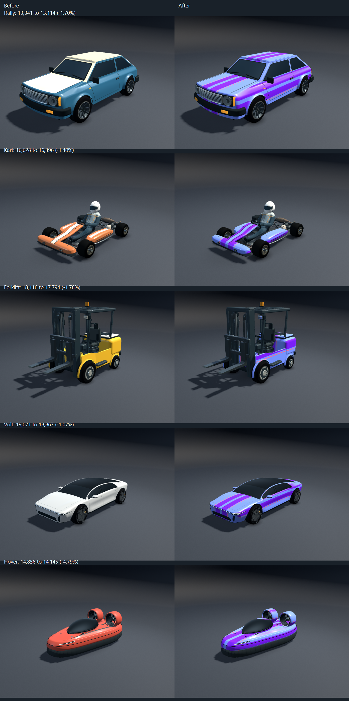

# Next 10% car reduction: review checkpoint, 16 November 2026

**The requested additional 10% has not been achieved or applied.** The current production racing models remain at **82,012 triangles**. Challenger remains excluded. The current candidates that pass the retained geometry and normal-field checks total **80,316 (-2.07%)**. They are rendered privately for review; there is no authored model publication, prepared-cache/picture refresh or runtime source change from this task.

| Car | Current | Screened candidate | Reduction | Approx. 10% target |
|---|---:|---:|---:|---:|
| Rally | 13,341 | 13,114 | 1.70% | 12,007 |
| Kart | 16,628 | 16,396 | 1.40% | 14,965 |
| Forklift | 18,116 | 17,794 | 1.78% | 16,304 |
| Volt | 19,071 | 18,867 | 1.07% | 17,164 |
| Hover | 14,856 | 14,145 | 4.79% | 13,370 |



## C301 — Establish the actual current baseline

Fifteen self-contained source snapshots cover stock, fitted and full-quality models. Baseline capture passes30/0. The source survey records3,573 part occurrences/1,213 mesh identities and uses the current exact-frame reduction pipeline. The starting stock counts match the preceding CP201–CP204 pass. Full masters, Challenger and the previously repaired landmarks are unchanged. Byte checks confirm all **354 preceding authored resource paths** and vehicle sources remain exact. Concurrent work changed the shared index and regenerated the project version; these are preserved. Restoring only the recorded starting `config/version` reconstructs the exact starting project hash, proving every other setting unchanged. The new tooling and documentation are separate from production authoring.

## C302 — Test the remaining room before forcing another reduction

The offline sweep tests index-only LODs, constrained remeshing, small/radial fittings, body patches, Kart panels and field-aware Volt paint candidates. A further boundary retessellation experiment permits removal of collinear boundary stations only when the independent segment/topology/contact checks still accept the result. **126 selected static candidates pass the final independent readback, zero rejected.** Checks retain the2mm sampled-distance limit, component/Euler/boundary/nonmanifold rules, encoded-corner or interpolated-field witnesses and mating-contact conditions. The selected Volt hood/deck changes retain the1° centroid normal-field gate: maximum0.94688° and0.31776°. These are sampled shape/field checks, not a continuous approximation proof.

The existing index-only driver simplifier is specifically rejected: its2% gloves proposal introduces six nonmanifold edges and changes Euler4→7, although steering boundary segments and sampled distances remain acceptable. The unmodified3,545-triangle driver is the only accepted combined index-stream option. The helmet stays exact. An additional morph-aware remeshing prototype does not qualify under its field test and remains private/rejected; it is not evidence of a mathematically optimal model or a definitive limit on other methods.

A separate closed-occluder study uses a0.5mm burial margin. Each proof subtriangle must fit wholly in a certified interior distance ball of a closed opaque mesh in the same rigid frame. Stock/fitted mask intersections and pinned occluders limit the screened potential to74 Kart and191 Forklift triangles, zero for the other three cars. These proposals are not included in the126-candidate render set or published: complete optional-kit receiving bindings would still require qualification. The result does not justify removing visible faces or modifying topology without an enclosure proof.

The tested methods therefore do not reach another10% while retaining these controls. This is a practical result of this candidate sweep, not proof that further optimization is impossible. A broader component redesign, different topology method or accepted change to visible detail would be a separate next approach. No thresholds or failed invariants are weakened to report success.

## C303 — Make the smaller candidates reviewable

Compatibility renders45 matched stock pairs and passes185/0, including source readiness, exact reference restoration, the helmet, Rally windshield/front and Volt doors/handles/roof views. The native counters and exact images are in [comparisons.json](evidence/car-pass10-2026-11-16/source-gl_compatibility-decorated/comparisons.json). Rendered triangle counts equal every listed candidate count. The images were inspected for the previously reported problem regions. They do not substitute for owner acceptance, both-renderer/prepared/fitted-kit qualification, actual App receiving tests or phone testing. Those publication checks have not been run for this private candidate set.

No FPS/GPU-time/physical-device claim is made. The remaining stock triangle saving is only2.07%, and stable material/draw work is not removed by a lower triangle count. Before applying a broader change, the pending choice is whether preserving the current appearance or reaching10% with subtle visible-detail changes should take priority. The default suggestion is appearance preservation, given the preceding artifact repairs. Production models remain unchanged while this decision is pending.

## C304 — Retain a reversible review checkpoint

The private Git checkpoint contains only the new offline review tools and scoped documentation/tracker blocks. Forward/reverse byte checks and whitespace checks leave the shared index untouched. It is a **review checkpoint, not a completed optimization or published model change**. Candidate resources and rejected controls remain in the task build/evidence folders. Standard `clean_build.ps1 -Apply` retention ran without a task pin; see [build-retention.log](evidence/car-pass10-2026-11-16/build-retention.log). Owner saves/processes, backend, export, deployment and device tests are untouched.

The evidence retains the initial missing-output-directory fixture rejection, corrected driver export, free-retessellation input-name rejection, all rejected topology/normal experiments and corrected surface-corner prototype. No failed test is relabelled as a pass. See [review-status.json](evidence/car-pass10-2026-11-16/review-status.json), [selected-plan.json](evidence/car-pass10-2026-11-16/selected-plan.json), [geometry-review.json](evidence/car-pass10-2026-11-16/geometry-review.json) and [source-checkpoint.json](evidence/car-pass10-2026-11-16/source-checkpoint.json).

Commands actually run (full engine arguments/outcomes are retained in receipts):

```powershell
python scripts/run_car_pass10.py baseline res://tests/capture_car_pass10_baseline.gd --headless
python scripts/run_car_pass10.py survey res://tests/survey_car_pass10.gd --headless
python scripts/prepare_car_pass10.py
python scripts/select_car_pass10.py
python scripts/check_car_pass10_geometry.py
python scripts/run_car_pass10.py preview-quality-candidates res://tests/capture_car_pass10.gd --rendering-method gl_compatibility -- --source --candidates --stock-only --decorated
powershell -NoProfile -ExecutionPolicy Bypass -File scripts/compare_car_pass10.ps1
powershell -NoProfile -ExecutionPolicy Bypass -File scripts/clean_build.ps1 -Apply
```
