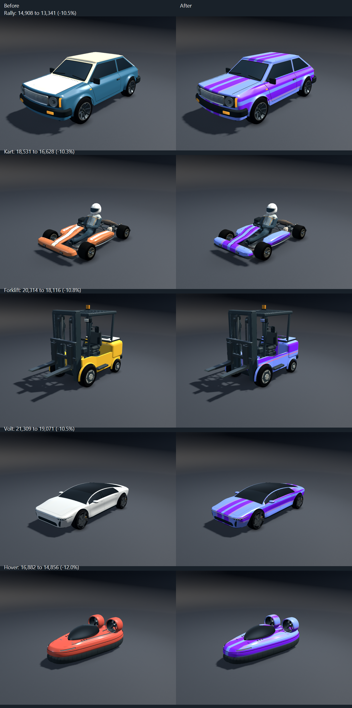

# Gradual car reduction, 16 November 2026

The next reduction is applied to the five finished factory racing models. Challenger remains excluded. Each included stock model loses **10.27–12.00%**, with the existing quality repairs retained. Total triangles fall **91,944 to 82,012 (-10.80%)**. Reload the project for owner appearance review before another iteration.

| Car | Before | After | Reduction |
|---|---:|---:|---:|
| Rally | 14,908 | 13,341 | 10.51% |
| Kart | 18,531 | 16,628 | 10.27% |
| Forklift | 20,314 | 18,116 | 10.82% |
| Volt | 21,309 | 19,071 | 10.50% |
| Hover | 16,882 | 14,856 | 12.00% |



## CP201 — Identify a bounded next pass

The starting point is the actual current source build, including Rally's closed lower fascia, preferred reflector lamps and Volt's repaired sides, door contours and straighter bonnet seam. Fifteen detached, self-contained stock/fitted/full snapshots and the post-reduction source survey preserve the starting geometry. These are current counts, not the abandoned 10,000-triangle experiment. The target applies to factory racing masters; fitted kits share the retained improvements but have their own authored geometry, and full-quality masters remain unchanged.

| Car | Fitted before | Fitted after | Full master, unchanged |
|---|---:|---:|---:|
| Rally | 22,729 | 21,169 | 100,356 |
| Kart | 20,719 | 18,920 | 72,544 |
| Forklift | 23,742 | 21,694 | 148,048 |
| Volt | 27,033 | 26,147 | 114,648 |
| Hover | 27,766 | 26,185 | 71,932 |

The final selection contains 271 static mesh identities plus the Kart's separate racing-only steering driver. Most savings come from redundant rings, planar or gently curved fittings, rim sections, body interiors and flatter surface regions. The final publication contains 354 authored native resources and complete-frame recipes; its exact paths and before/after hashes are in [publication.json](evidence/car-pass12-2026-11-16/publication.json). New resources are saved before their recipes. No runtime reducer, shader, vehicle builder or handling source is authored by this task. Hover uses existing racing-only resources; the four other cars use the existing exact-frame surface pass. The Kart additionally receives two detail-frame migrations for its native driver identity. Every unselected recipe row is retained.

## CP202 — Reject degradation before publication

The independent readback accepts **271/271 static candidates, zero rejected**, checking both directions at every used vertex and triangle centroid. Maximum sampled surface deviation is **1.79894 mm**, within the unchanged 2 mm gate. Component/Euler/boundary/nonmanifold controls and attribute/contact witnesses also pass. This is a dense sampled bound, not a continuous Hausdorff proof. The original complete-frame, source/result digest, AABB, opaque/shader allowlist and runtime batching guards remain unchanged. All unselected observed source members match their starting GPU identities.

Volt's side charts, rear corner skins, contour backing, handles and roof joins remain exact. The door/handle backing regression passes **7,443/0**. Every bonnet contour vertex retains backing and the existing **0.35–1.50 mm** exposure gate. A first hood/deck candidate passed the distance test but failed the additional centroid normal-field test at **20.04°/6.43°**. It was rejected. Final field-aware topology preserves the high-gradient normal rows: hood **1,920→1,006**, deck **1,200→750**, maximum centroid field changes **0.96571°/0.92472°**, both below the unchanged **1°** gate. Matching unmodified controls measure zero. The failures and their original assertions remain in the evidence.

Kart's helmet and steering assembly remain untouched. Only the racing driver's indices change: **3,695→3,545**. Every non-index GPU packet, vertex attribute, ten morph targets and material finish identity is retained. All **21 steering targets/interpolations × two surfaces** pass; maximum sampled deviation is **0.74598 mm** and **42 original boundary checks** pass. More aggressive driver candidates with topology or distance failures were rejected. Rally's repaired lower backing, grille and transparent lens/bulb style remain; selected opaque lamp fittings use fewer triangles.

## CP203 — Measure and qualify receiving models

Actual source models pass **4,646/0** and prepared stock/fitted/full models **40/0**. Five full source GPU/articulation signatures match the detached starting masters. Complete all-kit/source-versus-prepared checks pass for Rally, Kart, Forklift, Volt and Hover. The scoped preflight covers **468 prepared resources, 1,925/0 checks**. Source/identity fences retain **26,076 inputs with zero changes**.

Each desktop renderer, Compatibility and Vulkan/Mobile, passes **90 paired stock/fitted views / 385 checks**, **32 Volt moving-highlight pairs / 130 checks**, the actual five-car Garage/race App **48/0**, steering **170/0**, icons **507/0** and wash behaviour **1,403/0**. The moving highlights review the final hood and deck under eight lighting rotations in the actual Garage environment. Native comparison references settle and restore to exact pixels; these assertions do not require the simplified model to be pixel-identical to the original. Production parser **581/0**, driving **72/0**, recipe guards **793/0** and protected-batch checks pass.

Stock encoded mesh buffers fall **3,633,482→3,273,630 bytes (-9.90%)**. Material-surface counts and measured draw calls remain unchanged in every native comparison. Geometry processing and memory demand are lower; fragment work, lighting and material costs remain. These desktop counters do not establish a particular FPS gain. No phone test, paired GPU-time/FPS measurement or physical-device acceptance was performed.

Five catalogue pictures and five default header pictures were rebuilt, along with the global six-image selection portrait set. The Challenger portrait is derived UI artwork; its model sources and prepared-model readiness remain excluded. Catalogue/portrait provenance, **16 native imports**, current car identities and the final scoped preflight pass. The importer reports zero diagnostics and exact project settings.

The first Mobile wash run completed all 1,403 behaviour checks but reported two ObjectDB instances/one resource at shutdown. Its log and failing runner receipt remain. A fresh verbose run passes the same assertions and the unchanged zero-error runner gate. This does not establish a general teardown fix. Initial helper invocations, material-object comparison and frame lookup errors, fitted-frame counting errors, and the late-hook Hover reconstruction control remain retained. The final fitted count derives surviving kit paths; Hover's legacy fan replacement has no kit holders, so its final fan count is independently compared with the frozen fitted snapshot. No model assertion or geometric threshold was relaxed. Rejected simplification families and all normal-field controls remain available.

## CP204 — Reversible publication and review

Authored publication hashes, the source/consumer fence and all final receiving receipts are checked by `close_car_pass12.py`. The first closing settings check rejected the generated build-version update. Replacing only `config/version` with the recorded starting build ID reconstructs the exact original project hash, proving every other setting remains unchanged; the actual generated identity is retained. The private source checkpoint includes only authored resources, task tools and task documentation; it checks forward and reverse byte equality and whitespace without writing the shared Git index. Derived scenes/pictures must be rebuilt after reversal. Concurrent workspace work, including Challenger, is retained. Standard `clean_build.ps1 -Apply` retention removes two old eligible entries, **29.93→28.84 GiB**; recent/protected entries keep the build above its target. No task pin is created.

There was no export, backend request, deployment, owner-save/process action or root staging/commit/merge. Owner appearance acceptance and phone performance remain outstanding. Full per-part proof, candidates, exact engine command arguments, renderer counters and failures are in the [evidence folder](evidence/car-pass12-2026-11-16/). See [closure.json](evidence/car-pass12-2026-11-16/closure.json), [measurements.json](evidence/car-pass12-2026-11-16/measurements.json) and [source-checkpoint.json](evidence/car-pass12-2026-11-16/source-checkpoint.json).

Representative commands actually run (full arguments/outcomes are in the receipts):

```powershell
python scripts/select_car_pass12.py
python scripts/check_car_pass12_geometry.py
python scripts/run_car_pass12.py stage-final res://tests/stage_car_pass12.gd --headless
python scripts/publish_car_pass12.py
python scripts/refresh_car_pass12_assets.py
python scripts/run_car_pass12.py models-source-final-target res://tests/test_car_pass12.gd --headless
python scripts/run_car_pass12.py models-prepared-final res://tests/test_car_pass12.gd --headless -- --prepared
python scripts/qualify_car_pass12.py
python scripts/receive_car_pass12_app.py
python scripts/artwork_car_pass12.py
python scripts/measure_car_pass12_results.py
python scripts/close_car_pass12.py
powershell -NoProfile -ExecutionPolicy Bypass -File scripts/clean_build.ps1 -Apply
```
