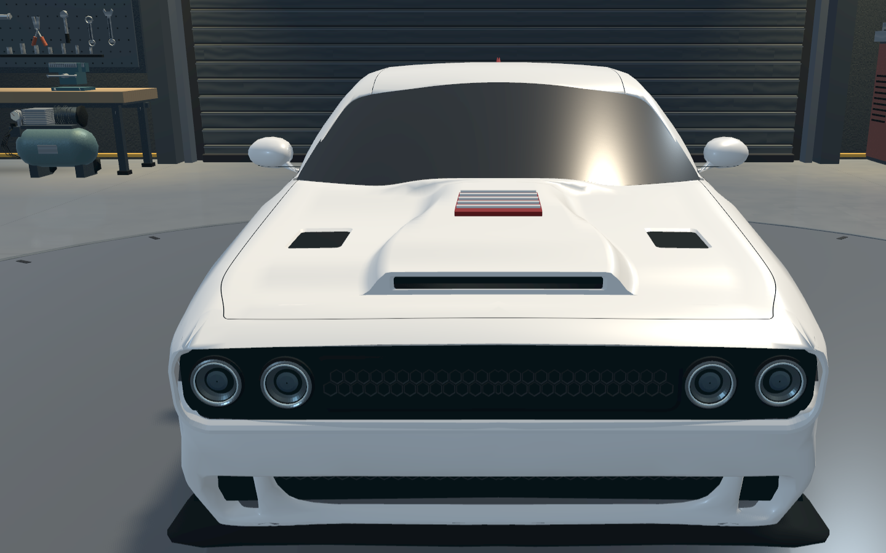
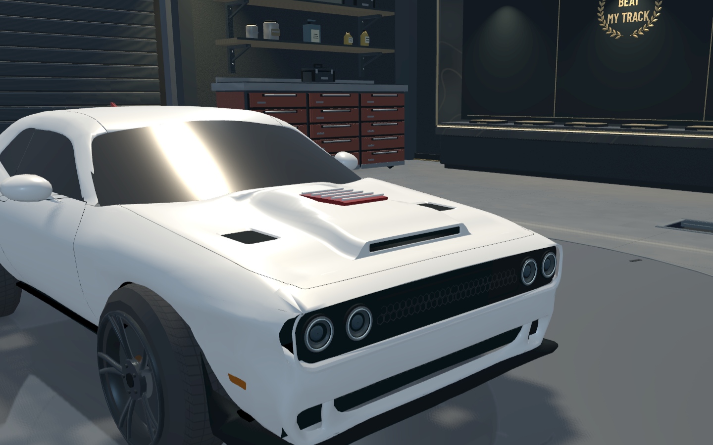

# Challenger leading nose surface repair

The strip above the grille now follows one convex profile. Its bonnet seam is seated against the rebuilt surface, and the front-quarter cracks have matching boundary vertices through the native export.

## Requirements and implementation

**NLS01** Investigate the marked ridge and black marks. Native views with the contour mesh hidden and the paint unshaded established that the diagonal marks were openings in the painted shell. The leading strip also contained overlapping, uneven skins. These defects needed geometry changes.

**NLS02** Reconstruct the leading strip while retaining the established fenders and bonnet features. The offline generator uses a concave longitudinal bonnet profile and supporting planes from the actual convex fender triangles. Their shared surface turns downward toward the grille. The intake, extractors, cabin, wheels and accepted side panels retain their design. A sparse interior grid and conforming boundary triangulation spend vertices at the joins. Duplicate faces are removed. The existing grille and lamp aperture keep their sharp styling boundary.

**NLS03** Close the front-quarter openings and preserve the normal field. Nearby continuous boundary stations are seated, uncovered wedges are reconstructed, and adjoining edges receive matching vertices. This prevents T-junctions separating during mesh packing. The fender keeps its established smooth normal field. Bonnet ribbons retain their paired attributes and are refitted to the actual final triangles.

**NLS04** Deliver the source change through the game pipeline. Reconstruction runs offline into the existing 22 asset buckets per tier. Model revision 17 refreshes the native assets and fitted-part profile. The native bank, coarse meshes, modular consumers, Garage models, livery previews and car pictures were rebuilt and checked.

The authored changes introduce the shared front surface, integrate it into the converter and advance the model cache revision. [Front surface](../scripts/challenger_front_surface.py), [converter](../scripts/prepare_challenger.py), [model revision](../game/vehicle/super_rally_model.gd).

The original measured source geometry and 17 protected source, configuration and legacy inputs remain exact.

## Matched views

| Before | Updated |
| --- | --- |
|  |  |
|  |  |

These views use the owner's white paint and extractor option, with the existing materials, lighting and matched cameras. Both desktop renderers also have full-detail front views, side and rear views, moving-highlight views, opacity checks and actual App captures in the evidence directory.

## Triangle counts

| Assembled model | Before | Updated | Change |
| --- | ---: | ---: | ---: |
| Reduced native | 49,978 | 49,944 | −34 |
| Full native | 80,672 | 80,790 | +118, +0.15% |
| Production reduced | 45,218 | 45,184 | −34 |

The original 50k and 85k allocation checks pass.

## Validation

- Native shape checks pass 170 checks. Roof, sampled lower sides and rear body positions have zero measured movement. The protected bonnet behind the repaired leading strip stays within the measured import packing cells.
- The established fender crown passes all eight checks. Maximum inward chord error is 0.0131 mm reduced and 0.0101 mm full. All 384 bonnet perimeter stations have exterior support in each tier.
- The leading strip passes all eight new checks. Across 2,559 chord samples per tier, maximum inward error is 0.1218 mm reduced and 0.0735 mm full. The survey finds zero forward upturn.
- All 21,417 front-quarter side stations per tier have paint coverage. The reduced tier has zero raw misses. One exact-edge ray rejection in the full tier resolves with a 2 µm neighboring probe. Raw results remain in [the native survey](evidence/challenger-nose-lip-2026-11-17/candidate-leading.json).
- Allocation passes 17 checks, panel contours 172, fitted kits 316, and fitted-profile checks 144 with a maximum 0.857 mm error against the existing 2 mm limit. Modules pass 1,436 checks, vehicle checks 3,677, wash 1,655, driving 72, and production parsing 583.
- The complete prepared-asset preflight passes 2,267 checks across 551 resources. Each desktop renderer passes 30 opacity checks and 13 actual App checks. All 14 native renderer jobs pass.
- The final asset fence covers 26,909 stable inputs. Sixty-four image imports are verified. Six selection portraits pass their current revision check against 26,013 stable producer inputs.

Actual entry commands were `run_preparation.py`, `review_native.py`, `deliver.py`, `checkpoint.py` and `finalize.py` in the evidence directory, plus `python scripts/check_garage_selection_pictures.py`. Individual commands, source pins and process results are retained beside this report. [Final verification](evidence/challenger-nose-lip-2026-11-17/final-verification.json) records the published asset hashes and protected inputs.

## Retained findings and review

Earlier prototypes introduced a concave fender join and were rejected. The first prototype runner could retain an earlier JSON output after a script error. It now stops on failure and checks output creation time. Final qualification uses a fresh complete Blender conversion and Godot native bake.

Initial source runs also exposed an empty closure-list error and an asymmetric packed triangle count. The closure path handles empty results, and final source symmetry is constructed from one retained half. Conforming triangulation closes the packed boundary openings. The original curvature, triangle, symmetry and fitting assertions remain in force. The leading-surface chord survey excludes the physical bonnet gap. The side survey uses a 2 µm shared-edge probe to distinguish exact-edge numerical rejection. Earlier failures remain recorded.

The three-source patch applies and reverses byte-exactly. Private checkpoint `a73713a97605c7071bfe3011383fd7f198fd86c5` is retained in [the verified bundle](evidence/challenger-nose-lip-2026-11-17/source-checkpoint.bundle) and [source patch](evidence/challenger-nose-lip-2026-11-17/source-only.patch). Concurrent work and the shared index were preserved.

Standard build retention ran successfully. Automatic approval review rejected the optional recursive cleanup of this task's temporary build directory with `blocked by policy` and supplied no further reason. The approximately 1.09 GB working directory remains under the existing retention policy. The original native bank, final command receipts and diagnostic views are archived in the evidence directory.

Reopen the Garage to load the updated resources. Owner appearance review, physical Android testing and device FPS measurement remain pending.
