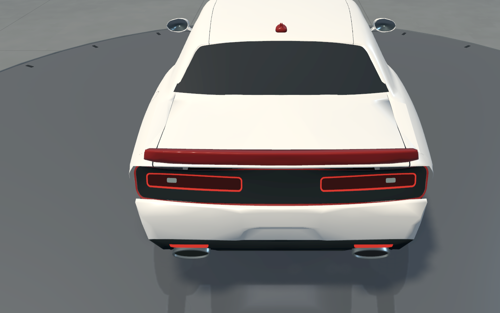
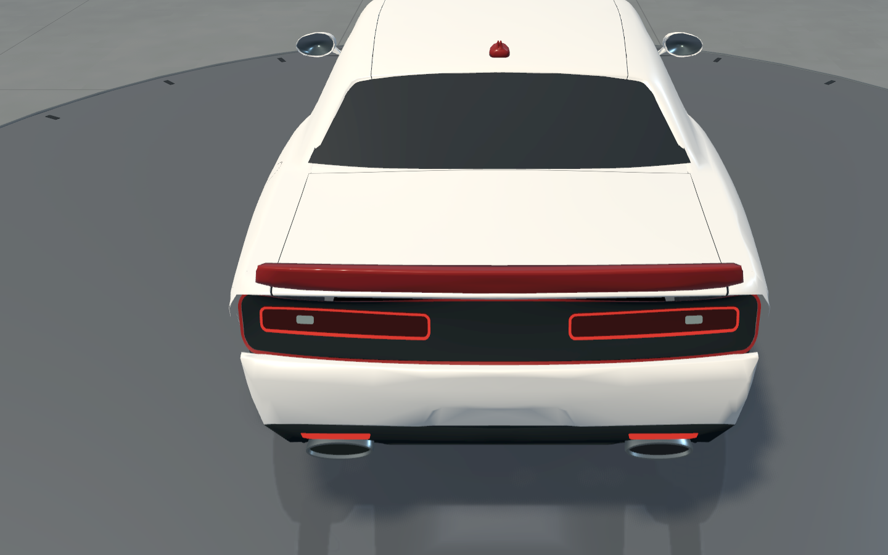
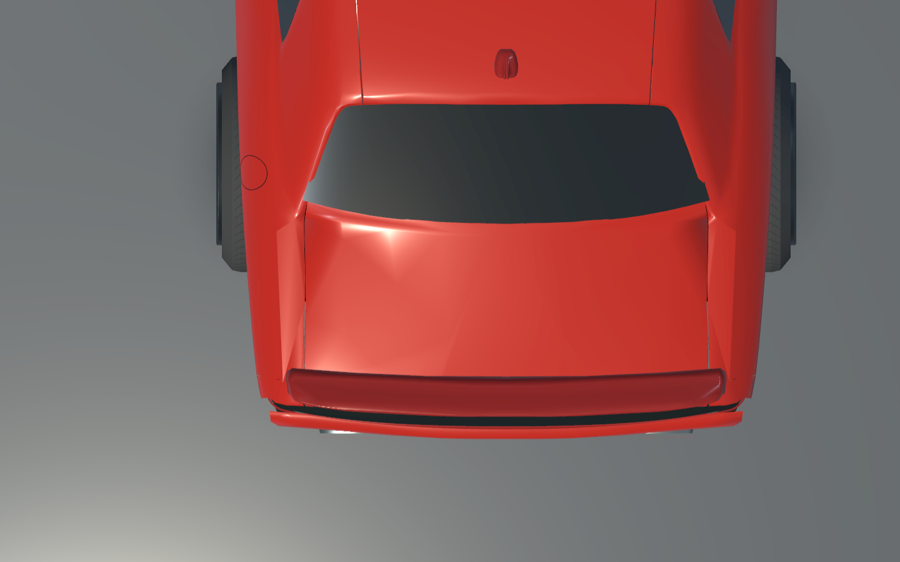
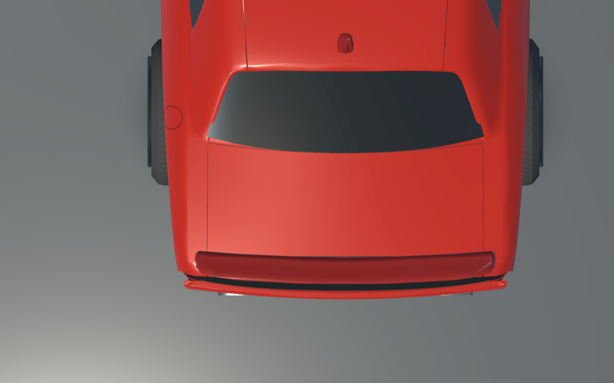

# Challenger rear bumper and trunk refinement

The rear shelf beneath the tail lights now has a continuous rounded section and an even transverse surface. The trunk uses a smooth deck with a consistent 2.5 mm shut line seated on its final triangles.

## Requirements and source changes

**RRS01** Investigate the rear defects. The original packed shelf varied 4.36 mm in the reduced model and 4.40 mm in full detail. Large source triangles crossed the face, rolled edge and shelf. Their interpolated normals exaggerated the uneven geometry. The source trunk gutters also contained physical openings and irregular recessed edges.

**RRS02** Fair the bumper through the actual offline generator. One fitted transverse profile describes the face. A cubic section matches its tangent to the lamp shelf. Explicit join stations prevent long triangles spanning both surfaces. The rounded outer corners follow the lamp aperture. Shared boundary triangles close the small corner opening. Normals follow the geometric mapping, and the flat shelf uses its physical plane normal.

**RRS03** Rebuild the trunk surface and seams. A smooth symmetric deck replaces the irregular gutter geometry. Constrained triangulation retains the surrounding edge stations, and a bounded 0.75 mm weld removes clipping fragments within the same smooth chart. Forty paired stations define the new shut line. Its two sides are fitted to the actual paint before native pixel-coverage attributes are baked.

**RRS04** Deliver the change through the game. Model revision 18 refreshes the native bank, coarse geometry, modular parts, Garage models, previews and pictures. The authored sources are [rear geometry](../scripts/challenger_rear_surface.py), [converter integration](../scripts/prepare_challenger.py) and [model revision](../game/vehicle/super_rally_model.gd).

## Matched native views

| Before | Updated |
| --- | --- |
|  |  |
|  |  |

The final set includes 64 prepared-model views across both detail levels, both desktop renderers, white and red paint, rear angles, overhead views and a front control. Thirty-two matched before views use the same cameras and lighting.

## Triangle counts

| Model | Before | Updated | Change |
| --- | ---: | ---: | ---: |
| Assembled reduced | 49,944 | 49,910 | -34 |
| Assembled full detail | 80,790 | 80,892 | +102, +0.13% |
| Production reduced stock | 45,184 | 45,150 | -34 |

Both tiers retain 22 native material buckets. The existing 50k and 85k allocation checks pass.

## Actual validation

- The packed rear survey passes 16 checks. All 290 shelf samples per tier have coverage. Transverse height variation is below 0.001 mm, and the maximum normal deviation is below 0.006 degrees. Maximum inward chord errors are 0.0885 mm reduced and 0.0623 mm full, within the existing 0.2 mm survey limit.
- All 7,857 trunk stations per tier have paint backing. The original controls had 208 reduced and 243 full-detail gaps. Eight seam checks pass. All 80 new ribbon vertices per tier have support, with approximately 1.77-1.88 mm clearance and a maximum physical half-width error below 0.036 mm.
- Protected front and side geometry stays within 0.064 mm of the original packed triangles. Nineteen other native mesh arrays match exactly. All 20 retain their topology and native attribute precision, including the red marker packet.
- Allocation passes 17 checks, panel contours 172, fitted kits 316 and the fitted-profile survey 144. Maximum fitted-profile error remains 0.857 mm against its 2 mm limit.
- Modules pass 1,436 checks, vehicle checks 3,677, wash 1,655, driving 72 and production parsing 583. The complete prepared preflight passes 2,267 checks across 551 resources.
- Both desktop renderers pass the final prepared views, 30 opacity checks and 13 actual App checks each. The unlit corner control changes from six dark pixels to zero after the adjoining edges are made conforming.
- The final vehicle fence covers 26,910 stable inputs. Sixty-four image imports and six current selection portraits pass their checks.

The actual entry commands were `python docs/evidence/challenger-rear-surface-2026-11-17/run_preparation.py`, `qualify.py`, `deliver.py`, `checkpoint.py` and `finalize.py`. The evidence includes each subordinate command, exit code, consumed-source pin and output receipt. [Final verification](evidence/challenger-rear-surface-2026-11-17/final-verification.json), [rear survey](evidence/challenger-rear-surface-2026-11-17/candidate-rear.json), [seam survey](evidence/challenger-rear-surface-2026-11-17/candidate-trunk.json) and [corner control](evidence/challenger-rear-surface-2026-11-17/corner-pixels.json).

## Retained findings and review

Early projections left large triangles spanning the rounded edge and flat shelf. Join stations and shared edges resolve their residual waves and the corner opening found during final visual review. The 0.15 mm shelf, one-degree normal, 0.2 mm chord and original allocation limits remain in force.

The initial protected-geometry fixture compared new clipping stations with old vertex locations. It now measures distance to the original triangles, preserving its 0.08 mm geometry limit. This accommodates legitimate edge stations introduced by the repair. An initial Mobile App run logged two ObjectDB instances and one resource at shutdown. A fresh verbose repeat passes 13 checks with a clean shutdown. The initial capture dependency and optional Python image-library failure remain recorded. Native Godot performs the final image check.

Private checkpoint `798da874703418048174c40940b72c59589ef6e4` contains the three authored source changes. Its patch applies and reverses byte-exactly, and checkpoint creation preserves the shared index. [Source patch](evidence/challenger-rear-surface-2026-11-17/source-only.patch), [verified bundle](evidence/challenger-rear-surface-2026-11-17/source-checkpoint.bundle).

The original native bank and final evidence are archived. Standard build retention applies. Reload the game to load the current assets. Owner appearance review remains pending. Physical Android testing and device FPS measurement were not performed.
