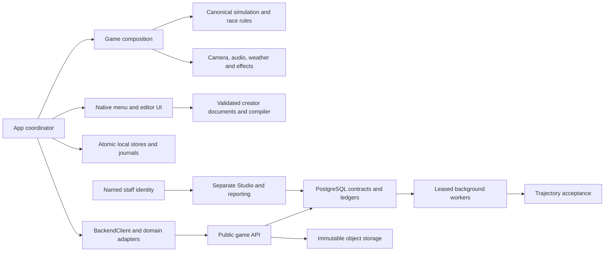

# Beat My Track: comprehensive mobile code and quality audit

Follow-up: the owner-requested MA13, MA04, MA05, MA06, MA07, MA08 and MA10 changes are documented in [Selected mobile audit fixes](MOBILE_AUDIT_FIXES_2026_10_26.md). Measurements and findings below describe the original audit checkpoint; its evidence is retained.

Audit date: **26 October 2026**, Europe/Helsinki. Scope: the current working tree, including its existing uncommitted and untracked work. This is an **audit, not an implementation change**. Requirements AUD01–AUD09 correspond to sections 1–9 of the supplied request; AUD10 covers the required report and roadmap.

The accompanying [verification ledger and evidence](evidence/mobile-audit-2026-10-26/report.json) records actual commands, results, source hashes, reproductions and limitations. File locations below are repository-relative and line numbers refer to the reviewed snapshot. Effort estimates are engineering estimates: S = roughly one or two days, M = several days, L = more than a week, including appropriate verification. Provider setup and external approvals can add elapsed time.

## A. Executive summary

The project has substantial engineering work behind its gameplay and service boundaries. Canonical driving uses a fixed 120 Hz step, quantized input and pinned contracts. Local records and authoring saves have recovery paths; uploads have account ownership and durable journals. The backend has server-owned wallets, idempotent transactions, bounded ingress, separate administrative workloads, named staff identity, and explicit development gates. Rendering already uses batching, spatial chunks, shader specialization, preparation caches and cooperative loading. There are hundreds of focused tests. Describing this as a simple prototype with no production safeguards would be inaccurate.

**It is not ready for an unconditional commercial Android launch.** The largest concerns are competitive trust, incomplete shipping monetization, an unreliable overall regression signal, and missing final-artifact/device acceptance. Existing mobile optimization work should be preserved. The next useful work is targeted verification and a small number of measured changes, rather than a broad rewrite or a visual downgrade.

The five most important findings are:

1. **MA01 — The public score acceptance policy verifies a path, not whether the car could drive it.** A locally generated path through the actual Ellipse gates, with no canonical driving inputs, passed the production trajectory function in **23.108 seconds for five laps**. Its first step implied **45.23 m/s immediately from the start**. Adding a client-authored clean-race claim switched `incident_free` to true. The reward path uses that flag for a 200-Coin bonus. This is a residual risk of the explicitly approved lightweight policy, not an accidental reversion of that policy.
2. **MA02 — Shipping checkout and ads are incomplete.** The Store explicitly disables real checkout; the client adapter is a debug simulator. AdMob code and SDK dependencies are development-only. Server proof and fulfillment components exist, but do not constitute a complete player-facing Billing/ads integration.
3. **MA03 — There is no trustworthy single release regression result.** The available suites expose real failures, stale doubles, backend-fixture prerequisites, ignored-directory baseline dependencies and lint failures. The main validation function explicitly invokes only 76 of 522 top-level client test entrypoints. This does not mean the other tests are useless or should all run on every edit; it means they need a maintained selection and prerequisite manifest.
4. **MA13 — First usable UI waits for the entire Garage.** Two desktop graphical captures took about 34–35 seconds to reach ready. A separate attribution run after the backend suite finished took 25.75 seconds, of which **25.59 seconds** was covered Garage preparation. That retained Garage contains **24 SubViewports**. The work happens even for a fresh offline guest opening Account.
5. **MA04 — Playing ordinary menu music defeats idle Garage rendering.** In a controlled callback probe, music playback caused 120 showroom render requests in 120 callbacks, each also requesting the two planar reflection views. Muting the same stable view caused zero. The render requests are measured; Android GPU time and battery cost remain unmeasured.

Other confirmed issues include a deferred pause-menu callback that accesses freed controls, Store offer actions falling below the initially visible scroll area at two tested sizes, and stale localization catalogues. Trajectory-only submissions still retain full nested control arrays: the actual append path held **43,753,760 bytes** at the 30-minute evidence cap, before proofs, ghosts and saves. The oversized application coordinator increases the cost of addressing these without regressions. Crash/ANR diagnostics and final release configuration need additional work.

**No P0 issue is asserted by this audit.** No live exploit, live provider purchase, successful external authentication, production database modification, deployment or device installation was performed. No physical-device attachment check or device test was performed. The competitive weakness is reproduced locally against the actual acceptance function; its public-service deployment status was not checked.

### Architecture established before assessing findings

| Area | Implementation and responsibility |
|---|---|
| Engine / languages | Pinned `4.7.2.stable.official.ed1daf0bf` in `godot-version.txt`; typed GDScript client, Python/FastAPI/SQLAlchemy backend, C++ GDExtensions, Java Android bridges, GLSL-style Godot shaders, PowerShell/Python tooling. |
| Entry and scenes | `game/project.godot:20` starts `core/app.tscn`; its root is the `app.gd` coordinator. Races instantiate `core/game.tscn`. Most screens and world nodes are composed in code, so two main scene files do not imply a small UI. |
| Autoloads | `Language` and `AudioWorld` only. Much other shared state is passed through App, adapter services and bounded static caches. Singleton count itself is not the architectural problem. |
| App / UI | App owns navigation, account storage selection, editor integration, race creation/return, online completion and presentation orchestration. `ui/` holds native controls, Garage, discovery, results, Store, settings, profiles and competition views. |
| Driving / rules | `vehicle/vehicle_simulation.gd`, `input/drive_frame.gd`, `race/track_session.gd` and `race/race_rules.gd` separate canonical state and ordered swept gates from cameras, particles, weather and audio. Current observed physics is `arcade-planar-0.73`, rules `standing-5-road-gates-v23`, compiler `creator-compiler-27`; seven vehicles are present. |
| Creator | `editor/track_document.gd`, `track_compiler.gd`, canvas/world, object population, history, commit/write queues and cancellable work jobs. Schema, point/section/object/document and prop-cost limits constrain authoring. |
| Persistence | `LocalRecords` schema 2, `creator-track-v5` documents, `surface-grid-v2` prepared tracks, JSON journals, protected session envelope, prepared/disk caches and ghost formats. Local PBs are explicitly unverified. |
| Network | `BackendClient` owns TLS transport, authorization, renewal, cancellation, decoding and response checks. CloudTracks, competition, economy, appearance, news, telemetry and configuration adapters handle domains. HTTP bodies, cache sizes and request ownership are bounded. |
| Backend | FastAPI app factory, PostgreSQL transaction layer, migrations, immutable blob storage, leased verification/publication workers, discovery projections, ranking/competition services, economy, privacy/moderation and separate Studio/reporting/monitoring workloads. SQLite is a test injection, not the production database. |
| Android | Credential Manager/Google ID sign-in, Android Keystore AES-GCM session storage, challenge/track intents and private image sharing, development AdMob, vibration and native geometry. Export minimum API 24; ARM64 and x86-64 enabled. |
| Dependencies | Hash-locked Python wheels and a digest-pinned runtime image; Gradle pins Ads 25.5.0, Credentials 1.5.0 and Google ID 1.1.1. Native geometry records a pinned godot-cpp source and NDK r28b. These are observed pins, not a claim that every dependency is vulnerability-free. |
| Tools / tests | `scripts/dev.ps1`, standalone Godot test scripts, pytest, Ruff, native/build identity checks, profiling scripts, Android frame traces and extensive dated evidence. Existing historical fixtures intentionally exercise old contracts. |

Inventory covered **1,997 source/configuration files** across game, backend, native and scripts. There are 442 client GDScript files outside tests and Android templates, 522 top-level client tests, and 175 top-level backend test modules. The inventory includes fixture/vendor configuration where applicable; those counts are not all production code. A literal `load`/`preload` graph found cycles among client/cloud/safety, road preparation helpers and profile/ranking views. Some edges are intentionally deferred loads. Parsing passed, so these are boundary-maintenance considerations, not evidence of a startup dependency failure.

## B. Quality scorecard

These scores describe inspected implementation and available verification. They are not mobile performance certification or a percentage of launch completeness.

| Category | Score | Evidence-based justification |
|---|---:|---|
| Runtime performance | 6/10, provisional | Good batching/preparation and very large warm-load improvements; redundant Garage passes and cold construction remain. Current Android CPU/GPU frame time and thermal behavior are **not assessed**. |
| Memory efficiency | 7/10, provisional | Explicit budgets, weak ownership and stable node/resource counts in the repeated-scene sample; avoidable nested input arrays and no current whole-app Android PSS soak. |
| UI/UX implementation quality | 7/10, provisional | Shared visual primitives, gesture ownership, safe-area/control tests and pause label-fit checks; Store layout and localization failures remain. Physical touch and premium visual acceptance are unassessed. |
| Correctness and reliability | 7/10, provisional | Strong fixed-step, ordered-gate, replay, persistence and App checks. Deferred-lifetime error reproduced; broader failing suites need triage. No claim that all normal/failure paths pass. |
| Software architecture | 6/10 | Useful simulation/service/platform boundaries, but a 5,859-line App with 259 functions combines several independently evolving lifecycles. |
| Maintainability | 6/10 | Typed code, contracts and evidence are strengths; central orchestration, historical fixtures and fragmented validation raise change costs. |
| Security | 6/10, provisional | Protected tokens, nonce validation, server-owned grants, MFA and bounded HTTP are substantial strengths. Path-only score trust and client-reported clean rewards remain exploitable in the local reproduction. No live penetration test or full dependency advisory scan. |
| Testing | 6/10 | Extensive focused tests and many passing checks, but coverage selection, prerequisites, outdated doubles and overall red status prevent a dependable release gate. |
| Observability | 6/10 | Structured backend logs, request IDs, optional quality/network data and watchdog code exist. Guest crash coverage, stack/symbol diagnosis and Play vitals integration are missing or unverified. |
| Android production readiness | 4/10 | Android adapters and compatible native alignment exist; shipping commerce/ads, release artifact configuration, final notices and current physical-device acceptance are incomplete. |

## C. Detailed findings

### MA01 — Fabricated trajectories and clean-race claims can obtain acceptance

**P1 — Security, competition and economy. Confirmed local trust limitation. Confidence: High.**

**Locations:** `backend/bmt_backend/verifier.py:362`, `backend/bmt_backend/trajectory_verifier.py:13`, `:103`, `:117`, `:137`, `:166`; `backend/bmt_backend/worker.py:162`, `:313`; `backend/bmt_backend/economy.py:248`; `game/backend/backend_client.gd:1061`.

The shipping verifier checks bounded positions, sample intervals, a speed ceiling, ordered gate crossings and completion. It does not reconstruct acceleration, steering, grip, road contact or collision response. For one-tick samples the extra 0.05 m movement allowance also has a different effective speed allowance than at six ticks. `clean_race_report` accepts the submitted zero-collision/off-track fields; the worker propagates that flag into rewards and achievements.

The isolated probe obtained real Ellipse geometry from the pinned Godot runner, generated gate-centre movements without any driving inputs and called the actual `check` function. It accepted 2,773 ticks, lap ticks `[561,553,553,553,553]`, and a first-step speed of 45.2325 m/s. An otherwise identical proof with `collision_count=0` and `off_track=false` became incident-free. The reward source adds 200 Coins on that flag. The probe did not submit a leaderboard score or mint any currency.

This explicitly follows the owner-approved trajectory-only policy. The audit does not authorize replacing that policy. It establishes that “verified” here means *passes trajectory bounds*, rather than *reproduces a legitimate drive*. Version/config pinning prevents accidental mismatches; it cannot authenticate the submitted motion.

**Impact:** modified clients can construct competitive times and clean-race claims that the normal car may not reproduce. Authentication, rate limits and idempotency limit access, load and duplicate effects, but do not establish physical legitimacy.

**Recommendation:** make an explicit launch trust decision. For protected rankings/rewards, evaluate sampled or risk-triggered canonical re-simulation, server-computable incident checks and stronger acceleration/curvature/layer constraints. Bounds alone remain incomplete protection. Preserve the inexpensive path for ordinary play if that tradeoff is accepted; do not silently invalidate old boards or change physics. Do not award a high-value verified-clean distinction solely from the client declaration without accepting that risk.

**Effort:** L for robust competitive validation, M for narrowed reward authority/abuse controls. **Regression risk:** High—existing cohorts, verifier load, recorded runs and reward policy. **Verification:** retain this adversarial fixture, add synthetic acceleration/corner/layer/incident cases, compare accepted legitimate races, then test throughput and migration of board contracts on disposable PostgreSQL.

### MA02 — Player-facing production Billing and ads are not connected

**P1 — Production readiness and monetization. Confirmed integration gap. Confidence: High.**

**Locations:** `game/ui/store_page.gd:62`, `:242`, `:249`, `:496`; `game/platform/purchase_simulator.gd:28`, `:74`; `backend/bmt_backend/commerce.py:38`; `native/admob/android.gradle:3`; `game/addons/bmt_admob/export_plugin.gd:14`; `native/admob/src/org/beatmytrack/admob/BmtAdMob.java:27`; `game/platform/admob_test_ads.gd:10`.

The Store always instantiates the debug simulator and exposes unavailability for real Billing. The backend product response has `store_available=false`. The Android ads SDK/source and manifest metadata are deliberately debug-only and use Google's demo units. Existing provider proof, account-binding, fulfillment and retry code are valuable prerequisites, but a release client cannot purchase through these components as shipped.

**Impact:** a launch promising paid slots, ad-free purchases or production ad monetization would not deliver those features. This is not evidence that the development simulator is accidentally charging money or granting production entitlements.

**Recommendation:** complete a real platform adapter with provider-priced products, account binding, pending purchase handling, durable server verification, acknowledgment/consumption, recovery on resume, restoration and cancellation/refund/revocation policy. Finish the production ad placement/consent/SSV contract separately; preserve banked/daily resume ordering and the development boundary. [Google's Billing integration guidance](https://developer.android.com/google/play/billing/integrate) covers purchase updates and resume recovery; [AdMob SSV guidance](https://developers.google.com/admob/android/ssv) describes signed reward verification. Shipping without these features is an alternative product decision, requiring matching Store presentation.

**Effort:** L. **Regression risk:** High—money and entitlements. **Verification:** licensed sandbox users, interrupted and pending transactions, duplicate callbacks, account changes, process death, provider outages, gifts, restore, refund/revoke, and a signed release artifact. No real purchase is needed for initial integration tests.

### MA03 — Current automation is not a dependable release gate

**P1 — Testing and development efficiency. Confirmed gate/prerequisite problems. Confidence: High.**

**Locations:** `scripts/dev.ps1:135`, `:462`; `game/tests/test_review_reliability.gd:28`, `:57`, `:99`; `game/tests/test_performance.gd:50`, `:76`, `:101`; `backend/tests/test_domains.py:69`; `game/tests/test_track_of_day.gd:33`; `scripts/test_localization.py:61`. Detailed outcomes and failure classes are in the evidence ledger.

The main client validation lists 76 of 522 top-level test entrypoints. Other feature suites must be selected manually; no checked-in CI workflow was found. Some tests depend on an explicitly configured local HTTP fixture or PostgreSQL; the parametrized PostgreSQL domain cases are not all excluded by `-m 'not postgres'`. Some checks compare against optional sources in ignored `build/` directories, so a clean checkout and a developer checkout can execute different assertions.

The current reliability test produces an incomplete `RunningGame` double (`preparation_complete` is missing) and fails other expectations. The performance test on this machine activates retained historical baselines and fails exact trail equivalence. The repeated-load profiler exits zero while logging freed-capture script errors. Ruff reports 13 issues, mainly imports plus unused/redefined test variables. These outcomes must not be collapsed into either “everything passes” or “all these are player bugs.”

**Impact:** regressions can bypass normal validation, while stale/environmental failures mask meaningful ones. Repeated manual reconstruction of test context slows each feature review.

**Recommendation:** maintain a small explicit test manifest with categories: fast pure checks, native layout, local HTTP, PostgreSQL concurrency, canonical-engine integration, device and historical diagnostics. Validate prerequisites before running; fail or skip with a reason rather than timing out. Require maintained release suites and scan logs for script/runtime errors as well as exit codes. Keep historical checks reproducible from versioned fixtures, with explicit selection. Add CI or an equivalent enforced release command; do not blindly execute all capture/bake/live scripts. Give the audit runner a read-only build-identity mode because the ordinary helper updates generated client source even for TestScript actions.

**Effort:** M initially, incremental maintenance thereafter. **Regression risk:** Low for test tooling, Medium when repairing stale expectations. **Verification:** a clean isolated checkout and an existing developer checkout select identical suites; missing services give explicit results; a synthetic runtime error makes the release gate red; no assertion is weakened to obtain green.

### MA04 — The rotating record forces three Garage view submissions every frame

**P2 — GPU, power and idle responsiveness. Render-request behavior measured; device cost unmeasured. Confidence: High.**

**Locations:** `game/ui/car_showroom.gd:538`, `:549`, `:559`, `:586`; `game/ui/garage_reflections.gd:25`, `:81`, `:100`; `game/ui/garage_page.gd:586`.

When menu music plays, `_process` rotates `GarageVinyl` and marks the entire showroom animated. `_request_render` resubmits the main view, and `_submit_render` calls `reflections.request_draw`, which resubmits both bounded planar captures even when their relevant inputs are unchanged. The vinyl belongs to the room; its movement cannot require a car-only pedestal reflection update.

**Reproduction:** the local probe used an unchanged actual Garage showroom, enabled its ordinary menu playback on the dummy output device and invoked 120 presentation callbacks. Unmuted: 120 render requests. Muted, same scene/state: zero. Both reflection views existed. This is callback/submission evidence, not GPU execution timing or a 3× frame-cost claim.

**Recommendation:** separate invalidation for the main view, room reflection and car reflection. Avoid refreshing the unchanged car-only capture for record animation; establish whether the record is visible in the floor capture before retaining that pass. Preserve visible vinyl motion and the accepted reflected appearance. Compare lower animation/capture cadence only if matched images and owner acceptance support it.

**Effort:** S–M. **Regression risk:** Medium—reflection update order and retained views have prior regression history. **Verification:** unchanged camera/car plus vinyl, washing, melting snow, orbit, resize, car changes, hidden views and return from racing. Measure GPU time and power on the Nord 2; retain pixel comparisons and existing reflection guards.

### MA05 — Full control arrays remain after the network switched to trajectories

**P2 — Memory, allocations and persistence. Confirmed and quantified locally. Confidence: High.**

**Locations:** `game/core/game.gd:407`; `game/race/attempt_evidence.gd:3`, `:8`; `game/backend/result_save_queue.gd:6`, `:29`; `game/backend/cloud_tracks.gd:611`, `:618`, `:621`, `:876`, `:888`; `game/backend/backend_client.gd:1061`, `:1088`.

Every active production tick appends a freshly packed nested input array. The completed save queue retains them; `_queue_run_io` encodes and hashes them into a local replay file. Trajectory packing later uses `frames.size()`, not the input contents. Control inputs still matter to diagnostics, rewind offsets and legacy recovery, so wholesale deletion would be unsafe.

| Actual append-path sample | Retained input memory | Serialized input document |
|---|---:|---:|
| 30 seconds / 3,600 frames | 734,288 B | 39,625 B |
| 150 seconds / 18,000 frames | 3,460,976 B | 198,025 B |
| 30-minute cap / 216,000 frames | 43,753,760 B | 2,376,025 B |

These numbers exclude proof samples, ghosts, rewind state, Array copies, active scenes, encoder temporaries and driver/GPU allocations. The queue's total 432,000-frame bound is useful but is not a small byte budget. At the cap, bulk JSON encoding took about 93 ms on the contended desktop host; it runs on a worker, so this is not a measured UI stall.

**Recommendation:** retain quantized inputs in a compact byte/packed representation when required, and persist a versioned trajectory-native journal with an explicit input count for ordinary submissions. Preserve exact launch markers, handbrake, rewind input offsets, identity hashing and old input-only recovery. Keep debug diagnostic capture explicit and independent.

**Effort:** M. **Regression risk:** Medium–High—persistence compatibility, retries and record identity. **Verification:** long attempts, three rewinds, save failures, restart, duplicate completion, old journals, two maximum pending recordings and account/origin changes. Compare actual retained bytes and hash/idempotency behavior before rollout.

### MA06 — Deferred pause-row layout accesses controls after destruction

**P2 — Lifecycle reliability. Confirmed diagnostic error. Confidence: High for root cause; Medium for frequency in player flows.**

**Locations:** `game/ui/race_pause_menu.gd:119`, `:120`, `:156`; `game/tests/profile_repeat_race_load.gd:44`.

The deferred `fit` lambda captures `button` and `content` directly. Disposing the menu before deferred work runs leaves those captures freed. The retained repeat-load profiler triggers “Lambda capture … was freed” and a `custom_minimum_size` access on Nil; a small isolated create/dispose reproduction confirms the same source location. The process can still exit zero.

**Impact:** runtime script errors and noisy diagnostics on fast destruction paths. A native process crash or ordinary queued-disposal player reproduction was not established; production race exits generally use `queue_free`, which has different ordering from the immediate `free` diagnostic.

**Recommendation:** schedule the fit through a node-owned method or valid weak references, with a lifetime/current-row check. Preserve the content-derived minimum height introduced by the tablet label-fit correction.

**Effort:** S. **Regression risk:** Low. **Verification:** immediate and queued disposal, repeated main/settings/help rebuilds, translation changes, viewport changes and race cancellation; retain all label-fit assertions and require an error-free log.

### MA07 — Publishing-pack actions no longer fit the initial Store view

**P2 — UI layout and offer discoverability. Confirmed layout regression. Confidence: High.**

**Locations:** `game/ui/store_page.gd:95`, `:134`, `:184`, `:321`; `game/tests/test_store_reference.gd:199`.

The current layout's combined headings, offer content, gifting and fixed footer exceed the previously established initial visible area. The local fixture suite reproduces **131 headless checks / six failures**, and the actual graphical Compatibility run reproduces **144 checks / the same six failures**: each of the three slot-pack checkout actions falls outside the initially visible `StoreScroll` at 1280×720 and 960×540. Other tested width, target and scrolling assertions remain intact. The current [1280×720 capture](evidence/mobile-audit-2026-10-26/captures/store-1280x720.png) and [960×540 capture](evidence/mobile-audit-2026-10-26/captures/store-960x540.png) show the cutoff above those actions.

**Impact:** extra scrolling and weaker offer hierarchy, including at common landscape logical sizes. The actions are reachable by scrolling; this is not an assertion that checkout is permanently inaccessible. Real checkout remains separately disabled under MA02.

**Recommendation:** recover vertical space through responsive content sizing/grouping and gifting presentation. Keep the five real products, clear benefit copy, minimum touch targets and usable scrolling at compact sizes. Preserve the existing typography and visual identity.

**Effort:** S–M. **Regression risk:** Low–Medium. **Verification:** the exact six assertions, 1600×1000, 1280×720, 960×540, 600×360, localization expansion, pending rows, keyboard focus and drag-release purchase suppression.

### MA08 — Translation source and shipping catalogues have drifted

**P2 — Localization and UI consistency. Confirmed. Confidence: High.**

**Locations:** `scripts/localization.py:279`, `:286`; `scripts/test_localization.py:61`; `game/localization/messages.pot`; `game/localization/en.po`, `fr.po`, `fi.po`, `ja.po`; `game/ui/garage_parts_list.gd:17`, `:52`, `:65`.

`localization.py check` reports **1,045 validation errors**, including a stale source catalogue, obsolete entries, missing entries and existing untranslated content. The current inventory contains 2,634 source messages; the inspected English/French/Finnish/Japanese catalogues each lack 49 current source keys. Visible examples include “Buy & Equip”, “CUSTOMISE / EXTERIOR” and “Showing equipped”. The extractor also includes non-display strings such as a route fragment, so 1,045 must not be presented as 1,045 distinct player-visible omissions.

The native translation suite passes 302 checks because it exercises a finite existing catalogue and view corpus; it does not override the failing global extraction gate. The Python authoring suite passes seven checks, while its localization suite fails one of twelve on source currency.

**Impact:** recently added screens/actions fall back to English, with inconsistent language switching and possible untested expansion. Existing translations must be preserved when regenerating source keys.

**Recommendation:** reconcile extraction, exclude route/code false positives, merge and author the missing display entries, validate placeholders/plurals, and gate later UI changes on catalogue currency. Avoid blindly machine-replacing existing legal text or proper names.

**Effort:** M including language review; S for extraction/gate work. **Regression risk:** Low–Medium. **Verification:** strict global check, authoring tests, native locale switching and representative long/Japanese/Korean strings at compact landscape sizes.

### MA09 — App remains a costly boundary for unrelated feature changes

**P2 — Architecture and maintainability. Confirmed structural concentration. Confidence: High.**

**Locations:** `game/core/app.gd:213`, `:1260`, `:1321`, `:1845`, `:2759`, `:3677`, `:3999`, `:4343`, `:4537`, `:4942`.

App has **5,859 lines, 259 functions and 70 explicit preloads**. It handles account/storage transitions, navigation and animation, creator transactions, challenge creation, race preparation/cancellation, results and upload ownership. Many paths correctly repeat scope/navigation/car/current-selection fences; maintaining those across one coordinator is expensive. The stale test double in MA03 demonstrates how broadly tests must mimic App's collaborators.

**Impact:** unrelated features require understanding shared mutable navigation and account state; cancellation and lifetime fixes are difficult to isolate. Size alone is not the defect, and there is no evidence that adding a generic event bus or more singletons would improve it.

**Recommendation:** extract incrementally along owned lifetimes, beginning with race-entry/preparation state and creator save/departure state. Give each a narrow context and explicit result/cancel contract; retain App as composition root. Move behavior only when it removes a real dependency or allows a useful isolated check. Do not rewrite all UI screens or introduce a large framework.

**Effort:** M per bounded extraction, L overall. **Regression risk:** Medium–High—preserve exact account/origin fences and suspended-menu return behavior. **Verification:** existing App/editor/race/competition suites, stale-response tests and one new boundary contract per extraction.

### MA10 — Operational telemetry cannot fully explain guest crashes or ANRs

**P2 — Observability. Confirmed coverage limitation. Confidence: High.**

**Locations:** `game/backend/client_quality.gd:37`, `:109`, `:200`; `native/google_sign_in/src/org/beatmytrack/signin/BmtProcessExits.java:18`; `backend/bmt_backend/quality.py:97`; `backend/bmt_backend/observability.py:18`; `backend/bmt_backend/studio_watchdog.py:16`.

There is useful consented quality/network collection, backend request IDs, bounded exit-reason reading and watchdog infrastructure. It is incorrect to report “no telemetry.” However, quality coverage is signed-in/opt-in; the Android bridge returns only recent coarse reason/timestamp records on supported OS versions. The API explicitly reports guest/crash-stack/Play-vitals coverage as unavailable. Backend exception logging preserves type and safe fields, which protects sensitive data but gives limited fault localization.

**Impact:** guest startup failures, early crashes and device-specific ANRs may be invisible or impossible to diagnose from a player report. Counters alone cannot identify the failing native symbol or script path.

**Recommendation:** retain release/native symbols and build mapping, add bounded safe failure-site identifiers, and establish a Play vitals/ANR review workflow. Define what coverage each dashboard represents. Add an explicit support diagnostic export if needed, with appropriate user choice and redaction. No new runtime analytics vendor is required by this recommendation.

**Effort:** M. **Regression risk:** Medium—privacy, report size and consent. **Verification:** deliberate test crash/ANR in a disposable build, guest/opt-out behavior, symbol resolution, request correlation, offline persistence and monitoring-source outage/recovery.

### MA11 — The checked-in export configuration does not establish a shipping release

**P2 — Android release engineering. Confirmed configuration/verification gap. Confidence: High.**

**Locations:** `game/export_presets.cfg:1`, `:12`, `:25`, `:34`; `scripts/dev.ps1:350`; `scripts/build_identity.ps1:1`; `scripts/build_track_geometry.ps1:33`; `game/addons/bmt_challenges/export_plugin.gd:18`.

The repository has a single Android Debug preset, APK format, version code 2 and the historical “CIRCUIT / 01” package label. A blank target SDK inherits the local engine/template rather than demonstrating a reviewed release target. The stable package identifier protects installed data and must not be casually changed. There is no final signed AAB/APK from this audit with a reconciled merged manifest, dependency/SBOM/notices inventory and upgrade acceptance.

The native geometry libraries are **not** a confirmed 16-KiB defect: both checked-in Android SOs have four PT_LOAD alignments of 16,384 bytes, and the build has the matching linker flag. Final packaging and every other native dependency still need artifact-level verification. [Android's page-size guidance](https://developer.android.com/guide/practices/page-sizes) distinguishes ELF alignment, packaging and runtime checks.

**Recommendation:** define a reviewed release variant and automated final-artifact checks: monotonically increasing Play version code, correct visible branding, intended ABIs, signed-app identity, SDK permissions/exported components, debug SDK/CA exclusion, notices, ELF/ZIP alignment and update preservation. Generate an SBOM from the resolved release graph and scan it against current advisories; the source pins alone are insufficient. Preserve the existing installed-data identity unless a migration is explicitly planned.

**Effort:** M before provider/device acceptance. **Regression risk:** Medium—signing, app links and updates. **Verification:** install/update a disposable signed test release through the intended distribution path; compare data before/after and inspect the actual resulting bundle/APKs. No APK/AAB was built by this audit.

### MA12 — Production settings can retain placeholder privacy identity/contact

**P2 — Release configuration and privacy information. Confirmed possible configuration, not a live legal violation. Confidence: High.**

**Locations:** `backend/bmt_backend/config.py:39`, `:40`, `:144`; `backend/bmt_backend/privacy_pages.py:31`.

Default settings include an unconfirmed developer name and empty privacy contact. The page visibly warns about these placeholders, but production configuration validation rejects several unsafe development options without requiring these fields to be complete. The current deployed values were not inspected.

**Impact:** an otherwise accepted production configuration can publish incomplete operator/contact information. This audit does not establish legal noncompliance of a live service or substitute for final disclosure review.

**Recommendation:** require completed release identity/contact and versioned policy/disclosure acceptance in the production preflight. Reconcile provider processing, actual retention, account deletion and the final package's Data safety declarations when shipping ads/Billing. Preserve the implemented deletion receipts, independent erasure journal and restored-backup replay protections.

**Effort:** S for the gate; disclosure sign-off is separate. **Regression risk:** Low. **Verification:** placeholder/empty configuration fails release preflight; valid configuration renders correct escaped information; deletion and opt-out tests remain intact.

### MA13 — Mandatory full Garage preparation delays first usable UI

**P1 — Startup performance and responsiveness. Confirmed desktop measurement; Android magnitude unmeasured. Confidence: High.**

**Locations:** `game/core/app.gd:474`, `:482`, `:2462`, `:2483`; `game/ui/garage_page.gd:586`, `:684`, `:704`; `game/ui/car_showroom.gd:67`, `:85`, `:118`; `game/ui/garage_reflections.gd:25`.

Startup awaits the complete retained Garage before showing Account or the initial competition page. The Garage creates the main showroom and all seven native-model carousel showrooms; each Garage-mode showroom also has two planar reflection viewports. The controlled attribution run counted **24 SubViewports** and measured **25,591.8 ms in `_prepare_garage_covered` out of 25,754.2 ms to `startup_complete`**. It used a fresh isolated profile, no configured backend, the pinned desktop engine, Compatibility on an RTX 3090 and dummy audio. Two separate earlier capture runs measured approximately 35.2 and 34.1 seconds to ready while other checks were running.

The preparation was intentionally introduced to prevent later Garage navigation hitches. That benefit is real, but the current cost is paid by every fresh guest before the first usable screen, including users who do not enter Garage. The attribution identifies preparation time, not a 25-second continuous main-thread stall or Android launch measurement. Exported release scripts, storage and mobile drivers can differ.

**Impact:** long initial waiting and expensive eager construction. The existing graphical App test exceeded its ten-second startup expectation, continued with an incomplete view and eventually timed out; a separate correctly waiting capture reached all six requested offline screens. The startup delay is measurable independently of that stale test deadline.

**Recommendation:** first measure the same stage in the target release on the Nord 2. Prepare the selected native model and immediately needed views cooperatively; prepare remaining previews in bounded idle slices or retain equivalent cached images until their native view is needed. Share immutable room geometry/resources where that removes actual duplication. Keep the accepted native art, car fidelity, reflection ordering and warm navigation behavior. Do not simply move the whole cold build onto the first Garage tap.

**Effort:** M–L. **Regression risk:** Medium–High—preview readiness, account-scoped retention, reflection order, cancellation and first-use hitches. **Verification:** process-launch-to-usable Account/Race and Garage ready times in a signed test release; cold/warm cache cases; early navigation/account changes; all seven carousel models; bounded main-thread stage/frame time; matched images and unchanged retained-menu regression expectations.

## D. Performance optimization opportunities

The host ran other audit checks concurrently. Millisecond timings below are indicative local observations, not isolated microbenchmarks or Android frame budgets. The root-certificate-store error in this sandbox does not invalidate an allocation/submission count, but prevents treating normal verifier-wrapper integration as passed.

| Priority | Area / problem | Evidence and expected impact | Effort |
|---|---|---|---|
| 1 | Eager startup Garage, MA13 | Attributed 25.59 of 25.75 desktop startup seconds to Garage preparation, with 24 viewports. Reduce startup work while retaining ready/cached native previews and smooth later navigation. Release/device gain must be measured. | M–L |
| 2 | Garage reflection invalidation, MA04 | Measured 120 versus zero stable-scene submissions in 120 callbacks. Avoid unchanged reflection passes while preserving animation; GPU/power benefit requires device measurement. | S–M |
| 3 | Nested input retention, MA05 | Measured 43.75 MB input-array retention at the cap, plus serialization work. Packed/versioned storage can materially reduce the array overhead. Exact savings require a prototype. | M |
| 4 | Large-track cold and repeated construction | Existing profiler: Ajorata total 4.96 s cold / 116–124 ms warm; Star spline 8.64 s cold / 4.09–4.25 s warm; verified oval 1.45 s cold / 81–88 ms warm. Attribute the remaining Star rebuild before changing budgets. This direct diagnostic path is not the ordinary cooperative App path. | M |
| 5 | Production built-in preparation | Nine direct native scene runs: Ellipse ready 2,051 ms first / 61–72 ms warm; Thunder Freight 1,779 ms first / 45–46 ms warm; Eye of the Storm 820 ms first / 42–73 ms warm. Source reading adds 115–222 ms. Preserve caching and measure longest unyielded stage during actual covered App entry. | M |
| 6 | Whole-app retention under low memory | All nine scene disposals returned to nine nodes, with 475 retained resources; within-track final memory increments were small. Sample did not show a growing node leak. Godot static memory after disposal was about 231–241 MiB; this is neither Android PSS nor GPU memory. Measure retained Garage plus editor plus active race together. | M |
| 7 | Night fire / Storm overdraw | Static candidate: Night fire raymarch has 32 samples; Storm includes one full-screen backbuffer copy and six local lenses. Both are bounded and already optimized. Profile fragment cost and screen coverage before considering appearance-preserving empty-space/capture changes. | M |
| 8 | Repeated presentation work while paused | `game.gd:550` still performs presentation with the paused flag; simulation itself stops correctly. A static candidate for dirty-state caching where appearance does not change. Establish device cost and necessary paused effects first. | S–M |
| 9 | Minor HUD/countdown polling | Some text/control states are assigned at display or physics frequency, e.g. `track_of_day_page.gd:124` and `game.gd:389`. Update only when displayed values change if profiling shows a useful cost. This is lower priority than GPU passes and allocations. | S |

Keep the current physical scale, cameras, car fidelity, shadows, visual identity and accepted effects. The inventory found 510 PNGs, with no evidence of indiscriminately oversized 8K/16K artwork; representative terrain imports already enable VRAM compression, mipmaps and a 1024-pixel size limit. Raw source-asset disk size (about 294 MiB) is not installed package size or resident texture memory.

## E. Technical debt and legacy code

**Do not delete a production module based on this audit.** No production script was established as safely unreachable across dynamic loads, tools and historical fixtures. For example, `HandlingSelection` appears old but remains referenced by car configuration, local record keys, creator validation and diagnostics. Old replay/rules fixtures remain necessary to explain versioned compatibility. The retired music archive is outside the runtime project; it should stay out of shipping content without destroying provenance.

| Recommendation | Why / compatibility constraint |
|---|---|
| Extract two narrow App lifecycles, MA09 | Reduces the number of unrelated account/navigation/editor/race states an edit must reason about. Keep existing fence semantics and tests. |
| Consolidate test prerequisites and selection, MA03 | Makes failures reproducible and prevents hidden use of ignored local baseline files or unavailable live-like services. |
| Introduce a versioned compact race evidence store, MA05 | Removes repeated control-array allocation/encoding while preserving legacy journals and exact rewind offsets. |
| Consolidate UI invalidation ownership, MA04/MA06 | Node-owned layout scheduling and separate reflection dirty state simplify correctness and avoid redundant work. |
| Reconcile documentation and executable capabilities | README still describes five ordinary cars while seven are in `VehicleCatalog.IDS`. Historical status records remain historical evidence; a short current architecture/release index should distinguish them. |
| Keep distinct persistence contracts explicit | AtomicJSON, LocalRecords, ConditionStore and TrackLibrary differ in validation, backups, threading and recovery. They are not interchangeable duplicate helpers. Share only proven common low-level operations. |
| Keep adapter boundaries and dependency pins | No evidence supports removing Credential Manager, optional native geometry or the consented observability path. Update dependencies in response to resolved advisory/compatibility evidence, not a generic “latest version” recommendation. |
| Archive rather than overwrite historical diagnostics | Reports referring to an original source/expected failure remain valuable. New execution records should use a new output directory and state their fixture version. |

The Python lint result is inexpensive cleanup once concurrent work settles, but import ordering is not a player-facing priority and is not counted as a separate product defect. The literal-load cycles are recorded in the evidence; many use runtime loads specifically to avoid eager preload cycles. Favor narrow ownership changes over automatic cycle-breaking abstractions.

## F. Test coverage and verification gaps

### Practical test strategy

1. **Fast deterministic gate:** parser, driving, ordered checkpoint/layer boundaries, launch/brake/steering, rewind branch equivalence, records/save migrations, strict document validation and placeholder/plural checks. No network, real accounts, captures or owner storage.
2. **Native UI gate:** App race/editor/results round trips; Store/Settings/Profile/competition layout at 1280×720, 960×540 and 844×390; simulated cutouts/insets; long translations; two-finger ownership; drag-release, modal/back and loading cancellation. The passing 747 mobile-control and 407 control-layout checks are a strong base, not physical-touch certification.
3. **Competition/adversarial gate:** preserve the MA01 synthetic trajectory and false incident claim; test acceleration, curvature, gate spans, layer changes, sample density, timing totals and rewinds. Run legitimate fixture races against matching pinned contracts and measure server cost before tightening acceptance.
4. **Persistence fault gate:** inject ENOSPC/read/write/rename failures, kill between journal phases, restart with a corrupt primary/good backup, change accounts while work is pending, and replay old journals exactly once. Explicitly test death before the first asynchronous result save becomes durable; current in-memory queue warnings are not durable storage.
5. **Disposable HTTP gate:** an owned temporary service supplies fake provider responses and deterministic discovery/TOD/Rivalry/Challenge fixtures. Cover request reorder, timeout, cancellation, token renewal, duplicate submissions and lost responses. Require fixture URL/version/key prerequisites; default to offline when absent.
6. **Real PostgreSQL gate:** gifts in opposite directions, wallet/entitlement grants, challenge-try reservation, replay/refresh/deletion races, worker lease recovery, object deletion leases and supported migrations/grants. SQLite passing does not validate row-lock or snapshot semantics. No PostgreSQL concurrency pass is claimed here.
7. **Provider sandbox gate:** Billing pending/approve/cancel, acknowledge/consume retries, restored ownership, duplicate/replayed proof, immutable gift recipient, refund/revoke; ads load/no-fill/close/earned/late SSV and account changes. Verify release excludes demo/development/diagnostic CA paths.
8. **Release artifact gate:** exact engine/templates, reproducible build identity, resolved SBOM/advisories, final notices, merged manifest and exported components, AAB/derived APK packaging, native symbols and upgrade preservation. Test the distributed release variant, not only desktop/debug code.
9. **Scheduled soak/performance gate:** cold and warm App launches and at least 50 Garage → race → results → Garage → editor → practice → Settings cycles. Retain frame-time distribution, load stages, nodes/resources, Android PSS/GPU memory and temperature trends. A bounded cache warming to a plateau is different from a leak.

### Android device and scenario matrix

| Device / environment | Required scenarios and measurements |
|---|---|
| **OnePlus Nord 2 5G**, owner target | Cold/warm launch; all seven cars and five biomes; dense valid creator tracks; 30–60 minutes of live play. Capture process and presented-frame p50/p95/p99, missed frames, input-to-visible response, PSS, thermal throttling and battery trend. Repeat at default graphics and one supported alternative. |
| Minimum-supported API 24-class ARM64, constrained memory | Startup, fallback UI/fonts, sign-in availability, storage exhaustion, low-memory pressure, long attempt and repeated transitions. Establish a realistic playable quality tier without changing canonical driving. |
| Recent Adreno ARM64 device | Compatibility depth/AA path, Storm glass/reflections, Night fire, shader first use, background/foreground and 60/90/120-Hz display pacing where supported. |
| Recent Mali ARM64 device | Same scenes and thermal soak; compare renderer/driver-specific artifacts and shader costs. Do not infer behavior from the desktop GPU. |
| Android tablet / wide and cutout landscape | Pause labels, sign-in keyboard, Store offers, results, creator panels, pinch/multi-touch, system back, safe areas, resizing and font scaling. |
| 16-KiB-page Android image/device plus ordinary 4-KiB environment | Install intended release, inspect all ELF/ZIP alignments, launch every native adapter and update with saved data retained. Checked-in geometry SO alignment alone is insufficient. |
| Offline / unstable network on two representative devices | Airplane mode, Wi-Fi/mobile handover, server timeout/outage, token expiry, queued results/publications, midnight UTC and week rollover, reconnect and duplicate recovery. |

For interruptions, exercise Home/recents, screen off, phone/audio interruption, notification overlay, ad/Billing activity, Google sign-in activity, app-link delivery while loading/racing, process kill while backgrounded and resume after a long suspension. Confirm the race remains paused until explicit continuation, fingers do not remain held, audio resumes correctly, no extra rewards/charges occur, and journal retries retain account ownership.

Use Android system/Perfetto traces and presented-frame measurements alongside the existing `scripts/profile_android_frames.ps1` and phone trace helpers. [Android's game optimization guidance](https://developer.android.com/games/optimize) supports separating game/render work and sustained power behavior. No physical device was checked or tested during this review; this matrix is future verification, not passed evidence.

## G. Improvement roadmap

| Phase | Work / dependencies | Effort and risks | Expected benefit / exit evidence |
|---|---|---|---|
| **1 — Immediate improvements** | Decide competitive trust policy; repair the automation signal and prerequisite selection; fix deferred pause lifetime, Store fit and catalogue drift; measure/reduce mandatory startup preparation and unchanged car reflection draws; add privacy/release preflight. Complete or deliberately omit production commerce/ads before offering them publicly. | About 2–4 engineer-weeks for the bounded quality/gate work, plus M–L startup preparation; Billing/ads and robust competition validation are additional L items. Low–Medium risk for UI/gates, High for provider/score-policy changes. Requires a stable review snapshot and owner decisions on trust and release scope. | Error-free maintained gates; exact UI regressions green; adversarial acceptance disposition documented; startup/idle Nord 2 trace and matched views; an honest available-feature surface. |
| **2 — Quality and maintainability** | Compact/version race journals; targeted App lifecycle extraction; current device soak and low-memory handling; PostgreSQL/provider sandbox coverage; symbols and usable crash/ANR investigation. | Roughly 3–6 engineer-weeks, depending on regressions and provider access. Medium risk from journal compatibility and lifecycle movement. Depends on Phase 1 contracts and stable fixtures. | Lower measured input retention and unchanged journal recovery; stable transition plateau; reliable concurrency tests; traceable device failures and improved load/idle cost. |
| **3 — Long-term architecture** | Extend competitive validation and capacity planning according to the selected trust policy; finish App/domain boundary work only where it improves isolation; automate final-artifact/upgrade/device gates and reporting coverage. | Roughly 4–8+ engineer-weeks, in separate slices. Medium–High risk; avoid a big-bang client rewrite. Depends on actual device/server profiles, release adoption and measured change costs. | Sustained quality budgets, explainable and repeatable releases, bounded operational costs, and lower time to diagnose and change features. |

These are planning ranges, not delivery commitments or authorization to implement, deploy, buy services or alter accepted gameplay policy. Parallel engineering capacity and actual profiling can change elapsed time.

## H. Ten highest-value quick wins

| # | Improvement | Tangible benefit | Size |
|---:|---|---|---|
| 1 | Make pause row fitting node-owned/lifetime-safe | Removes the reproduced freed-control script errors without changing tablet label sizing. | S |
| 2 | Restore initial Store offer-action fit | Removes six reproduced layout failures and unnecessary scrolling at common landscape sizes. | S–M |
| 3 | Refresh/merge localization source and exclude extractor false positives | Stops new UI silently escaping translation; preserves authored translations. | S for tooling, M for language completion |
| 4 | Declare HTTP/PostgreSQL/native/device prerequisites in the test manifest | Replaces long misleading failures with actionable runs and protects local services. | S |
| 5 | Fail verification on script/runtime errors even with exit code zero | Catches the demonstrated profiler false-green condition. Classify the known environment certificate error explicitly. | S |
| 6 | Replace the incomplete reliability-test doubles with maintained boundary fixtures | Restores useful protection for restart/offline selection instead of accepting stale red tests. | S |
| 7 | Cache the unchanged car-only Garage reflection during vinyl animation | Avoids demonstrably redundant render submissions while retaining the visible scene. | S–M |
| 8 | Add a production privacy identity/contact preflight | Prevents shipping the placeholder page under an otherwise accepted production configuration. | S |
| 9 | Add final-release version/branding/debug-component checks | Catches accidental Debug preset delivery and upgrade/version mistakes before upload. | S |
| 10 | Keep exact build/native symbol mappings and a standard device trace recipe | Makes real player failures and slow frames cheaper to diagnose without a new runtime vendor. | S–M |

The trajectory trust decision, mandatory startup preparation and production Billing integration rank above several of these by impact, but are not presented as quick fixes.

## I. Review coverage and limitations

### Coverage and verification

The [coverage checklist](evidence/mobile-audit-2026-10-26/coverage.csv) records the major subsystem dispositions. Inventory and targeted execution-path inspection covered client composition, driving/rules/timing, incidents/rewards/ghosts/rewind, creator validation/geometry/history/persistence, discovery and comparison reads, Garage/cosmetics/washing, results and pause, Rivalry/Challenges/TOD/ranking, profiles/friends/news, Store/gifts/ads/resumes, sign-in and token storage, settings/onboarding/localization, telemetry, privacy/moderation/deletion, backend authorization/transactions/jobs/storage/retention, Studio/configuration/monitoring, Android Java/C++ bridges and manifests, rendering/shaders/assets, exports/dependencies/build tooling and historical fixtures.

This was a systematic inventory plus targeted code/data-flow audit and selected executions, **not a claim that every line, image or possible state combination was manually inspected**. Ancillary browser UIs and offline music/trailer tools received inventory/configuration review rather than a complete interactive product audit. The original blueprint and historic evidence were used as context, not substituted for current source inspection.

Representative confirmed passes include parser **1,217 / 0 failures**, startup `APP_READY`, App **141**, driving **72**, handling **88**, checkpoint rules **266**, rewind **61**, records **54**, creator **113**, editor workflow **254**, Challenges **216**, native localization **62**, translations **302**, appearance sync **56**, gifts **57**, mobile controls **747**, control layout **407**, and race-menu label fit **619**. These headless/native counts describe the actual selected scripts, not a full regression pass. The focused backend security suite passed **35 tests**. The broader available-backend run finished **1,249 passed, 35 skipped, 20 failed, 1,013 deselected**, stopping at the configured 20-failure limit; it is not a completed all-tests pass. A subsequent focused triage gave **35 passed / three failed**. Full outcomes and classifications are in the evidence ledger.

The graphical Store suite produced **144 checks / six failures** and 13 captures. A separate successfully completed current-App capture visited Account, Race, Garage, Settings, Store and Creator; it intentionally used no backend, so the fresh Race view is empty. The Creator image shows early preparation rather than a settled populated track. [Garage](evidence/mobile-audit-2026-10-26/captures/garage.png), [Account](evidence/mobile-audit-2026-10-26/captures/account.png) and [Settings](evidence/mobile-audit-2026-10-26/captures/settings.png) are current desktop captures. An earlier capture had an audit-harness output-path error; its failed output and the corrected run are both retained.

The performance evidence includes the real append path at three recording lengths, controlled Garage invalidation counts, actual geometry plus adversarial acceptance, nine built-in scene constructions/disposals and the existing nine-row repeat-load profiler. The latter logs lifecycle errors despite exit zero and therefore is **not** an error-free profiler pass. A separate controlled queued-disposal probe established stable node counts without those immediate-free errors.

A redacted pattern scan of 918 selected runtime source/configuration files found no matches for the scanned private-key blocks, AWS access-key forms, GitHub token forms or Google API-key form. Protected session storage, explicit TLS/loopback policy and ignored signing/credential files were also inspected. This limited scan is not proof that every credential or sensitive value is absent; private local configuration and environment secrets were intentionally not dumped.

### Explicit limitations

- **Physical Android:** no attachment check, installation, touch test, current device rendering/FPS, thermals, battery or Android PSS measurement. Earlier dated phone evidence is historical and cannot certify this working tree.
- **Backend:** source was available and inspected. Local disposable/fake-service and SQLite tests are meaningful, but unavailable PostgreSQL services prevented real row-lock/concurrency acceptance. No deployed cloud configuration, IAM, private provider console, live database or production load was inspected or mutated.
- **Environment:** sandboxed Godot reports a Windows root certificate-store error. Direct local geometry output and pure checks are usable, but the normal `GodotVerifier` wrapper rejects the engine error. That integration is not counted as passed. The first backend command also needed the repository root added to `PYTHONPATH`; the initial collection error is retained.
- **External services:** production Google sign-in/Billing/AdMob/SSV/refund/restore flows were not exercised. Fixture-dependent native lifecycle/TOD/Store attempts did not establish product failures and are classified separately. They did not complete authentication or a purchase.
- **Dependencies and legal:** dependency pins, storage protections and selected primary Android/Google technical guidance were checked. No exhaustive current CVE/OSV/SBOM scan, final Gradle release dependency resolution, signed-binary provenance verification, or legal compliance opinion is claimed. Final notices and disclosures require reconciliation with the actual distributed package.
- **Visual quality:** native controls/layout and available desktop captures support bounded conclusions. There is no AAA/premium certification, full accessibility audit or owner acceptance of all car/track art. All seven cars/all biomes still need the device matrix.
- **Memory/performance:** Godot `MEMORY_STATIC`, object/resource counts and CPU timings are not RSS/PSS/GPU memory or presented frames. Nine direct race transitions are not a 50-cycle Garage/editor soak. Warm stable retention is not proof of no leaks elsewhere. Diagnostic construction timings are not the production cooperative App frame budget.
- **Concurrent working tree:** runtime source already contained extensive concurrent work. `game/vehicle/handling_config.gd` changed externally during the audit and was preserved. A nested backend test invoked `dev.ps1` and regenerated `project.godot`/`build_identity.gd`; both were restored to exact audit-start hashes from a matching build receipt. Source hashes and the manifest used by the trajectory reproduction are retained. Re-run a release gate against a frozen final snapshot.

### Deliverables and change boundary

The audit adds this report, coverage/evidence records and isolated diagnostic harnesses. No production fixes were made, staged, committed, deployed or restarted. Incidental generated identity changes from the nested launcher were restored byte-for-byte; concurrent handling work was preserved. Existing tests used isolated application-data roots; subsequent fixture/capture runs use an audit-specific evidence directory. Historical test helpers can write their own generated evidence, and those outputs are distinguished from runtime edits. No APK/AAB, real purchase, owner process restart or device test was performed.
