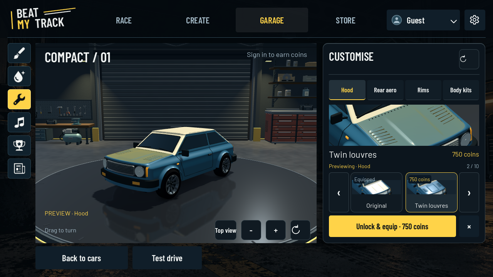

# Customisation carousel and free preview — 2026-10-24

CCP01–CCP04/R01/Q01 implement the owner's supplied Garage reference and explicit requirement that preview must work without purchase.

The right workbench has one row of Hood / Rear aero / Rims / Body kits tabs, a selected-part detail view, readable item name and account-driven price/ownership, a horizontal choice carousel, and a separate equip action. Patterns use the same carousel and preview/equip separation. The primary car remains attached, with its camera, turntable, paint, wear and reflection rig retained. A gold overlay applies only to the selected part's existing mesh instances, and the main car pane identifies a temporary preview. Cancel restores the equipped appearance. Changing category, paint tab, section, car, account or visibility discards a temporary preview.

Browsing all 43 part choices and 49 paint designs is independent of ownership. Preview does not change equipped IDs, local appearance saves, achievement progress, the upload outbox or the coin ledger. Equip uses the existing ownership and explicit purchase confirmation path. A preview serial additionally fences delayed purchase replies, so cancelling or browsing elsewhere cannot equip an obsolete selection. Prices and ownership come from the existing economy service. Existing cleanliness requirements and the Compact-only kit catalogue remain.

CCP02 reuses the existing gesture-owning carousel for mouse drag, wheel, touch, snapping and bounded spring return at both ends. Arrows, cancel and equip have at least 52-unit touch targets; keyboard focus reveals complete cards. The right panel scales between 344 and 520 units. At short landscape heights, compact spacing and insets keep the carousel/actions visible; the main car provides the large preview. Taller windows also show a 768 × 384, two-sample, on-demand detail target whose camera shares the actual showroom world/car. There is no duplicate car, extra per-choice world, new artwork or continuously rendered detail target. The existing sixteen-thumbnail cache is retained.

Runtime changes are limited to `game/ui/garage_page.gd`, `garage_livery_menu.gd` and new `garage_cosmetic_shelf.gd`, `garage_part_highlight.gd` / `.gdshader`, plus resource IDs. The focused suite is `game/tests/test_customisation_carousel.gd`. No simulation, geometry, saved appearance schema, economy API or backend authority contract changed.

Run the focused native checks through the pinned engine entry point:

```powershell
powershell -NoProfile -ExecutionPolicy Bypass -File docs/evidence/customisation-carousel-2026-10-24/run.ps1 -Mode headless
powershell -NoProfile -ExecutionPolicy Bypass -File docs/evidence/customisation-carousel-2026-10-24/run.ps1 -Mode gl_compatibility
powershell -NoProfile -ExecutionPolicy Bypass -File docs/evidence/customisation-carousel-2026-10-24/run.ps1 -Mode mobile
```

The focused results are 227 checks headless and 248 checks per desktop renderer. Existing clean-car checks pass 262, retained customisation checks 1,396, ownership checks 9, App checks 141, and rendered Garage presentation checks 86. The final full script parser and pinned headless import also pass.

The runner isolates APPDATA and all fixture records under task-specific paths. Exact expanded commands, timestamps, exit codes, checks, source/capture hashes, corrections and checkpoint verification are recorded in [report.json](evidence/customisation-carousel-2026-10-24/report.json). Existing checks cover exterior cleanliness, retained paint/sticker controls and geometry/thumbnail data, account ownership, App navigation and the Garage's other views. The earlier two-column Tuning layout test is unchanged; its grid-specific assertions describe the presentation explicitly superseded by this request. New layout checks enforce full card visibility and control bounds for the requested carousel.

Initial null button callback, absent metadata, short App layout, live-world binding and detached deferred-layout errors were corrected, with failed runs retained. Screenshot inspection caught the initial blank detail camera despite the first structural pass; final checks verify shared world identity and rendered image variation. The first sandboxed engine startup was denied access to the Windows certificate store; local validation succeeded with reviewed execution access. No existing assertion was removed or weakened.

[Open the native review and captured carousel animation](evidence/customisation-carousel-2026-10-24/preview.html).



Client reload and owner visual/interaction acceptance remain. Desktop Mobile verification runs on the Windows GPU; this is not a phone performance measurement. The extra selected-part camera and highlight still need physical-device cost/appearance acceptance. No phone/tablet attachment check or physical-device test, APK/export/install, actual purchase, live mutation, deployment or owner-process restart was performed. Concurrent work is preserved. The task-only Git patch is reviewable against exact task-start source copies; nothing was staged or committed.
