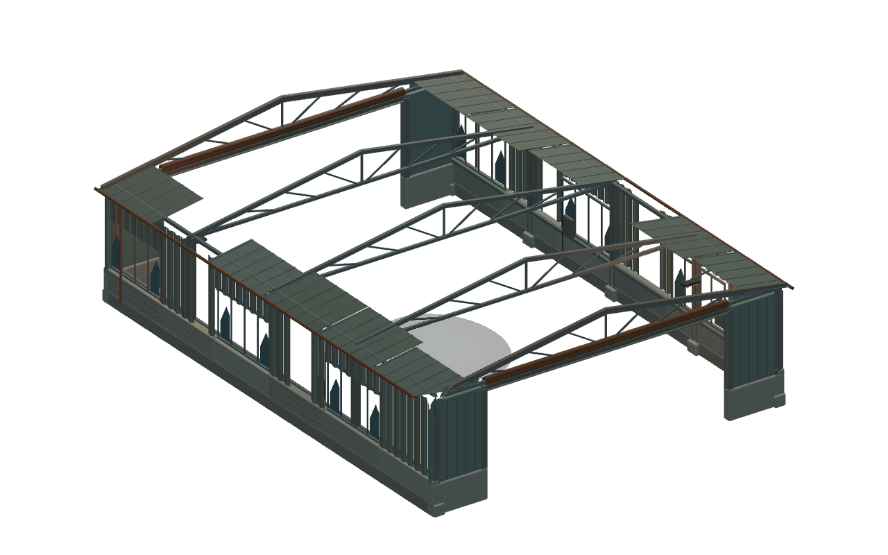
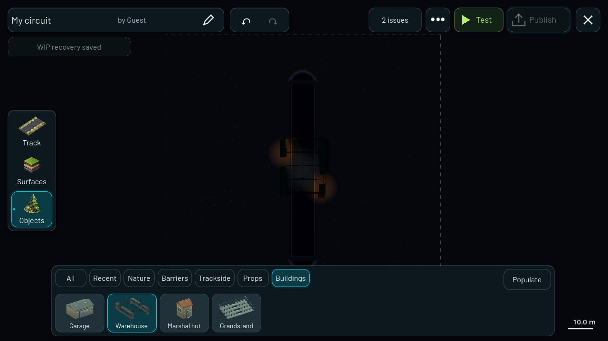

# Abandoned drive-through warehouse — 2026-10-16

Night → Buildings now offers **Warehouse**. Place it across a road and rotate its two open ends to follow the road. It is an original ruined industrial shell with raised roller doors, corrugated metal, broken glazing, missing wall/roof panels, exposed steel trusses, masonry, rust tears, caged lamps, electrical cabinets, guttering and bolted foundations.

WH01 covers Night-only placement, saved ID/JSON and native previews. WH02 covers both open ends, road preservation and real side-wall collision. WH03 covers the abandoned model and camera visibility. WH04 covers retained editor/cache behavior, bounded lighting and canonical isolation.

The shell is24m long with12.3m clear openings at scale1; its full selection outline is19.2m by25m. Collision follows the two long walls and the end panels beside the entrances. It never stamps a solid rectangle or a floor over the road. The central roof has collapsed, so the existing overhead camera can show the car throughout the passage. Thin overhead trusses and side roof remnants retain the building silhouette. Buried footings meet the surrounding ground even at0.5x on raised asphalt. The final model is9,790 triangles, below the existing10,000-triangle per-object review budget.

Two warm fixtures use the existing four-light Night pool, with a conservative bound covering arbitrary rotation near terrain edges. The new object shares the existing static Night material, contact shading, retained editor batches and prepared-world caches. No new per-frame geometry, shader, rendering world, camera mode or canonical state fields were introduced. `authored-props-9-drive-through-warehouse` fences older prepared meshes and photographs. Compiler27/physics0.60 stay unchanged. Placement is manual; Populate's existing roadside clearance behavior remains.

Actual validation on Godot4.7.2, using isolated `build/warehouse-*-user` APPDATA:

- Dedicated warehouse suite:264 headless and282 per native renderer. Six allowed scales from0.5–3x and five rotations, including37°, preserve the asphalt through both doors and the interior. Solid side/end masks, JSON identity and native barrier suppression pass.
- All five cars drive completely through in both directions with zero collisions, retain asphalt and replay exact vehicle snapshots. Sideways swept contacts hit the actual walls.
- Native Compatibility/Mobile views cover the entry, interior and exit with the original gameplay camera and a Pickup. Actual browser placement onto an existing road, one-step undo/redo, native building preview and editor refresh/removal pass. Presentation leaves vehicle snapshots exact.
- Existing Night suite103, all-prop geometry/isolation834, prepared-race ownership/bounds85 and whole-project parser823 pass at the observed runs.

The initial fixture used negative road headings and a noncanonical throttle value; normalizing headings and using the actual byte input corrected it. The first model exceeded the triangle limit at10,480; refining tiny fasteners, roof seams and roller hoops brought it below the original bound. A temporary boundary-light fixture changed its own source before asserting an unchanged editor refresh; restoring that fixture source corrected the test. All failures remain in the retained logs.

The open straight road used for native editor/practice views intentionally lacks a closed timed-race route. Its editor route issues are visible; this is not a complete publishable circuit or a verified lap. Scripted native captures also retain cold-start/render diagnostic hitches and low synthetic telemetry readings. They are visual checks, not a frame-rate measurement or a hitch-free claim.

Commands, hashes, final/initial logs, captures and the task-only Git checkpoint/patch are in [report.json](evidence/warehouse-2026-10-16/report.json). Existing saved tracks and independent work are preserved. No external media/audio, phone test, attachment check, APK, backend/catalog mutation or deployment. Owner/device visual and performance acceptance remain.
