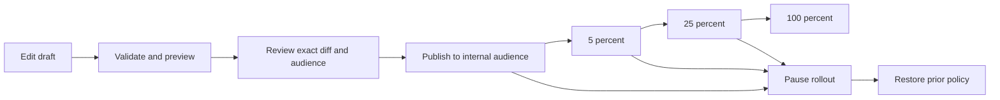

# Beat my track Game Configuration interface specification

**Status: Design for review. Date: 2026-10-24.**

**Implementation follow-up:** The owner subsequently authorized implementation. The [2026-10-24 implementation report](GAME_CONFIGURATION_IMPLEMENTATION_2026_10_24.md) identifies the delivered app/backend/Studio controls, required A/B integration, actual verification and remaining rollout/future-policy limits. The design below remains the broader use-case inventory.

Game Configuration gives the owner a single place in Studio to control advertising, existing feature availability and future approved live operations, with integrated **A/B and A/B/n testing**. Each change can be previewed for a player, published to a limited audience, measured and rolled back. The game applies settings at defined transitions while the backend retains authority over purchases, rewards and competitive contracts.

**A/B testing is a required capability of the first operational release.** It includes creating control/treatment variants, stable assignment, actual exposure tracking, comparative results and reviewed promotion or rollback. A configuration editor alone does not satisfy this specification.

This specification covers the administration interface, its service and client contracts, and use cases. All screens, new parameters, ranges and delivery timings below are proposals. Creating this specification does not activate a policy or authorize implementation.

## 1. Existing behavior and design boundaries

The attached ideas supply the starting point. The following existing decisions determine how they fit Beat my track:

| Area | Existing baseline | Consequence for this interface |
| --- | --- | --- |
| Studio | Eight workspaces, owner and analyst access, audit history, release registry and presentation experiment registry. | Add Game Configuration within Administration and link it from relevant workspaces. Extend existing registries. |
| Automatic interstitial | Three ordinary race finishes **OR** ten active foreground minutes, with presentation deferred to a race finish. Currently uses the Android debug Show ads opt-in and demo integration. | Offer this as the existing cadence preset. Production enablement remains separately gated. |
| Attachment ad examples | Four races **AND** six minutes, first-ad delay, rewarded-ad cooldown and session cap. | Provide an alternative draft preset, clearly labelled as a proposal. |
| Experiments | Existing allowlist covers onboarding message, offer layout and store ordering; stable signed-in assignments and explicit exposure endpoints exist. | Ad-policy experiments need an additional supported setting type and client integration. An active registry entry alone cannot deliver it. |
| Publishing | One initial free publishing slot per account; purchased capacity and consumed publications persist. | Recurring monthly allowances remain a future policy decision. Config cannot reset capacity or revoke purchases. |
| Coins | Guests earn no Coins. Registered-player rewards are issued by the server; the current clean-race bonus is 200 Coins. | Reward amounts belong to a future versioned server policy, with matching client presentation. |
| Competitive play | Rules, track versions and car/setup are pinned. World Ranking includes purpose-bound free official resumes. | A policy change cannot modify an active race, published challenge or competition's promised terms. |

Production advertising needs a supported release client, configured provider integration and an approved audience/consent policy. A remote toggle cannot supply these prerequisites.

The existing product invariants remain constraints: unlimited ordinary racing, free racing on shared tracks, performance progression obtainable by driving, and preserved owned benefits. There is no arbitrary script, SQL, executable code or unrestricted URL field in Game Configuration.

## 2. Navigation and common interface

Entry: **Studio → Administration → Game Configuration**. Monetisation links directly to Advertising; Content & competitions links to competition settings; Player support links to the selected player's effective configuration. Existing Administration → Experiments remains the experiment workspace, with links in both directions.

Game Configuration tabs:

| Tab | Main purpose | Main actions |
| --- | --- | --- |
| Overview | Explain current policy and delivery health. | Open active version, create draft, inspect rollout, emergency disable. |
| Settings | Edit typed settings by category. | Edit, reset an override to inherited value, compare, save draft. |
| Audiences | Define eligible populations and overrides. | Create rule, preview matches, inspect overlaps. |
| A/B testing | Manage experiments through the existing registry with configuration context. | Create control/treatment variants, allocate traffic, inspect exposure and results, pause, promote a variant. |
| Releases | Review, schedule and advance configuration rollouts. | Validate, publish, advance, pause, cancel schedule. |
| History | Inspect immutable published versions and command history. | Compare versions, clone, restore a version. |
| Player preview | Explain what a real or hypothetical client would receive. | Resolve settings, simulate an ad decision, inspect exclusions. |

Every tab retains a header showing environment, backend origin, active version, publication time and latest delivery observation. Changing environment clears the selection and unsaved edits only after an explicit discard choice. Environment names appear as text as well as colour. A production draft is a separate object from a staging draft.

Reuse Studio's navigation, light workspace, teal primary actions, forms and tables. Reserve red for restrictive emergency actions. Use plain labels such as **Minimum time between ads**, display units beside every number, and show **Inherited**, **Overridden**, **Locked**, **Needs client support** or **Unavailable** as text.

The settings toolbar contains search, category, state and compatible-build filters. Each row shows name, explanation, effective value, draft value, source audience, activation boundary and validation state. Row details expose defaults, supported builds, range, owner and history. Parameter identifiers belong in an expandable technical detail, rather than the ordinary editing flow.

At 1280×800, the setting form and an impact summary appear side by side. At narrow widths or 200% zoom, the summary follows the form. All fields and commands work by keyboard; errors link to fields, focus returns after dialogs, and status updates do not move the current input.

### Overview content

The first row shows active policy version, rollout coverage, reporting clients that applied it, and config-delivery health. Counts include a time window and reporting denominator. An estimate of eligible accounts is labelled as an estimate; missing guest or device coverage is shown as unavailable.

Below it, show Advertising, Features, Economy, Competitions, Store and Messaging cards with a short policy summary and links to current overrides. A second panel shows scheduled changes, running experiments, recent publications and active emergency restrictions. An alert links to clients using old or rejected settings without claiming that every installed app has reported.

## 3. Advertising screen

The advertising editor is the primary first-release screen. It presents the complete policy in ordinary language before exposing individual fields.

Illustrative wireframe; values show an unpublished example:

```text
Administration / Game Configuration / Settings / Advertising
Environment: Production       Active: v42       Draft: Unsaved changes

Policy summary
After 4 completed races AND 6 active minutes, at an ordinary race finish.
First ad after 6 active minutes. At most 3 automatic ads per session.

Automatic ads                         Player and delivery preview
  Enable automatic ads       [Off]      Platform          Android
  Placement                  Race end  Build             Select build
  Become due when            [Both v]   Access            No ad-free access
  Completed races            [4]       Capability        Needs supported build
  Active minutes             [6]       Result            Not eligible
  First-ad delay, minutes     [6]       Reason            Automatic ads disabled

Spacing and limits
  Minimum races between ads  [4]
  Minimum minutes between ads[6]
  Wait after rewarded ad     [10] min
  Maximum per session        [3]

Rewarded ads
  Offer rewarded Resume      [Off]
  Reward description         Existing approved Resume entitlement

[Preview a session] [Create A/B test] [Compare with active]
[Save draft] [Review publication]
```

**Create A/B test** copies the selected policy into a control and treatment draft. An experiment selector lets the owner edit each variant using the same advertising form and preview its complete effective policy. Every registered experiment-eligible setting exposes this action; locked or unsupported settings explain their restriction.

### Advertising controls

The first release exposes only supported placements: automatic ads after ordinary race completion and the existing explicit rewarded-Resume offer. New placements and reward mechanics require client work.

| Control | Input and proposed validation | Meaning |
| --- | --- | --- |
| All advertising permitted | On/off; restrictive master control. | Off suppresses new automatic and rewarded requests. In-flight earned obligations still settle. |
| Automatic ads enabled | On/off. | Effective only when master, release capability, provider and player-policy checks permit it. |
| Placement | Read-only: ordinary race finish. | After saving/building results, before a new driving attempt begins. |
| Become due when | Either threshold / Both thresholds. | Explicitly selects **OR** or **AND**; neither is implicit in the UI. |
| Completed races threshold | Integer 1–100. | Finishes since the last shown automatic ad, or session start. |
| Active time threshold | 1–120 minutes, stored in seconds. | Qualifying foreground time over the same interval. |
| First-ad delay | 0–120 active minutes. | Minimum qualifying time from the start of this app session. Zero adds no delay. |
| Minimum races between ads | Integer 0–100. | Additional hard minimum; applies even when the time trigger is already due. |
| Minimum time between ads | 0–120 active minutes. | Additional hard minimum; applies even when the race trigger is already due. |
| Wait after rewarded ad | 0–120 active minutes. | Suppresses automatic ads after an actual rewarded-ad presentation. It does not restrict banked or free resumes. |
| Maximum automatic ads per session | Integer 1–100, or explicit No additional cap. | Counts actual automatic ad presentations. Zero is rejected rather than interpreted as unlimited. |
| Rewarded Resume offered | On/off. | Controls new ad-funded offers after existing owned/free sources, within the race's pinned resume policy. |
| Reward type and amount | Read-only until a supported server reward policy exists. | Display the exact promised benefit. Config cannot mint an entitlement. |
| Reward multiplier | Future, locked. | The attachment's 2× example needs an approved reward type, bounded server policy and corresponding client support. |
| Ads during racing, editor tests, practice or Garage free drive | Locked off. | These states never become automatic ad placements. |

Ranges are proposed operator limits, to be confirmed before implementation. The validator also checks combinations: a hard minimum can make an OR policy behave more restrictively, and the summary must explain that outcome. A deliberately cap-free policy requires an explicit selection.

Two draft presets make the difference visible:

| Preset | Due rule | Additional spacing and limits |
| --- | --- | --- |
| Existing cadence | 3 finishes **OR** 10 active minutes. | No new first-ad delay, spacing or cap; existing entitlement/lifecycle checks remain. |
| Attachment example | 4 finishes **AND** 6 active minutes. | First delay 6 minutes; minimum spacing 4 finishes and 6 active minutes; 10-minute pause after rewarded ad; 3 automatic ads/session. |

Selecting a preset fills a draft and shows a diff. Both retain production advertising disabled until release prerequisites are satisfied. Demo/debug opt-in remains a separate local prerequisite and cannot be switched on remotely.

### Exact eligibility and counter behavior

An automatic ad is eligible only when **all** of these hold: advertising permitted, automatic placement enabled, supported client/provider, permitted player policy, no applicable ad-free entitlement, due rule satisfied, first-ad delay satisfied, both hard spacing minima satisfied, rewarded cooldown satisfied, session cap available, fresh emergency status, loaded ad available and the exact ordinary result still visible.

Signed-in entitlement reads that fail or become stale suppress the opportunity. Guests use the supported guest eligibility path and public policy; guest state never clears a known signed-in ad-free entitlement during an account transition.

Count each completed Free Race, Rivalry or Challenge attempt once. Abandonment, restart before completion, duplicate callbacks, creator tests, practice and Garage free drive add no finishes. Qualifying time follows the existing cadence definition: foreground menus and ordinary racing; excludes background/focus loss, paused races/results, loading, editor/draft work, practice and ads. Use a monotonic clock outside canonical simulation.

An ad session is the current app-process session. Backgrounding preserves its counters while adding no active time; cold restart starts a new session. A future cross-session or daily cap requires its own persistence contract and is outside the first release. Keep the process-wide session cap conservative across account switches, while fencing private settings and entitlement data by account.

Only an actual automatic-ad show resets race/time spacing counters; finalize the reset after its fullscreen lifecycle returns. Loading, no-fill, timeout, navigation cancellation and failed ownership reads preserve the due state. Rewarded ads update their own automatic-ad cooldown without consuming automatic-ad count or resetting its due counters. Duplicate SDK callbacks cannot count another impression or grant another benefit.

If a rewarded offer lacks permission or availability, explain that it is temporarily unavailable and consume nothing. Preserve existing banked, daily and competition-specific free sources. A release client cannot enter the development-only temporary ad bypass through a config change.

A policy update preserves accumulated counters and the number already shown. It evaluates the new thresholds at the next eligible result. Lowering a session cap below the number already shown suppresses further ads. Increasing frequency never creates a menu popup or interrupts a race. Implemented counters must retain enough bounded information for the supported threshold range rather than saturating at an earlier, smaller threshold.

The session preview accepts race durations, finish/abandon events, foreground/background periods, rewarded ads, entitlement state and no-fill outcomes. Its timeline marks **Due**, **Suppressed**, **Shown** and the reason. Previewing has no player or provider side effect.

## 4. Other configuration categories

Controls are registered individually. Each has a type, allowed range or enumeration, default, authority, compatible capabilities, activation boundary and experiment eligibility. The interface cannot create an unregistered key.

| Category | Intended controls | Activation and limits |
| --- | --- | --- |
| Feature availability | Enable an implemented entry point; restrict a faulty optional feature; expose a compatible feature to internal testers. | Next menu entry. Preserve saved data, owned content and existing in-flight actions. Unsupported client capability disables the control. |
| Rewards and progression | Future approved base/bonus amounts, existing reward-type enablement, bounded cosmetic reward multipliers. | Server policy pinned when the qualifying action starts; settlement reuses it. Guests keep zero Coins. No paid competitive power or exhaustion of ordinary base progression. |
| Publishing capacity | Inspect current initial allowance and purchased/granted capacity; future policy for new-account initial allowance. | Backend authority. Existing balances, consumed publications and purchases remain. Monthly allowance is locked pending a separate owner decision. Local draft/save/export remains available. |
| Store presentation | Select/order existing offers, approved copy, supported presentation variants; link to current product availability controls. | Next Store entry. Prices and purchase fulfillment stay with the commerce/provider contracts; remote presentation cannot invent a price or enable simulation in release. |
| Competitions | Visibility, future-event schedule, eligible approved track pool and supported event templates. | New event/week only. Published rules, scores, free resume promises and existing starts remain pinned. Use existing Rivalry planning tools for actual event editing. |
| Challenges and tasks | Visibility of implemented formats; future default duration/tries and supported task templates. | New creation only. An existing challenge keeps its exact track/car/rules/deadline/tries. Award receipts remain authoritative. |
| Messages and service status | Supported localized notice, expiry, severity and allowlisted internal destination; feature-specific maintenance notice. | Next safe menu transition. Preview wrapping and every supported locale. No arbitrary HTML or executable content. |
| Compatibility guidance | Supported optional-update notice and existing service compatibility requirements. | Respect existing bootstrap/race contracts. A notice cannot invalidate an already accepted upload or turn offline ordinary driving into a remote dependency. |
| Presentation and performance | Existing bounded quality presets or cosmetic effects with client support. | Menu/new-world boundary as registered; respect a player's explicit settings. Canonical physics, timing, collision, gates and scoring are locked. |

Display future categories as **Planned** with an explanation and link to their prerequisites. Controls cannot become clickable merely because an administrator adds a value to storage.

## 5. Audiences and player preview

An audience has a name, purpose, environment, typed conditions, priority and linked releases. First-release conditions support platform, registered compatible build range, client capability, authenticated/guest state, explicit internal-test membership and authoritative entitlement state. Client-reported platform/build values are compatibility hints, never proof of eligibility for money or rewards.

Later conditions may include approved territory, account age or activity segments when authoritative data and policy exist. Unknown data produces a visible non-match and the baseline policy. Do not introduce advertising IDs, guest identity linking or inferred age/location through configuration. Consent and commercial eligibility are gates, not experiment variants.

Audience preview shows each condition, its source, match/non-match/unknown, estimated recent reach and coverage limits. A real-player lookup uses existing support authorization, records access and exposes no credentials. A hypothetical profile needs no real account and is clearly labelled simulated.

Resolution order is deterministic:

1. Start with built-in defaults and the environment's published baseline.
2. Apply matching audience overrides in declared priority order; higher priority wins. Equal-priority overlapping writes to the same key block publication.
3. Apply the assigned variant for supported keys in one exclusive experiment layer.
4. Apply active restrictive emergency overrides.
5. Enforce hard limits, entitlement protection, consent/provider prerequisites and client compatibility.

Compile and validate the complete effective policy atomically after resolution. Validate every satisfiable audience/variant combination; ambiguous overlap is a publication error. Preview explains each final value's source, overwritten rules, restrictions and activation boundary. **Set to default** and **Remove this override** are separate actions.

The player preview also separates **Expected from server now**, **Last reported as applied** and **Pending until safe transition**. A server resolution is not proof that an offline client received it.

## 6. Drafts, publication and rollout

Published snapshots are immutable. Editing creates a draft based on an explicit active revision. The interface lifecycle is **Draft → Validated → Scheduled or Rolling out → Fully active → Superseded**. Cancelled schedules and restored versions remain in history. Emergency restrictions have their own visible state.



The review page shows the environment, exact before/after values, affected audience, client support, active experiment interaction, effective time, activation boundaries, fallback, rollout stages and recorded reason. It blocks unsupported settings, invalid combinations, policy violations, unresolved overlaps and drafts based on stale active revisions.

Publishing uses one owner command after this review. An analyst can inspect and preview. Existing staff identity and step-up policy apply; the design does not assume that a shared owner credential identifies an individual person. Audit presentation states the actual available actor identity.

Rollout defaults to explicit owner advancement: internal testers, then 5%, 25% and 100% of the eligible audience. A stable account bucket and fixed release salt make successive stages nested. Per-stage audience estimates show the denominator. Guests receive the public baseline in the first release; percentage experiments and personalized rollouts initially cover signed-in accounts only.

**Pause rollout** stops enrolling additional accounts and holds already delivered policy. **Restore prior policy** actively publishes the previous values under a new generation. These are distinct actions. Clients must never encounter a numeric version moving backward.

The stage panel shows observed application, validation failures, config errors, ad show/no-fill/error rates and available quality metrics against the previous policy. Missing instrumentation is labelled unavailable. Automatic promotion is off; predeclared severe delivery-error thresholds may pause expansion, with any automatic restore policy explicitly included in the review.

Schedules display local time with timezone and exact UTC. Activation revalidates the draft's base revision, capabilities, overlaps and experiment state. A failed check produces **Blocked**, leaves the active policy in place and links to the conflict. Ending a timed override re-resolves the current policy rather than replaying an old snapshot over later changes.

Draft saves, publication, stage advancement, schedule changes, restore and emergency commands use revision checks and idempotency identities. A lost reply can be retried without publishing twice. Concurrent edits show a field-level diff for reconciliation and never overwrite silently.

## 7. Emergency controls and recovery

Overview and Advertising expose **Disable automatic ads**, **Disable rewarded-ad offers** and **Disable all advertising**. Other feature restrictions appear only for implemented features with a registered safe disable action. The dialog shows environment, scope, effect and a required incident reason; the command then publishes a small restrictive override.

An emergency restriction has precedence over audiences and experiments. It cancels pending presentation opportunities once received. An ad already displayed closes through the SDK's normal lifecycle; a completed reward continues through its original idempotent settlement. Disabling purchases blocks new intents while preserving owned benefits and pending legitimate fulfillment.

Proposed delivery: a small conditional emergency-status read at startup, foreground return and at most every two foreground minutes in safe menu states. It is deferred during driving/loading. A new fullscreen-ad request requires emergency status confirmed within the previous two minutes; otherwise skip that opportunity and refresh asynchronously. Offline or unreachable clients cannot be commanded instantly, and the UI displays the last observation rather than promising universal immediate delivery.

Removing a restriction is a separate reviewed action. It never silently expires into enabled advertising. Restoring an older configuration preserves current emergency restrictions until they are explicitly cleared. Restore previews also show keys added since that older version, using registered safe defaults for those keys.

## 8. A/B testing interface and measurement

Extend the existing experiment registry rather than creating a competing assignment service. Each experiment specifies a hypothesis, supported configuration keys, eligible audience, enrollment percentage, exclusive layer, control, variants, allocation, primary metric, guardrails, minimum mature sample, observation horizon and decision owner.

Support ordinary **A/B tests with a control and one treatment**, and **A/B/n tests with up to four total variants**, using the same assignment, delivery and analysis contracts. Every registered setting declares whether it can be tested. Advertising frequency, delay, cooldown and session caps must be testable in the first operational release. Supported feature visibility, messaging and Store presentation can use the same interface as their client capabilities become available. Future server reward policies require their separately approved authority and fairness rules.

### Experiment builder and results

The A/B testing tab lists Draft, Running, Paused and Completed experiments, with hypothesis, audience, enrollment, variants, primary metric, exposure count and results readiness. Opening an experiment shows **Setup**, **Variants**, **Audience**, **Metrics**, **Preview** and **Results**.

| Builder area | Required controls and behavior |
| --- | --- |
| Setup | Name, hypothesis, owner, baseline version and exclusive layer. An A/A option duplicates the control for delivery validation. |
| Variants | One labelled control plus one to three treatments; add/remove while draft; side-by-side setting diffs and effective summaries. The control can be the pinned current policy or an explicitly supported no-ad policy. |
| Audience | Supported eligibility filters, total enrollment percentage and per-variant weights that sum to 100%. Show the effective percentage of the eligible population for each arm. |
| Metrics | One primary metric, observation horizon, minimum mature sample and available retention, ad-error, revenue and quality guardrails. Display source availability before activation; an unavailable primary metric or exposure feed blocks starting the test. |
| Preview | Resolve each variant for a compatible hypothetical client, simulate ad opportunities and check conflicts without assigning a real player. Flag variants with identical effective behavior, including hard minima that mask different thresholds. |
| Review and start | Show the complete variant policies, eligibility, allocation, expected exposure boundary, metric readiness and stop behavior; activate through the existing audited owner flow. |
| Results | Control/treatment sample and exposure counts, denominators, metric values, absolute and relative differences, uncertainty, maturity, allocation checks and guardrail status. |

An illustrative setup is: **Ad spacing test → 10% of eligible signed-in Android players → A 50% / B 50% → A: existing 3 races OR 10 minutes; B: 4 races AND 6 minutes**. Both use the same declared common settings and protection rules. Each arm's session preview explains the resulting behavior.

Freeze the compared policy group's common values as well as its variant overrides when starting. A competing baseline edit to that group requires an experiment conflict review and pause/new experiment where needed; it cannot silently change the comparison. Emergency restrictions and entitlement protections always retain precedence and are annotated on results.

The attachment's illustrative frequency experiment can be represented as:

| Variant | Share of enrolled accounts | Policy |
| --- | --- | --- |
| A, control | 33% | 3 races AND 4 active minutes. |
| B | 34% | 4 races AND 6 active minutes. |
| C | 33% | 5 races AND 7 active minutes. |

These are example candidates, not accepted balance values. The displayed due rules assume common additional spacing minima of zero; previews still enforce first-ad protection, cooldown, caps and all other eligibility gates. First run an A/A delivery check. Enrollment percentage and variant percentages are distinct: enrolling 10% with this allocation reaches 3.3%, 3.4% and 3.3% of the eligible audience respectively. Preview shows both.

Assignment is stable by server account across devices; sign-out uses the guest baseline and never inherits another account's assignment. Guest experiments and guest-to-account attribution need a separate identity decision. One account can receive at most one experiment per exclusive layer; ad frequency/cooldown experiments share a layer. Overlapping writes from other layers block activation.

Freeze variant definitions, weights and assignment salt when the experiment starts. Changing them creates a new experiment; expanding enrollment preserves existing assignments. **Pause experiment delivery** returns participants to the current non-experiment baseline at the registered boundary, keeps assignment history and stops new exposure. Resuming reuses assignments. This differs from pausing rollout expansion, which holds delivered policy.

Record exposure when the applied policy first governs a qualifying opportunity, including control/no-ad variants. For ad experiments this is the first ordinary result boundary meeting common player/client eligibility, before variant-dependent due, delay, cooldown, cap or no-fill outcomes; counting only shown ads would bias the comparison. Assignment retrieval and config download are not exposure.

Attach effective policy version, resolution identity, experiment/variant and application time to relevant observations. Attribute each decision using the policy active when it happened. Record a new effective exposure when a new policy actually applies. Backend reward records carry their own authoritative policy identity.

Scorecards show assignment, application and exposure counts separately; sample-ratio checks; mature D1/D7 retention; races/player; foreground duration; ad requests/shows/errors; and verified provider revenue when available. ARPDAU and revenue lift require provider-backed money, currency/accounting context and sufficient coverage. Missing feeds, guest coverage, immature follow-up or artificial-population contamination prevent an optimization conclusion. Preserve inclusive Studio totals and label the actual experiment-analysis scope.

There is no automatic winner. A decision requires the predeclared metric/horizon, guardrails and uncertainty, with repeated-testing or multiple-comparison handling declared before launch. **Promote variant** copies it into a reviewed baseline draft; stopping an experiment alone does not promote its settings.

## 9. Client delivery and authority contract

Use the existing backend API, authentication, persistence and worker boundaries. A typed versioned snapshot in the existing database is the initial design; introducing a second remote-config vendor is a separate infrastructure choice. Publish a prevalidated active generation and resolve from bounded cached data. Config requests do not scan player history or occupy verification worker batches. Reach estimates and delivery totals use bounded prepared aggregates, rather than resolving every account during a page load.

### Fetch and activation

Bootstrap advertises supported config protocol and endpoint. A client without that capability follows its existing behavior. A supporting client requests asynchronously at startup, foreground return, after an account/origin change and approximately every 30 minutes with jitter. Menu returns may trigger a rate-limited refresh. One in-flight request is shared; replies are fenced by account, origin and request generation.

The proposed snapshot limit is 64 KiB. Use conditional requests, bounded parsing, backoff and atomic last-known-good storage. Normal config work, persistence and telemetry drain defer during driving/loading. Emergency reads follow the separate small, rate-limited contract above. No network, wall clock or config resolution enters canonical simulation.

Apply a coherent policy group at its registered boundary: ad eligibility at the next qualifying result, menus on next entry, rewards on the server's next qualifying action start, and competition policy at the next event creation. A received version can remain pending for several groups; acknowledgements report the applied group versions rather than pretending everything changed at once. Recheck emergency restrictions at an ad handoff.

Built-in safe defaults cover first launch. A valid cache can serve presentation settings for a proposed maximum of seven days; expired, corrupt, incompatible or account-mismatched data falls back to built-in values. New advertising requires fresh emergency permission. Scheduled commercial offers require trusted current server time; uncertainty hides the offer. Clock rollback cannot extend permission. Online rewards and entitlements use server truth regardless of cache age.

Unknown optional fields can be ignored only when declared optional by the schema. An unsupported required capability or invalid coherent group rejects that group and retains its compatible last-known-good/default group. Audit delivery telemetry records rejection and its reason. A snapshot never half-applies an ad policy or purchase presentation.

### Proposed service surface

Paths and payload names are illustrative design contracts; they are not implemented endpoints.

| Interface | Purpose and response |
| --- | --- |
| `GET /v1/game-config` | Public guest baseline or private authenticated resolution. Accept supported schema, registered build, platform and capabilities; return versioned effective groups and assignments. |
| `GET /v1/game-config/emergency` | Small conditional read of current restrictive generation and bounded validity. |
| `GET /v1/admin/game-config` | Current state, paged versions, drafts and delivery summary. |
| `GET /v1/admin/game-config/parameters` | Typed registry, allowed values, prerequisites and activation metadata. |
| `POST /v1/admin/game-config/drafts` | Clone an explicit published version into a draft. |
| `PATCH /v1/admin/game-config/drafts/{id}` | Revision-fenced edits of values/audiences. |
| `POST /v1/admin/game-config/drafts/{id}/validate` | Validation results, overlaps, compatible-build coverage and effective-policy previews. |
| `POST /v1/admin/game-config/preview` | Side-effect-free resolution/session simulation for a supported hypothetical context or authorized player. |
| `POST /v1/admin/game-config/drafts/{id}/publish` | Publish now or create an explicit schedule; return command/audit identity and new generation. |
| `POST /v1/admin/game-config/releases/{id}/advance` | Advance a rollout stage after checking its current revision. |
| `POST /v1/admin/game-config/releases/{id}/pause` | Hold rollout expansion. |
| `POST /v1/admin/game-config/releases/{id}/cancel-schedule` | Cancel an unactivated schedule with audit evidence. |
| `POST /v1/admin/game-config/restore` | Publish a reviewed prior policy under a new generation. |
| `POST /v1/admin/game-config/emergency` | Create or explicitly clear a restrictive override. |

Audience editing is part of a draft. History/delivery lists use bounded stable cursors. Use existing `/v1/admin/experiments`, `/v1/experiments/assignments` and exposure routes for experiments; the config resolution must reference the same committed assignments. Application/rejection acknowledgements use the existing bounded telemetry mechanism, extended with registered event types rather than an additional unbounded uploader.

Config GETs and previews do not create assignments. If enrollment is needed, return the baseline with an assignment-refresh indicator; the client uses the existing assignment POST and then performs one coalesced config refresh. Until a committed assignment is available, its experimental settings cannot apply. Account authorization failure returns an explicit auth error; it cannot silently substitute a guest policy that permits more advertising.

The client envelope includes schema version, monotonic published generation, content version, account/origin scope, resolution identity, server time, refresh/expiry information, effective groups with activation metadata, and assignment references. The server returns one coherent generation. A conditional response renews validity only through explicit server freshness metadata. Authenticated responses use private caching; no account-specific response enters a shared public cache. The client never sends an arbitrary player ID to choose another player's settings.

Every administrative mutation carries `command_id`, `expected_revision`, reason and exact intended payload; repeat commands return the committed result. Conflicting revisions produce a conflict response and diff; validation errors identify fields; read-only roles receive an authorization error. Preview and estimated reach cannot create wallets, assign experiments, grant rewards or contact the ad provider.

Client reports are diagnostic observations, not authority. The server resolves valuable actions itself, pins their policy at issuance, and validates subsequent receipts against it. Purchase terms, granted capacity, free resumes, accepted runs and published event rules survive later config changes. Restoring configuration never undoes ledger entries or historical awards.

## 10. Permissions and audit

| Role | Allowed actions |
| --- | --- |
| Analyst | Read settings/history, compare, preview within existing support authorization, inspect delivery and experiment results. |
| Owner | Analyst actions plus create/edit drafts, publish/schedule, advance/pause, restore, emergency restriction and experiment decisions. |

Use existing staff authorization on every API command. Game sessions provide no administrative access. Record draft changes and publication commands with available actor identity, environment, before/after, audience, expected/new revision, command identity, reason and UTC time. Record sensitive player previews through the support access audit. Secrets and raw provider tokens never appear in config, diffs or exports.

History filters by date, actor, setting, environment and release. Its compare view highlights value, audience, capability and timing changes. The owner can download a redacted specification snapshot and audit references for review. Imports, if later provided, must pass the same registry and policy validation.

## 11. Use cases

| ID | Use case | Operator flow | Expected player/service outcome |
| --- | --- | --- | --- |
| UC01 | Reduce automatic ad frequency. | Clone current policy; choose 5 races AND 7 minutes; preview; stage publication. | Subsequent eligible result opportunities use the new spacing; driving continues normally. |
| UC02 | Retain the accepted three-race-or-ten-minute policy. | Select Existing cadence; compare before publishing. | Both triggers are explicit and a time trigger waits for race completion. |
| UC03 | Protect the beginning of a session. | Set first-ad delay and preview several short races. | Thresholds can become due, but no automatic ad shows before the delay. |
| UC04 | Prevent back-to-back rewarded and automatic ads. | Set rewarded cooldown to 10 minutes. | Actual rewarded presentation postpones automatic ads; owned/free resumes continue. |
| UC05 | Limit automatic ads in a long session. | Set session cap to 3; simulate no-fill and several shows. | Only actual automatic shows count; the fourth is suppressed. |
| UC06 | Suppress ads for ad-free players. | Inspect an entitled-player preview. | Entitlement protection wins over every audience and variant. Owner cannot override it. |
| UC07 | Stop ads during a provider incident. | Use Disable all advertising with incident reason. | Newly permitted requests stop as clients receive the restriction or lose fresh permission. In-flight rewards settle. |
| UC08 | Handle no-fill or slow provider responses. | Inspect the decision trace and provider error segment. | Result actions remain usable; due state carries to a later race finish. |
| UC09 | Test an ad policy internally. | Target explicit internal accounts on compatible Android builds. | Public baseline remains; native release/debug prerequisites still apply. |
| UC10 | Expand a successful rollout. | Review delivery/quality at 5%; advance to 25%, then 100%. | Stable nested cohorts avoid random reassignment. Each stage has an audit entry. |
| UC11 | Freeze expansion while investigating. | Pause rollout. | New accounts stay on baseline; accounts already receiving the policy retain it. |
| UC12 | Restore after a bad publication. | Compare a prior version; choose Restore prior policy. | A new generation restores its values at safe boundaries and retains emergency restrictions. |
| UC13 | Compare three ad-frequency policies. | Register hypothesis, variants, allocation, guardrails and horizon. | Signed-in accounts keep assignments; scorecards use actual policy exposure. |
| UC14 | Pause an experiment. | Pause experiment delivery and record the reason. | Next safe boundary returns participants to baseline; historical assignment/exposure remains. |
| UC15 | Promote an experiment result. | Copy the selected variant into a draft; review and roll out. | Baseline changes only through normal publication. |
| UC16 | Explain a player's reported ad behavior. | Open support profile → Effective configuration → ad decision trace. | Staff see expected policy, last applied report, counters when available and suppression reasons; unknowns stay explicit. |
| UC17 | Roll out an implemented feature. | Enable for compatible internal builds, then a bounded audience. | Unsupported builds keep their fallback; existing saved content remains usable. |
| UC18 | Temporarily restrict a faulty optional feature. | Publish a registered feature restriction and notice. | New entry is suppressed; active operations follow their registered completion/recovery contract. |
| UC19 | Change Store presentation. | Reorder existing offers; preview locale/layout; publish. | New Store entries use the presentation; owned benefits and provider checkout terms persist. |
| UC20 | Stop new checkout for a faulty offer. | Open linked product availability controls; disable new intent creation. | Existing ownership, accepted pending fulfillment and recovery remain valid. |
| UC21 | Schedule a future weekly event. | Open competition planner; select approved pool/template and future UTC week. | New event uses the planned terms; current week's rules and scoring remain. |
| UC22 | Change defaults for new challenges. | Select supported duration/tries defaults and a future boundary. | Newly created challenges use them; existing invitations and reserved tries keep their terms. |
| UC23 | Schedule a localized service notice. | Preview each supported locale; choose audience and expiry. | Notice appears at a safe menu entry and expires without overwriting subsequent policy changes. |
| UC24 | Adjust a future cosmetic reward policy. | Choose an approved supported reward amount; stage a server/client policy. | New actions pin the new amount; already started actions settle once under their original policy. |
| UC25 | Consider monthly publishing allowances. | Open the planned allowance panel and inspect prerequisites. | Interface explains the pending policy decision; no monthly refill is activated. |
| UC26 | Continue with an unavailable config service. | Inspect cache/fallback delivery status. | Driving and saved results continue; safe cached/default presentation applies and stale ad permission suppresses ads. |
| UC27 | Switch account or backend origin. | Client signs out/in or changes service endpoint. | Private cache, assignments and replies are fenced; another account's benefits/settings cannot leak. |
| UC28 | Reconcile simultaneous staff edits. | A second publication detects an old base revision. | Active policy remains; owner reviews the exact conflict before publishing a new draft. |
| UC29 | Investigate an offline or old-build client. | Filter delivery by build, applied version and last observation. | Staff distinguish unsupported, pending, rejected and unobserved delivery without assuming universal reach. |
| UC30 | Review accountability. | Filter History by setting/release; compare and export. | Reviewer can identify the actual change, scope, actor evidence and reason. |
| UC31 | Create a two-arm ad-frequency test directly from a setting. | Choose Create A/B test; retain current policy as A; change frequency in B; set 50/50 allocation within the selected enrollment. | Eligible accounts receive one stable policy; non-enrolled accounts keep the baseline. |
| UC32 | Validate the experiment pipeline with an A/A test. | Duplicate the control; use equal allocation; review assignment, application and exposure counts. | Delivery or allocation discrepancies are visible before interpreting a treatment difference. |
| UC33 | Compare a supported feature or Store presentation. | Select an experiment-eligible setting; define control/treatment; preview compatible clients. | The same experiment flow works across supported categories without affecting protected purchase or competitive terms. |
| UC34 | Judge whether an experiment is ready for a decision. | Open Results and inspect mature samples, control/treatment differences, uncertainty, coverage and guardrails. | Insufficient data remains inconclusive; an owner can pause or promote through a reviewed command. |

## 12. Proposed delivery order and acceptance

These are future implementation slices, with no implementation included here. The first operational release requires both slices 1 and 2, including end-to-end A/B testing; the foundation slice alone is not a complete release.

| Slice | Scope | Design requirements |
| --- | --- | --- |
| 1 | Typed registry, baseline snapshots, Advertising editor, preview, history, publish/restore, emergency restriction, client fallback and delivery observations. | RGC01–RGC03, RGC06, RGC08–RGC11; baseline-preview/publication portions of RGC04–RGC05. |
| 2 | Required A/B and A/B/n builder/results, audience overrides, nested rollout, scheduling and supported ad-policy experiments through the existing assignment service. | RGC04–RGC08, RGC10–RGC11; required alongside slice 1 for the first operational release. |
| 3 | Approved server reward policies, additional feature/store/message controls and future-event links as client/domain capabilities become available. | RGC02, RGC08–RGC09. Monthly allowances remain decision-gated. |

| Requirement | Acceptance criterion for later implementation |
| --- | --- |
| RGC01 — Studio interface | Owner can find controls, compare, preview and publish; analyst is read-only; narrow/zoom/keyboard states remain usable. |
| RGC02 — Typed catalog | Every field has units, bounds, default, compatibility, authority and activation metadata; unregistered/unsupported keys cannot publish. |
| RGC03 — Ad policy | Exercise OR/AND, first delay, hard minima, rewarded cooldown, cap, failed show and duplicate callback; preview and real decisions agree. |
| RGC04 — Audience resolution | Deterministic precedence, explicit unknowns, blocked equal-priority conflicts, private player preview and stable nested cohorts. |
| RGC05 — Publication | Immutable atomic generations; concurrent edits conflict; scheduled activation revalidates; lost command replies retry once logically. |
| RGC06 — Restriction and restore | Restrictive override wins; stale ad permission suppresses display; restore creates a new generation and preserves active restrictions. |
| RGC07 — Required A/B testing | First operational release supports A/B and up to four total variants, side-by-side editing, stable shared-account assignment across devices, exclusive layers, no fetch-as-exposure, unbiased no-ad control exposure, mature comparative scorecards and explicit pause/promotion. |
| RGC08 — Delivery | Built-in/cache fallback, corruption/expiry handling, origin/account fences, bounded conditional requests and safe-boundary group activation. |
| RGC09 — Authority and continuity | Owned benefits, free resume promises, valuable-action receipts, accepted uploads and pinned competition contracts survive changes and retries. |
| RGC10 — Observability | Distinguish eligible, assigned, received, applied and exposed; disclose missing coverage, guest limits and unavailable revenue. |
| RGC11 — Access and history | Each command is authorized, revision-fenced, idempotent and audited with actual actor evidence; exports are redacted. |

This design addresses the earlier BMT-060–067 remote-configuration and experiment requirements. It specifies behavior; it does not mark those requirements as implemented or validated.

## 13. References and design delivery record

Existing product and service references:

- [Studio navigation and registries](STUDIO_PLATFORM_2026_10_16.md) and [experiment activation contract](STUDIO_PLATFORM_ACTIVATION.md).
- [Current interstitial cadence](INTERSTITIAL_CADENCE_2026_10_22.md), [AdMob development boundary](ADMOB_DEVELOPMENT.md), and current source [race_ad_breaks.gd](../game/platform/race_ad_breaks.gd).
- [Presentation experiment allowlist and assignments](../backend/bmt_backend/studio_experiments.py).
- [Publishing and entitlement policy](BACKEND_STUDIO_POLICIES_2026_10_11.md), [store authority](STORE_AND_ADMIN.md), and [registered-player rewards](GUEST_AND_REGISTERED_COINS_2026_10_16.md).
- [World Ranking contract](WORLD_RANKING_SPEC_2026_10_22.md) and [implementation boundaries](WORLD_RANKING_IMPLEMENTATION_2026_10_23.md).
- [Existing requirements inventory](BACKEND_STUDIO_REQUIREMENTS_2026_10_11.md).

Source ideas: owner-supplied attachment `Pasted text.txt` accompanying this request. Its example settings are represented as proposals above; its general architecture is adapted to the existing Studio/API/assignment services.

Design delivery changes only this specification. Actual commands used for review: `Get-Content`, `rg`, `git status --short -- docs/GAME_CONFIGURATION_INTERFACE_SPEC_2026_10_24.md`, and `git diff --no-index --check -- NUL docs/GAME_CONFIGURATION_INTERFACE_SPEC_2026_10_24.md`. A PowerShell document check resolves local Markdown links, checks whitespace and fences, and counts the 34 use cases and 11 requirement rows. Final outcomes are recorded in the delivery response. Runtime tests, rendered UI tests and physical-device tests are outside this design delivery; phone/tablet attachment was not checked. Owner review of the proposed interface, control ranges and future implementation scope remains.
