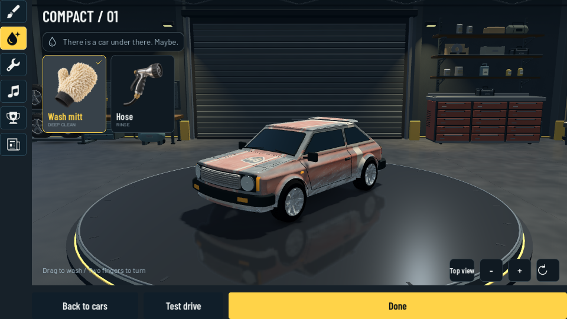

# Garage cleanliness labels — 2026-10-24

GCL01 replaces the five status descriptions, from dirtiest to cleanest:

1. There is a car under there. Maybe.
2. I can tell the color now
3. OK in the dark
4. Clean for most people.
5. Shiny. For now.

The owner's “Sniny” is treated as a spelling typo. R01 retains every grading threshold, exterior sample, local patch rule, wash mask, editing gate and condition save. The only runtime changes are four string literals in `game/ui/garage_cleanliness.gd`; the top label already matched. Three existing tests have their expected strings updated. `test_garage_clean_customisation.gd` also accepts an evidence destination so this task preserves older captures.

Q01 validation uses the pinned `scripts/dev.ps1` through the retained wrapper, with isolated workspace APPDATA and an empty backend URL. The existing native clean-customisation suite passes **286 checks**, including all five grades in order, 960×540 and 1280×720 label fit, live washing updates and editing gates. Existing easier-washing and cleanliness-match suites pass **40** and **95** checks. No existing invariant is weakened. Command arguments, exit codes, logs, hashes and a reverse-checked task-only patch are retained in [report.json](evidence/garage-cleanliness-labels-2026-10-24/report.json).

```powershell
powershell -NoProfile -ExecutionPolicy Bypass -File docs/evidence/garage-cleanliness-labels-2026-10-24/run_validation.ps1 -Mode gl_compatibility
powershell -NoProfile -ExecutionPolicy Bypass -File docs/evidence/garage-cleanliness-labels-2026-10-24/run_validation.ps1 -Test test_garage_wash_easier
powershell -NoProfile -ExecutionPolicy Bypass -File docs/evidence/garage-cleanliness-labels-2026-10-24/run_validation.ps1 -Test test_garage_cleanliness_match
python docs/evidence/garage-cleanliness-labels-2026-10-24/checkpoint.py
```



Reload the client to see the names. Owner/device appearance acceptance remains; no device attachment check or physical-device test, APK, owner-process restart, live mutation or deployment was performed. Concurrent work and the Git index are preserved.
