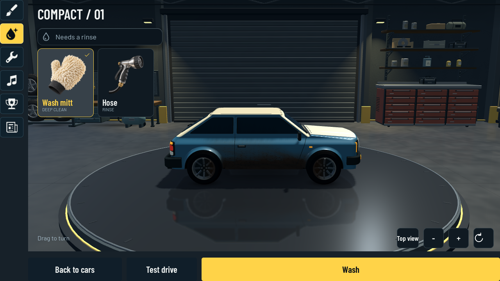
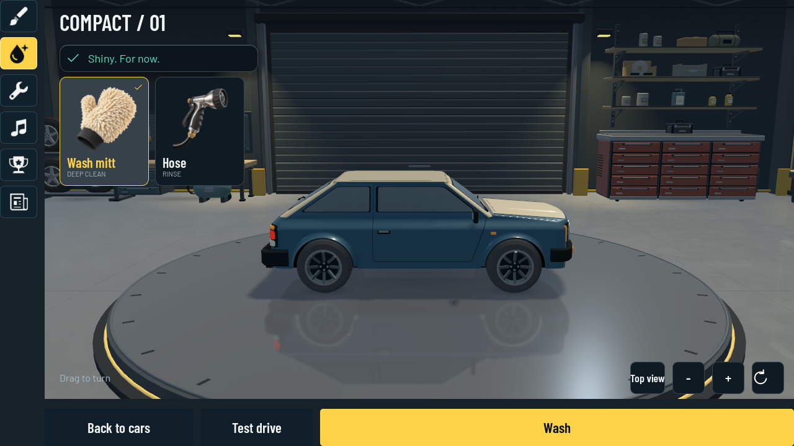

# Garage cleanliness matches missed sides and negligible film — 2026-10-24

The owner reports a visibly dirty side receiving **Clean enough for company**, and an apparently clean car failing to reach the fully clean grade. This change fixes two reproduced classification errors in `game/ui/garage_cleanliness.gd`.

| Requirement | Implementation |
| --- | --- |
| CCM01 | Check each of the five reachable exterior views independently, separating road spray, upper snow and slow dust. Clean upper panels cannot dilute a dirty lower door. |
| CCM02 | Award **Shiny. For now.** for negligible interpolated film, while retaining **Clean enough for company** for noticeable light film and preventing localized visible patches from earning Shiny. |
| R01 | Preserve local condition/masks, gradual mitt/hose work, paint/parts, achievements, shared editing gate, hidden-underbody and small-patch tolerance, existing five labels and canonical driving. |
| Q01 | Reproduce with exact task-start source; exercise all five cars, both sides, snow, cache refresh and real washing; capture the actual Garage status on both desktop renderers. |

The original checker combines the potential footprints of primary grime and slow dust into one whole-car average. Even a fully washed dust layer contributes its large clean footprint to the denominator. The dirty-door fixtures therefore have only **0.0217–0.0409** mean residue and **2.99–5.55%** strongly dirty area, despite the dark lower-door band in the native view. All five cars incorrectly receive Clean enough for company. The original also refuses Shiny for nearly removed slow dust: its conservative maximum-opacity estimate is **0.0322–0.0366**, just above the old 0.025 cutoff.

The existing global 0.20 mean / 0.30 strong-patch / 25% missed-area tests remain. Fifteen bounded view/footprint buckets add a local check: a substantial bucket fails readiness when its mean exceeds 0.25 **and** more than 25% of its footprint contains strong residue. Requiring both preserves the accepted light upper film and the narrow interpolation strip above hidden bottom cells. No new rays, meshes, shaders or GPU readbacks are added; the same five 16×16 exterior ray grids are cached with one additional region index per sample.

Shiny permits up to 0.04 negligible mean residue and retains the 1% strong-patch limit. Each substantial local bucket must also have no more than 0.04 mean and 2% of its weight above 0.08 residue. For this top grade, slow dirt uses the shader's typical 0.52 film coefficient instead of its 0.62 darkest-mottle bound; the conservative readiness calculation remains unchanged. These are bounded exterior estimates, not exact visible-pixel measurements for every paint colour, livery or lighting condition.

The shared `is_clean` decision still controls the live status, Customise/Tuning and wash completion. Inspection never clears condition fields or fills masks. Actual washing invalidates the cached grade through the existing mask state. Runtime changes are confined to `garage_cleanliness.gd`; the new `test_garage_cleanliness_match.gd` and its UID provide the regression and native captures.

| Actual validation | Result |
| --- | --- |
| Exact task-start checker, expanded regression | 96 checks, 20 reproduced failures |
| Focused regression, headless | 95 checks, zero failures |
| Focused regression, Compatibility / desktop Mobile | 145 / 145 checks, zero failures; 20 actual Garage captures each |
| Existing surface/underside/material boundaries | 45 checks, zero failures |
| Existing easier washing / light upper film | 40 checks, zero failures |
| Existing clean-customisation guards and all five grades | 262 checks, zero failures |
| Existing gradual scrubbing / ageing / split samples / persistence | 501 checks, zero failures |
| Existing native mouse/touch washing and App flow, Compatibility | 1,402 checks, zero failures |
| Existing App regression | 141 checks, zero failures |
| Project script compilation | 1,091 scripts, zero failures |

The new tests preserve every condition field/mask during inspection, check both dirty sides and a snowy side, retain the intermediate light-film grade, and use actual local strokes to reach Shiny and refresh the cached result. Native Garage checks verify that the status and actual editing gate agree. Existing assertions were left intact.

Initial corrections are retained in `evidence/garage-cleanliness-match-2026-10-24/corrections/`: the first local-mean-only trial rejected accepted upper film and the Classic's bottom interpolation strip; the first Shiny trial still used darkest dust strength; the expanded snow fixture exposed Formula road-spray dilution by upper-snow coverage. The final separate footprints and strength-plus-area rule resolve these without changing the existing tests. The initial sandbox run could not read the Windows certificate store; successful runs use approved native access with workspace-only APPDATA and an empty backend URL.

Run the retained wrapper from the repository root:

```powershell
powershell -NoProfile -ExecutionPolicy Bypass -File docs/evidence/garage-cleanliness-match-2026-10-24/run_validation.ps1 -Before
powershell -NoProfile -ExecutionPolicy Bypass -File docs/evidence/garage-cleanliness-match-2026-10-24/run_validation.ps1
powershell -NoProfile -ExecutionPolicy Bypass -File docs/evidence/garage-cleanliness-match-2026-10-24/run_validation.ps1 -Mode gl_compatibility
powershell -NoProfile -ExecutionPolicy Bypass -File docs/evidence/garage-cleanliness-match-2026-10-24/run_validation.ps1 -Mode mobile
powershell -NoProfile -ExecutionPolicy Bypass -File docs/evidence/garage-cleanliness-match-2026-10-24/run_validation.ps1 -Test test_garage_wash_surfaces
powershell -NoProfile -ExecutionPolicy Bypass -File docs/evidence/garage-cleanliness-match-2026-10-24/run_validation.ps1 -Test test_garage_wash_easier
powershell -NoProfile -ExecutionPolicy Bypass -File docs/evidence/garage-cleanliness-match-2026-10-24/run_validation.ps1 -Test test_garage_clean_customisation
powershell -NoProfile -ExecutionPolicy Bypass -File docs/evidence/garage-cleanliness-match-2026-10-24/run_validation.ps1 -Test test_gentle_scrubbing
powershell -NoProfile -ExecutionPolicy Bypass -File docs/evidence/garage-cleanliness-match-2026-10-24/run_validation.ps1 -Test test_car_wash -Mode gl_compatibility
powershell -NoProfile -ExecutionPolicy Bypass -File docs/evidence/garage-cleanliness-match-2026-10-24/run_validation.ps1 -Test test_app
powershell -NoProfile -ExecutionPolicy Bypass -File docs/evidence/garage-cleanliness-match-2026-10-24/run_validation.ps1 -Test test_script_parse
python docs/evidence/garage-cleanliness-match-2026-10-24/checkpoint.py
```

The `-Before` command deliberately fails to demonstrate the original classification errors. Expanded arguments, exit codes, elapsed time and full output are retained with each command. Source hashes, capture hashes and a task-only reverse-checked patch are in [report.json](evidence/garage-cleanliness-match-2026-10-24/report.json).





Restart the client to load the correction. Owner acceptance with the reported real car/paint/wash state and physical-device appearance remains. No phone/tablet attachment check or physical-device test, APK/export/install, owner-process restart, live account/backend mutation or deployment was performed. Concurrent work and the Git index remain preserved.
