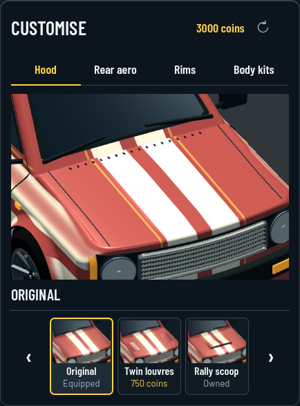

# Garage customisation visual correction — 2026-10-25

GCU01–GCU03/R01/Q01 address the owner's rejected customisation panel screenshot.

GCU01 removes the boxed wallet/reset treatment, uses a smaller aligned heading and flat category tabs with an active underline, and replaces the repeated equipped state with the single card caption. The disabled full-width Equipped button is removed. Preview keeps its small badge, price, explicit gold equip action and named cancellation. Option cards use quieter frames and readable names: two on short narrow panels, three at medium widths and four on wide panels. The actual car/camera, paint, condition and purchase/save rules are retained. The concurrent restoration of the Workshop navigation is preserved and is outside this task.

GCU02 replaces the mismatched blue option pictures in the Parts workbench with native photographs of the current paint/pattern/stickers and fitted parts, changing only the candidate part. One temporary 320×208 studio renders queued photos sequentially, then releases its world. It does not alter the actual showroom car or its camera. Paint/part changes invalidate the exact appearance key; stale or detached work is discarded. Cached appearances render no new photos. The existing cache retains at most sixteen images. The legacy offline-photo API remains unchanged and passes its exact-pixel checks. New uncached appearances add temporary rendering work and larger photos; physical-device cost acceptance remains.

GCU03 adds red striped-car equipped / owned-preview / unowned-preview captures at 960×540, 1280×720 and 1720×900, including close-ups of the panel. Checks inspect actual red photo pixels, repaint to green and inspect the changed pixels, verify cache reuse and studio release, and retain free-preview, explicit confirmation, delayed-reply/account fences, touch swipe, keyboard reveal, layout bounds, save and cleanliness checks. The initial clipping failure and stale eight-unit-gap assertion are retained under `attempts/`; smaller-height spacing is corrected, and the card test now checks the actual bounds of each of four cards.

Runtime files: `garage_page.gd`, `garage_cosmetic_shelf.gd`, `garage_studio_style.gd`, `compact_kit_thumbnail.gd` and new `garage_part_photos.gd` / resource UID. The focused checks extend `game/tests/test_customisation_carousel.gd`. No external artwork, dependencies, backend changes, appearance schema or simulation changes are introduced.

Actual expanded commands, exit codes, results, source/image hashes and a reverse-checked scoped patch are recorded in [report.json](evidence/customisation-polish-2026-10-25/report.json). The task-start copies remain under `before/`; `checkpoint-base/` excludes the separately restored Workshop navigation from the scoped patch. No staging or commit is implied.

```powershell
powershell -NoProfile -ExecutionPolicy Bypass -File docs/evidence/customisation-polish-2026-10-25/run.ps1 -Mode headless
powershell -NoProfile -ExecutionPolicy Bypass -File docs/evidence/customisation-polish-2026-10-25/run.ps1 -Mode gl_compatibility
powershell -NoProfile -ExecutionPolicy Bypass -File docs/evidence/customisation-polish-2026-10-25/run.ps1 -Mode mobile
```

The same runner was used for `test_garage_customisation_speed`, `test_garage_clean_customisation`, `test_garage_sidebar`, `test_app` and `test_script_parse` with `-Test <name> -Mode headless`. The pinned editor import was run through `scripts/dev.ps1 -Action Import`. APPDATA, records and shop responses are isolated fixtures; no real purchases or online player mutation are performed.

Focused results are 298 headless / 342 Compatibility / 342 desktop Mobile, all passing. Retained customisation 1,396, cleanliness 262, sidebar 463, App 141 and parser 1,121 pass; the pinned import also passes.

[Open the actual panel states and before/after views](evidence/customisation-polish-2026-10-25/review.html).



Reload and owner appearance/interaction acceptance remain. Desktop Mobile means Windows Vulkan, not a phone measurement. No phone/tablet attachment check or physical-device test, APK, purchase, deployment or owner-process restart was performed. Concurrent work is preserved.
