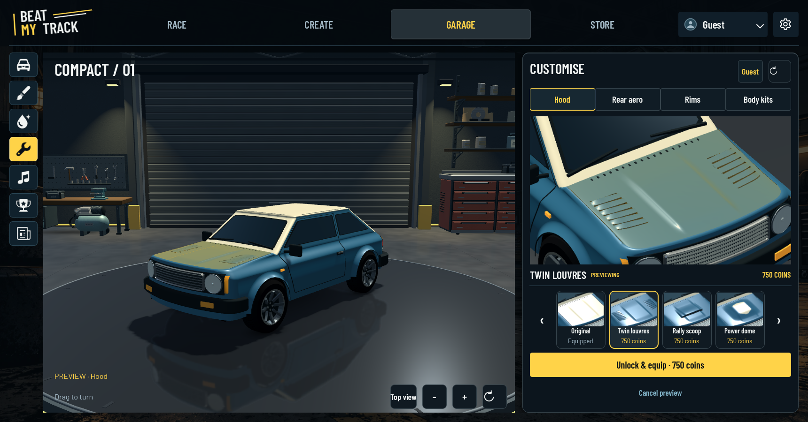

# Garage customisation reference correction — 2026-10-24

GCR01–GCR03/R01/Q01 implement the owner's second supplied image as the menu layout reference, and remove Back to cars / Test drive from Appearance and Parts.

GCR01 replaces the extra Appearance / Parts / Wash row above the car with direct brush, wash and spanner destinations in the left rail. Car selection remains available as the first rail button. Records, trophies and news remain directly accessible. The car and workbench now align along their top and bottom edges, with the released footer space used by the preview. Care retains its Wash action and the car-selection screen retains its Select / Test drive actions.

GCR02 refines the native workbench: a compact CUSTOMISE heading and account balance, joined category tabs, the selected part's actual detail camera, a condensed item name with adjacent preview state, price aligned right, photo cards with ownership/prices below their names, quieter arrows, a gold selected frame, full-width equip and a named Cancel preview beneath. The panel scales to 600 logical units; four complete choices fit at 1720×900. Smaller layouts show fewer complete cards. The detail image remains visible at 960×540, using shorter cards and spacing. Existing photo assets are cropped for the cards; no generated reference pixels or replacement car artwork are used.

GCR03 preserves free preview, separate explicit equip, existing purchase confirmation, account and delayed-reply fences, cancellation, cleanliness rules, save format, car/camera retention and the sixteen-thumbnail cache. The underlying car geometry, showroom camera settings, paint, condition and rendering are unchanged. The result follows the reference composition using the game's actual assets; it does not claim identical generated car materials or geometry.

Runtime files: `game/ui/garage_page.gd`, `garage_cosmetic_shelf.gd`, `garage_studio_style.gd`, `garage_livery_menu.gd` and `compact_kit_thumbnail.gd`. The existing carousel and sidebar suites now assert the new explicit navigation/footer contract, while keeping purchase, cancellation, input, bounds and retained-car assertions. Assertions for the superseded top row and footer are replaced with seven direct rail destinations, absent customisation footer, actual workbench bounds and aligned pane tops.

Actual checks and expanded commands are in [report.json](evidence/customisation-reference-2026-10-24/report.json), with per-run `command.json` and `console.log`. Tests use the pinned Godot 4.7.2 engine through `scripts/dev.ps1`, isolated APPDATA/records and no live API URL. The fixture shop simulates unlock responses and never purchases a real item.

```powershell
powershell -NoProfile -ExecutionPolicy Bypass -File docs/evidence/customisation-reference-2026-10-24/run.ps1 -Mode headless
powershell -NoProfile -ExecutionPolicy Bypass -File docs/evidence/customisation-reference-2026-10-24/run.ps1 -Mode gl_compatibility
powershell -NoProfile -ExecutionPolicy Bypass -File docs/evidence/customisation-reference-2026-10-24/run.ps1 -Mode mobile
powershell -NoProfile -ExecutionPolicy Bypass -File docs/evidence/customisation-reference-2026-10-24/run.ps1 -Test test_garage_sidebar -Mode headless
powershell -NoProfile -ExecutionPolicy Bypass -File docs/evidence/customisation-reference-2026-10-24/run.ps1 -Test test_garage_clean_customisation -Mode headless
powershell -NoProfile -ExecutionPolicy Bypass -File docs/evidence/customisation-reference-2026-10-24/run.ps1 -Test test_garage_customisation_speed -Mode headless
powershell -NoProfile -ExecutionPolicy Bypass -File docs/evidence/customisation-reference-2026-10-24/run.ps1 -Test test_app -Mode headless
powershell -NoProfile -ExecutionPolicy Bypass -File docs/evidence/customisation-reference-2026-10-24/run.ps1 -Test test_script_parse -Mode headless
```

The baseline native suite passes 248 checks. Final focused checks pass 246 headless / 267 Compatibility / 267 desktop Mobile. Sidebar 592, cleanliness 262, retained customisation 1,396, App 141 and parser 1,119 also pass. Initial sandbox startup failures (user log path, then Windows certificate store), three obsolete hidden-footer bounds failures and the actual small-window workbench clipping failure are retained in `before/` and `attempts/`. Short-layout spacing and card heights correct the clipping without lowering bounds requirements. Expanded commands and final counts are recorded in the report.

[Open before/after views, all categories, small-screen captures and carousel motion](evidence/customisation-reference-2026-10-24/review.html).



Reload and owner visual/interaction acceptance remain. Mobile here means the Windows Vulkan renderer; no phone/tablet attachment check or physical-device test was performed. No APK/export/install, real purchase, live mutation, deployment or owner-process restart. Concurrent work is preserved. The scoped checkpoint is a reverse-checkable task-only patch against exact source copies; no staging or commit is implied.
