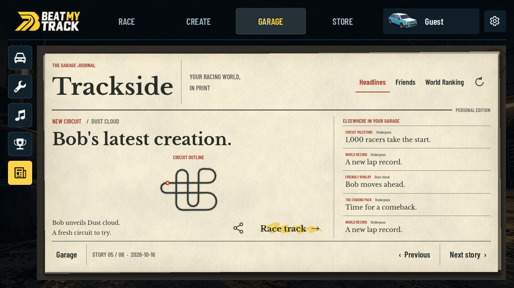

# Friend track publications in Garage News

The Trackside newspaper now includes **NEW CIRCUIT** stories when an accepted friend publishes a new track. Each story names the friend and track and shows the published revision's actual circuit outline. The usual lead-story/briefs/navigation and retained hidden Garage car are unchanged.

This uses shared publication facts instead of writing into every friend's inbox. Migration `0039_friend_publications`, after `0038_garage_news`, adds one small row per newly published physical track and indexes for author/time and expiry. Successful verified Publish and the legacy publish route capture that fact inside their existing transaction with one conditional insert. The indexed earlier-version check suppresses revisions, including tracks predating this feature. Unique track IDs suppress retries. Failed/rolled-back publications leave no fact. The migration does not backfill old announcements.

There is no new worker job or per-player publication scan. An explicit, cached News read fetches at most100 accepted friend IDs and acceptance times. With friends, one additional statement batches their indexed recent ranges, carrying at most31 eligible rows per friend into a thin candidate merge and selecting at most31 publication records before reading their stored outlines. SQL statement count is independent of friend count: the existing inbox and demand reads, one roster read, and one publication read only when friends exist. No track documents or blobs are fetched. The resulting private/publication candidates share the existing30-item keyset page and cursor, including identical timestamps, and the client retains its100-item bound.

Only the current mutually accepted friendship qualifies. Publications before acceptance or more than90 days old are excluded. Repeated acceptance does not move that baseline. Pending requests, self/nonfriends, hidden/archived tracks, restricted/deleted/artificial authors and either direction of block are excluded. The publication statement rechecks membership and account/block state after the roster read. Unfriending removes cached publication rows immediately and invalidates the feed cache. Other historical news remains intact.

The existing account/origin-scoped60-second cache still governs reads. Publication stories can appear on the next feed read in the same day without scheduling another percentile pass. Inactive players generate neither reads nor publication jobs. Shared facts expire using the existing indexed cleanup's combined100-row/minute budget; this adds a global expiry delete, not a job per player. Publication cost is one small conditional write statement per publication attempt that reaches finalization, independent of the publisher's friends. Read cost is the bounded roster plus batched author ranges when News is requested. Production capacity and phone latency were not measured.

Actual tests and source hashes are in [the report](evidence/garage-news-friend-publication-2026-10-16/report.json) and [task-only checkpoint](evidence/garage-news-friend-publication-2026-10-16/checkpoint.json). Tests cover both SQLite/PostgreSQL, actual verified and legacy publication transactions, rollback/idempotency/revisions, pending/removed/blocked friends, restrictions/visibility, expiry, mixed75-item pagination, author-index access and the full100-friend/two-statement publication read. Native client and HTTP checks cover real JSON outlines, private sessions and immediate removal on unfriend. Full-app captures at960/1280/1600 pixels use actual Dust cloud/Underpass fixture outlines on Compatibility and Vulkan Mobile.

Initial fixture corrections are retained: the second real publication needed an additional test publishing slot; the seeded pending request needed the same requester direction as the acceptance helper. The first publication HTTP fixture reused a helper that dates tracks one second in the past, correctly placing it before acceptance; the fixture now records its intended post-acceptance publication time. Product eligibility rules were not relaxed. The final write path was consolidated to one SQL statement and its relevant tests rerun on both databases. Engine root-certificate warnings are unrelated sandbox output; final News script checks pass.

This is local source implementation and disposable test databases only. A matching API/worker/client release with migration0039 is still required. No retained backend migration, deployment, catalog mutation, phone run or APK was performed. Owner/physical-phone appearance acceptance remains.
