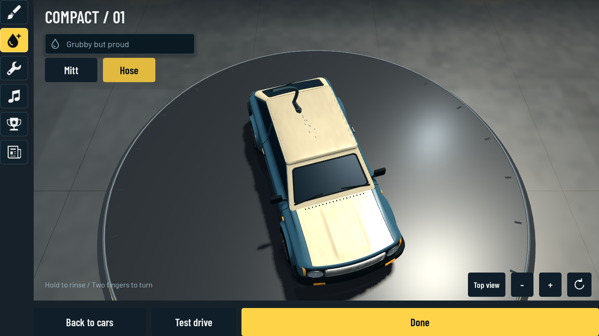
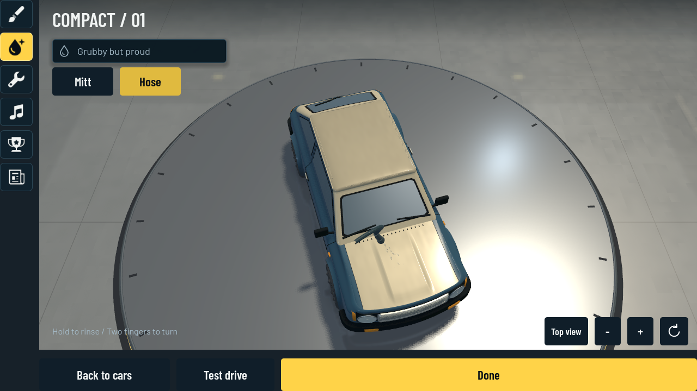
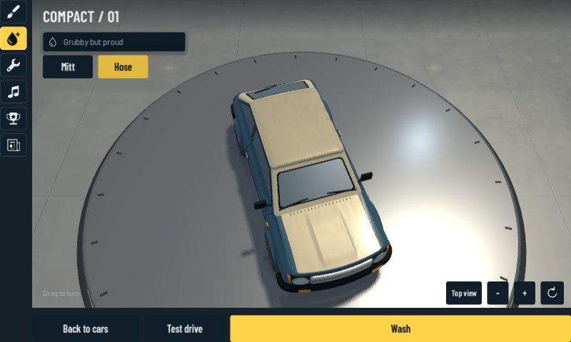

> Owner follow-up: the connected reel, broader water animation and 1.08 rinse radius in [Garage hose spray refinement](GARAGE_HOSE_SPRAY_2026_10_24.md) supersede the first implementation below.

# Garage hose — 2026-10-24

Garage → Washing now offers **Mitt** and **Hose**. Selecting Hose enters washing; holding a mouse button or one finger over the car rinses the selected surface. Top view is available here for the hood and roof. Done saves progress and returns to ordinary orbiting.

| Requirement | Implemented behavior |
| --- | --- |
| HWS01 | The existing fine dust/film mask rinses quickly, including actual picked hood and roof surfaces. |
| HWS02 | Water also removes the primary heavy grime, very slowly. The mitt retains its original cleaning speed and radius. |
| HWS03 | A reusable native nozzle, curved rubber hose, twelve moving water filaments and the existing 32-droplet pool show rinsing. Water produces no soap foam. |
| R01 | Keep local per-car condition, existing masks and persistence format, paint, stickers, fitted parts, camera, grades, achievements, reflections and canonical driving. |
| Q01 | Check all five cars, real mouse/touch input, missed hits, lifecycle, independent disk persistence and both native desktop renderers. Preserve original assertions and concurrent work. |

The hose uses a 0.72 model-unit radius with the existing smooth falloff, grime-age resistance and fractional work accumulation. Its film rate is 1.60 mask-units per second and primary-grime rate is 0.025. At the brush centre, heavy grime therefore takes 46 times as long as the unchanged 1.15-rate mitt; a fresh primary patch needs about 40 seconds of uninterrupted centred water. Edge falloff and older grime take longer. These are tuning values awaiting owner feel acceptance.

Film and heavy grime update their existing independent R8 wash volumes. Existing two-argument `wash()` callers still select the mitt. No condition amount or cleanliness threshold is cleared to simulate cleaning, and no save schema changes. Invalid tools, non-finite input and missed surfaces are inert. The original mitt arithmetic order is retained.

The nozzle and hose are original code-built meshes, cached once. They are prepared on the first hose contact, with one twelve-instance water-filament draw and the existing bounded droplet pool. The effect uses the existing room/car reflection layers. Release stops the jet; droplets drain normally. Tool changes, touch cancellation, orbiting, hiding, navigation and teardown use the existing gesture/effect cleanup. The two tool targets are 112 × 52 logical units. No new audio or bitmap asset is introduced.

Changed runtime sources:

- `game/vehicle/vehicle_weathering.gd`: separate film/grime hose rates through the existing cleaning and batch-upload path.
- `game/ui/car_showroom.gd`: selected tool, gesture fencing and tool dispatch from actual mesh picking.
- `game/ui/garage_page.gd`: Mitt/Hose actions, wash hint and Top view availability.
- `game/ui/garage_wash_effect.gd`: lazy nozzle/hose, bounded water filaments, no rinse lather.
- `game/ui/garage_wash_geometry.gd`: shared original nozzle and rubber hose geometry.

`game/tests/test_garage_hose.gd` and its UID add the focused regression. This report, the three repository status notes, retained runners, command receipts, captures, hashes and scoped source patch complete the checkpoint.

| Actual validation | Result |
| --- | --- |
| Hose, headless | 81 checks, zero failures |
| Hose, native Compatibility / desktop Mobile Vulkan | 84 / 84 checks, zero failures |
| Existing gradual scrubbing | 501 checks, zero failures |
| Existing exterior boundaries, all five cars | 45 checks, zero failures |
| Existing complete manual wash and actual App flow, Compatibility | 1,402 checks, zero failures |
| All-script compilation | 1,066 scripts, zero failures |
| Pinned project import | Passed |
| Existing animation regression, Compatibility | 139 checks, one retained restart assertion failure |
| Exact pre-task versions of all five runtime files, same animation regression | Same 139 checks and same restart assertion failure |

The existing failed assertion is `restart retains exact serialized completed wash`. Both the current and original-source control logs remain in evidence. No assertion was removed or relaxed. The new hose suite independently flushes and reads the serialized local condition file, checks both masks through reload, and passes. No broad all-washing pass is claimed.

The first sandboxed attempt stopped at the Windows certificate-store access diagnostic. A later normal Windows invocation of the same pinned `scripts/dev.ps1` runner succeeded with isolated workspace APPDATA. The stale sandbox test was stopped only after checking its exact test command, PID and parent PID. An initial existing App regression was interrupted while the concurrent Desert source was being written (`ROOTS` was temporarily unresolved); the unchanged test subsequently passed. The initial logs are retained. No TLS checks were disabled.

Commands run from the repository root:

```powershell
powershell -NoProfile -ExecutionPolicy Bypass -File docs/evidence/hose-wash-2026-10-24/run_validation.ps1 -Test test_garage_hose -Mode headless
powershell -NoProfile -ExecutionPolicy Bypass -File docs/evidence/hose-wash-2026-10-24/run_validation.ps1 -Test test_garage_hose -Mode gl_compatibility
powershell -NoProfile -ExecutionPolicy Bypass -File docs/evidence/hose-wash-2026-10-24/run_validation.ps1 -Test test_garage_hose -Mode mobile
powershell -NoProfile -ExecutionPolicy Bypass -File docs/evidence/hose-wash-2026-10-24/run_validation.ps1 -Test test_gentle_scrubbing
powershell -NoProfile -ExecutionPolicy Bypass -File docs/evidence/hose-wash-2026-10-24/run_validation.ps1 -Test test_garage_wash_surfaces
powershell -NoProfile -ExecutionPolicy Bypass -File docs/evidence/hose-wash-2026-10-24/run_validation.ps1 -Test test_car_wash -Mode gl_compatibility
powershell -NoProfile -ExecutionPolicy Bypass -File docs/evidence/hose-wash-2026-10-24/run_validation.ps1 -Test test_garage_wash_animation -Mode gl_compatibility
powershell -NoProfile -ExecutionPolicy Bypass -File docs/evidence/hose-wash-2026-10-24/run_baseline.ps1
powershell -NoProfile -ExecutionPolicy Bypass -File docs/evidence/hose-wash-2026-10-24/run_validation.ps1 -Test test_script_parse
powershell -NoProfile -ExecutionPolicy Bypass -File scripts/dev.ps1 -Action Import -CommandTimeoutSeconds 240
python docs/evidence/hose-wash-2026-10-24/checkpoint.py
```

Each test runner invocation sets a separate APPDATA under `build/hose-wash-2026-10-24/` and records expanded arguments, exit code, elapsed time and complete console output. The baseline runner uses exact task-start runtime copies in a separate project; all other dependencies are shared with the current workspace. It does not replace the working source. The scoped Git-checkable patch includes only this hose task; concurrent configuration, challenge, Desert, deployment and cost work remains intact.







Restart the desktop client to load the change. Owner washing speed, nozzle/spray appearance and physical-device touch/performance acceptance remain. No phone/tablet attachment check or physical-device test, APK/export/install, owner-process restart, live account/backend mutation, purchase or deployment was performed.
