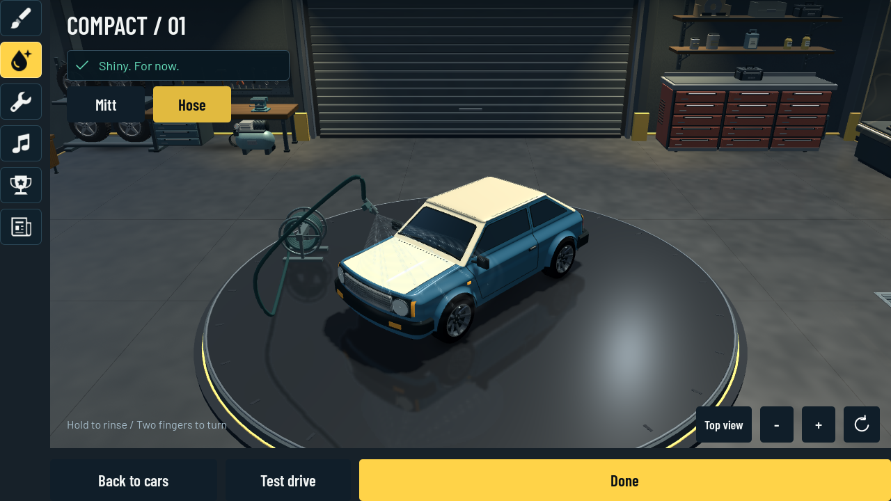
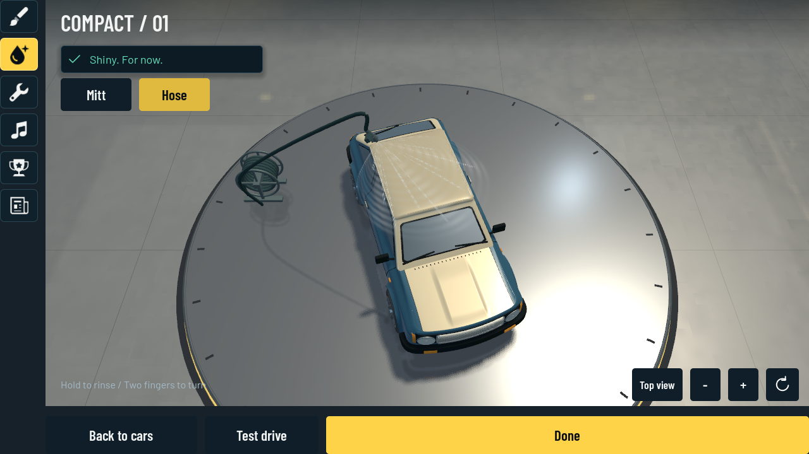

> Owner follow-up: [the hose and water visual rework](GARAGE_HOSE_WATER_REWORK_2026_10_24.md) replaces the rejected cone/ribbon effect and thick hose described below.

# Connected hose and wider spray — 2026-10-24

The owner rejected the short detached hose tail and sparse water animation. The hose now connects the moving spray nozzle to a fixed, coiled reel beside the car. A translucent spreading water cone, flowing filaments and distributed splash droplets replace the twelve isolated thin streaks. The actual rinse covers a larger panel area.

| Requirement | Result |
| --- | --- |
| HSR01 | A continuous rubber hose starts inside the nozzle coupling and ends at the reel outlet. The reel stays anchored when aiming or orbiting. |
| HSR02 | Water spreads from the nozzle into a broad cone, with twelve flowing filaments, soft mist and the retained 32-droplet pool distributed across the footprint. |
| HSR03 | Rinse radius increases from 0.72 to 1.08 model units: 50% wider and 2.25 times the nominal surface area. A 0.24-unit depth fence follows the picked panel normal, protecting the opposite side. |
| R01 | Fine-film rate 1.60, heavy-grime rate 0.025, mitt rate/radius, local masks/save format, appearance, camera, grades, achievements and canonical driving remain. |
| Q01 | Verify both hose ends, real native spray visibility/motion, all five cars, surface depth, existing washing and both desktop renderers. Preserve concurrent work. |

The reel and nozzle use original shared geometry. A single reusable 960-triangle tube uses 49 path points; the shader places its rings along the current route without rebuilding meshes. The tube routes toward the clear side of the car and down to the reel, with a floor clamp. The nozzle stays above the deck even when aiming low. Its fixed reel and both moving/fixed endpoints are checked on actual side contacts for every car. Hidden, released, cancelled or finished washing clears the entire rig through the existing lifecycle.

The spray uses two shader materials: flowing surface ribbons and a soft transparent outer cone. Both stop with the held contact. Twelve filament instances and the original 32 splash slots remain fixed. The spray shares the existing room/car reflection layers. This adds original game-native geometry and shaders; no generated images, remote service, audio asset or runtime dependency is introduced. Uniform-array use follows the [Godot shader language documentation](https://docs.godotengine.org/en/4.3/tutorials/shaders/shader_reference/shading_language.html#uniforms).

The cleaning path transforms the actual picked world normal into wash-volume coordinates. Hose work uses a broad tangential radius and shallow normal depth; the mitt retains its original arithmetic. The normal and volume bounds also drive the visual footprint and hose route. Existing two/three-argument calls remain supported. Existing local condition amounts and both wash volumes persist in their original format.

Changed existing runtime files are `game/ui/car_showroom.gd`, `game/ui/garage_wash_effect.gd`, `game/ui/garage_wash_geometry.gd` and `game/vehicle/vehicle_weathering.gd`. New runtime files are `game/ui/garage_hose_rig.gd`, `game/ui/garage_hose_geometry.gd`, `game/ui/garage_hose_cable.gdshader` and `game/ui/garage_hose_spray.gdshader`, with their UIDs. `game/tests/test_garage_hose_refinement.gd` adds focused checks and captures. Repository status notes, this report and the scoped evidence/checkpoint complete the slice.

The original hose report remains a historical record of the first implementation; this revision supersedes its detached-tail visuals and 0.72 radius.

Actual validation results are recorded in [report.json](evidence/hose-spray-refinement-2026-10-24/report.json), with expanded command receipts and full console logs. The focused refinement has passed 38 headless checks and 55 checks on each native desktop renderer. Existing scrubbing passes 501 checks and all-car exterior boundaries pass 45. Final broader-suite results are retained in the report.

The native visibility control holds the car, camera, nozzle, reel and cable still, then hides only the water layers. On the captured roof view, 6,043 Compatibility pixels and 13,901 desktop Mobile pixels change by at least 2.5% in a colour channel. Water, droplets and their reflections span 204 × 153 and 208 × 285 pixels respectively. These are desktop readability checks, not measured physical spray coverage or phone performance. Twelve successive native frames verify flowing water without moving the nozzle; [the local preview](evidence/hose-spray-refinement-2026-10-24/preview.html) replays those exact frames in 1/30-second animation steps.

The initial comparison retained a connected reel with insufficiently clear strands; the final mist/cone and wider flowing ribbons supersede it. An initial mathematical fixture omitted `restore()`, leaving fractional work arrays uninitialized; the fixture was corrected and its failure log retained. One existing-suite launch encountered a concurrently edited recording cache's temporary `PackedByteArray.sha256_text` parser error. The unrelated source was preserved; its owner corrected it before the final checks. No test assertion was removed or weakened.

Commands use the pinned `scripts/dev.ps1` entry point with isolated workspace APPDATA via the retained runner:

```powershell
powershell -NoProfile -ExecutionPolicy Bypass -File docs/evidence/hose-spray-refinement-2026-10-24/run_validation.ps1 -Test test_garage_hose_refinement -Mode headless
powershell -NoProfile -ExecutionPolicy Bypass -File docs/evidence/hose-spray-refinement-2026-10-24/run_validation.ps1 -Test test_garage_hose_refinement -Mode gl_compatibility
powershell -NoProfile -ExecutionPolicy Bypass -File docs/evidence/hose-spray-refinement-2026-10-24/run_validation.ps1 -Test test_garage_hose_refinement -Mode mobile
powershell -NoProfile -ExecutionPolicy Bypass -File docs/evidence/hose-spray-refinement-2026-10-24/run_validation.ps1 -Test test_garage_hose -Mode gl_compatibility
powershell -NoProfile -ExecutionPolicy Bypass -File docs/evidence/hose-spray-refinement-2026-10-24/run_validation.ps1 -Test test_garage_hose -Mode mobile
powershell -NoProfile -ExecutionPolicy Bypass -File docs/evidence/hose-spray-refinement-2026-10-24/run_validation.ps1 -Test test_gentle_scrubbing
powershell -NoProfile -ExecutionPolicy Bypass -File docs/evidence/hose-spray-refinement-2026-10-24/run_validation.ps1 -Test test_garage_wash_surfaces
powershell -NoProfile -ExecutionPolicy Bypass -File docs/evidence/hose-spray-refinement-2026-10-24/run_validation.ps1 -Test test_car_wash -Mode gl_compatibility
powershell -NoProfile -ExecutionPolicy Bypass -File docs/evidence/hose-spray-refinement-2026-10-24/run_validation.ps1 -Test test_script_parse
python docs/evidence/hose-spray-refinement-2026-10-24/checkpoint.py
```





Restart the desktop game to load the revision. Owner spray/hose appearance and washing-effort acceptance remain, as do physical-device touch, fragment cost and thermal checks. No phone/tablet attachment check or device test, APK/export/install, owner-process restart, backend/account mutation, purchase or deployment was performed. Earlier baseline-confirmed restart-test limitations remain documented in the original hose report. Concurrent source and document work is preserved.
