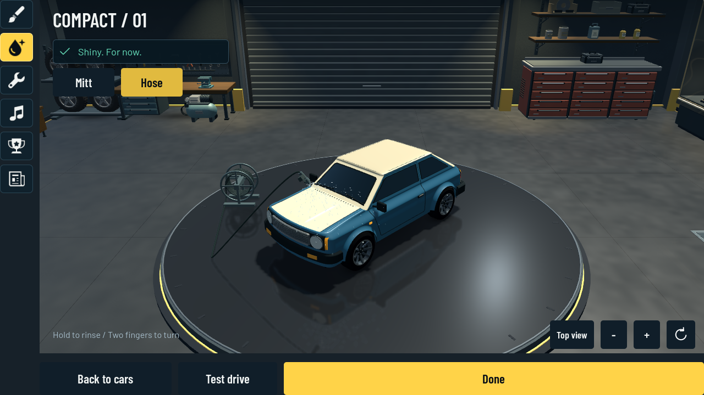
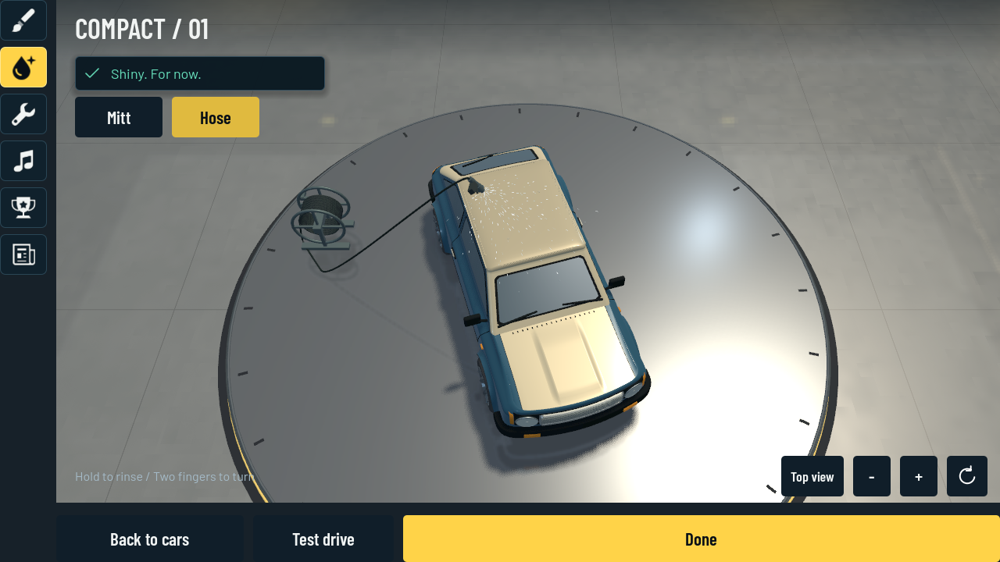

# Hose and water visual rework — 2026-10-24

The owner rejected the hose and water appearance again. This revision replaces the cone sheets and striped ribbons with short moving droplets, and makes the rubber hose thinner with a smoother hanging/floor curve. The existing wider cleaning behavior stays intact.

| Requirement | Change |
| --- | --- |
| HWR01 | A 22 mm matte charcoal hose and continuous matching reel winding replace the thick teal tube and separate rings. A hanging Bezier curve settles into the floor route without the earlier elevated loop. Both ends remain connected. |
| HWR02 | One fixed pool of 256 soft camera-facing droplets replaces twelve full-length ribbons and the cone mesh. Droplets travel from the nozzle on gravity-curved paths and break up across the same broad footprint. Existing 32 splash slots remain. |
| R01 | Keep the 1.08-unit rinse radius, 0.24 depth, fine-film/heavy-grime rates, local saves, mitt, paint, camera and driving. No cleaning/runtime authority changes. |
| Q01 | Review ordinary/overhead native captures and motion on both desktop renderers, retain readability/lifecycle/all-car checks, and save a scoped source patch. |

Droplet phases and destinations vary independently; there is no full-length geometric surface or repeating stripe pattern. The GPU evaluates each short droplet's travel, billboard orientation and soft edge. The CPU prepares the fixed seed pool once and updates the nozzle/target frame and time. The water draw uses 512 triangles rather than the previous combined 536-triangle ribbon/cone surfaces. This is not a physical-device performance measurement.

Changed files are `game/ui/garage_hose_rig.gd`, `garage_hose_geometry.gd`, `garage_hose_spray.gdshader` and `garage_hose_cable.gdshader`. The two existing hose tests are updated for the revised 256-particle budget and removal of the cone object. Their input, surface-depth, persistence, readability, motion and cleanup assertions remain. The readability threshold stays unchanged at 300 pixels differing by at least 2.5% in a colour channel; the first droplet trial failed with 194 and was retained before increasing droplet size/contrast.

The ordinary and roof previews are actual native captures. The [animation preview](evidence/hose-water-rework-2026-10-24/preview.html) replays twelve successive captured phases with the nozzle held still. A screenshot alone does not show the droplet motion, and owner appearance acceptance remains necessary.

Both native renderers pass the 55-check refinement suite, including all five actual cars, fixed/moving hose endpoints, wide surface-only work, native water readability/motion, release, navigation and teardown. Headless refinement passes 38 checks. Existing hose input/save checks pass 84 checks on each desktop renderer. Final regression receipts and complete logs are in [report.json](evidence/hose-water-rework-2026-10-24/report.json). An initial unrelated Garage newspaper preload was temporarily missing while being edited concurrently; its unchanged-source reruns pass. The all-project script scan stops at the concurrent generated `game/track/desert_wind_envelope.gd:5` constant-expression error. Those unrelated sources are preserved; no full-project compilation pass is claimed.

Run the retained wrapper from the repository root; it invokes pinned `scripts/dev.ps1` and sets isolated workspace APPDATA:

```powershell
powershell -NoProfile -ExecutionPolicy Bypass -File docs/evidence/hose-water-rework-2026-10-24/run_validation.ps1 -Test test_garage_hose_refinement -Mode gl_compatibility
powershell -NoProfile -ExecutionPolicy Bypass -File docs/evidence/hose-water-rework-2026-10-24/run_validation.ps1 -Test test_garage_hose_refinement -Mode mobile
powershell -NoProfile -ExecutionPolicy Bypass -File docs/evidence/hose-water-rework-2026-10-24/run_validation.ps1 -Test test_garage_hose_refinement
powershell -NoProfile -ExecutionPolicy Bypass -File docs/evidence/hose-water-rework-2026-10-24/run_validation.ps1 -Test test_garage_hose -Mode gl_compatibility
powershell -NoProfile -ExecutionPolicy Bypass -File docs/evidence/hose-water-rework-2026-10-24/run_validation.ps1 -Test test_garage_hose -Mode mobile
powershell -NoProfile -ExecutionPolicy Bypass -File docs/evidence/hose-water-rework-2026-10-24/run_validation.ps1 -Test test_script_parse
python docs/evidence/hose-water-rework-2026-10-24/checkpoint.py
```





Restart is required to load the new visuals. Owner appearance/feel and physical-device cost acceptance remain. No phone/tablet attachment check or device test, APK/export/install, owner-process restart, live mutation, purchase or deployment was performed. Earlier baseline-confirmed animation restart-test limitations stay in the first hose report. Concurrent work is preserved.
