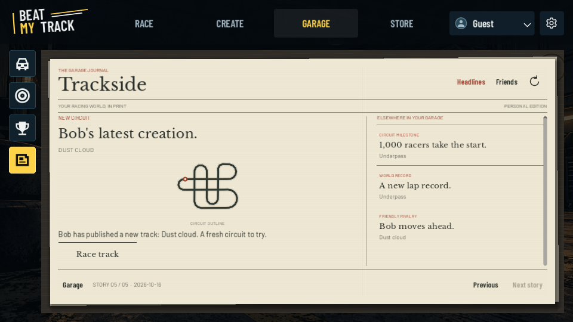

# Direct racing throughout the Garage newspaper

GNA01 adds **Race track** to every article that identifies a track: milestones, world records, friendly rivalry, comeback stories and new circuits. This follows the owner's 2026-10-18 request and supersedes the earlier new-circuit-only restriction. Local Dust cloud and Underpass stories carry their real authoring IDs, verified against the packaged source documents. Stories without a track identity have no race action.

GNA02 uses the newspaper's Libre Baskerville serif, dark ink, transparent paper background, fine ink rule and quiet paper hover/press colours. The action follows the story and its timing facts and retains a52-unit minimum touch height. GNA03/G01/R01 preserve normal immutable-version resolution, on-demand bounded reads, hash-checked documents, cached preparation, selected-car tickets, full countdown/five laps, duplicate/cancellation guards and retained Garage resources. Reading articles adds no track requests or jobs. No backend contract changed.

Runtime files: `game/ui/garage_news_menu.gd`, `game/ui/garage_news_examples.gd` and one admission guard in `game/core/app.gd`. Existing client, native layout and actual race harnesses were extended. The race fixture now includes the current rating metadata fields, a distinct Underpass publication, and an evidence-output option. Requirement/status notes are updated in `DEVELOPMENT_STATUS.md` and `docs/PHASE_0_PLAN.md`.

[World-record race action](evidence/garage-news-all-races-2026-10-18/mobile/race-world_record-960.png), [rivalry race action](evidence/garage-news-all-races-2026-10-18/gl_compatibility/race-friend_overtake-960.png). Captures are actual native Windows renders; Mobile denotes the desktop Vulkan renderer.

Validation used pinned Godot4.7.2 through `scripts/dev.ps1`, isolated workspace APPDATA and fixture transport only. Actual commands/results and initial attempts are in [report.json](evidence/garage-news-all-races-2026-10-18/report.json).

| Check | Actual result |
|---|---|
| Newspaper client, every actual/local article action, exact story copies, trackless and stale-account guards |58 checks,0 failures |
| Actual native race pipeline, every story kind, exact version/cached document, local Underpass, selected car/five laps, tickets/errors/cancellation |90 checks,0 failures |
| Compatibility layout at960x540/1280x720/1600x720, full race target reachable inside article |289 checks,0 failures |
| Desktop Mobile layout at the same sizes |289 checks,0 failures |
| Existing application regression |101 checks,0 failures |
| Complete script parsing |854 scripts,0 failures |

Initial attempts are retained. Windows execution policy required a process-local Bypass invocation; sandboxed Godot startup ended with certificate/access-denied errors. Native runs outside that sandbox completed. An initial parallel dev-script launch raced its generated build-identity write; subsequent launches were sequenced through initialization. The first evidence argument used the wrong PowerShell parameter form and was corrected. The initial race harness reached all article kinds before encountering its older fixture's missing `rating_average`; the fixture was brought up to the current metadata contract without changing runtime catalog behavior or weakening assertions. All final checks above exited0 without captured script/parse failures.

The [task-only patch/checkpoint](evidence/garage-news-all-races-2026-10-18/checkpoint.json) compares the exact pre-task workspace with this change, preserving unrelated dirty work. No phone attachment check or physical-device test, APK build/install, live backend/rating write or deployment was performed. Owner appearance/touch acceptance remains.
