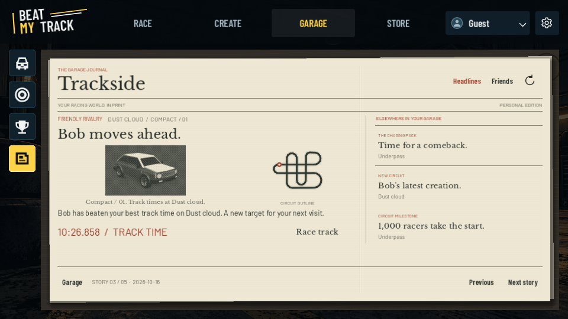

# Borderless news racing without scrolling

The owner's correction rejects borders around the racing action. GNF01 removes its border and filled background in normal, hover, pressed and keyboard-focus states. The existing Libre Baskerville type, dark ink,52-unit target and colour feedback remain.

The scrolling wording was ambiguous; an optional clarification was sent, and work proceeded after allowing time for a reply with the stated interpretation that scrolling should be unnecessary. GNF02 fits the complete article on screen: category/track facts share a byline, the original car photo/circuit outline use a114-unit image height, and race times and the direct racing link share the closing row. The headline, full story, captions and known timing facts remain. Newspaper rules elsewhere retain their original appearance. GNA01/G01/R01 preserve racing from all five story types, real local track identities, exact published versions, ordinary selected-car/five-lap racing and the retained Garage.

[New circuit](evidence/garage-news-fit-2026-10-18/gl_compatibility/race-friend_track-960.png), [local record in desktop Mobile](evidence/garage-news-fit-2026-10-18/mobile/local-record-960.png).

Changed runtime: `game/ui/garage_news_menu.gd`. Existing tests: `game/tests/test_garage_news.gd` verifies transparent/borderless interaction states; `game/tests/test_garage_news_native.gd` now verifies the complete article is enclosed at scroll position0, the full action target is visible, and no scrollbar appears. These tests no longer scroll the action into view. Both actual and local stories are covered at960x540,1280x720 and1600x720. Status/plan notes are updated.

The prior layout reproduces78 failures in286 checks with the new no-scroll assertions (headless, after removal of the race border only). Final client62, native Compatibility334 and desktop Mobile334, actual native race90, and parser854 all pass with exit0. Existing real-race tests cover the moved action's signal, five story kinds, local Underpass, selected car, five laps, version/cached document/ticket contracts, unavailable tracks and cancellation. No assertions were weakened. All final logs have no captured script/parse errors.

Actual commands/results: [report.json](evidence/garage-news-fit-2026-10-18/report.json). Pinned Godot4.7.2 is invoked through `scripts/dev.ps1` with isolated workspace APPDATA, fixture services and sandbox-approved native execution. Mobile refers to the desktop Vulkan renderer. [Task-only checkpoint](evidence/garage-news-fit-2026-10-18/checkpoint.json) preserves the exact previous workspace and unrelated changes.

No phone attachment check or physical-device test, APK build/install, live backend write or deployment was performed. Owner appearance/touch acceptance remains.
