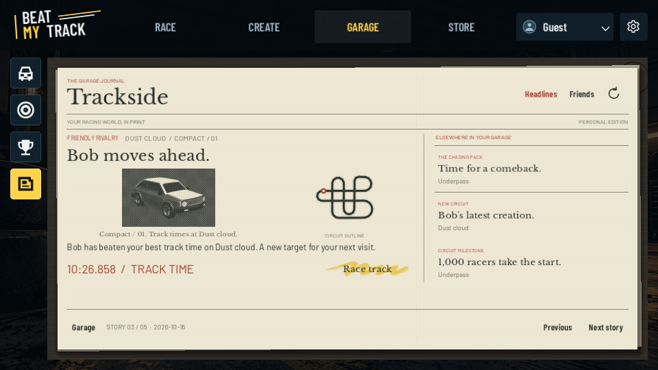

# Reference-based handwritten marker for Race track

GNH01 implements the owner's supplied brush-stroke reference: a few broad diagonal back-and-forth sweeps, tapered lead-in/finish and rough dry-marker edges. A transparent warm yellow brush image replaces the regular line pattern. The image contains only marker ink; existing Libre Baskerville text remains above it.

The built-in imagegen tool generated the asset using the imagegen skill. The reference is visual guidance and is not exported. The original2172x724 RGBA PNG is copied byte-for-byte to `game/assets/news/race_marker_handdrawn_v1.png`. [Exact generation prompt](evidence/garage-news-hand-marker-2026-10-18/generation-prompt.txt), [asset manifest/hash](evidence/garage-news-hand-marker-2026-10-18/asset-manifest.json) and `licenses/ASSETS.md` record provenance. Godot imports one shared512px mipmapped texture. Native drawing fits its ink region behind the link at78% opacity, preserving alpha and rough edges. No new runtime generation, provider, bitmap-editing dependency or animation is introduced.

GNM01/GNF02/GNA01/G01/R01 preserve the borderless52-unit action, complete article without scrolling, all track story links, original newspaper/photos/outline/Garage and racing behavior. Runtime changes are confined to `game/ui/garage_news_art.gd`, the new PNG and its import settings. Status/plan and asset provenance documentation are updated. Existing tests are reused.

[Desktop Mobile view](evidence/garage-news-hand-marker-2026-10-18/fitted/mobile/race-friend_overtake-960.png).

Actual native import succeeds. Existing client62 checks, final fitted Compatibility334 and desktop Mobile334 checks pass with exit0. Layouts cover every actual/local story at960x540,1280x720 and1600x720, full article/target visibility at scroll0, no scrollbar and retained Garage resources. Complete parsing858 scripts passes after texture integration; final source-region fitting is also loaded by both successful native layout runs. No final captured script/parse errors. Views were visually inspected on both desktop renderers. Actual commands/logs: [report.json](evidence/garage-news-hand-marker-2026-10-18/report.json).

Earlier work remains scoped in evidence: an interim curve-only marker passed334 Compatibility checks before the reference arrived; its code was superseded. The first asset-read attempt found Pillow unavailable, so .NET performed read-only PNG/alpha inspection without installing a dependency. Pre-fit texture layouts also pass334 per renderer. The generated image is unedited; the final UI source rectangle excludes excess transparent canvas. The [binary task-only checkpoint](evidence/garage-news-hand-marker-2026-10-18/checkpoint.json) includes the actual PNG and preserves concurrent unrelated edits.

Validation uses pinned Godot4.7.2 through `scripts/dev.ps1`, isolated workspace APPDATA and fixture services. Mobile denotes the desktop Vulkan renderer. No phone attachment check or physical-device test, APK build/install, live backend write or deployment was performed. Owner appearance acceptance remains.
