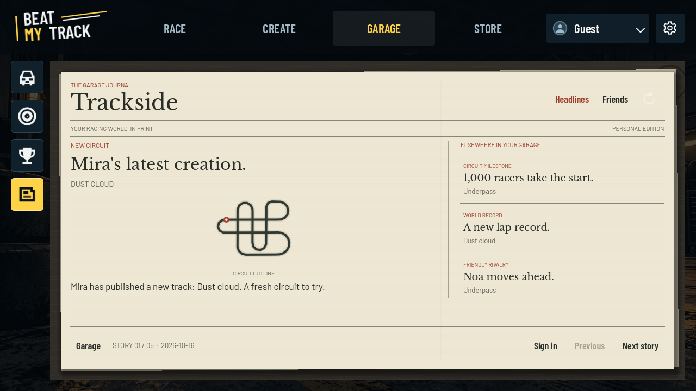

# Normal newspaper stories for an empty News feed

The owner requests example stories presented like normal stories. Headlines now fills an empty/unavailable feed, including guests and older servers, with five local stories using the existing newspaper, categories, dates, navigation, native car photographs and circuit ink. There is no separate example tab or edition badge. Actual available account news replaces the local stories automatically; the two sources are never mixed or written into each other.

The stories cover Mira publishing Dust cloud,1,000 racers on Underpass, Jules setting a Formula lap record, Noa beating a Compact track time and a Classic lap time slipping outside the top5%. `garage_news_examples.gd` packages two immutable96-point projections from the existing Underpass/Dust cloud fixtures. Its five dictionaries are created only when needed and retained by the menu. No test fixture files are loaded at runtime, no additional images or 3D worlds are created, and no export-filter change is needed.

Reading all five local stories performs no API requests, worker work or account/local-record writes. A real signed-in feed retains its original scoped cache, demand-based refresh and bounded polls. The Friends tab retains real authentication and server capability checks; local names are not inserted as friends. Guest readers retain the normal Sign in action on the paper.

[Record article at960px](evidence/garage-news-examples-2026-10-16/gl_compatibility/local-record-960.png). Native captures at960/1280/1600px verify every local story's packaged outline, the original retained Garage, no reads/account mutation, and replacement by actual news. Focused29 checks and112 checks per renderer pass; whole-project parsing reports830 scripts with0 failures. The usual sandbox root-certificate warning remains. Backend source/data are unchanged, so no database or deployment checks were needed.

[Report and commands](evidence/garage-news-examples-2026-10-16/report.json), [task-only checkpoint](evidence/garage-news-examples-2026-10-16/checkpoint.json). Owner/physical-phone appearance acceptance remains; no phone check/test, APK, backend mutation or deployment was performed.
