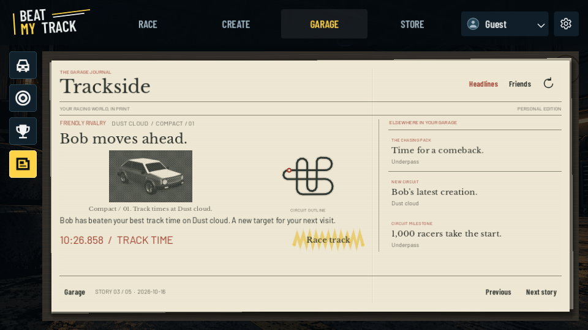

# Marker background for the newspaper race link

GNM01 implements the owner's requested zigzag marker background behind **Race track**. Twenty-three fixed zigzag points form translucent yellow chisel strokes, soft ink bleed and uneven turns. Existing native newspaper art draws the decoration behind the button's serif text. The marker ignores pointer/touch input and redraws only on layout/size changes; it adds no bitmap, shader, animation or processing loop.

GNF02/GNA01/G01/R01 preserve the borderless52-unit target, complete article without scrolling, original newspaper/car/outline, all track story links and ordinary racing. The owner explicitly replaces the previous background-free presentation with marker ink. Runtime files: `game/ui/garage_news_art.gd` and `game/ui/garage_news_menu.gd`. Status/plan documentation is updated; no new tests were added for this visual change.

[Desktop Mobile view](evidence/garage-news-marker-2026-10-18/mobile/race-friend_overtake-960.png).

Existing client62 checks, native Compatibility334 and desktop Mobile334 checks, and parser857 scripts all pass with exit0 and no captured script/parse errors. Native layouts cover every actual/local story at960x540,1280x720 and1600x720, complete article/target visibility at scroll0, no scrollbar and retained Garage resources. Client checks retain exact race-action signals and borderless interaction states. Screenshots were visually inspected. Actual commands/logs are recorded in [report.json](evidence/garage-news-marker-2026-10-18/report.json); [task-only checkpoint](evidence/garage-news-marker-2026-10-18/checkpoint.json) preserves unrelated workspace edits.

Validation uses pinned Godot4.7.2 through `scripts/dev.ps1`, isolated workspace APPDATA and fixture services. Mobile denotes the desktop Vulkan renderer. No phone attachment check or physical-device test, APK build/install, live backend change or deployment was performed. Owner appearance acceptance remains.
