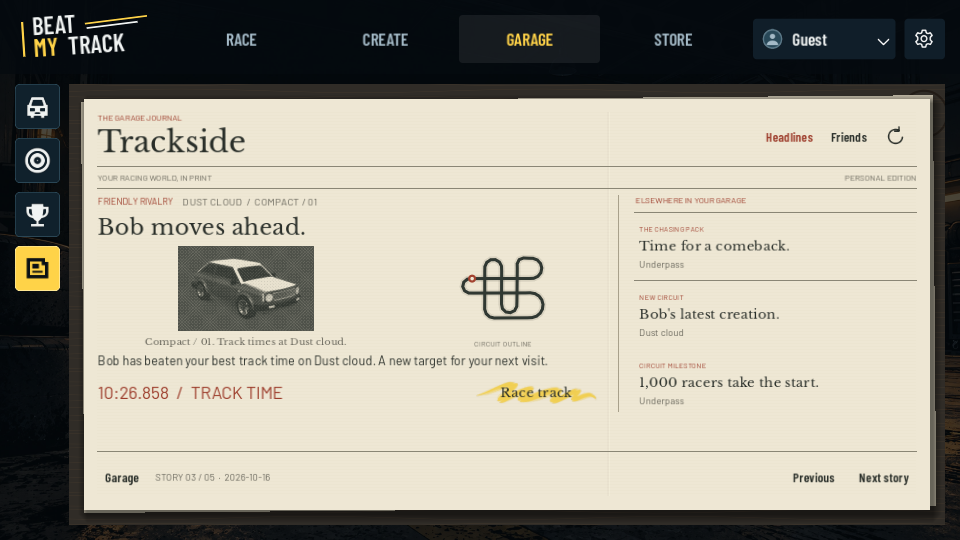

# Individual brush gesture for the news race link

GNH02 implements the owner's request for small alterations away from the supplied reference. The yellow brush keeps its loose texture while changing the shorter/curved lead-in, first return, spacing, broad middle sweep and downward-curving end flick. This changes the visible gesture rather than relying on colour alone.

Built-in imagegen edits the earlier local asset. The new original2172x724 transparent PNG is saved byte-for-byte as `game/assets/news/race_marker_handdrawn_v2.png`; v1 is retained unchanged. [Final prompt](evidence/garage-news-marker-variation-2026-10-18/generation-prompt.txt) and [asset manifest](evidence/garage-news-marker-variation-2026-10-18/asset-manifest.json) record mode, input/output identifiers, hashes, bounds and alterations. The shared512px mipmapped import and existing draw destination/opacity remain; only the preload and source fit change in `game/ui/garage_news_art.gd`. `licenses/ASSETS.md` and status/plan notes are updated.

[Desktop Mobile view](evidence/garage-news-marker-variation-2026-10-18/mobile/race-friend_overtake-960.png).

GNF02/GNA01/G01/R01 preserve the borderless52-unit action, every track story link, full article without scrolling, original photos/outline/Garage and racing behavior. No new tests were added for the artwork edit. Native import succeeds; existing native Compatibility334 and desktop Mobile334 checks pass with exit0 at960x540/1280x720/1600x720. They cover all actual/local articles, full target/article visibility at scroll0, no scrollbar and retained Garage resources. Both renderer views were inspected; final logs have no captured script/parse errors. Actual commands/results: [report.json](evidence/garage-news-marker-variation-2026-10-18/report.json). Read-only .NET alpha inspection confirms transparent corners and fits the ink with20 source pixels of margin. No programmatic pixel edits or dependency installs were used.

[Binary task-only checkpoint](evidence/garage-news-marker-variation-2026-10-18/checkpoint.json) includes the new PNG and preserves concurrent unrelated changes. Validation uses pinned Godot4.7.2 through `scripts/dev.ps1`, fixture services and isolated workspace APPDATA. Mobile denotes the desktop Vulkan renderer. No phone attachment check or physical-device test, APK build/install, live backend change or deployment was performed. Owner appearance acceptance remains.
