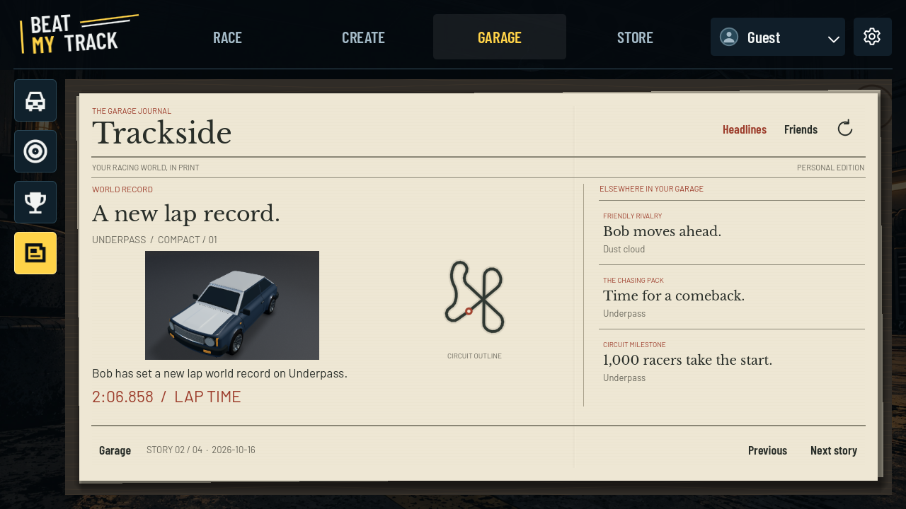

# Garage News: Trackside newspaper

The owner rejected the narrow dark News list and suggested a newspaper on a desk, with relevant car photographs and track shapes. News now occupies the main Garage area as **Trackside**: warm paper, serif masthead, faint fold, stacked edges, walnut desk, lead article and three selectable side headlines. Previous/Next browse the cached stories; only explicit older-story navigation can request another feed page. Friends uses a matching drivers' directory. The Garage control is on the paper.

The original live showroom remains attached, hidden with its viewport disabled, retaining the car, camera, local condition and cosmetics for return. Other Garage workbenches restore their usual slots. No new 3D world, car instance or live photograph renderer is created. The article uses the existing native file photograph for its actual board vehicle; it does not claim to depict that driver's personal paint or fitted parts. Track milestones without a board show the circuit alone.

Circuit ink comes from the actual published version's stored discovery projection. The existing indexed News page query also selects that small projection, without reading track documents or creating jobs. The response adds `tracks`, keyed by version ID, with one validated outline per version on the page, capped at96 two-coordinate points. The client attaches the outline to its existing bounded item cache. Missing/legacy projections say `OUTLINE UNAVAILABLE`; they never draw an invented circuit or download a track. The existing Studio projection validator also rejects malformed/nonfinite/out-of-range points.

Daily demand, expiring requested work, changed-board comparisons, the scoped60-second cache, four bounded visible polls, private mutual friendships, block filtering and identity fences remain unchanged. Inactive players gain no work. New backend cost is the small projection column on an already bounded read and bounded response bytes. No additional SQL statement, object-store read/write, ranking calculation or background worker job is introduced. The new font is171900 bytes; all car photos were already packaged. Its full OFL license is explicitly included by the export preset; no package was built.

[960px record](evidence/garage-news-newspaper-2026-10-16/gl_compatibility/record-960.png), [milestone front page](evidence/garage-news-newspaper-2026-10-16/gl_compatibility/news-1280.png), [Friends directory](evidence/garage-news-newspaper-2026-10-16/gl_compatibility/friends-1280.png), [Vulkan article](evidence/garage-news-newspaper-2026-10-16/mobile/record-1280.png). Screenshots use clearly seeded test events and actual Underpass/Dust cloud fixture outlines, with disposable local records. The old UI captures remain in `evidence/garage-news-2026-10-16/`.

Validation with pinned Godot4.7.2 and the local Python environment:

- `test_garage_news.gd`:19 checks, including cached story browsing without reads, correct vehicle photo, queued tab changes, hidden/departing panes, identity changes and blocks.
- `test_garage_news_native.gd`:67 checks each on Compatibility and Vulkan Mobile at960x540,1280x720 and1600x720. Actual full app, viewport disabled during News, retained car/viewport/camera/condition/cosmetics, actual96-point circuit, no requests when browsing, and return into Records/Customise/Tuning/Care/Trophies.
- `pytest backend/tests/test_news.py backend/tests/test_news_http.py -q`:40 passed,2 SQLite concurrency skips. SQLite and disposable PostgreSQL include the new same-query outline bound/deduplication check, malformed projection handling, original demand/correctness/privacy/deletion and indexed access-path checks. The wire test was subsequently extended and rerun:1 passed,11 native HTTP checks with real Bearer sessions and exact circuit coordinates.
- Existing `test_garage_menu_motion.gd`:135 headless checks. Its temporary test copy changes only the unique fixture storage path to a globalized workspace build path; the product and assertions are unchanged. The unmodified harness could not write `user://` in this sandbox; a first isolated attempt also needed path globalization. Both initial logs are retained. The final copy, exact substitution and hashes are recorded with the report.
- Whole-project parse:819 scripts,0 failures. Ruff on changed Python source/tests passes.

Initial corrections are retained: a first font-import parse caught an incorrect catalog helper name; early captures cropped the car and put the result below the fold, corrected by fitting the full photograph and moving the Garage control onto the paper. The added HTTP assertion initially compared JSON floats against a nested integer literal; it now compares equivalent parsed JSON. The expanded room-return test now waits for the existing0.65s camera tween and uses approximate transform equality; direct News returns still check exact camera equality. A repeated root-certificate warning is from the sandboxed engine, with no News script errors in final runs.

Commands, outcomes, source hashes and the task-only patch are in [the report](evidence/garage-news-newspaper-2026-10-16/report.json) and [checkpoint](evidence/garage-news-newspaper-2026-10-16/checkpoint.json). Concurrent source changes are preserved. This is local implementation and desktop validation; owner/physical-phone visual acceptance and a matching backend rollout remain. No APK, phone run, catalog change or deployment was performed.
