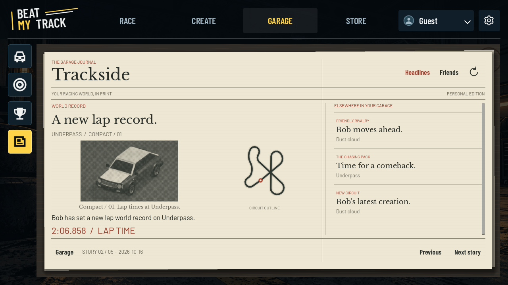

# Centered newspaper car photographs

The owner reports that the newspaper cars are not centered. The previous livery-preview photographs placed the models low in the image; the Formula and Kart also extended beyond the bottom edge. GNC01 replaces only News's image source with five offline native photographs whose complete model bounds are centered. GNC02 retains the newspaper treatment, responsive photo/caption alignment, original Garage and zero additional backend/live-preview work. G01/R01/Q01 preserve canonical behavior and actual evidence.

`game/tests/bake_news_car_photos.gd` fits every visible native mesh vertex in the original three-quarter studio direction. An orthographic photograph camera centers the projected silhouette and leaves10% top/bottom clearance. This camera exists only in the offline baker; gameplay and the live Garage camera are unchanged. The five640x400 PNGs in `game/assets/news/vehicles/` use the original native chassis, Midnight pigments and studio lighting. They are mipmapped and displayed with the existing paper/ink shader, frame and captions. The older livery gallery files remain untouched.

The native bake measures all five model bounds: maximum center error is below0.001px, with at least40px clearance on every image edge. The exact projected bounds, source counts, camera transforms and PNG hashes are in [framing.json](evidence/garage-news-centering-2026-10-16/framing.json). No image editing/generation service or invented car is used. Five PNGs total801181 bytes; runtime uses ordinary packaged textures, with no image processing, extra cache, query, job or render target.

[Complete Formula at960px](evidence/garage-news-centering-2026-10-16/mobile/printed-formula-960.png), [complete Kart](evidence/garage-news-centering-2026-10-16/gl_compatibility/printed-kart-1280.png). Both renderers capture every car at960/1280/1600px. The native harness checks the fitted image source, photo/caption centers, real class/track context, absence of extra reads/live cars and the existing retained Garage/direct-race behavior.

Changed files: the image path/filter in `game/ui/garage_news_menu.gd`; the five new PNGs/import settings; the offline baker; all-car responsive checks in `game/tests/test_garage_news_native.gd`; asset provenance and requirement/status documentation. Pinned Godot4.7.2 native bake passes5 cars; focused News passes35 checks and the native menu passes214 per renderer. Whole-project parsing, commands, logs and hashes are in [report.json](evidence/garage-news-centering-2026-10-16/report.json); the [task-only checkpoint](evidence/garage-news-centering-2026-10-16/checkpoint.json) includes the new binary assets and excludes concurrent workspace work.

The first bake's exit-time resource warnings are retained. Disabling unused rest-scene caching in this one-time tool and allowing bounded cleanup removes them in the final bake. Asset imports succeed, while the sandbox prevents Godot from saving its global editor settings. Known root-certificate and native shader-cache errors remain in engine logs; final script/assertion checks pass. No phone test or attachment check, APK, backend mutation or deployment was performed. Owner/device visual acceptance remains.
