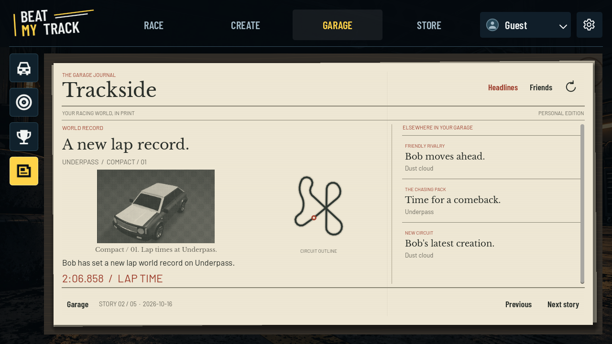

# Printed car photographs in Garage News

The owner requests car pictures that look like real newspaper photographs. GNP01 adds a single charcoal-ink treatment on the existing warm paper, restrained angled halftone dots, static print grain, a fine image rule and a small serif caption. GNP02 preserves the actual native chassis photographs, bounded menu resources and zero additional backend work. G01/R01/Q01 retain the original Garage, canonical racing and actual validation evidence.

Each article still uses its board's existing packaged native car photo. One shared `ShaderMaterial` converts it to paper/ink tones; no new car models, render targets, source image changes or generated imagery are introduced. All five chassis use the same material. The screen-pixel dot spacing is2.2px, antialiased and blended at18% to keep the body/windows/wheels clear. There is no TIME input, animation, processing callback or uniform-update loop. The new fragment work is limited to the existing visible photograph; no phone performance claim is made.

The caption uses the actual vehicle class, lap/track metric and track name. It does not claim to show a driver's personal cosmetics or an actual race capture. Existing story navigation, outlines, local examples, Friends and Race track actions remain. Reading adds no queries, jobs or live showroom draws; the same hidden retained Garage car/camera/condition is restored on return.

[960px article](evidence/garage-news-print-2026-10-16/gl_compatibility/record-960.png), [Formula on Vulkan Mobile](evidence/garage-news-print-2026-10-16/mobile/printed-formula.png), [Kart](evidence/garage-news-print-2026-10-16/gl_compatibility/printed-kart.png). The native harness also captures Compact, Pickup and Classic. These are disposable fixture stories with actual packaged native photographs.

Runtime changes are `game/ui/garage_news_menu.gd` and `game/ui/garage_news_photo.gdshader`; the existing native News harness adds captions and all-five-car coverage. Status/requirement documentation accompanies the source. The first native review exposed an overly coarse dot screen; its exact image and shader are retained in the evidence directory. The final pass uses finer dots, less halftone coverage and stronger photographic contrast.

Pinned Godot4.7.2 validates35 focused News checks and144 native checks per renderer, including960/1280/1600px, all five car photos/captions, no extra reads, retained Garage resources and direct-race action reachability. Whole-project parsing and exact commands/outcomes are recorded in [report.json](evidence/garage-news-print-2026-10-16/report.json). Root-certificate and shader-cache file errors remain in the native engine logs; final script/assertion checks pass. The [task-only checkpoint](evidence/garage-news-print-2026-10-16/checkpoint.json) preserves unrelated workspace changes.

Owner/physical-phone appearance and fine-pattern acceptance remain. No physical-phone test or attachment check, APK, backend change or deployment was performed.
