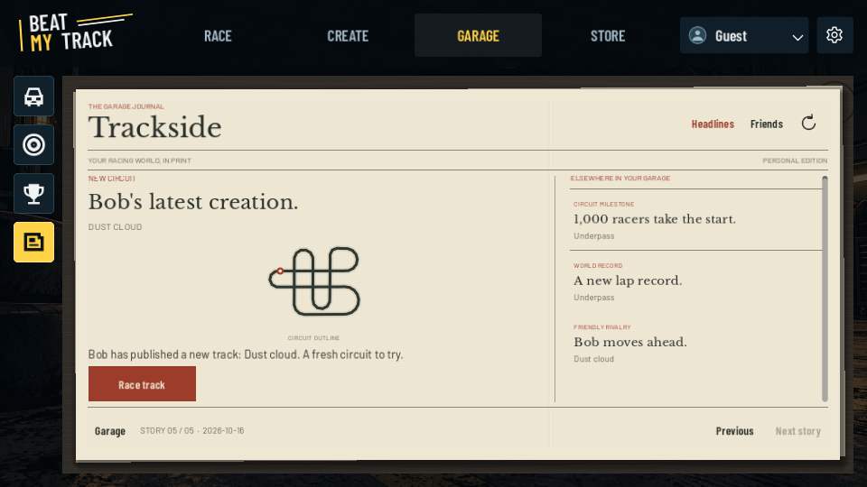

# Race directly from a new-track story

The owner requests immediate racing from the new-track story. A **Race track** action now sits below every NEW CIRCUIT article, including the local Dust cloud story. It opens the existing loading cover and starts the published track with the selected car, without visiting the track browser. The cover shows the article's real outline and known facts immediately, then the actual biome when publication metadata arrives.

GNR01 covers the article action and immutable published-version selection. GNR02 covers on-demand reads, existing caches and the normal race pipeline. GNR03 covers unavailable tracks, duplicate presses and context cancellation. G01/R01/Q01 preserve the original Garage, canonical racing and actual validation evidence.

Real stories resolve exactly their `version_id` through the existing version endpoint. A hidden, archived, blocked, missing or mismatched version fails without substituting another revision. The local article carries the existing Dust cloud authoring ID and resolves an actual matching published catalog entry on demand. It uses an already loaded catalog entry when available, otherwise one name-filtered page of at most20 entries, filtered again by authoring ID. No fabricated publication ID or local draft bypass is used.

Viewing and browsing still add zero track requests or worker jobs. Pressing Race adds one metadata read, plus a document read only if the validated document is not already cached. Existing bounded prepared-track and road caches serve compilation/preparation. Signed-in racing requests the ordinary selected-car ticket; the existing manifest/handling checks, explicit offline choice on failure, full countdown, five laps, result and verification flows remain. Guest starts retain the existing guest race behavior. No API, migration, worker or canonical contract changes were needed.

One loading operation admits the click; duplicate presses are ignored. Navigation, Garage section, account/origin, selected car and selected track are checked around asynchronous work. The metadata resolver and optional download cancellation callback stop subsequent requests or cache writes after departure/context changes. A previously started transport request can finish, but its stale reply cannot start a hidden race. The original retained Garage car/camera remain available on return. Fresh Garage entry also initializes the catalog cache when Race has never been opened.

Runtime files changed: `game/ui/garage_news_menu.gd`, `game/ui/garage_page.gd`, `game/ui/garage_news_examples.gd`, `game/core/app.gd`, and `game/backend/cloud_tracks.gd`. Tests extend the existing News client/native harnesses and add `game/tests/test_garage_news_race.gd`. The existing Rivalry failure test adapter accepts the optional cancellation parameter; its behavior/assertions are unchanged. Requirement/status documentation and a task-only patch accompany the source.

[Normal local story](evidence/garage-news-race-2026-10-16/mobile/local-stories-1280.png), [loading cover](evidence/garage-news-race-2026-10-16/mobile-Windows/story-race-loading.png), [actual countdown](evidence/garage-news-race-2026-10-16/gl_compatibility-Windows/story-race-countdown.png).

Validation uses pinned Godot4.7.2, isolated workspace persistence, actual native race construction and fixture transport replies. The signed-in fixture passes the actual CloudTracks ticket contract checks; it does not contact or change a retained service. The full race harness exercises a real article-button signal, exact version/document requests, hash failure, blocked/archived/missing tracks, duplicate clicks, nine cancellation contexts (including document and local-search replies), no cancelled document writes, full countdown/five laps, selected car, retained Garage, signed-in ticket success/failure, local resolution, cached documents and mismatched-version rejection. The layout harness checks the action is reachable inside the scrolling article at960/1280/1600px on both renderers. Actual commands/results are in [report.json](evidence/garage-news-race-2026-10-16/report.json).

Initial failures are retained: a missing test-local RaceLoading type was corrected; the actual fresh-Garage catalog initialization fault was fixed; the transport fixture gained the ordinary browser-return adapter, a typed-array append and workspace road-cache isolation. Whole-project parsing caught the older Rivalry adapter signature and it was updated for the optional callback. The final tests retain the engine's root-certificate and shader-cache file errors in their logs; script assertions and native launches pass. No invariant was relaxed.

No physical-phone test or attachment check, APK, retained backend mutation or deployment was performed. Owner/device appearance and touch acceptance remain. Actual online racing still requires the same matching client/server verification contract as Free Race; this task does not deploy the concurrent News/backend/physics changes. [Task-only checkpoint](evidence/garage-news-race-2026-10-16/checkpoint.json).
