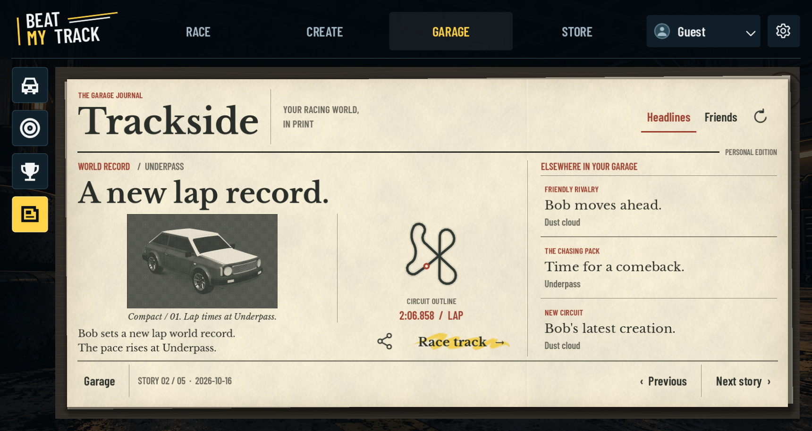

# Trackside newspaper reference refinement

The owner's ten requested changes are implemented in the existing native Garage newspaper. The supplied image guides composition; it is not a shipping texture.

[Milestone at the reference dimensions](evidence/garage-news-refinement-2026-10-18/final/gl_compatibility/news-1720.png) · [960px desktop Mobile with both times](evidence/garage-news-refinement-2026-10-18/final/mobile/local-friend_overtake-960.png) · [Friends directory](evidence/garage-news-refinement-2026-10-18/final/gl_compatibility/friends-1280.png).

| Requirement | Implemented behavior |
| --- | --- |
| GNS01 | Larger Trackside masthead, adjacent two-line tagline and strong horizontal rule. |
| GNS02 | Larger serif lead headline using the existing variable font's real 700 weight; long headlines fit their column. |
| GNS03 | Retained car photograph and actual bounded circuit outline share a spread with a vertical rule. Milestones use the selected class's existing file photograph, identified as such; publication stories retain the outline alone. |
| GNS04 | Genuine Libre Baskerville italic photo captions, centered beneath the original complete car frames. |
| GNS05 | Serif headlines/article text and Barlow Condensed labels/navigation. |
| GNS06 | Stationary pulp mottling, grain, flecks, irregular fold and edge aging replace evenly repeated paper stripes. Original shader code has no time input, processing loop or texture sampler. |
| GNS07 | Three selectable sidebar briefs have stronger hierarchy, rules and balanced spacing. |
| GNS08 | Shorter two-line copy beneath the visuals; known new/personal times remain beside the outline. |
| GNS09 | Retained yellow marker v2 beneath the heavier Race track action and arrow; transparent interaction states and minimum 52-unit target remain. |
| GNS10 | Editorial previous/next arrows, vertical separators, story number and actual story publication date. Garage, sign-in and sharing actions remain. |

G01/R01 preserve the current account/feed and local-example boundaries, cached reading, exact published/local track identities, share signals, selected-car/five-lap racing and retained Garage car/camera/condition. No backend or canonical changes are part of this task. The illustrative milestone photograph changes no story record or race car selection.

Runtime files: `game/ui/garage_news_menu.gd`, `game/ui/garage_news_art.gd`, new `game/ui/garage_news_paper.gdshader`/UID and `game/assets/fonts/libre_baskerville/LibreBaskerville-Italic.ttf`/import. The unmodified 167,456-byte italic font uses the existing adjacent SIL OFL 1.1 license; its source and exact SHA-256 are recorded in `licenses/ASSETS.md` and the report. Existing car photos, marker and other fonts are retained. No image-generation service or added dependency is used.

The existing `game/tests/test_garage_news_native.gd` adds reference-size 1720×914 coverage to 960×540, 1280×720 and 1600×720. It checks that masthead/tagline and picture/divider/outline stay separate, the footer fits, all ordinary/local article copy stays in two lines, complete articles/actions fit at scroll position zero and there is no article scrollbar. Existing photo identity/framing, original Garage resource retention, cache/account, Friends and racing assertions remain.

Pinned Godot 4.7.2 results: News client **62 passed**, final native layouts **482 Compatibility / 482 desktop Mobile passed**, direct native race flow **90 passed**, publication/share flow **39 passed**, project parser **891 passed**, and native import completed. No captured final script/parse/shader errors. Desktop Mobile denotes the Windows Vulkan renderer, not a phone test.

The broader App suite reports **140 checks / 11 failures**, all editor mouse/touch gesture/history assertions. An isolated copy using the exact saved pre-task newspaper sources reproduces the same eleven failure messages. [Comparison](evidence/garage-news-refinement-2026-10-18/app-baseline-comparison.json) and source fingerprints are retained; the working project was never restored or overwritten for this comparison. The isolated copy has no Git source identity; its generated empty-source build ID is not treated as a client release identity. These existing editor failures remain outside the newspaper change.

Initial attempts are retained: direct PowerShell execution met the host execution policy; the normal explicit Bypass entry point then met the sandbox's certificate-store restriction, and approved native execution was used. Early renders exposed a wrapping edition label, excessive sidebar minimum height, inherited 12-unit circuit-row spacing and personal-best overflow at wide/short dimensions. Final layout fixes address these without removing or weakening invariants. The weight axis uses its numeric OpenType tag. A temporary geometry probe was moved out of the export root into evidence; unavailable Python fontTools was replaced by a read-only standard-library font-table inspection. A provisional oblique caption was replaced by the real licensed italic face before final screenshots.

Actual commands/results, retained initial runs, font provenance, [task-only Git patch and checkpoint](evidence/garage-news-refinement-2026-10-18/checkpoint.json): [report.json](evidence/garage-news-refinement-2026-10-18/report.json). Concurrent unrelated changes are preserved. `DEVELOPMENT_STATUS.md`, `docs/PHASE_0_PLAN.md` and `AGENTS.md` record this slice.

Owner appearance/touch acceptance remains. No phone attachment check or physical-device test, APK/export/install, live publication/account/backend mutation or deployment was performed. GPU cost and physical-device performance are not measured by these layout checks.
