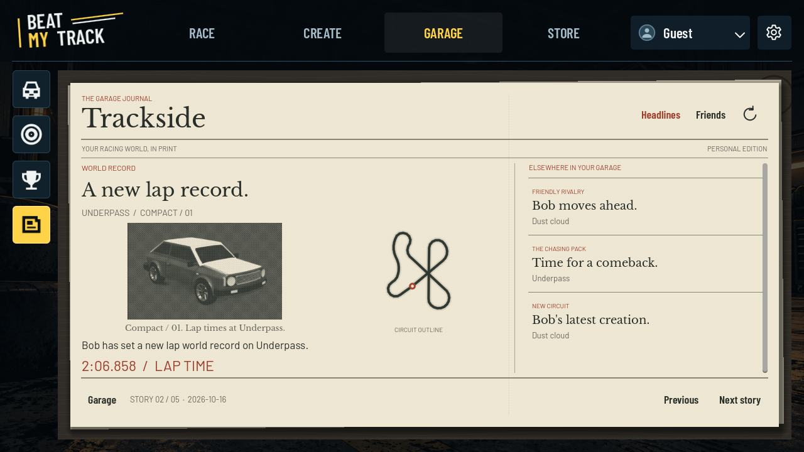

# Rivalry's car view in the Garage newspaper

The owner requests the same car view as the Rivalry standings. GNV01 changes the newspaper photographs to use the actual `rivalry_victory_car.gd` podium renderer: its lower camera angle, front-facing PI pose, perspective projection, simpler native models and Garage lighting/finishes. GNV02 preserves centered complete framing and the existing newspaper print effect, captions and bounded runtime behavior.

The offline baker now instantiates that existing renderer with `podium_presentation` and `simple_model` enabled. Camera position/basis remain exactly those used by Rivalry: position(-5,2.5,6), looking toward(0,0.65,0). Only field of view changes to fit the paper's aspect ratio; a canvas offset centers the projected complete mesh without moving or rotating the camera. The renderer's existing antialiasing and transparent-edge composite resolve the car onto a quiet charcoal background before saving the RGB image. Midnight pigments and stock parts remain. These are class photographs, without a claim to show a remote driver's personal appearance.

All five640x400 mipmapped files are rebaked in place. Their measured centers are exact in the projected bounds; minimum edge clearance is58.107px. [framing.json](evidence/garage-news-rivalry-view-2026-10-17/framing.json) records original/fitted FOV, unchanged camera transforms, matched-view assertions, bounds, canvas offsets and PNG hashes. The five PNGs total313325 bytes. The ordinary News menu, print shader and other galleries do not change. Runtime still loads one packaged image per illustrated article; there are no new requests, jobs, image-processing steps or live previews.

[Formula article](evidence/garage-news-rivalry-view-2026-10-17/mobile/local-record-1280.png), [Pickup at960px](evidence/garage-news-rivalry-view-2026-10-17/gl_compatibility/printed-pickup-960.png). The existing native harness captures all five cars at960/1280/1600px on both renderers and preserves the original Garage/camera/condition, caption alignment and direct-race action. The actual Rivalry renderer and podium studio files remain byte-exact; no standings, scores, cosmetics sharing or canonical behavior changes.

Changed files are the offline `game/tests/bake_news_car_photos.gd`, five `game/assets/news/vehicles/*.png` images, this report and the requirement/status/provenance entries. Pinned Godot4.7.2 passes the five-car matched-view/framing bake,35 focused News checks,214 native checks per renderer and839-script parsing. Actual commands, logs, hashes and the binary task-only checkpoint are linked in [report.json](evidence/garage-news-rivalry-view-2026-10-17/report.json) and [checkpoint.json](evidence/garage-news-rivalry-view-2026-10-17/checkpoint.json).

Known root-certificate and Vulkan shader-cache file errors remain in the logs. Asset import succeeds while Godot cannot save its global editor settings outside the sandbox. Final script/assertion checks pass. Owner/device visual acceptance remains; no physical-phone test or attachment check, APK, backend mutation or deployment was performed.
