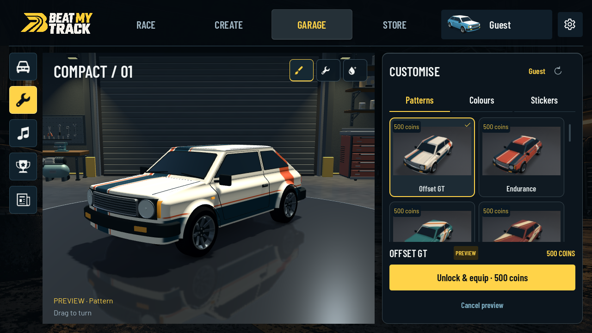

# Garage options and main-view focus — 2026-10-25

GOF01–GOF03/R01/Q01 implement the owner's request for options on the right and an appropriately zoomed main Garage view.

Patterns was still constructing the older detail-photo shelf. It now explicitly uses the same two-column scrolling catalogue as Parts, and that layout is also the shelf default. The duplicate large sidebar photo stays hidden and no sidebar detail viewport is created. Pattern cards have a compact height, the selected option stays visible after relayout, and the selected-item title retains space beside its state and price. Small option thumbnails remain for choosing designs and parts.

Opening a workbench now focuses the main Garage camera once the panel transition settles. Patterns and Colours fit the actual vehicle bounds while preserving the previous viewing direction. Parts focuses Hood, Rear aero, Rims or Body kits; Stickers focuses its selected surface. Whole-body framing accounts for window aspect and reserved header space, works with all seven car models, and caches bounds until the car or fitted parts change. The actual car, showroom viewport and cosmetic-photo cache remain retained.

Cancel preview restores equipped cosmetics while keeping the editing focus. Leaving editing restores the previous camera and its exact scalar orbit values. This supersedes the prior Appearance carousel layout and zoom-out-on-cancel expectations. The existing wash overlay, absent view buttons, gesture input, free previews, explicit equip/purchase and cleanliness/account/save guards remain.

Runtime changes are confined to:

- `game/ui/garage_page.gd`: focus after layout, resize handling and camera lifetime through editing tabs.
- `game/ui/garage_livery_menu.gd`: options-only Patterns and selected-option visibility.
- `game/ui/garage_cosmetic_shelf.gd`: catalogue default, pattern card heights and title width.
- `game/ui/garage_customisation_camera.gd`: model-bound body fit and exact return-camera state.

The existing carousel and retained-customisation tests now check the requested focus behavior. Existing ownership, save, delayed response, guest preview, cache and retained-object assertions remain. All seven vehicles are checked at 960 × 540 and 1720 × 900 for projected bounds, useful view occupancy, viewing direction and exact restoration. Actual App screenshots also cover 1280 × 720 and selected parts. Touch scrolling must move the options without selecting or buying on release.

Actual commands and outcomes, source/capture hashes and the reverse-checked task-only Git patch are recorded in [report.json](evidence/garage-options-focus-2026-10-25/report.json). Tests use the pinned Godot through `scripts/dev.ps1` with isolated APPDATA and local records:

```powershell
powershell -NoProfile -ExecutionPolicy Bypass -File docs/evidence/garage-options-focus-2026-10-25/run.ps1 -Mode gl_compatibility
powershell -NoProfile -ExecutionPolicy Bypass -File docs/evidence/garage-options-focus-2026-10-25/run.ps1 -Mode mobile
powershell -NoProfile -ExecutionPolicy Bypass -File docs/evidence/garage-options-focus-2026-10-25/run.ps1 -Test test_garage_sidebar -Mode gl_compatibility
powershell -NoProfile -ExecutionPolicy Bypass -File docs/evidence/garage-options-focus-2026-10-25/run.ps1 -Test test_script_parse -Mode headless
```

Final focused checks pass 425 headless, 475 Compatibility and 475 desktop Mobile. Retained customisation passes 1396, actual App 141, Workshop/Wash navigation 549, removed-view-control/gesture checks 65 and the final full parser 1199 scripts. All have zero failures.

The original native baseline passes 362 checks. Initial passing visual captures exposed a collapsed selected-item title, a scrolled-away selected pattern and a whole-body direction change; these were corrected and new assertions retain the required visibility/direction. The navigation regression then caught one exact-orbit failure: storing the return values in a Vector3 rounded them. Separate scalar values correct this without relaxing the navigation assertion. Its initial failed log is retained under `initial/`.

The broader cleanliness suite's previously documented Forklift heavy-film failure is outside this camera/layout change; it was not rerun or altered. No all-suite cleanliness claim is made.

[Review the native before/after and part close-ups](evidence/garage-options-focus-2026-10-25/review.html).



Reload and owner appearance/touch acceptance remain. Mobile here means Windows Vulkan, not a phone measurement. No device attachment check or physical-device test, APK, real purchase, live mutation, deployment or owner-process restart was performed. Concurrent work is preserved; the checkpoint does not stage or commit it.
