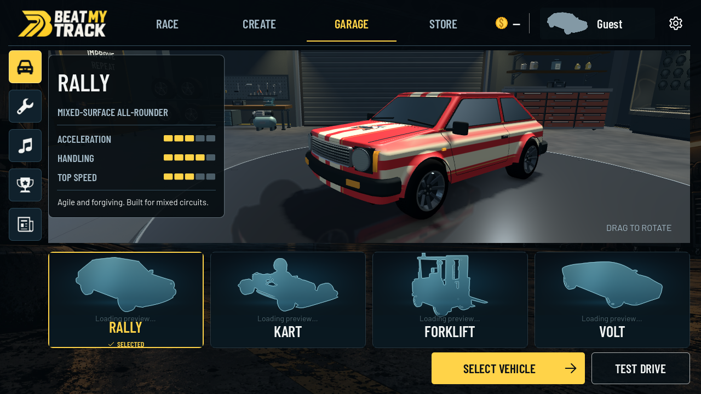
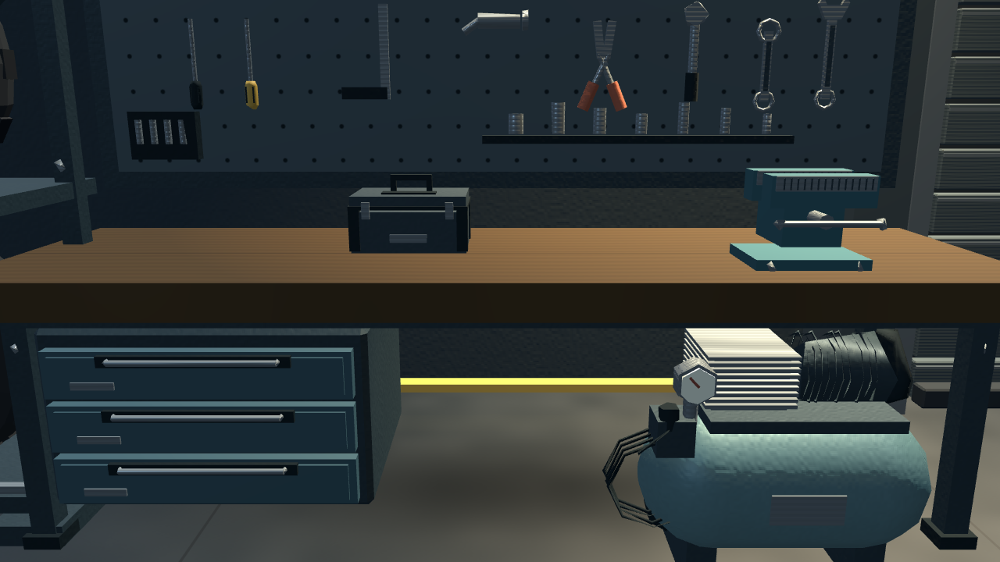

# Simplified Garage applied — 15 November 2026

The owner requested applying the smaller Garage after the review-only experiment. This change applies the same offline index-selection method, with complete material batches protected for the gold lettering and the red/blue drawer fronts. Vehicle geometry, handling, camera and menu layout are outside this change.

## Requirements and result

- **GSA01:** publish a reproducible reduced workshop for normal entry and source fallback.
- **GSA02:** retain named objects, attachments, transforms, finishes, lighting, animation and interaction routing.
- **GSA03:** qualify current prepared assets, native appearance and cache provenance without claiming a loading-speed or device improvement.

| Geometry | Previous | Applied |
|---|---:|---:|
| Workshop | 29,245 | 16,826 |
| Physical platform | 1,816 | 1,816 |
| Floor and contact | 14 | 14 |
| Default environment | 31,075 | **18,656** |

This is **39.96% fewer environment triangles** in this step and 86.09% fewer than the original 134,089. The 17,985-triangle review candidate was more aggressive: keeping the lettering and cabinet-front batches costs 671 triangles. The current car is additional to the environment total.

The compressed workshop scene falls from 445,071 to 281,179 bytes (36.82%). Unique ArrayMesh payload falls from 1,520,084 to 931,060 bytes (38.75%). There are still 109 mesh instances and 96 unique meshes; this does not establish fewer draw calls or better FPS. A separate 125,318-byte generated source-fallback plan is also packaged; the scene-file reduction is not the total package saving.

## Implementation

`game/ui/garage_mesh_reduction.gd` selects the existing offline-generated LOD nearest half of each eligible ArrayMesh's master index count. It compacts complete original encoded vertex records and remaps retained lower LODs. It does not fit new positions, resample attributes or alter primitives, skinning or blend shapes. Protected batches retain their original master and LODs.

Normal Garage entry loads the reduced prepared scene directly. A fresh procedural build applies the preselected recipe only after batching. No mesh simplifier or recipe read is added to the normal prepared entry path. Unknown or invalid recipes retain the original geometry; source/prepared equality and the strengthened triangle budget expose missing recipes.

The architecture producer disables recipe application while constructing its full source, generates ordinary native LODs, selects the recipe and publishes the scene, recipe and provenance through the existing transaction with the manifest last. Its receipt binds all 29 declared source hashes, the scene hash, recipe hash, schema and engine. The export gate checks those bindings. Both export presets include the generated JSON. The catalogue producer and preview identity include the new helper dependency.

The environment budget is strengthened from 31,100 to 20,000 triangles; all previous checks remain. The new integrity regression checks exact original encoded position/normal/tangent/UV/colour records, source-buffer immutability, master/lower-LOD index ranges, culling bounds, protected batches, instance placement/finish and conservative invalid/missing-plan handling.

## Verification and appearance

Initial qualification on the published scene:

| Check | Actual outcome |
|---|---|
| Source/prepared geometry, budget and prior named-object layout | 82 checks, 0 failures |
| Recipe integrity and fallback guards | 494 checks, 0 failures |
| Existing enclosed-face cleanup | 20 checks, 0 failures |
| Existing transaction/error handling | 25 checks, 0 failures |
| Python workshop receipt controls | 12 tests pass |
| Production parser | 577 scripts, 0 failures |
| Complete prepared car resources | 551 resources, 2,267 checks, 0 failures |
| Six cars / three views / ten close prop views / two reflections | 202 checks per desktop renderer, 0 failures |
| First receiving captures | 90 checks per desktop renderer, 0 failures |
| Real reflection pixels and lifecycle | 26 checks per desktop renderer, 0 failures |
| Opening tools | 16 checks per desktop renderer, 0 failures |
| Actual App selection, rotation, saved appearance and reentry | 45 checks per desktop renderer, 0 failures |
| Record-player playlist controls/layout | 63 checks per desktop renderer, 0 failures |
| Published workshop receipt | Exact scene/plan and 29 current sources |
| Refreshed native catalogue | Six images and 174 current sources |
| Refreshed selection portraits | Six pictures; 25,418 inputs stable during native production |
| Private native image import | 12 current PNGs verified and published |

The paired captures compare identical native car instances and finishes. There are 84 image pairs per renderer. **35 pass and 49 fail the unchanged earlier tight appearance gate in each renderer.** This is a visible quality tradeoff, not pixel identity: plants, tyres, fittings, shelf objects and record-player details are coarser. The largest mean differences are in the close record-player views (4.709/255 Compatibility, 3.740/255 Mobile). No assertion was relaxed to hide this change. Lettering and coloured drawer-front batches are protected and their complete source mesh resources are retained by the integrity regression.





Final actual App samples report first live page 2,451.807 ms Compatibility and 2,812.626 ms desktop Mobile. Earlier samples were 3,588.171/2,879.705 ms. These are unmatched diagnostic samples on current sources, not a before/after comparison. The earlier controlled review found no dependable loading gain attributable to mesh reduction. First-use rendering and asynchronous carousel previews remain. No FPS, phone latency or whole-project acceptance claim is made.

## Commands and retained controls

All engine commands use `scripts/run_garage_simplified.py`, which wraps the pinned 4.7.2 console engine with `run_no_crash_dialog.py`, isolated disposable storage, Dummy audio and offline backend configuration. Native runs use `gl_compatibility` and `mobile` sequentially.

```powershell
python scripts/run_garage_simplified.py publish-room --headless --script res://tests/bake_garage_architecture.gd --output=res://assets/garage
python scripts/run_garage_simplified.py final-budget --headless --reference-room=res://../build/garage-simplified-apply-2026-11-15/before/workshop_v1.scn
python scripts/run_garage_simplified.py recipe-final --headless --script res://tests/test_garage_mesh_reduction.gd
python -m unittest discover -s scripts -p test_garage_workshop.py
python scripts/check_garage_workshop.py
```

All 556 checked car-resource files and the complete modular car revision dictionary remain exact. No vehicle resource was rebaked for this task. The build identity was regenerated through the standard script; catalogue photographs and selection portraits were actually rendered again against their new dependency keys. Their manifests were not merely relabelled.

The first final fence rejected a build-identity change during a passing Mobile App run. The concurrent Rally-front task refreshed the Rally catalogue PNG while its already-current geometry/cache keys remained unchanged; the portrait's shared lighting binding then correctly rejected. The current Rally photograph was preserved. The standard identity recomputation confirmed the current revision; six portraits were rendered again and current catalogue/portrait native imports were refreshed. An intervening MD5 check rejected the superseded image-import receipt before another live run. **The final 1,301-input fence is stable**, both final App runs pass 45/0, all 12 imported PNG hashes match and all three live asset validators pass. The rejected fence and receipts remain in the evidence. The existing selection-picture loader emits raw-PNG export warnings in these final App runs; no loader change or export qualification is claimed.

The evidence directory retains launcher receipts and logs for exact arguments, source fences and outcomes, source-only checkpoint, two image-comparison tables and selected paired native screenshots. The initial helper used a String hash method on a PackedByteArray and failed parsing; it was corrected before baking. The first pedestal-only fixture omitted the material initialization performed by the full builder and failed; the corrected fixture builds the room first. Both initial failure logs are retained. Production publication succeeded under the source/output transaction; no error result was accepted.

The 15-file task-only source checkpoint applies and reverses exactly after BOM/line-ending normalization in a private fixture; the shared index was not used. The concurrent Rally AGENTS entry is preserved and excluded from this task's delta. The first checkpoint byte check rejected the repository's automatic PowerShell CRLF conversion; normalized checks retain that finding without changing production files. Required retention ran with `powershell -NoProfile -ExecutionPolicy Bypass -File scripts/clean_build.ps1 -Apply`: 33.07 GiB remained, zero eligible entries removed; recent/protected/locked outputs prevent the 20 GiB target. No task pin was created.

Reload the client to try the applied Garage. Owner appearance and physical-device performance acceptance remain. No physical-device query/test, export, backend request, deployment, owner-save/process action or main-index staging/commit was performed.
