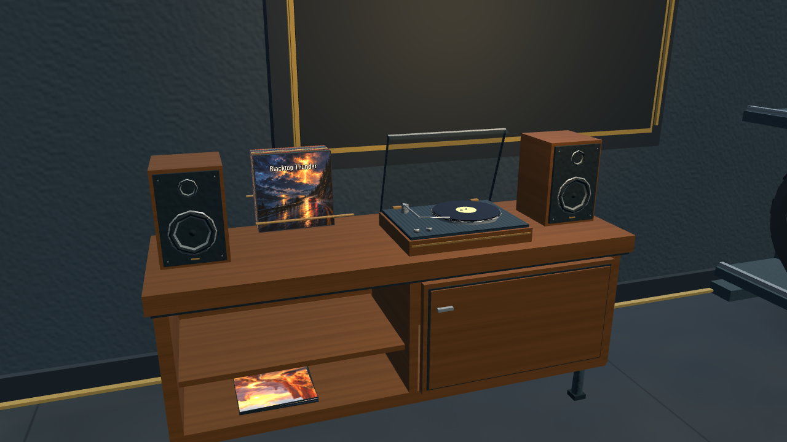
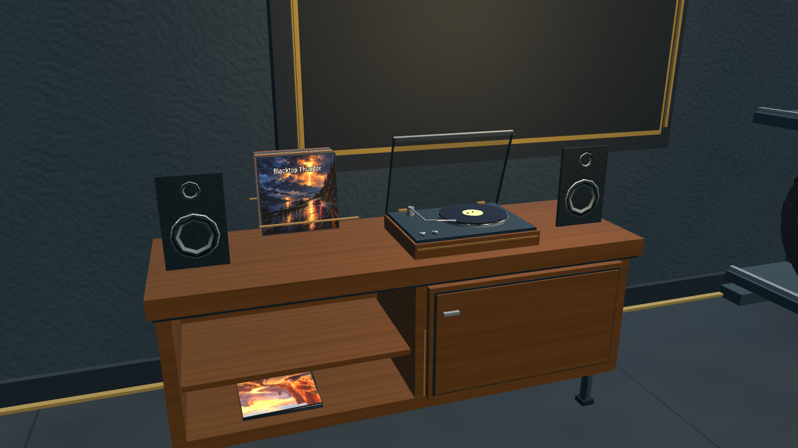

# Garage speakers restored — 15 November 2026

**GSP01–GSP03:** The owner reports that the speakers vanished after applying the simplified Garage. The aggressive shared-material LODs removed cabinet and driver faces. Both speakers now retain their complete original source geometry at the master and every remaining distance level. The rest of the workshop remains reduced.

The environment increases by **478 triangles**, from 18,656 to **19,134**: workshop 17,304, physical platform 1,816, floor/contact 14. This remains below the unchanged 20,000 budget and 38.43% below the prior 31,075 environment. No extra mesh instances or material batches/draw groups are introduced. All 557 checked car resources and all modular car geometry revisions remain exact.





`game/ui/garage_record_station.gd` declares the two small speaker volumes. The offline plan generator in `garage_mesh_reduction.gd` maps those volumes into each existing material batch. It removes collapsed faces touching a speaker and restores the exact original triangles, including every retained LOD. The encoded position/normal/tangent/UV/colour records remain original. Reused mesh instances combine their protection requirements. Normal entry still loads the prepared scene directly; runtime source fallback applies the stored index plan without simplification.

The new `test_garage_speakers.gd` independently compares source-face multisets in both speakers against the published master and each LOD. Each speaker has 404 original faces across the protected material batches. The previous scene fails **34 of 37 checks**; the fixed candidate and final published scene pass **37/0**, including 34 master/LOD comparisons. The test also checks that material-batch counts remain unchanged. Existing recipe integrity passes **494/0**, and the unchanged geometry/layout/budget regression passes **82/0** with the new 19,134 total. No existing assertion or budget was weakened.

Final native Compatibility and desktop Mobile each pass:

- Speaker geometry regression: **37/0**.
- Pair, left, right and distant before/after views: **8 captures**, all successful.
- Actual receiving first Garage captures: **90/0**.
- Existing real-reflection/lifecycle/120-frame rotation probe: **146/0**.

Production parsing passes **577/0**. Its early receipt records a concurrent build-identity rewrite; final native runs record no input changes. The closing **1,300-input fence** is stable, and current asset checks pass: workshop exact scene/plan and **29 sources**, six catalogue pictures/**174 sources**, six selection portraits/**25,418 stable bake inputs**, and **12 current native PNG imports**. The existing portrait loader's raw-PNG export warnings remain in reflection logs. The Mobile reflection probe also reports two objects/one resource at shutdown after its 146 passing checks; this diagnostic is retained, with no teardown fix, portrait-loader change or export/device qualification claimed.

The workshop scene, index recipe and provenance were actually rebuilt through the existing transaction. Standard identity generation, native catalogue/portrait rendering and private image imports refreshed the dependent outputs. No car geometry resource was rebuilt or merely restamped. Selected paired images, exact commands, run logs, output controls, source snapshots and the checked task-only patch are retained under `docs/evidence/garage-speakers-fix-2026-11-15`.

The seven-file normalized source checkpoint applies and reverses exactly in a private fixture without using the shared index. Required retention ran with `powershell -NoProfile -ExecutionPolicy Bypass -File scripts/clean_build.ps1 -Apply`: 32.75 GiB remained, zero eligible entries removed, with recent/protected/locked output preventing the 20 GiB target. No task pin was created.

Representative commands (the runner always wraps the pinned 4.7.2 engine with the crash-dialog guard, isolated storage, offline configuration and Dummy audio):

```powershell
python scripts/run_garage_speakers.py reject-old --headless --candidate-room=res://../build/garage-speakers-fix-2026-11-15/before/workshop_v1.scn
python scripts/run_garage_speakers.py publish --headless --script res://tests/bake_garage_architecture.gd --output=res://assets/garage
python scripts/run_garage_speakers.py published-budget --headless --script res://tests/test_garage_environment_budget.gd --reference-room=res://../build/garage-speakers-fix-2026-11-15/before/workshop_v1.scn
python build/garage-speakers-fix-2026-11-15/finish.py
```

Reload the client for the prepared scene to replace the retained old Garage. Owner appearance and physical-device acceptance remain. No phone/device query or test, export, backend operation, deployment, owner-save/process action or main-index staging/commit was performed. This is a visible restoration with a small measured triangle cost; no FPS or loading-speed improvement is claimed.
