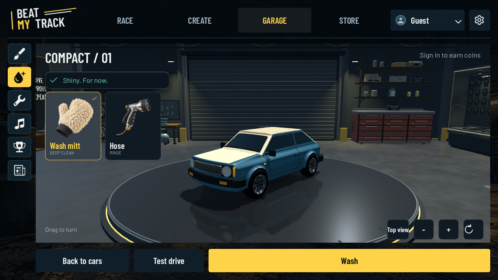
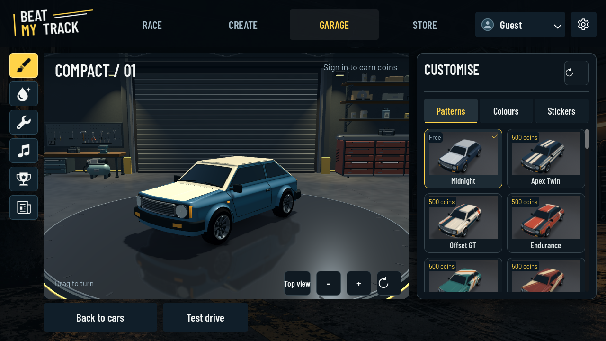

# Garage washing and customisation presentation — 2026-10-24

The owner requests pictures of the hose and mitt and a much higher standard of presentation for washing and customisation. This local implementation replaces the washing text switches with original tool pictures and gives the native customisation and tuning workbenches a shared charcoal surface, clearer type, larger model previews and consistent interaction states.

| Requirement | Result |
| --- | --- |
| GSP01 | Transparent hose and chenille wash-mitt pictures inside actual exclusive-choice buttons. Visible names, purpose captions, a gold border/check, pointer animation, keyboard focus and accessible names. |
| GSP02 | Consistent panel edges, shadow, headers, 52-unit reset/tab controls, segmented selection, larger design/part cards and refined paint swatches. Guest coin status is quieter. |
| GSP03 | A 0.84 Garage framing scale replaces 0.96, bringing the same actual car closer. Workbenches use 380 units on wider windows and 344 on narrower ones. Short windows use shorter part cards; selected-card scrolling updates after resize. |
| R01 | Retain the live viewport and car across tool menus, local paint/parts/condition persistence, clean-car restriction, ownership and purchase fences, hose/mitt behavior, particle pools and canonical driving. |
| Q01 | Actual native picture input, full-App views, all-car framing, responsive layout and relevant existing regression checks; task-scoped Git-checkable source checkpoint. |

The two generated PNGs are original built-in image_gen outputs copied without pixel edits. Exact prompts, provider paths and import treatment are in [provenance-v1.json](../game/assets/menu/garage/provenance-v1.json). Their imported textures are bounded to 512 pixels with mipmaps. The picture selectors add no 3D viewport or runtime network dependency. Existing car and part photography is retained. This records AI generation provenance, without claiming independent photography or third-party clearance.

The larger initial part cards exposed an existing ordering sensitivity: selection was revealed while the scroll viewport still had its initial short height, leaving the top of the first card clipped after layout settled. A new unchanged-strength visibility assertion rejected all three initial sizes. Short card heights and a deferred reveal on scroll-viewport resize correct the layout; the failed 82-check trial is retained as `initial-clipped-part-82.log`. Earlier 69-check full-App and 39-check baseline trials are retained. The first sandboxed native start stopped at Windows root-certificate access; the same isolated preview runs with the required host access. A source-image inspection using the default Python did not run because Pillow is unavailable; imported bounds/mipmaps are checked in Godot instead.

Actual commands are retained in each validation directory's `command.json`, with full logs in `console.log`. Run from the repository root:

```powershell
powershell -NoProfile -ExecutionPolicy Bypass -File docs/evidence/garage-studio-polish-2026-10-24/run_suite.ps1
python docs/evidence/garage-studio-polish-2026-10-24/checkpoint.py
```

Final focused checks pass 57 headless and 86 on each desktop renderer. Existing tuning layout passes 61 on Compatibility, hose input/save checks pass 84 on each renderer, clean-car customisation passes 262, retained/prepared customisation passes 1396, App passes 141 and all 1091 scripts compile. Asset import and scoped whitespace checks pass. No test invariant was removed or weakened. The Desktop Mobile renderer runs on the Windows GPU.

Results, hashes, native views and review checkpoint are in [report.json](evidence/garage-studio-polish-2026-10-24/report.json). [Open the native review](evidence/garage-studio-polish-2026-10-24/preview.html) to compare before/after and view the three screen sizes. The screenshots are actual engine output; they are not interface mockups or a frame-rate benchmark.





Client reload and owner appearance/feel acceptance remain. AAA is the requested quality bar; this change does not certify that subjective bar or physical-device performance. No phone/tablet attachment check or physical-device test, APK/export/install, live mutation, purchase, deployment or owner-process restart was performed. Concurrent work is preserved.
