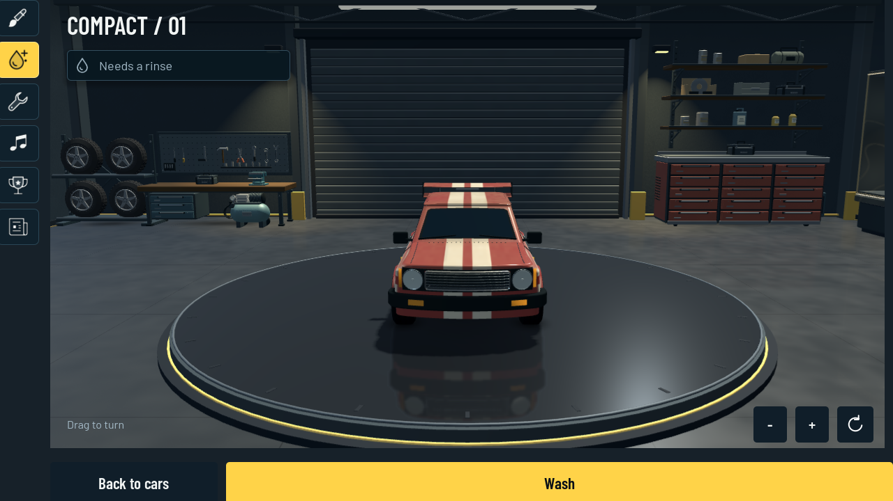
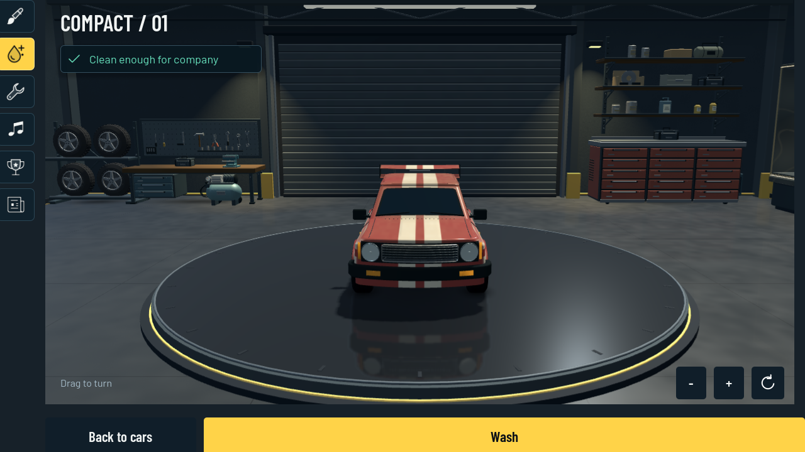
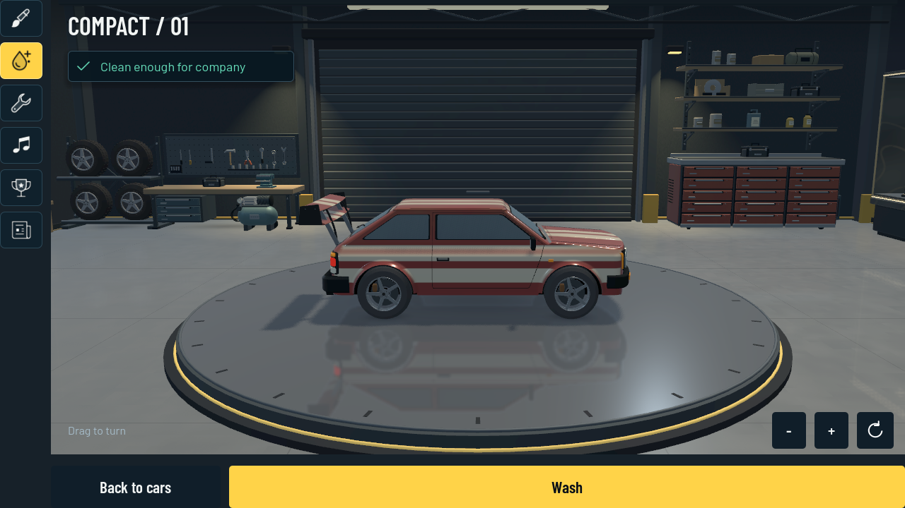

# Easier washing and inspection of the running Compact — 2026-10-19

The owner reports extensive scrubbing, an apparently clean car and a persistent **Needs a rinse** grade. This supersedes the shared average/patch cutoff and original brush rate/radius in the preceding washing overrides.

| Requirement | Result |
| --- | --- |
| GWE01 | Inspect the actual running desktop instance and its saved local cosmetic condition. Map remaining residue to actual washable meshes and inspect four native views. |
| GWE02 | Keep the 0.20 mean-residue limit and 25% missed-area limit, but count only patches above 0.30 as missed. Light film across several panels no longer counts like strong unwiped dirt. |
| GWE03 | Increase scrub rate from 0.85 to 1.15 (35.3%) and brush radius from 0.48 to 0.60 (25%). Keep gradual strokes, sub-frame accumulation, bounded grime resistance, actual mesh picking and opposite-side isolation. |
| R01 | Retain every condition field and mask, local per-car persistence, existing five grades/editing gates, fitted parts, achievements and canonical driving. |
| Q01 | Reproduce failures using saved original source; test every native car, existing wash/customisation flows and both desktop renderers; retain commands, native captures and a task-only Git checkpoint. |

The actual running window showed the red/cream Compact with fitted rear wing and **Needs a rinse**. A cosmetic-only copy of its current local condition, livery and fitted parts was inspected in a separate Garage. The private fixture stays under ignored `build/wash-easier-2026-10-19`; no owner record is used as a test output. Desktop captures containing unrelated applications remain there too.

The inspector found 459 exterior samples. Of 163 samples above the old 0.20 cutoff, all 163 contained slow dust film; only two also had primary dirt above that cutoff. Named areas include `RolledRoof` (40/42), `HoodAccent` (24/24), the rear biwing (27/30), `CrownedHood` (3/6), upper tailgate (5/12), and upper body batches. The lower body and rims were well scrubbed. The retained underside exclusion was functioning. These are conservative shader-footprint samples, not measured visible-pixel opacity.

The weighted mean was **0.165192871466968**, already below the existing 0.20 mean limit. The old binary missed-area test still returned **44.3698%**, above its 25% allowance. With the separate stronger-patch cutoff, the exact same state returns **22.0271%** and **Clean enough for company**. Both native renderers agree, and all inspected bound surfaces retain their actual weathering material (zero mismatches). No wash mask is filled or dirt amount cleared to obtain this result. The existing spotless grade remains stricter.

Changed runtime files are `game/ui/garage_cleanliness.gd` and `game/vehicle/vehicle_weathering.gd`. Added `game/tests/test_garage_wash_easier.gd` exercises native geometry, faint upper film, exact condition retention, missed halves and equal-time brush work against the original brush. Added `game/tests/inspect_wash_residue.gd` captures and reports a copied cosmetic state without opening owner records. Their UIDs, this report and the project instructions/status/plan complete the slice.

| Actual validation | Outcome |
| --- | --- |
| Saved original checker/brush against new regression | 40 checks, 18 reproduced failures |
| New regression, headless / Compatibility / desktop Mobile | 40 / 40 / 40 checks, zero failures |
| Existing surface boundaries, all five cars | 45 checks, zero failures |
| Existing gradual strokes, sample splitting, ageing and persistence | 501 checks, zero failures |
| Existing full manual wash and mouse/touch/App flow, Compatibility | 1,402 checks, zero failures |
| Existing customisation/readiness, headless / Compatibility / desktop Mobile | 262 / 286 / 286 checks, zero failures |
| Copied actual Compact, Compatibility / desktop Mobile | Both show Clean enough for company; four views each |
| Project script compilation | 909 scripts, zero failures |
| Pinned project import | Passed |

The full existing customisation suite still rejects heavy slow film and broad missed halves. The rate comparison checks that the same 0.8-second surface stroke removes at least 25% more at contact and more than 50% more across nearby storage cells, while leaving the opposite side untouched. The existing quick-swipe test still proves dirt is removed progressively. No existing test assertion was changed.

Actual commands use the pinned `scripts/dev.ps1` entry point. Expanded invocations and exit codes are in `evidence/garage-wash-easier-2026-10-19/commands.json`, with retained per-command logs. The ignored `build/wash-easier-2026-10-19/verify.ps1` runs the sequence; its exact script is retained alongside the command receipts.

```powershell
powershell -NoProfile -ExecutionPolicy Bypass -File scripts/dev.ps1 -Action TestScript -ScriptPath res://tests/inspect_wash_residue.gd -Graphical -RenderingMethod gl_compatibility -RenderingDriver opengl3 -CommandTimeoutSeconds 120
powershell -NoProfile -ExecutionPolicy Bypass -File scripts/dev.ps1 -Action TestScript -ScriptPath res://tests/test_garage_clean_customisation.gd -CommandTimeoutSeconds 180
powershell -NoProfile -ExecutionPolicy Bypass -File scripts/dev.ps1 -Action TestScript -ScriptPath res://tests/test_garage_wash_easier.gd -TestArgument '--before' -CommandTimeoutSeconds 180
powershell -NoProfile -ExecutionPolicy Bypass -File build/wash-easier-2026-10-19/verify.ps1
powershell -NoProfile -ExecutionPolicy Bypass -File scripts/dev.ps1 -Action Import -CommandTimeoutSeconds 240
python build/wash-easier-2026-10-19/checkpoint.py
```

Initial inspection limitations are retained: restricted CIM process access failed, and a headless Godot attempt could not open its normal `user://logs` directory. Normal approved desktop access allowed the successful read-only inspection and isolated tests. Only the failed task-owned headless inspection processes were stopped after checking their exact command lines. The initial diagnostic method name was corrected from `_select_section` to the actual `_show_section` before the successful inspection.







Evidence and the scoped source checkpoint are under `docs/evidence/garage-wash-easier-2026-10-19/`. The checkpoint preserves the main branch/index and concurrent work. The client loads this change on restart; the owner's washing-effort and appearance acceptance remains. No phone attachment check or device test, APK/export/install, backend change or deployment was performed.
